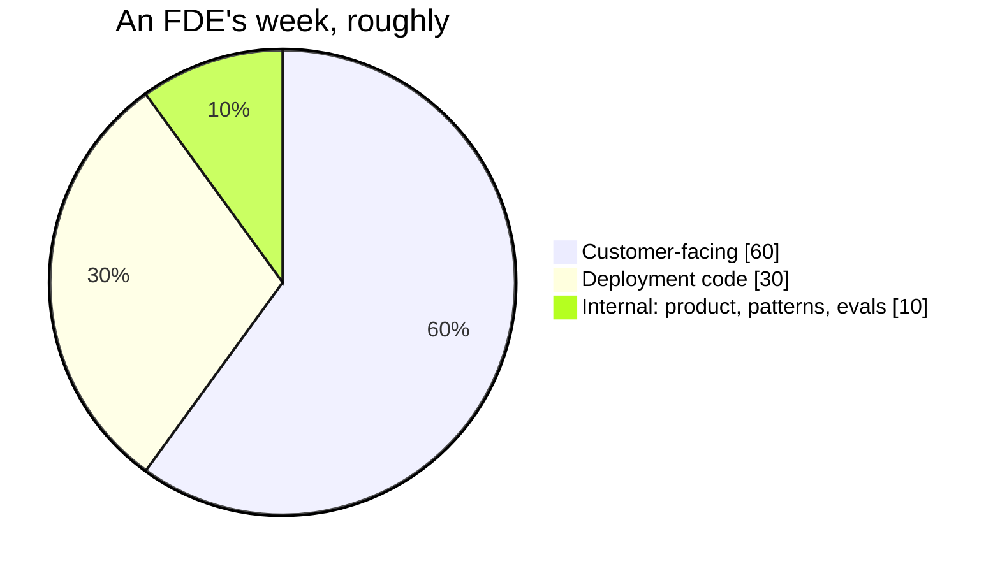
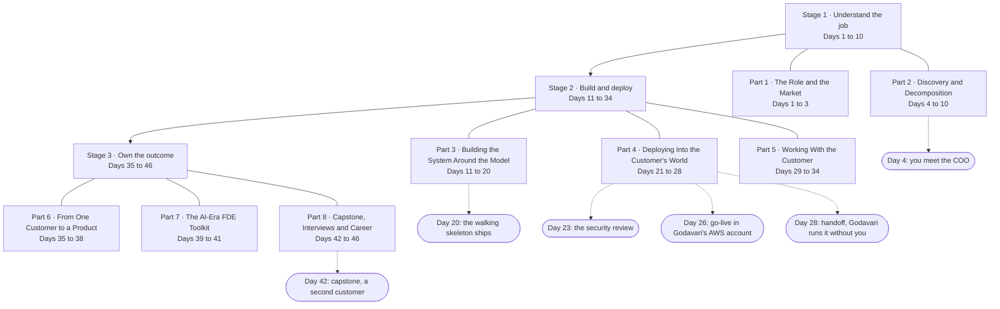

# Day 0 · The Engineer in the Room

> **Part 0 · Start Here** · the course trailer · read this before Day 1
>
> *The script is for the video. These notes are for learning the concept deeply.*

## Monday, 9:40 am, Godavari Finance

You work for Kaagaz AI, a forty-person company that sells a document-and-workflow AI
platform. Three weeks ago your sales team closed Godavari Finance Ltd, a mid-sized lender
headquartered in Hyderabad: 1,200 staff, 300 branches, and a loan-origination process that
is 60 percent paper and PDF. The demo deck shows the model reading a salary slip and
pulling out the employer, the net pay and the month with 97 percent accuracy. The COO
signed because of that slide.

You are the engineer sent in to make the slide true. You have twelve weeks.

On Monday you sit in a glass meeting room on the fourth floor. The COO opens with one
sentence: "A loan takes nine days from application to sanction. I want three." Everyone
nods. You nod too, and you write down the only question that matters: nine days doing
what?

On Tuesday you meet the CISO. You ask for a VPN account, read access to the document
store and a test login to the core lending system. The answer is no, no and not yet. "Where
does the PDF go?" she asks. "Does your model train on our data?" "Which country is the
server in?" You do not have a security questionnaire filled in, because nobody told you
there would be one. You leave with visitor Wi-Fi and a promise of a meeting in two weeks.
You cannot deploy anything yet. You can still learn.

On Wednesday you take the train to Vijayawada and sit beside Lakshmi, a credit-ops analyst
who has processed loan files for eleven years. She shows you the core lending system, built
in 2009, with a SOAP API and screens that take forty seconds to load. Then she opens
something nobody mentioned in any meeting: an Excel tracker on a shared drive, one row per
loan file, with columns like "waiting on bank statement since" and "called customer, no
answer". Forty analysts across two cities keep this file alive by hand. It is the real
state of every loan in the company. The nine days live in this spreadsheet, not in the
salary slips.

You count. A loan file needs fourteen documents. The model reads two of them well. The
delays come from documents that have not arrived, and from a credit check that the 2009
system runs as a batch at 6 pm.

On Thursday the COO stops you in the corridor. "So when will we be at three days?" He
wants a number. You do not have one, and saying "soon" would be the first lie of the
engagement. What you do have is better: you know which document the queue waits on most,
you know the batch job that eats a day, and you know the spreadsheet that could become
the system's first screen. You ask for twenty minutes on Friday and you get them.

On Friday you write page one of the discovery document. It does not mention the model.

That is the first week of a forward deployed engineer. The model was the easy part. The
job is everything around it, and this course teaches that job by running this engagement
from Monday morning to the handoff.

## What a forward deployed engineer is

In plain words: a **forward deployed engineer (FDE)** is the engineer a vendor sends into a
customer to turn a model, a platform or an API into a system that the customer's own
people actually use, in the customer's environment, with the customer's data, under the
customer's rules.

Each clause carries weight.

| Clause | What it means at Godavari |
|---|---|
| The customer's own people use it | Forty analysts in Hyderabad and Vijayawada change how they work on a Tuesday. If they keep the Excel tracker open beside your system, you have not finished. |
| In the customer's environment | Godavari's AWS Mumbai account and on-prem data centre, not Kaagaz AI's cloud. The CISO decides where the PDF goes. |
| With the customer's data | Real loan files with real PII, a 2009 core system with a SOAP API, and a spreadsheet nobody put in the architecture diagram. |
| Under the customer's rules | An RBI audit every year, India's DPDP Act, "no customer PII leaves India", "no model trains on our data". |

Here is an analogy for the Telugu audience that the course will keep coming back to. A
specialist sits in a cold room and the patient has to come. A family doctor comes to the
house, sees the kitchen, the drinking water and the grandmother who refuses tablets, and
makes the treatment work there. The FDE is the family doctor of software. The product
team builds the medicine. You make it work in the house.

## Where the title came from

The title was invented at Palantir, where the forward deployed engineers are called
"Delta" internally and the product engineers "Echo". For years it was mostly a Palantir
word.

Then generative AI changed who needed it. Every company could buy a capable model; very
few could make it do useful work inside their own systems. The vendors with the best
models discovered that the gap between "the API works" and "forty analysts use it" was
where deals were won or lost. So the title spread. In 2026 it is the fastest-growing
engineering title in AI, adopted by OpenAI, Anthropic, Atlassian, Databricks and Scale, by
the vertical-AI companies (Harvey, Sierra, Decagon, Hebbia) and by the Indian IT majors.
Indeed's data, as reported in 2026, shows FDE postings in India up nearly 19 times between
June 2025 and June 2026, in Bengaluru, Hyderabad, Chennai, Delhi, Mumbai and remote.

Day 1 tells the origin story properly. Day 3 explains why the economics of the role are
different from consulting, and what the title pays in India and globally. Day 0 only needs
you to know that the role is real, growing and still badly understood.

## The three buckets and the 60/30/10 week

Most people who search for "forward deployed engineer" cannot say in one sentence what
the job consists of. Here it is in one table. The shares are from an analysis of 1,000 FDE
job postings published in 2026.

| Bucket | In postings (2026) | What it means in practice | At Godavari |
|---|---|---|---|
| **Core engineering** | 95 percent or more | Python or TypeScript, SQL, cloud, containers, APIs, data pipelines. Production-grade, in a codebase you did not write. | Talking SOAP to a 2009 system, CI/CD into an AWS account you do not own, a pipeline that survives a 40-page scanned PDF. |
| **Applied AI** | 80 percent or more | LLM application development, retrieval, evals, agents, guardrails. Not training models. | Structured extraction from fourteen document types, a golden set built with Lakshmi, a review queue for low-confidence files. |
| **Customer-facing discovery** | 70 percent or more, rising fastest | Finding the right problem, decomposing it, scoping, winning trust, saying no, handing off. | The Excel tracker, the 6 pm batch job, the COO's number, the CISO's questionnaire. |

Most engineers have the first two buckets. Most courses teach only the middle one. The
third bucket is where FDE interviews fail most often: the open-ended decomposition round
has the lowest pass rate of any stage, and the most common rejection reason is jumping to
a solution before scoping. Part 2 of this course drills that bucket until it is a reflex.

The week splits roughly like this:

Sixty percent of your time is with the customer: shadowing, interviewing, demoing,
reviewing, explaining, refusing. Thirty percent is deployment code, which is the code that
makes the product work in their environment. Ten percent is internal: feeding what you
learned back to the product team so the next customer needs less of you. If that split
surprises you, that is normal. Day 2 shows a real week hour by hour.

## What the job is not

The title is new enough that it gets confused with three older ones. Being clear now saves
you from applying for the wrong job, and from doing the wrong job once hired.

| It is not | Why not | The FDE difference |
|---|---|---|
| **Pre-sales or solutions engineering** | A solutions engineer builds the demo and leaves before production. The deal closing is the finish line. | The FDE arrives after the deal, and the finish line is forty analysts using the system on a Tuesday, with a runbook and without you. |
| **Consulting that leaves** | A consultant delivers a recommendation or a one-off build and bills for the hours. Each customer starts from zero. | The FDE builds on a product and owes the product team patterns that generalise. Day 3 explains why the best teams measure recurring revenue per FDE, not hours. Day 38 names the trap of becoming a systems integrator. |
| **Model training or research** | Nobody at Godavari needs a new model. They need the existing one to read their bank statements and talk to their core system. | The FDE deploys models, writes evals and builds the deterministic code around them. No ML theory is required; the maths lives in learn-ai-ml Stage 2 for those who want it. |

A useful test: if you could do the job without ever seeing the customer's data, their
systems or their people, it is not the FDE job.

## Who this course is for, and what you need first

This course is for engineers with two or more years of real work in backend, data,
DevOps, ML or solutions roles who want the FDE or applied-AI engineer title. It is also
for engineers already in solutions or consulting roles who want to move from recommending
to building and owning.

You need:

- **Python at a working level, SQL, Git, and comfort with APIs.** The DevOps Masterclass
  Parts 0 to 5 or equivalent.
- **Docker and basic cloud.** Kubernetes helps in Part 4 but is not required.
- **Some exposure to LLM APIs.** learn-ai-ml Stage 1 (Days 1 to 19) is the ideal on-ramp;
  Part 3 here goes deeper on the parts an FDE needs.

You do not need machine learning theory, a consulting background or a job at an AI
vendor. You do need to be willing to practise conversations out loud, because a third of
this job is conversations and reading about them does not build the skill.

## The course map: 47 chapters in 3 stages

One engagement runs through the whole course. The diagram shows the three stages, the
nine Parts, and the moments where the engagement moves.

**Stage 1 · Understand the job (Days 1 to 10).** Where the role came from, what a week
looks like, and why the economics are not consulting (Part 1). Then the engagement begins:
on Day 4 you meet the COO and pick the right problem; by Day 10 you have written and
defended a discovery document, and you have said no to at least one request (Part 2).

**Stage 2 · Build and deploy (Days 11 to 34).** Part 3 builds the system around the model:
what the LLM does and what deterministic code does, structured outputs, prompts as code,
evals first with Lakshmi's golden set, retrieval over real PDFs, the SOAP integration, the
review queue and observability. On Day 20 the walking skeleton ships, the first thin slice
that works end to end. Part 4 takes it into Godavari's world: the deployment model argued
with the CISO in the room, SSO, the security review on Day 23, DPDP and data residency, the
model gateway, CI/CD into their account, go-live on Day 26, and handoff on Day 28 when
Godavari can run it without you. Part 5 is the conversations: the weekly readout for a COO,
delivering bad news, demos that build trust, pushback, adoption, and six scripted client
simulations.

**Stage 3 · Own the outcome (Days 35 to 46).** Part 6 turns the Godavari fix into product
patterns and measures value honestly. Part 7 is the AI-era toolkit: coding agents on
customer code, building when the agent is not allowed in, and red-teaming your own
deployment. Part 8 gives you a second customer on Day 42, Krishna District Hospital
Network in Vijayawada, with discharge summaries and insurance pre-authorisation: different
data, a different regulator, the same method. Then the full interview loop, the drills,
and your portfolio.

Who can start where: everyone starts at Day 1. Engineers moving from solutions or
consulting roles can jump to Part 2. Engineers who already know Python and LLM APIs can
start at Part 3. DevOps and platform engineers can start at Part 4. Interview preparers
can go straight to Days 43 to 45, but the stories they need come from running the
engagement.

## How the course teaches

**One engagement, end to end.** Every chapter moves Godavari forward. Nothing is taught
in the abstract and then forgotten; the decomposition method from Day 7 is the one you use
on Day 20, Day 42 and in the Day 44 interview drills. Each concept has one owning chapter
and every other chapter links back to it instead of re-teaching it.

**Role-plays, out loud.** Parts 2, 5 and 8 include scripted conversations: a frustrated
CTO, a security team refusing credentials, a VP who wants 100 percent accuracy. Each has a
model answer and the patterns interviewers score. Read them aloud, ideally with another
person. A third of the job is these conversations, and you cannot learn them silently.

**Two sections in every chapter.**

- **Build it with AI**: how an FDE uses a coding agent for that chapter's work today, the
  context to give it, a strong example prompt, and the specific mistakes the agent makes for
  that task (the SOAP client it invents, the eval it skips, the PII it logs).
- **How do you know it's right?**: tests, sanity checks, a baseline, the edge cases, and a
  review checklist, whether a human or an agent wrote the code.

**The two modes of using AI.** This course shares them with learn-ai-ml, which owns them
and explains the study behind them. In two lines:

| Mode | When | AI's role | Your role |
|---|---|---|---|
| **Learning mode** | Learning a concept | Tutor: explain, quiz you, say why something failed | Write the code yourself |
| **Building mode** | Building the engagement | Pair: drafts the code | Specify, review, test and own the result |

An FDE who lets the agent think for them will not survive the customer's first hard
question. When the CISO asks "where does the PDF go?" or the COO asks "why is this file
wrong?", the answer has to be yours. Read
[learn-ai-ml Day 0](../../../learn-ai-ml/00-start-here/00-the-ai-native-engineer/README.md)
if you have not already; it is twenty minutes and it decides whether this course works for
you.

**Real companies, careful claims.** Godavari Finance, Kaagaz AI and Krishna District
Hospital Network are fictional, and all their data is synthetic and generated by code in
the repo. Real companies appear only where a published source describes what they did,
and the Part file cites it.

## What you will have at the end

Every chapter adds a file to one folder: the engagement folder. By Day 46 it holds the
discovery document, the stakeholder map, the decomposition and 90-day scope, the business
case, the golden set and eval reports, the walking skeleton, the deployment decision
record, the security questionnaire with your answers, the data-residency memo, the IaC and
CI/CD for a customer account, the runbooks and handoff pack, the weekly readouts, the
postmortem, the value measurement, the patterns memo to product, the red-team page, and the
capstone for a second customer.

That folder is your portfolio. It is the thing you show in the take-home round, the thing
you draw from in the behavioural round ("I" not "we"), and the thing a hiring manager at
an AI vendor recognises as the job, because it is the job.

## Check yourself

Five questions. Answer them before opening the answers.

1. In one sentence, what is a forward deployed engineer?
2. Name the three buckets of the job and say which one is rising fastest in postings.
3. Why is the Excel tracker on Lakshmi's shared drive more important to the engagement than the model's 97 percent accuracy on salary slips?
4. The COO asks on Thursday of week one, "When will we be at three days?" What is the honest answer, and what do you offer instead of a date?
5. What is the difference between learning mode and building mode, and why does it matter more for an FDE than for most engineers?

<b>Answers</b>

1. The engineer a vendor sends into a customer to turn a model, platform or API into a
   system the customer's own people use, in the customer's environment, with the customer's
   data, under the customer's rules.
2. Core engineering (95 percent or more of 2026 postings), applied AI (80 percent or more)
   and customer-facing discovery (70 percent or more, rising fastest).
3. The tracker is the real state of every loan file and the real source of the nine days.
   It shows that delays come from missing documents and a 6 pm batch job, not from reading
   salary slips. A system that does not replace the tracker will sit beside it, unused. The
   model's accuracy matters only once the right problem is picked.
4. The honest answer is that you do not have a number yet. You offer what you do have: the
   document the queue waits on most, the batch job that costs a day, and a twenty-minute
   session on Friday to show the first page of the discovery document. Day 9 turns this into
   a business case and Day 30 covers the harder version of this conversation.
5. Learning mode: AI is a tutor and you write the code, so you learn the concept. Building
   mode: AI drafts and you specify, review, test and own the result. It matters more for an
   FDE because the customer's hardest questions ("where does the PDF go?", "why is this
   file wrong?") come to you in a room, in real time, and the answer has to be yours.

## A note on the numbers

The market figures in this chapter (the "fastest-growing title" claim, the nearly 19 times
growth in Indian postings between June 2025 and June 2026, and the bucket shares from
1,000 postings) are dated October 2026 and come from recruiter, career-prep and industry
sources, not from a peer-reviewed study or an official labour survey. They are quoted as
published and never rounded up to make a point. Treat them as a snapshot of a market that
is moving fast, not as a forecast. Days 1 to 3 own these figures and refresh them yearly;
Day 0 quotes them once so the story has a floor under it.

## Your first step

Go to [Day 1 · Where the role came from](../../01-the-role/01-where-the-role-came-from/README.md).
It tells the Palantir story properly, explains what "Delta" and "Echo" mean, and shows why
generative AI turned a one-company title into everyone's model. By Day 4 you are back in
the glass room with the COO, and this time you know what to ask.

## Sources

- learn-fde course plan, the promise, the three buckets and the running engagement: [CURRICULUM.md](../../CURRICULUM.md)
- learn-ai-ml Day 0, The AI-Native Engineer (learning mode and building mode): [README](../../../learn-ai-ml/00-start-here/00-the-ai-native-engineer/README.md)
- Anthropic, *How AI assistance impacts the formation of coding skills* (Jan 2026), the study behind the two modes: https://www.anthropic.com/research/AI-assistance-coding-skills
- 2026 FDE hiring trends: what 1,000 job posts reveal (the bucket shares): https://getperspective.ai/blog/2026-fde-hiring-trends-what-1000-job-posts-reveal
- Indeed India data on FDE postings, as reported by Analytics India Magazine: https://analyticsindiamag.com/ai-news/forward-deployed-engineer-job-postings-in-india-grew-nearly-19x-in-a-year-report
- Atlassian, Forward Deployed Engineering Playbook (the 60/30/10 split and the role definition): https://www.atlassian.com/blog/guides-research/forward-deployed-engineering-playbook
- OpenAI forward deployed engineering, summarised in the ZenML LLMOps database: https://www.zenml.io/llmops-database/forward-deployed-engineering-bringing-enterprise-llm-applications-to-production

## Video map

| Video | Covers |
|---|---|
| Day 0 (trailer, ~9 min) | The first week at Godavari, the definition, the three buckets, the 60/30/10 week, the course map, the two modes |
| Short 1 | "The fastest-growing engineering title in AI, explained with one loan file." |
| Short 2 | "AI as tutor or AI as ghostwriter: the habit that decides whether you learn this." |
