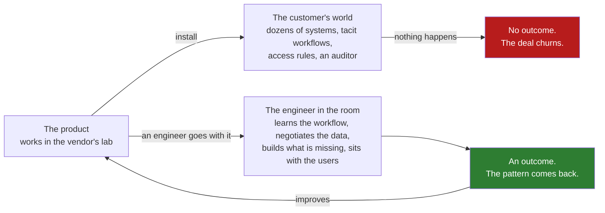

# 01 · The Problem Palantir Had: Software That Could Not Be Installed

> Day 1 · Section 1 of 12 · [Chapter overview](README.md) · Next: [02 · Delta, Echo and Dev](02-delta-echo-and-dev.md)

---

## 1.1 The morning the introduction arrives

Day 0 showed you the first week on site at Godavari Finance, three weeks after the deal closed. Rewind
further. This chapter starts on the morning the deal did not yet exist.

You are at your desk at Kaagaz AI, a forty-person company in Hyderabad that sells a document-and-workflow
AI platform. The CEO forwards an email. It is one line, from the COO of Godavari Finance Ltd: "loan
turnaround is nine days, we want three, can your AI do it". Below it, the CEO has typed: "Thoughts
before I reply?"

There are two replies Kaagaz could send. One is a quote: a team, a custom build, a price per phase,
the thing a services company sends. The other is a question and an offer: where do the nine days go
today, and can we put one engineer in your building for two weeks to find out. The second reply is the
forward deployed model. Before you can argue for it, you need to know where it came from, why it was
invented, where it failed, and why every AI vendor copied it after 2023. That is this chapter. The
argument itself is the project (section 09), and it becomes the first page in the engagement folder.

## 1.2 Why it matters for your career

Two reasons, both from the research behind this course (CURRICULUM.md and the Part 1 plan; sources in
section 12).

First, the title is the fastest-growing engineering title in AI as of 2026, and most people applying
for it cannot say what it is. Indeed's data, as reported in October 2026, shows FDE postings in India
up nearly 19 times between June 2025 and June 2026. The managers who built these teams at OpenAI,
Anthropic and Atlassian read the same Palantir playbook, and they interview for it. "Why this role?"
in the first ten minutes is really "do you know what you are signing up for?", and "how is this not
consulting?" is the follow-up. You cannot answer either without the lineage.

Second, the lineage contains the failure. Palantir's field teams went through a period, named by
people who were there as the "dark ages", when they built separate systems the product could not
absorb. Every FDE team since has organised itself to avoid repeating it. If you join a team that has
not, you will be a consultant with a better title, and you should know that before you accept.

> **Analogy (Telugu audience).** The city specialist knows the disease. The family doctor knows the
> family, the kitchen, the drinking water and what the patient will actually do when nobody is
> watching. Both are doctors. The specialist's treatment works in the clinic; the family doctor's has
> to work in the house. The FDE is the family doctor the vendor sends. This chapter is the history of
> how a software company discovered it needed family doctors.

## 1.3 The problem, in plain words

Palantir was founded in 2003 and built Gotham, a data-integration and analysis platform, for
intelligence and defence customers. (The early dates in this section come from a vendor blog dated May
2026, which cites Palantir's own history; treat them as approximate.) The customers had the hardest
version of a problem every enterprise has: data in dozens of systems that did not agree with each
other, people whose work depended on joining it, and rules about who could see what that no outside
engineer could learn from a document.

The product worked. It could not be installed. Not because the installer was broken, but because
"install" was the wrong word. Making Gotham useful at a customer meant understanding how that
customer's analysts actually worked, negotiating access to each data source, cleaning it, mapping its
fields to the platform's model, building the screens the analysts needed and nobody else did, and
sitting beside them while they tried it. Nobody at the customer could do that, and nobody at Palantir
could do it from Palo Alto.

So from about 2005 the company placed its own engineers inside the customer, for six to twelve months
at a time, with a mandate to make the software produce an outcome there. That placement is the origin
of the role. The vendor blog's phrase for the discovery is "it was a co-engineering problem", not a
deployment problem. By 2014, the same source says, more than a hundred such engineers were in the
field.

Here is the structure of the problem, which has not changed in twenty years:

The bottom path is the forward deployed model. The arrow from the outcome back to the product is the
part most people miss, and it is the part that makes the model a software business rather than a
consultancy. Section 03 is about that arrow. Section 04 is about what happened when it broke.

## 1.4 What was different about it

Plenty of companies sent engineers to customers before 2005. Systems integrators did nothing else.
Three things made Palantir's version a new role rather than an old one with a new name:

| The old pattern | The Palantir pattern | Why it matters |
|---|---|---|
| The customer's requirements document decides what gets built | The engineer on site decides, by watching the work | requirements documents describe the sponsor's version of the problem (Day 5); the operators' version is only visible from the desk beside them |
| The build is paid for by the hour and belongs to the customer | The build is paid for by the platform subscription and belongs to the vendor | the vendor has a reason to make each build reusable; the integrator has a reason to make each one bespoke |
| The engineer leaves when the deliverables list is signed | The engineer leaves when the customer's people use the system without them | "done" is an outcome in someone else's company, not a document |

Hold on to the middle row. It is the economic engine of the whole model, and Day 3 is entirely about
it. For now the one-line version: a services company sells people, so its margins are people margins;
a product company sells software, so its margins are software margins; the forward deployed model is
the way a product company gets software margins on work that looks like services. The first-hand
account this chapter leans on (section 12) puts Palantir's gross margin at 80 percent in 2023 against
32 percent for Accenture. That gap is the arrow from outcome back to product, measured in money.

## 1.5 The hard parts, named up front

This chapter is history and judgement, not code, and that makes it easy to read and hard to use. Three
things to watch for:

1. **The names are confusing.** Palantir uses three internal words (Delta, Echo, Dev) and two public
   titles (Forward Deployed Software Engineer, Deployment Strategist), and secondary sources mix them
   up. Section 02 gives you the mapping once, from Palantir's own blog and postings, and you will not
   need to think about it again.
2. **The sources are mostly interested parties.** The vendor blogs sell to FDE teams; the recruiter
   blogs sell FDE candidates; the company interviews are the companies describing themselves. The
   chapter dates every figure and marks who said it. The timeline script in section 09 counts how many
   rows rest on vendor and recruiter content, so you can see the floor under the story.
3. **The model is easy to admire and easy to misapply.** By the end of section 06 you will want to be
   an FDE. Section 07 is the list of jobs that use the title and are not the job, and section 04 is
   what the job becomes when the loop back to product breaks. Read both before the interview.

By the end of the chapter you will have a one-page lineage map and a day-one note in the engagement
folder, a timeline with every claim dated and sourced, and a written answer to "why FDE?" built on
Godavari rather than on a slogan.
