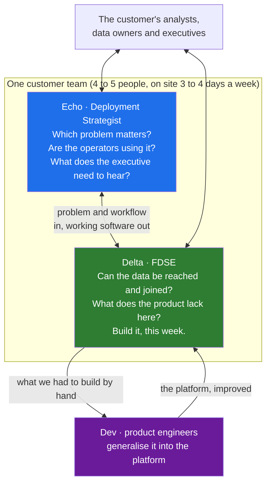

# 02 · Delta, Echo and Dev: The Three Roles and How They Paired

> Day 1 · Section 2 of 12 · [Chapter overview](README.md) · Previous: [01 · The problem Palantir had](01-the-problem-palantir-had.md) · Next: [03 · The loop back to product](03-the-loop-back-to-product.md)

---

## 2.1 The mapping, once

Day 0 gave you two names in one line. Here is the full set of three, from Palantir's own engineering
blog (the post titled "Dev versus Delta: demystifying engineering roles at Palantir"), its public job
postings, and the first-hand account by a former forward deployed engineer who joined in summer 2015
(sources in section 12).

| Internal name | Public title | Sits in | What they do |
|---|---|---|---|
| **Delta** | Forward Deployed Software Engineer (FDSE) | Business Development, on a team that serves one customer | deploys the platform at the customer, often on site; integrates the data; builds the custom web apps and workflows the product does not have; speaks to customer executives; "technology-driven value creation" in Palantir's words |
| **Echo** | Deployment Strategist | the same customer team | owns the problem and the relationship: meets the customer's analysts to find the critical questions, maps workflows, identifies datasets, builds customer-specific workflows, leads training, builds and gives demos, presents to audiences "ranging from analysts to C-suite executives" |
| **Dev** | Software Engineer (product development) | the product organisation, rarely at a customer | takes what the Deltas built for one customer and generalises it into the platform; builds the tools that give Deltas leverage |

The internal names are NATO alphabet letters, which tells you they were coined by people who were
deploying to military customers. "Delta" is Palantir's own published word (the blog post is titled
with it). "Echo" is the internal name for the deployment strategist as reported by former employees
and used in the course plan; Palantir's public postings use the title Deployment Strategist. Palantir's
FDSE posting lists the three groups an engineer works with internally in exactly these terms: other
FDSEs, product teams, and Deployment Strategists.

Two things to notice. The Delta is an engineer who writes production code and is paid from the
business-development budget. That is unusual, and it is the structural fact behind the role: the
engineer's job is measured by the customer's outcome, not by features shipped. And the Echo is not a
salesperson. The Echo is the person who knows which problem matters and whether the operators are
using the thing, and the Deployment Strategist posting asks for Python, R or SQL.

## 2.2 A Delta's day

Palantir's own FDSE posting says a day "might span" these: "discussing architecture with fellow
engineers", "wrangling massive-scale data", "coding a custom web app", "speaking with customer
executives", "establishing strategy for your team". The first-hand account from 2015 fills in the
texture:

- On site **three to four days a week**, which the author notes was unusual for a Silicon Valley
  company and meant heavy travel. He spent about a year in Toulouse, four days a week, on Airbus's
  A350 production line.
- Customer teams were small, **four or five people**, and ran autonomously.
- The core work was **data integration**: negotiating access to data, cleaning it, making it
  available to others. Pilots of **8 to 12 weeks** often spent most of their time on data access.
- Delta code was fast and, in the author's phrase, politely described as carrying technical debt.
  Speed was the point; the Devs would clean it up if it proved worth keeping.

Read that list against Day 0's week at Godavari. The CISO's "no, no and not yet" on Tuesday is the
data-access problem that ate most of a Palantir pilot. Lakshmi's Excel tracker on Wednesday is the
tacit workflow that only an engineer on site could find. The forty-second screens of the 2009 core
system are the integration. Twenty years and a generative model later, a Delta's week is your week.

## 2.3 How the pairing worked

The Delta and the Echo were on the same customer team, in the same building, and they divided the
work by question rather than by seniority:

The Deployment Strategist posting describes the hand-off in one sentence: strategists "work with
Forward Deployed Engineers to integrate the data into a stable and extensible pipeline". The Echo
found the question and the datasets; the Delta made the data flow and built the screen; the Echo ran
the training and took the result to the executives; the Delta told the Devs what had to be built by
hand.

What the pairing bought was a division of attention. An engineer who is also the relationship owner
spends the morning in a steering meeting and the afternoon debugging a join, and does both worse. The
Echo absorbed the meeting so the Delta could stay in the data, and the Delta absorbed the data so the
Echo could stay with the users.

## 2.4 Why most AI vendors have no Echo, and what that means for you

Here is the uncomfortable part. Almost every FDE team formed after 2023 hired Deltas and not Echos.
Anthropic's FDE posting (closed June 2026) asks the engineer to "build long-term customer
relationships", find "new deployment opportunities", and travel 25 to 50 percent to customer sites.
Atlassian's playbook (October 2026) describes its FDEs as "senior engineers, bringing AI engineering
and applied AI together in a single role" who start from a business outcome and map the work to reach
it. That is the Delta's job and the Echo's job in one person. Day 2's 60/30/10 week, with 60 percent of
the time customer-facing, is what one person carrying both halves looks like.

At Kaagaz AI, with forty people, there is no Echo either. The lineage map in the project (section 09)
has a row for this: you carry both hats, and you write down which one you are wearing in each meeting,
because the Echo's questions ("which problem matters?", "are they using it?") get crowded out by the
Delta's ("why does the SOAP call time out?") unless you make room for them on purpose. Part 2 of this
course is, in effect, the Echo's half of the job taught to engineers.

## 2.5 What a Delta did not do

The role is defined as much by its edges. A Delta did not sell: the deal existed before the Delta
arrived, or the Delta was there to make a pilot convert, which is different from closing. A Delta did
not build the core platform: that was the Devs' job, and section 04 is about what went wrong when
Deltas started doing it anyway. A Delta did not deliver a report and leave: the Delta left when the
customer's people were using the system, and often not even then, since embeds ran six to twelve
months. Section 07 turns these edges into the three jobs the FDE title is confused with today.

## 2.6 Key takeaways

- Three roles: Delta (the FDSE, in business development, on site, building what the product lacks),
  Echo (the deployment strategist, owning the problem and the relationship, training and demos), Dev
  (the product engineer, generalising field work into the platform).
- A Delta's week in 2015 was three to four days on site, small autonomous teams, and mostly data
  access. It is your week at Godavari.
- The pairing divided attention: the Echo held the question and the users; the Delta held the data
  and the build.
- The AI-era FDE is a Delta carrying the Echo's half too. Kaagaz has no Echo. Make room for the
  Echo's questions on purpose.
