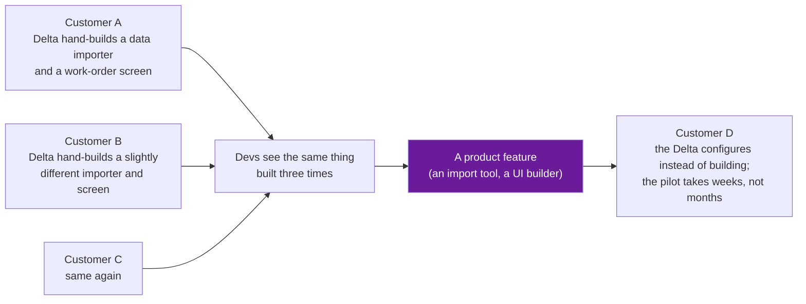

# 03 · The Loop Back to Product: How Field Work Became Foundry

> Day 1 · Section 3 of 12 · [Chapter overview](README.md) · Previous: [02 · Delta, Echo and Dev](02-delta-echo-and-dev.md) · Next: [04 · The dark ages](04-the-dark-ages.md)

---

## 3.1 The arrow that makes it a software business

Section 01's diagram had one arrow that separates the forward deployed model from a systems
integrator: the outcome at one customer flows back and improves the product for the next. This
section is about how that arrow worked in practice, because it is the thing you will be asked to do at
Kaagaz AI (the 10 percent of the week in Day 2's split) and the thing Day 3's economics depend on.

The first-hand account (section 12) describes the mechanism in a few lines. Deltas on site did manual
"cruft work": the same cleaning, importing, joining and screen-building at customer after customer.
Devs watched what repeated and automated it. Out of that came the tools that became Foundry's core:
the account names Magritte (data import), Contour (visualisation) and Workshop (building web app
interfaces). The author adds that these were not ready when first offered to customers, which is what
you would expect of tools extracted from field work rather than designed in a lab. By the time of the
essay (October 2024), Foundry drove, in the author's figure, 50 percent or more of the company's
revenue.

The loop has a direction and a speed. Field work runs fast and dirty; product work runs slow and
clean. The account calls the combination one of the company's key secrets: FDE speed to find what
works, PD discipline to make it scale across customers and not break. Neither half alone is a
business. Fast-and-dirty alone is an integrator with technical debt in every account. Slow-and-clean
alone is a product nobody can install (section 01).

## 3.2 An example with a number

The account's clearest example is Airbus. On the A350 production line in Toulouse, the field team
built what the author describes as "Asana for building aircraft": one interface that combined work
orders, missing parts and quality issues, which until then lived in separate systems and separate
teams' heads. He reports it helped raise manufacturing speed by about four times while keeping Airbus's
quality standards. (One company's reported outcome, from a former employee; quote it as that.)

Notice what the thing was. Not a model, not an algorithm. A screen that joined three systems and
matched how the people on the line actually worked. Every component of it (an importer, a join, a
work-queue UI) was the kind of thing that, built three times, becomes product. That is the pattern you
are looking for at Godavari: Lakshmi's Excel tracker is a work queue joining the document store and
the core system by hand; the product version of it is the review queue Day 18 builds, and it will be
the Kaagaz feature the next lender gets without an engineer on site.

## 3.3 The loop, in money

Day 3 owns the economics, so one paragraph here. The first-hand account puts Palantir's gross margin
at 80 percent in 2023 and Accenture's at 32 percent. Both companies send people into customers. The
difference is where the work ends up: at the integrator it ends in the customer's codebase, paid for
once; at the product company it ends in the platform, paid for by every subsequent subscription. The
loop is the margin. If a Kaagaz engineer spends twelve weeks at Godavari and nothing comes back into
the platform, Kaagaz did services work at a product company's cost base, which is the worst of both.

## 3.4 What the loop needs in order to run

Three conditions, each of which is a decision a vendor makes or fails to make. You will meet all three
again in Day 38.

| Condition | What it looks like when present | What it looks like when absent |
|---|---|---|
| Someone is watching for repeats | a product team that reads field reports and counts how many customers needed the same hand-built thing | field reports go to a folder; every customer's importer is written from scratch |
| The field is allowed to be dirty | Delta code is expected to carry debt; the Dev's job is to pay it down for the ones that generalise | field code is held to product standards and the Delta ships nothing in twelve weeks |
| The product is allowed to absorb | Devs have the time and the mandate to generalise; the platform has the extension points to receive it | the product roadmap is set a year out; field work has nowhere to land; the field builds around the product instead (section 04) |

At Kaagaz AI the first condition is a fortnightly patterns note from you to the product team (the
lineage map in section 09 commits you to it); the second is the walking skeleton on Day 20, which is
deliberately thin; the third is the product team's problem, and Day 35 is where you learn to make
the case for a Godavari fix becoming a feature.

## 3.5 The AI-era version of the loop

The loop did not change with generative AI; its currency did. Day 36 owns this, so a preview only.
OpenAI's FDE team describes evaluation sets, built with the customer's experts before serious
development, as what travels back from an engagement: the evals define what "working" means for that
kind of problem, and the product and research teams build against them. The published example is
Klarna: in 2023, hand-writing prompts for more than 400 customer-service policies became
unsustainable, the team built a parameterised approach, and that approach became the open-source Swarm
framework, the ancestor of the Agent SDK the course plan mentions. A customer-specific fix became a
product. Same arrow as Foundry, twelve years later, with a model in the middle.

## 3.6 Key takeaways

- The loop: field teams hand-build the same thing at several customers; product engineers generalise
  it; the next customer configures instead of building. Foundry's core tools came from it.
- Fast-and-dirty in the field plus slow-and-clean in product is the whole recipe; either alone fails.
- The loop is where the software margin comes from: 80 percent against an integrator's 32 percent
  (2023 figures, from a former employee's account).
- It needs someone watching for repeats, field code allowed to be dirty, and a product allowed to
  absorb. Kaagaz's version is your fortnightly patterns note, a thin skeleton, and Day 35's case.
- In the AI era the thing that travels back is the eval set. Klarna's policies became Swarm.
