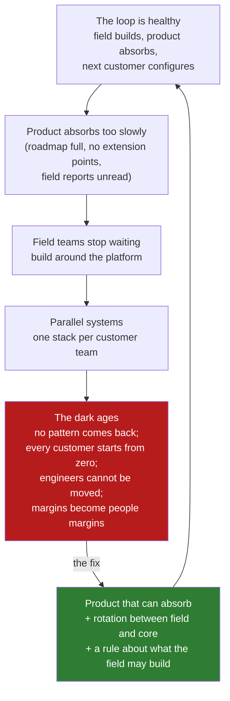

# 04 · The Dark Ages: When the Field Stopped Sending Things Back

> Day 1 · Section 4 of 12 · [Chapter overview](README.md) · Previous: [03 · The loop back to product](03-the-loop-back-to-product.md) · Next: [05 · Why AI made it everyone's model](05-why-ai-made-it-everyones-model.md)

---

## 4.1 What happened

The phrase comes from people who were there. In the 2026 panel of FDE leaders summarised in the ZenML
LLMOps database (section 12), the CTO of Nominal, speaking from Palantir experience, describes a period
"when FD teams essentially revolted" and, in the summary's words, "essentially gave up on core products
and built parallel systems". The panel calls it Palantir's "dark ages". No dates are given, and the
course does not invent them; the shape of the failure is what matters.

Here is the shape. The loop in section 03 depends on the product absorbing what the field learns. At
some point it stopped absorbing fast enough. Field teams, measured on customer outcomes and sitting
beside frustrated users, did the locally rational thing: they stopped waiting for the platform and
built what the customer needed around it, then beside it, then instead of it. Each customer team ended
up with its own stack. The product became something the field worked around rather than with.

## 4.2 Why it is the most important failure in the lineage

Because it is the default. Nothing in the forward deployed model prevents it; only deliberate
structure does. An engineer on site, measured on the customer's outcome, under pressure from a sponsor
who wants a number, with a platform that does not quite do the thing, will build the thing. Every time.
That is not a character flaw; it is the job description read without the loop. The dark ages are what
the FDE model becomes with the last arrow removed, and the result is indistinguishable from a systems
integrator with a worse cost base.

The symptoms are worth memorising because you will see them in vendors you interview with:

| Symptom | What it means |
|---|---|
| Every customer has a fork of the product, or a repo of its own | the platform is not absorbing; the field has routed around it |
| FDEs cannot be moved between customers without a month of handover | the knowledge is in the custom stack, not in the product |
| The product team has not shipped a feature that came from the field in a year | the loop is broken at the "someone is watching" condition (section 03) |
| Revenue per FDE is flat or falling as the team grows | each engagement costs the same as the last; nothing compounds (Day 3) |
| The sales team sells "whatever the customer wants, our FDEs will build it" | the model has become services with a product attached |

## 4.3 The fixes the AI-era teams adopted

The panel is explicit that the newer teams organised themselves against the dark ages from the start.
Three fixes recur, and Day 38 treats them in full:

1. **Rotation between field and core.** Nominal rotates engineers between forward deployed and core
   product roles. The summary credits it with engineers coming back from site motivated to fix what
   they saw the product fail at, and with platform engineers who have used their own features at a
   customer. Rotation is the structural version of "someone is watching for repeats".
2. **Custom work in partnership with the core team, not beside it.** Ramp's FDEs work inside the core
   codebase alongside the other engineering teams; when custom work is necessary, it is done in close
   partnership with the product team. The summary names the trap it avoids: "enterprise deals derail
   product roadmaps through endless custom feature requests".
3. **A rule about what the field may build, and a refusal.** OpenAI's team is described as willing to
   turn down lucrative services opportunities that do not advance strategic goals, and as avoiding
   becoming "a cast of thousands". A team that cannot say no to an engagement cannot keep the loop
   running, because the engagements that break it are the ones that pay best in the short term.

## 4.4 The Kaagaz version

At forty people the dark ages arrive faster, not slower, because there is no product team big enough
to absorb and no second FDE to notice the fork. The day-one note in the project (section 09) therefore
writes the first "will not build" line before the engagement exists: anything only Godavari would ever
use. The lineage map commits you to a fortnightly patterns note. And Day 3 gives the CEO the number to
watch, recurring revenue per FDE, so that the drift shows up in a spreadsheet before it shows up in a
fork.

One honest caution. You will be tempted, around week eight at Godavari, when the SOAP integration is
late and the COO wants his number, to build the thing beside the platform. The Deltas who started the
dark ages were not weaker engineers than you. Write the temptation down when it comes, and take it to
the product team as a pattern request rather than to your editor as a workaround. Day 32 is the chapter
on saying no to the customer; this is the chapter on saying no to yourself.

## 4.5 Key takeaways

- The dark ages: field teams, waiting on a product that absorbed too slowly, built parallel systems
  per customer. No pattern came back. The model collapsed into services.
- It is the default failure of the model, not an aberration; only structure prevents it.
- The AI-era fixes: rotation between field and core (Nominal), custom work inside the core codebase
  (Ramp), a rule and a refusal about what the field will take on (OpenAI). Day 38 has the detail.
- At Kaagaz: the "will not build" line written on day one, the fortnightly patterns note, and Day 3's
  revenue-per-FDE number.
