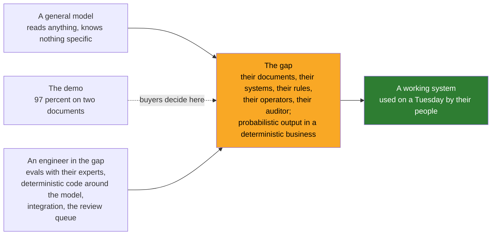

# 05 · Why AI Made It Everyone's Model: A General Model, a Specific Problem, and the Gap Between

> Day 1 · Section 5 of 12 · [Chapter overview](README.md) · Previous: [04 · The dark ages](04-the-dark-ages.md) · Next: [06 · The 2026 adopters](06-the-2026-adopters.md)

---

## 5.1 For fifteen years it was mostly one company's word

Between 2005 and 2022 the forward deployed engineer was a Palantir role, copied here and there, but not
a market title. The reason is in section 01: the model is expensive. You only send an engineer to live
inside a customer when the gap between "the product works" and "the customer gets an outcome" is too
wide for an installer, a manual or a partner to close, and wide enough that closing it is worth a
senior engineer's year. For most software the gap was narrow. A CRM is a CRM. You configure it.

In November 2022 ChatGPT launched, and the gap opened for everyone at once.

## 5.2 Three things a general model does to the gap

**It is general, and the problem is specific.** The same model that writes poems reads bank statements.
That is the pitch, and it is true, and it is also the problem: the model knows nothing about Godavari's
fourteen document types, its 2009 core system, which address proofs the compliance head accepts, or
what Lakshmi does when a salary slip is for the wrong month. Someone has to carry that specificity into
the system, and it cannot be read from a document, for the same reason Palantir's engineers could not
learn an analyst's workflow from Palo Alto.

**It is probabilistic, and deployments are messy.** A 2009 SOAP API either returns the record or it
does not. A model returns a plausible answer, most of the time, with a confidence that does not always
mean what it says. The OpenAI interviews (section 12) give the plainest example: a voice agent for a
telecom customer whose first prototype "struggled with basic tasks like reading back phone numbers
correctly", followed by six months of iteration and evaluation tooling before it ran reliably at about
70,000 calls a day. Nothing in the model's benchmark predicted that phone numbers would be the hard
part. Only someone running it against the customer's real calls could find it, and only someone with
the authority to build evals and change the system could fix it.

**The demo is easy, and the demo is where buyers decide.** Day 0's slide showed the model reading a
salary slip with 97 percent accuracy. The COO signed because of it. The slide was true. It was also
two of fourteen documents, none of the integration, none of the access rules, and none of the Excel
tracker. The distance between that slide and forty analysts using the system is where the value of an
AI deal is won or lost, and in 2023 every vendor with a capable model discovered it at the same time.

The engineer in the gap is the forward deployed engineer. Palantir's version carried a data platform
into a customer's systems. The AI version carries a model into a customer's workflow. The gap is the
same shape; only the thing being carried changed.

## 5.3 The first published case: Morgan Stanley, 2023

The OpenAI interview describes the team's first enterprise GPT-4 customer, Morgan Stanley, in 2023.
The technical pipeline took six to eight weeks. Then about four more months of pilots and
trust-building before the firm's wealth advisers adopted it; the reported figure is 98 percent adoption
among advisers and a threefold rise in use of the firm's research reports. Day 31 owns the lesson
(eight weeks to build, four months to trust). For this chapter the point is structural: the build was
a sixth of the engagement. The rest was an engineer inside the customer, running evals with the
customer's experts, showing results, changing things, and being there when the result was worse than
the demo. That is a Delta's year, compressed.

The same interview gives the team's growth: from two people at the start of 2024 to 39 at the time of
the interview, with a plan for 52 by the end of 2024, and by the 2026 panel, more than 90, running
about ten major engagements at a time. The person who leads it joined in November 2022, the month
ChatGPT launched, when OpenAI had fewer than 200 staff. The function did not exist before the gap did.

## 5.4 What the AI-era FDE added to the Palantir model

Three things the Delta did not need, which Part 3 of this course teaches:

| Added | Why the model forced it | Where the course owns it |
|---|---|---|
| **Evals first.** The golden set built with the customer's experts before serious development; the rule the OpenAI team states as "no LLM-based code is considered done until verification exists" | a deterministic platform either works or does not; a model's "works" has to be defined and measured per customer | Day 14 |
| **Deterministic code around the model.** Hard business rules (RBI's mandatory KYC documents) in code the model cannot override | a probabilistic component inside an audited business needs a fence | Day 11 |
| **Verification in the interface.** The review queue, confidence routing, a human decision per file | the operators and the auditor need to see why, not just what | Day 18 |

None of these is research. All of them are engineering done in the gap, with the customer's data,
and they are why the role is "applied AI" in 80 percent or more of 2026 postings and "model training"
in almost none (Day 2).

## 5.5 Why the title spread rather than the work being done by partners

Enterprise software has always had a channel: integrators and consultancies who do the deployment
work for a fee. Why did the AI vendors keep it in-house this time? The published teams give two
reasons, both of which trace back to section 03's loop. First, the learning was the product: at the
frontier the vendor did not yet know what the model was for inside an enterprise, and the engagements
were how it found out (the OpenAI team splits its capacity between engagements with a clear product
hypothesis and engagements in industries, such as semiconductors or life sciences, where the
technical problems are interesting enough to teach the research side something even without a product
path). A partner would have kept that learning. Second, trust: the probabilistic failures above are
the vendor's reputation, and the vendor wanted its own engineers in the room when they happened.

This is also why the panel reports FDE roles growing about ten times in a year as of 2026, and why
better models increased demand rather than reducing it. In the summary's words, "improved model
capabilities actually enable tackling more complex, heterogeneous problems that require deep domain
expertise to implement successfully". A more capable model widens what can be attempted; it does not
narrow the gap between attempt and outcome.

## 5.6 Key takeaways

- The role stayed one company's word for fifteen years because the gap between product and outcome was
  narrow for most software. Generative AI widened it for everyone in late 2022.
- Three reasons: the model is general and the problem is specific; the output is probabilistic and the
  business is not; the demo is easy and buyers decide on it.
- Morgan Stanley, 2023: six to eight weeks to build, about four months to trust. OpenAI's team: 2 to
  90+ in about two years, about ten major engagements at a time.
- The AI-era FDE added evals first, deterministic fences and verification in the interface. Not
  research.
- Vendors kept the work in-house because the learning was the product and the failures were their
  reputation. Better models widened what could be attempted and raised demand.
