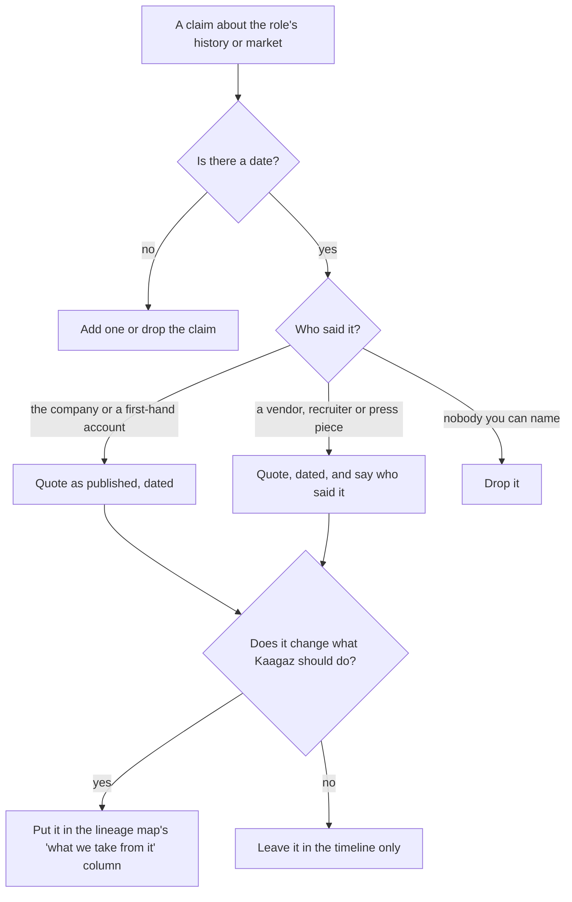

# 08 · Production Concerns, Mistakes and Debugging

> Day 1 · Section 8 of 12 · [Chapter overview](README.md) · Previous: [07 · What the role is not](07-what-the-role-is-not.md) · Next: [09 · Project: the lineage map and the day-one note](09-project-lineage-map-and-day-one-note.md)

---

## 8.1 Production concerns: what a badly adopted model costs, and when it shows

This is a judgement chapter, so "production" means the vendor's business rather than a server. The
model, adopted without its loop or its refusal, fails on a schedule. The table is built from the
published failures in sections 03 to 06 and from Day 38's treatment of scaling the function; it is
what the CEO of Kaagaz AI should be watching for.

| When | What shows | Which part of the lineage was skipped | The cost |
|---|---|---|---|
| Month 1 | the reply to the COO is a quote and a team | the day-one note; the services-versus-FDE choice (section 09) | the engagement is priced as hours before anyone knows the problem |
| Month 3 | the FDE has built a Godavari-only tool "to unblock the pilot" | the "will not build" line (section 04.4) | a fork that the product cannot absorb; the first dark-ages symptom |
| Month 6 | no patterns note has reached the product team; the product has shipped nothing from the field | the loop's "someone is watching" condition (section 03.4) | the engagement cost a senior engineer's half-year at product-company cost and returned services-company value |
| Month 9 | a second lender is sold "the Godavari system" and the same engineer is needed again | the time box and self-sufficiency (section 06.2, Atlassian's 12 weeks) | the engineer cannot be moved; revenue per FDE flat (Day 3) |
| Month 12 | sales describes Kaagaz as "we build whatever the customer wants" | the refusal (section 04.3) | the company is a systems integrator with a platform attached; margins are people margins |

Cost, latency and scale have analogues here. Cost is the senior engineer's time against recurring
revenue. Latency is time to self-sufficiency: twelve weeks is the published bar, and an engagement
that runs to month nine without handoff is the lineage's warning sign. Scale is the ratio of customers
to engineers: Ramp's five to six per FDE is the published high end, Palantir's one team per customer
the low end, and Day 38 is where you learn which fits a given product. Security and monitoring belong
to Part 4; the only monitoring this chapter asks for is the patterns note and the revenue-per-FDE
number.

## 8.2 Mistakes in understanding the lineage

Symptom, cause, fix, with the section that explains it.

| Symptom | Likely cause | Fix |
|---|---|---|
| You describe Echo as the product engineer or Delta as the strategist | secondary sources mix the three names; Day 0's one-liner compressed them | the mapping in section 02.1, from Palantir's own blog and postings: Delta is the FDSE, Echo the deployment strategist, Dev the product engineer |
| You quote "Palantir invented FDEs in 2005" as fact | a vendor blog's date taken as primary | say "a vendor source dated May 2026 puts it at 2005"; the first-hand account starts in 2015; the timeline CSV marks the row as vendor (section 06.1) |
| You say OpenAI "has 90 FDEs" without a date | the figure moved from 2 to 39 to 52 to 90+ in two years | date it: 2 in January 2024, 39 at the 2024 interview, 90+ at the 2026 panel (section 05.3) |
| You say "the dark ages were in year X" | no source gives a date | describe the shape, cite the panel, give no date (section 04.1) |
| You explain the spread as "AI is hot, so companies hired" | missed the mechanism | general model, specific problem; probabilistic output; demo easy; the learning kept in-house (section 05) |
| You say the role is applied research | confused with the model-trainer edge | the AI-era additions are evals, deterministic fences and verification, not training (section 05.4, 07.1) |

## 8.3 Mistakes in the interview

| Symptom | Likely cause | Fix |
|---|---|---|
| "Why FDE?" answered with "I like working with customers" | the answer describes an SE or a consultant | answer with the outcome and the loop: "I want to own whether the customer's people use it, and to send what I learn back into the product" (section 06.4) |
| "How is this not consulting?" answered with "it is more technical" | missed the economic difference | the loop: the work ends in the product and is paid for by every subsequent subscription, not once (section 03.3; Day 3) |
| You cannot name a published FDE team besides Palantir | the lineage stopped at section 02 | OpenAI (2 to 90+, ten engagements, Morgan Stanley, Klarna), Anthropic (patterns back to product), Atlassian (12 weeks), Ramp, Nominal, Dataland, each with a date (section 06) |
| You praise the model and cannot name its failure | section 04 skipped | the dark ages, and the three fixes: rotation, custom work inside the core codebase, a refusal |
| Asked what you would not build, you say "nothing, if the customer pays" | the refusal missing | the Godavari branch CRM; anything only one customer would use (section 04.4; Day 3) |

## 8.4 Mistakes in the project (the artifacts and the script)

| Symptom | Likely cause | Fix |
|---|---|---|
| `line N: date 'circa 2014' is not YYYY, YYYY-MM or YYYY-MM-DD` | a vague date in the CSV | give the year and mark the row's type as vendor; the vagueness belongs in the source column, not the date |
| `line N: no source; a dated claim without a source is a rumour` | a row you remembered rather than read | find the source or delete the row; the lineage map must not contain a claim the script would reject |
| `source_type 'blog' not in [...]` | an unlisted type | choose from primary, company, vendor, recruiter, press, job board; "blog" is not a type, it is a medium |
| The day-one note names a model, a vector database or a framework | the Day 7 anti-pattern arriving early | the note is about the shape of the work; nothing technical belongs in it before discovery |
| The lineage map's "we do not copy" column is empty | the model admired, not adapted (section 01.5) | at least three rows: embed length, the branch CRM, hourly pricing |
| The "as a Delta" exercise reads like a job description | written in the third person, about the role | first person, about this customer, with the operators' day in it (section 09.4) |

## 8.5 A routine for checking a lineage claim

## 8.6 Key takeaways

- The badly adopted model fails on a schedule: quote at month one, fork at month three, no patterns
  at month six, the engineer cannot be moved at month nine, "whatever the customer wants" at month
  twelve.
- Lineage mistakes are mostly undated figures and mixed-up names; the fix is the mapping and the
  timeline.
- Interview mistakes are answering "why FDE?" as an SE or a consultant would; the fix is the outcome
  and the loop.
- The script catches undated and unsourced rows; the human checks are whether the note stays
  technology-free and whether the map says what Kaagaz will not copy.
