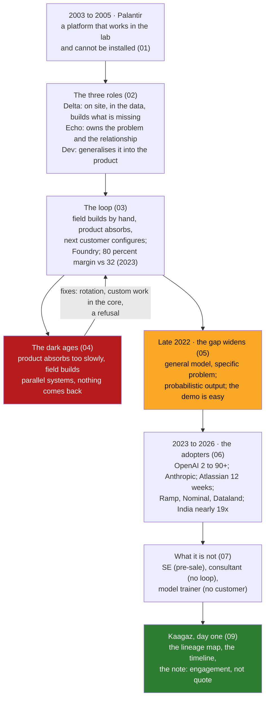

# Day 1 · Where the Role Came From: Palantir's Delta and Echo, and Why AI Made It Everyone's Model

> **[Part 1 · The Role and the Market](../README.md)** · Chapter 1 of 3 · Video ~12 min · Chapter tier: medium
> Builds on: [Day 0 (the engineer in the room, the course map)](../../00-start-here/00-the-engineer-in-the-room/README.md)
> Sets up: Day 2 (the three buckets and the 60/30/10 week: one engineer carrying both Delta and Echo),
> Day 3 (the economics: the loop in money, revenue per FDE, titles and pay), Day 14 (evals first, the
> AI-era addition), Day 28 (the 12-week bar), Day 36 (the Klarna-to-Agent-SDK path), Day 38 (the dark
> ages, rotation and the services drug in full), Day 43 and Day 45 ("why FDE?" and "how is this not
> consulting?")
> **Owner:** this chapter owns **the lineage of the forward deployed engineer: the problem Palantir had
> and why it placed engineers inside customers; the three roles (Delta the FDSE, Echo the deployment
> strategist, Dev the product engineer) and how they paired; the loop from field work back into
> product and how Foundry came from it; the dark ages when the loop broke; why generative AI widened
> the gap for every vendor after late 2022; the dated spread to OpenAI, Anthropic, Atlassian, Ramp,
> Nominal, Dataland, the vertical-AI companies and India; what the role is not; and the day-one note
> that chooses a forward deployed engagement over a services proposal.** The three buckets and the
> week are Day 2's; the economics, titles and pay are Day 3's; the full treatment of the dark ages,
> rotation and ratios is Day 38's; the interview loop is Day 43's.
> Versions used: the one script was run on **Python 3.14.3** (standard library only, no packages; as
> of October 2026). Shown outputs are from real runs. Every market and history figure is dated in the
> text with its source type.

---

## Why this chapter exists

The CEO of Kaagaz AI forwards one line from the COO of Godavari Finance: "loan turnaround is nine
days, we want three, can your AI do it". Before anyone replies, Kaagaz has to decide what kind of
company it is: the one that sends a quote and a team, or the one that sends a question and an
engineer. That choice has a history. Palantir made it from about 2005, when it found that a data
platform that worked in the lab could not be installed at a customer without an engineer living in
the customer's data; it named the engineer a Delta and paired her with an Echo who owned the problem
and the relationship; it built Foundry out of what the Deltas hand-built; and it went through a period
its own people call the dark ages, when the field stopped sending things back and the model collapsed
into services. Then generative AI widened the gap between "the model works" and "the customer gets an
outcome" for every vendor at once, and OpenAI grew a forward deployed team from two people in January
2024 to more than 90 by 2026, Anthropic and Atlassian wrote the role into postings and playbooks, and
Indian FDE postings rose nearly 19 times between June 2025 and June 2026.

The title is the fastest-growing engineering title in AI as of 2026 and most people applying for it
cannot say what it is. The managers who built these teams read the same playbook, and the interview's
"why this role?" is really "do you know what you are signing up for?". This chapter gives you the
lineage with every figure dated and every source typed, the three roles and their edges, the failure
and its fixes, and a first artifact for the engagement folder: the one-page note that argues for an
engineer in Hyderabad over a custom build, before anyone has seen a loan file.

## Mental model

One sentence to carry out of the chapter: **a vendor sends an engineer into the customer because the
gap between a working product and a working outcome cannot be closed from the lab; the engineer owns
the outcome, sends the pattern back so the product improves, and the moment nothing comes back, the
model is consulting with a better title.**

## Learning goals

After this chapter you can:

1. Explain in plain words why Palantir placed engineers inside customers from about 2005, and what
   was new about it compared with a systems integrator.
2. Give the mapping of Delta, Echo and Dev to their public titles and jobs, from Palantir's own blog
   and postings, and describe a Delta's week from the 2015 first-hand account.
3. Describe the loop from field work to product, name the Foundry tools that came from it, and state
   the 2023 margin comparison with its source.
4. Describe the dark ages as a shape (not a date), explain why it is the model's default failure, and
   name the three fixes the AI-era teams adopted.
5. Explain, with the telecom voice and Morgan Stanley examples, why generative AI widened the gap for
   every vendor and why better models raised demand rather than reducing it.
6. Give the dated spread of the role (OpenAI 2 to 90+, Anthropic's posting, Atlassian's 12 weeks,
   Ramp, Nominal, Dataland, India's nearly 19 times) with the source type of each figure.
7. Distinguish the FDE from the solutions engineer, the consultant and the model trainer by the edge
   each lacks, and apply the two-clause test to a posting.
8. Write the one-page lineage map and the day-one note for the engagement folder, keep the timeline
   as checked data, and write the Godavari engagement as a Delta would have described it.
9. Pressure-test a lineage with an AI agent and catch its two characteristic failures: invented dates
   and figures, and swapped names.
10. Answer "why FDE?" and "how is this not consulting?" with the outcome and the loop, in sentences a
    solutions engineer could not say.

**Prerequisites:** Day 0. Python at a reading level for the one small script; no libraries.

## Reading order

| # | Section | What you get | Words |
|---|---|---|---|
| 01 | [The problem Palantir had](01-the-problem-palantir-had.md) | The morning the introduction arrives; the career reason; a product that could not be installed; what was new versus an integrator; the hard parts named | ~1,450 |
| 02 | [Delta, Echo and Dev](02-delta-echo-and-dev.md) | The mapping from Palantir's own blog and postings; a Delta's day; how the pairing worked; why AI vendors have no Echo and what it means for you; what a Delta did not do | ~1,350 |
| 03 | [The loop back to product](03-the-loop-back-to-product.md) | How field work became Foundry; the Airbus example; the loop in money; the three conditions; the AI-era currency (evals, Klarna to Swarm) | ~1,150 |
| 04 | [The dark ages](04-the-dark-ages.md) | What happened; why it is the default failure; the symptoms to spot in a vendor; the three fixes; the Kaagaz version | ~1,050 |
| 05 | [Why AI made it everyone's model](05-why-ai-made-it-everyones-model.md) | Fifteen years as one company's word; three things a general model does to the gap; Morgan Stanley 2023; what the AI-era FDE added; why vendors kept it in-house | ~1,400 |
| 06 | [The 2026 adopters](06-the-2026-adopters.md) | The spread, dated and typed; what each adopter kept and changed; India with the caveats; what has not changed | ~1,250 |
| 07 | [What the role is not](07-what-the-role-is-not.md) | SE, consultant, model trainer with the edge each lacks; the two-clause test; 2026 patterns and hype; four interview questions | ~1,000 |
| 08 | [Production concerns, mistakes and debugging](08-mistakes-and-debugging.md) | What a badly adopted model costs by month; mistakes in the lineage, the interview and the project; a routine for checking a claim | ~1,350 |
| 09 | [Project: the lineage map and the day-one note](09-project-lineage-map-and-day-one-note.md) | The map, the timeline as checked data with real output, the note, the Delta exercise; Build it with AI; How do you know it's right | ~2,650 (incl. output) |
| 10 | [Interview questions](10-interview-questions.md) | 13 questions with model answers, plus a quick-fire round | ~1,750 |
| 11 | [Exercises](11-exercises.md) | 9 graded exercises: name the role, date the claim, the reply to the COO, the Delta model answer, extend and break the script, "review this AI-written lineage", argue the other side, a different vendor | ~2,300 |
| 12 | [Further reading](12-further-reading.md) | The Palantir sources, the OpenAI interviews, the Anthropic and Atlassian pages, the India data, each with its type and what was and was not fetchable | ~1,000 |

**Short on time?** Read 02, 04 and 05, then do the project's part C (09.4) and exercise 2.3. That is
the video plus the "why FDE?" answer. Add 06 before any interview and 07 before accepting any offer.

## Files

| Path | What |
|---|---|
| [`worksheet/godavari-lineage-map.md`](worksheet/godavari-lineage-map.md) | the one-page lineage map for the engagement folder: the model, four steps, roles at Kaagaz, copy and do not copy, dated figures |
| [`worksheet/godavari-day-one-note.md`](worksheet/godavari-day-one-note.md) | the day-one note: a forward deployed engagement versus a services proposal, for the CEO; the first artifact in the folder |
| [`worksheet/godavari-as-a-delta-template.md`](worksheet/godavari-as-a-delta-template.md) | the reflective exercise template; the model answer is in section 11 |
| [`worksheet/ai-draft-lineage.md`](worksheet/ai-draft-lineage.md) | an AI-written lineage with at least nine errors; exercise 3.1 |
| [`data/fde-timeline.csv`](data/fde-timeline.csv) | the timeline of the role's spread: date, event, who, source, source type; 19 rows |
| [`code/timeline.py`](code/timeline.py) | checks the CSV (dates, sources, types), sorts it, writes `data/fde-timeline.md`, prints rows per source type |
| [`data/fde-timeline.md`](data/fde-timeline.md) | the rendered table (regenerated by the script) |

Run from the chapter folder: `python -X utf8 code/timeline.py` (under a second). No packages, no
downloads, no API keys. `-X utf8` keeps Windows consoles happy with the middle dot.

## What this chapter does *not* teach (single-owner rule)

| Topic | Where it's taught |
|---|---|
| The three buckets, the 60/30/10 week, the sample calendar | [Day 2](../02-the-three-buckets/README.md) |
| Consulting versus FDE economics with numbers, revenue per FDE, titles, pay bands, reading a posting | [Day 3](../03-the-economics/README.md) (section 03.3 here is one paragraph) |
| Picking the problem and the stakeholder map | [Day 4](../../02-discovery-and-decomposition/04-picking-the-problem/README.md) and [Day 5](../../02-discovery-and-decomposition/05-the-stakeholder-map/README.md) |
| Evals first, the golden set | [Day 14](../../03-building-the-system/14-evals-first/README.md) (section 05.4 here names it) |
| The 12-week bar and the handoff | [Day 28](../../04-deploying-into-their-world/28-handoff-and-self-sufficiency/README.md) |
| The Morgan Stanley lesson (build versus trust) | [Day 31](../../05-working-with-the-customer/31-demos-and-workshops/README.md) |
| Saying no to the customer | [Day 32](../../05-working-with-the-customer/32-scope-pushback-and-governance/README.md) (section 04.4 here is saying no to yourself) |
| Feeding product and research; Klarna to the Agent SDK | [Day 36](../../06-from-customer-to-product/36-feeding-product-and-research/README.md) |
| Scaling an FDE function: ratios, rotation, the dark ages in full, the services drug | [Day 38](../../06-from-customer-to-product/38-scaling-an-fde-function/README.md) |
| The interview loop and the behavioural round | [Day 43](../../08-capstone-and-career/43-the-interview-loop/README.md) and [Day 45](../../08-capstone-and-career/45-behavioural-and-client-simulation-prep/README.md) |

## Analogies for the Telugu audience

- **The family doctor versus the city specialist** (the chapter's main picture, from Day 0): the
  specialist knows the disease; the family doctor knows the family, the kitchen and what the patient
  will actually do. The FDE is the family doctor the vendor sends (01.2).
- **The wedding caterer and the restaurant chef** (Day 3's picture, previewed here): the caterer
  invents a recipe for every wedding; the restaurant sends a chef to run a counter at the wedding and
  the recipe improves with every function. The loop is the recipe improving (03.1).
- **The village well and the water tanker**: a tanker that delivers once is a services contract; a
  well dug in the village, with the digger teaching the village to maintain it, is the engagement
  with a 12-week bar (06.2).

## Video map

The video (~12 min) covers a slice; the notes cover everything.

| Asset | Covers | Sections |
|---|---|---|
| **Day 1 main video** (~12 min) | Hook: the CEO forwards the COO's one line; two replies Kaagaz could send (1 min) → the problem Palantir had: a platform that could not be installed (1.5 min) → Delta, Echo, Dev in one table; a Delta's week in 2015 is your week at Godavari (2 min) → the loop: Foundry from field work; 80 versus 32 percent (1.5 min) → the dark ages and the three fixes (1.5 min) → why AI widened the gap: general model, probabilistic output, easy demo; the phone-numbers story (2 min) → the spread, dated: OpenAI 2 to 90+, Anthropic, Atlassian's 12 weeks, India nearly 19x (1.5 min) → what it is not, and the one sentence that has not changed (0.5 min) → the day-one note and the Day 2, 3, 38 teasers (0.5 min) | 01.1, 01.3, 02.1 to 02.3, 03.1, 03.3, 04.1, 04.3, 05.2, 05.3, 06.1, 06.4, 07.1, 09.4 |
| **Short 1:** "Palantir called them Deltas. Now every AI company wants one." | The three names in thirty seconds; a Delta's week; the one thing that has not changed | 02.1, 02.2, 06.4 |
| **Short 2:** "Why OpenAI put 90 engineers inside other companies instead of just selling an API." | The gap in one diagram; the phone-numbers story; 2 to 90+ with dates; what travels back | 05.2, 05.3, 03.5 |
| Notes only | What was new versus an integrator (01.4), the hard parts (01.5), why AI vendors have no Echo (02.4), the loop's three conditions (03.4), the dark-ages symptoms (04.2), what the AI-era FDE added (05.4), why vendors kept it in-house (05.5), what each adopter changed (06.2), India's caveats (06.3), hype (07.3), the four interview questions (07.4), production concerns and debugging (08), the full project, Build it with AI and How do you know it's right (09), interviews (10), exercises (11), further reading (12) | as listed |

**Callbacks to use on screen:** "Day 0 lo Godavari first week chusam; ivala aa role ekkada nunchi
vachindo chustunnam." (section 01); "Day 0 lo Delta, Echo oka line lo cheppam; ivala full mapping
istunnam." (section 02).
**Forward callbacks:** Day 2 (ee Delta plus Echo oka vyakti ga week ela untundo), Day 3 (ee loop ni
rupees lo), Day 38 (dark ages full ga, rotation tho).

## Callbacks

- **Builds on:** [Day 0](../../00-start-here/00-the-engineer-in-the-room/README.md) (the definition,
  the first week at Godavari, the one-line Delta and Echo, the three buckets).
- **Sets up:** Day 2 (one engineer carrying both halves, hour by hour), Day 3 (the loop in money,
  the two-column model with numbers, the "will not build" list priced), Day 4 (the problem the
  day-one note refuses to pick), Day 14 (evals first), Day 28 (the 12-week bar), Day 31 (Morgan
  Stanley), Day 36 (Klarna to the Agent SDK), Day 38 (the dark ages, rotation, ratios), Day 43 and
  Day 45 ("why FDE?" answered with Godavari).

**Next chapter:** [Day 2 · The three buckets and the 60/30/10 week: what the job actually consists of](../02-the-three-buckets/README.md).
