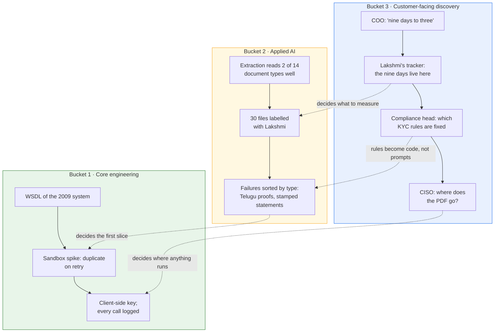

# 03 · The Buckets Up Close: What Each One Consists Of, and What It Looks Like at Godavari

> Day 2 · Section 3 of 12 · [Chapter overview](README.md) · Previous: [02 · The measured job](02-the-measured-job.md) · Next: [04 · The 60/30/10 week](04-the-60-30-10-week.md)

---

Each bucket gets the same treatment: what it means, how it differs from the same skill inside a product
team (the part engineers underestimate), the trade-offs, and what it looks like at Godavari in week
one. The skills are taught in their own chapters; here they are named and placed.

## 3.1 Bucket 1 · Core engineering, in a codebase and an environment you did not build

**What it means.** Python or TypeScript at production level, SQL, a cloud account, containers, APIs and
data pipelines. Nothing exotic. The 95 percent figure says every posting assumes it; the practical
coding round tests it directly.

**How it differs from the product team's version.** Inside a product team you own the repo, the CI, the
cloud account and the on-call rota. As an FDE, most of those belong to the customer. Your code runs in
Godavari's AWS Mumbai account, whose IAM you do not administer, through a pipeline their platform team
owns, against a 2009 core system whose SOAP API has no idempotency and a sandbox refreshed quarterly,
over scanned PDFs that arrive by SFTP at night. You cannot refactor the system you integrate with, pick
the database, or often see production logs. The skill the posting is really asking for is **building
something production-grade when you control a third of the stack**.

| You want | The customer's environment says | What an FDE does |
|---|---|---|
| a clean integration layer | the SOAP API returns duplicates on retry | own idempotency on your side; write it down as a risk in week one (Day 7, step 3) |
| to deploy from your laptop | their pipeline, their approvals, their change window | learn their pipeline in week one; a deploy that needs you is not a deploy (Day 26) |
| real data to test on | "no customer PII leaves the building" | synthetic data from code, and a path to test inside their boundary (Day 24) |
| to fix the upstream system | not yours, not in scope | a translation layer that absorbs the ugliness (Day 16) |

**At Godavari, week one:** the WSDL of the 2009 system on Thursday afternoon; the extraction demo run
locally to see it reads two of fourteen document types well; access requests for VPN, the document
store and a core-system login. Week two: the sandbox spike that produces a duplicate on the first
timeout, and the client-side key that makes retry safe. None of it is glamorous; all of it is why the
system will work in their account and not only in yours.

## 3.2 Bucket 2 · Applied AI: the system around the model, not the model

**What it means.** LLM application development, retrieval, evals, agents and guardrails. Explicitly
**not** model training. Nobody at Godavari needs a new model; they need the existing one to read their
bank statements and talk to their core system.

**How it differs from the ML engineer's version.** An ML engineer in a lab is judged on a benchmark. An
FDE is judged on whether forty analysts trust the output on a Tuesday. That shifts the bucket towards
three things: **evals built with the customer's experts** (the golden set Lakshmi helps label, Day 14),
**deterministic code around the model** for anything the regulator cares about (the KYC completeness
rules the compliance head signs, Day 11), and **verification in the interface** (the review queue for
low-confidence files, Day 18). Prompting and retrieval matter; they are the part that generalises least
across customers and the part an agent drafts fastest. The eval is the contract, and OpenAI's FDE team
calls its practice eval-driven development for exactly this reason (Day 14 cites it).

**What is hype, as of October 2026.** Fine-tuning on the customer's historical decisions is almost never
the first move and often forbidden ("no model trains on our data"). "An agent that handles the whole
loan file" is a Day 17 state machine with a human approval step. Retrieval serves the analysts' lookups;
it is not the lever that moves nine days to three (Day 7 shows the lever is completeness). An FDE who
leads with any of these in week one has confused bucket 2 with a demo.

| You want | The engagement says | What an FDE does |
|---|---|---|
| the best model | the CISO wants it inside India and inside their boundary | model choice is a deployment decision made with the CISO in the room (Days 21, 24) |
| to iterate on prompts quickly | the compliance head signed last week's behaviour | prompts as code, versioned, regression run before every change (Day 13) |
| the model to decide | the RBI auditor wants a human decision per file | confidence routing to a review queue; the model proposes, an analyst disposes (Day 18) |
| 97 percent on the demo slide | 2 of 14 document types read well on real files | measure on the golden set, report the real number, scope the slice to what works (Day 14) |

**At Godavari, week one:** Tuesday afternoon, the extraction demo on real sample slips and statements.
Week two: thirty files labelled with Lakshmi on a call, then extraction run on them and the failures
sorted by type (Telugu address proofs, stamped bank statements). Nothing in bucket 2 happens that is not
measured against something an analyst marked correct.

## 3.3 Bucket 3 · Customer-facing discovery: finding the problem, scoping it, winning trust, saying no, handing off

**What it means.** The analysis lists customer empathy, requirements discovery, stakeholder management,
translating ambiguous business problems, running discovery sessions. The course names the skills more
sharply: picking the right problem (Day 4), the stakeholder map (Day 5), interviews and shadowing (Day
6), decomposition and scoping (Days 7, 8), the business case (Day 9), the discovery document and saying
no (Day 10), the readout and bad news (Days 29, 30), pushback (Day 32), adoption (Day 33), handoff (Day
28).

**How it differs from the solutions engineer's version.** A solutions engineer runs discovery to find
the demo that closes the deal. An FDE runs discovery to find the problem that, solved, changes the COO's
number, and then lives with the answer for twelve weeks. The difference shows in what each does with an
inconvenient fact. The Excel tracker on Lakshmi's shared drive is bad news for a demo and the best news
of the engagement for an FDE, because the nine days live there and the lever is visible. **Bucket 3 is
the bucket in which you go looking for the inconvenient fact.**

**Why it is rising fastest.** Engineers who can build a retrieval pipeline are easy to find, and agents
draft most of it. Engineers who can sit with a credit-ops analyst for a morning, notice the spreadsheet
nobody mentioned, and turn "nine days to three" into a plan a CISO signs are not. The market is pricing
the scarce thing.

| You want | The customer says | What an FDE does |
|---|---|---|
| to start building | "so when will we be at three days?" | asks for twenty minutes on Friday and shows what was found, not a date (Day 0; Day 30 for the harder version) |
| the sponsor's version of the problem | the operators' version is different | shadows the operators before writing the document (Days 5, 6) |
| to say yes | the ask is the branch CRM, which would never become product | says no with a reason and an alternative (Day 10; Day 3 names the trap) |
| to be needed | the bar is a customer team that runs it without you | plans handoff from week one (Day 28; Atlassian's twelve weeks, 04.4) |

**At Godavari, week one:** almost all of it. The COO kickoff and "nine days doing what?"; the CISO's
three questions; shadowing analysts; seven hours with Lakshmi and the tracker; counting which document
the queue waits on; the corridor question; page one of the discovery document, which does not mention
the model. Section 05 shows week one at 77 percent bucket 3, and that is correct for week one.

## 3.4 The three buckets on one floor

The dotted arrows are the point. Bucket 3 decides what bucket 2 measures and where bucket 1 runs.
Without Wednesday with Lakshmi, the thirty labelled files would have been salary slips (the demo's
strength) instead of bank statements (the queue's bottleneck). Without the CISO's questions, the spike
would have been built against the wrong boundary. The buckets are one job in which the customer-facing
hours set the direction of the engineering hours.

## 3.5 Which bucket is this? A test you can apply to any task

The calendar in section 05 depends on deciding this the same way every time:

| Ask | If yes |
|---|---|
| Is a customer's person in the room, on the call, or the intended reader of what I am writing? | customer-facing (bucket 3), even if the output is a table of numbers |
| Am I writing, running or configuring code or environments for this deployment? | deployment code (bucket 1, or bucket 2 if it touches the model, retrieval or evals) |
| Is the audience Kaagaz: the product team, the engagement lead, the pattern memo, the log? | internal |

So: reading the customer's SOP alone at your desk is customer-facing (the reader of your notes is their
COO). An access request with their helpdesk is deployment. Labelling files with Lakshmi is
customer-facing; running extraction on them is deployment. The Friday status for the COO is
customer-facing; the same facts as a pattern memo for Kaagaz are internal. Travel and lunch are not
counted.

## 3.6 Key takeaways

- Bucket 1 is ordinary engineering when you control a third of the stack; the skill is building
  production-grade work anyway.
- Bucket 2 is the system around the model: evals with experts, deterministic code for the rules,
  verification in the interface. Not training; rarely fine-tuning; agents with a human in the loop.
- Bucket 3 is going to look for the inconvenient fact; it is rising fastest because it is scarce.
- The three buckets are one job: the customer-facing hours set the direction of the engineering hours.
- Decide the bucket by the audience, the same way every time.
