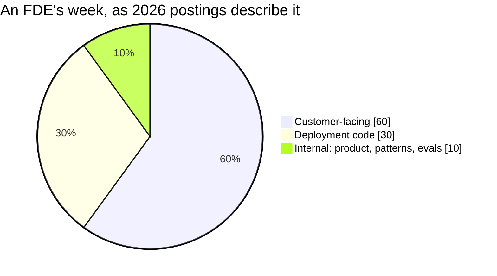

# 04 · The 60/30/10 Week: Where the Split Comes From and Why It Is Still Engineering

> Day 2 · Section 4 of 12 · [Chapter overview](README.md) · Previous: [03 · The buckets up close](03-the-buckets-up-close.md) · Next: [05 · Two weeks at Godavari](05-two-weeks-at-godavari.md)

---

## 4.1 The split

The figure is section 02.4's: postings analysed in the first half of 2026 "consistently describe"
roughly 60 percent customer-facing time, 30 percent deployment-specific code and 10 percent internal
work. Day 1 showed Palantir splitting this between two people, Delta (the engineer) and Echo (the
deployment strategist who owned the relationship); the 2026 week is one engineer carrying both, which is
why the customer-facing slice is the largest. This section says what goes in each slice, where the
published teams sit, and why a week that is 60 percent with the customer is still an engineering week.
Section 05 builds one.

## 4.2 What counts in each slice

Using section 03.5's audience test:

| Slice | In it | Not in it |
|---|---|---|
| **Customer-facing (~60)** | shadowing operators; interviews; workshops; kickoff and readouts; reading the customer's documents and systems; writing anything whose reader is at the customer (discovery document, status, questionnaire answers); labelling data with their experts; demos; the conversations where you say no | small talk; travel; "being on site" with nobody in the room |
| **Deployment code (~30)** | integration against their systems; the pipeline over their documents; environments, access, CI/CD into their account; extraction runs on labelled files; the eval harness for this customer; the spike that finds the duplicate | the product's core code (that is the product team's; if you write it full time you have been reassigned, not deployed) |
| **Internal (~10)** | the pattern memo to Kaagaz product; the engagement log; planning with the engagement lead; evals and findings fed back so the next customer needs less of you; "is this a product feature" (Day 35) | your own training; company all-hands |

The Friday status for the COO is customer-facing; the same facts as a pattern note for product are
internal. One hour of thinking, two readers, and the slice is decided by the reader. Keep the rule
mechanical and the calendar stays honest.

> **Analogy (Telugu audience).** The wedding caterer's chef at the counter, previewing Day 3's biryani.
> Most of the function the chef is talking to the family and the hall manager: how spicy, how many
> guests have arrived, why the second batch is late. A third of it is cooking. And there is an evening
> afterwards, back at the restaurant, telling the kitchen what to change in the recipe. Nobody says the
> chef is "not really cooking"; the conversation is how the biryani came out right in that hall.

## 4.3 Why 60 percent customer-facing is still an engineering job

**The customer-facing hours are engineering input.** Wednesday with Lakshmi is seven hours in which the
engineer learns that the nine days live in a spreadsheet, that the core system's screens take forty
seconds, and that the model's strongest document type is not the one the queue waits on. Each fact
changes the architecture (Day 6 teaches how to ask for them). An engineer who spent those hours coding
would have built the wrong pipeline faster.

**The deployment hours are denser because of them.** Thursday's SOAP spike in week two takes six hours
and finds the duplicate-on-retry problem because Thursday in week one was spent with the core-system
owner and the WSDL. Thirty percent aimed at the right problem beats a hundred percent aimed at the
sponsor's version of it.

**The customer judges the engineering, not the meetings.** The 60 percent is how you learn what to build
and earn the right to deploy it; the outcome is still forty analysts using a system in Godavari's
account. OpenAI's FDE team, in the interviews summarised in the ZenML LLMOps database (read October
2026), says that since early 2026 its FDEs "write much less plumbing code and spend proportionally more
time solving actual customer use cases". The plumbing moved to the product and to coding agents; the
engineering judgement moved closer to the customer. That is the trend the 60 percent measures.

## 4.4 The pace of real teams, as published

The split is a shape, not a schedule. Every figure below is as published, with its source type and the
date it was read.

| Team | What is published | Source type, date | What it says about the week |
|---|---|---|---|
| **Ramp** | FDEs "typically handle five to six customers simultaneously"; they "work primarily remotely via Zoom" and meet customers perhaps once a quarter; ROI is enterprise revenue divided by FDE salaries | OpenAI interview summarised in the ZenML LLMOps database; read October 2026 | the 60 percent can be remote and spread across six accounts; "on site" is not the definition |
| **Atlassian** | "about 12 weeks to self-sufficient teams"; FDEs are "senior engineers, bringing AI engineering and applied AI together in a single role", building alongside the customer's team in their environment | vendor-published playbook page, dated 4 October 2026 | the week has an end date; handoff (Day 28) is planned from week one |
| **OpenAI** | from two people to over 90; about ten major engagements at a time; two kinds, repeatable ones that could become self-service products and the hardest industry problems worked with post-training teams; the team qualifies whether a problem is "genuinely FDE-shaped" and declines pure services work | OpenAI interviews summarised in ZenML; read October 2026 | the internal slice is larger at a lab (06.3), because feeding product and research is half the point |
| **Dataland** | two FDEs expanding to three; "multiple millions in ARR per headcount"; engineers "deeply embed" in a new industry before building | same source | a small team can run the model if each engineer owns the outcome; Day 3 prices this |

The customer-facing 60 percent at Ramp is Zoom calls across six accounts; at Dataland it is an engineer
embedded in one industry; both are the same bucket. The numbers with business meaning (customers per
FDE, weeks to self-sufficiency, ARR per head) belong to Day 3 and Day 38; here they show that the week
has a shape and a deadline.

## 4.5 Remote, on site, or both

The Godavari calendar is mostly on site in week one and mostly at a desk in week two, which is what the
accounts suggest: discovery wants presence, deployment code wants quiet, and the mix shifts as the
engagement moves. Indian postings in 2026 span all three modes (Day 3). What does not change with the
mode is the audience test: a call with Lakshmi is customer-facing; an afternoon alone in Godavari's
office building a stub is deployment code. **Count by audience, not by location.**

## 4.6 Key takeaways

- Roughly 60 customer-facing, 30 deployment code, 10 internal, as postings describe it; a shape, not a
  schedule.
- The slice is decided by the reader or audience of the hour, mechanically.
- The customer-facing hours are engineering input; they make the deployment hours denser and earn the
  right to deploy.
- Ramp: five to six customers each, mostly remote. Atlassian: about twelve weeks to a self-sufficient
  team. OpenAI: about ten engagements, product-shaped or research-shaped, services declined. All as
  published, all dated.
