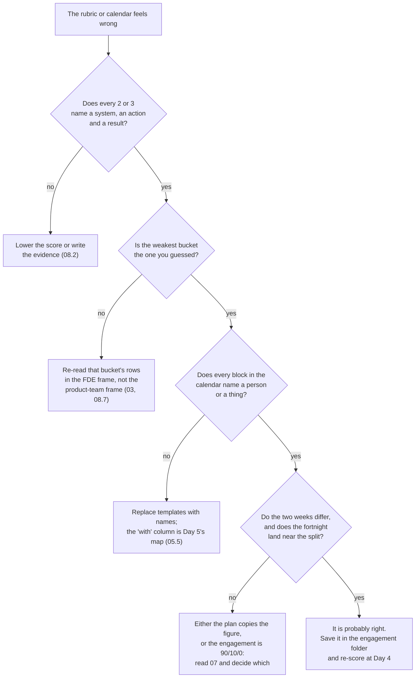

# 09 · Common Mistakes and Debugging

> Day 2 · Section 9 of 12 · [Chapter overview](README.md) · Previous: [08 · Project: the self-assessment and gap plan](08-project-self-assessment.md) · Next: [10 · Interview questions](10-interview-questions.md)

---

Each row is **symptom, cause, fix**, with the section that explains it. The first table is reading the
figures and the role; the second is planning the week; the third is scoring yourself; the fourth is the
scripts.

## 9.1 Reading the figures and the role

| Symptom | Likely cause | Fix |
|---|---|---|
| You quote "70 percent of FDEs spend their time on discovery" | the share of postings was read as a share of time | the 70 is the share of postings that list bucket 3; the time split is the separate 60/30/10 "consistently describe" figure (02.2, 02.4) |
| An engineering manager asks "where does 60 percent come from?" and you have no answer | the figure was quoted without its source type | "postings analysed in H1 2026 by a recruiting vendor consistently describe it; the direction is supported by every published team account" (02.1, 02.5) |
| You use the Stack Overflow figure as the survey's own words | it was quoted second-hand and not found on the survey site | say "as quoted by the June 2026 analysis"; or leave it out (02.4) |
| You applied for a "Forward Deployed AI Engineer" role expecting 60/30/10 and got evals all day | the title variant was not read | the title says which bucket is over-weighted; read the bullets against all three (06.1) |
| The role turned out to be paid on deals | solutions engineer wearing the title | the pay test: deal or hours means not FDE (06.2; Day 3) |
| The role has no internal slice at all | services tier; the consultancy owns the outcome | the missing 10 percent is the tell (06.3; Day 3) |

## 9.2 Planning the week

| Symptom | Likely cause | Fix |
|---|---|---|
| Every week of the plan is exactly 60/30/10 | planned backwards from the figure | plan the work, then count; weeks should differ (05.1, 05.4) |
| The calendar assumes credentials on Monday | access not treated as a workstream | access requests in week 1 with no dependency on them until they exist; the CISO's no did not stop 70 hours of work (05.5, 07.4) |
| Blocks say "stakeholder meeting" with no name | the calendar was written from a template, not from the stakeholder list | every block names a person and a thing; the "with" column is Day 5's map in disguise (05.5) |
| You cannot decide whether labelling with Lakshmi is C or D | no audience rule | the audience test: a customer's person in the room is C; running the code on the result is D (03.5) |
| Week 6's calendar has no internal block | escalation meetings ate it | a protected pattern-memo block; cancelled twice means the engagement lead hears (07.1) |
| The customer has not heard from you in two weeks | deep in bucket 1 | never a week without the readout hour and one customer hour (07.2) |
| Travel is counted as customer-facing | location confused with audience | travel is its own line, uncounted in the split (04.5, 07.4) |

## 9.3 Scoring yourself

| Symptom | Likely cause | Fix |
|---|---|---|
| Your rubric is mostly 3s | CV scoring | the definitions: a 3 has a failure story; evidence names a system, an action and a result (08.2) |
| Your weakest bucket is not the one you expected | either the guess or the scores are wrong | re-read the rows for the unexpected bucket; "AWS certified" is not E3 (08.7) |
| You scored C4 a 3 because of sprint planning | bucket-3 rows read in a product-team frame | the rows are about a customer's problem, a thin slice and a "will not do" list the customer signed (03.3, 08.6) |
| Your bucket-3 plan is a reading list | reading is what an AI or a tired engineer can see | recorded drills and role-plays per gap; bucket 3 is practised out loud (08.6, 08.7) |
| The gap plan is twenty rows long and you stopped reading | all gaps treated alike | weakest bucket first, lowest score first, three rows at a time; the "where I will spend longest" block holds three (08.2) |

## 9.4 The scripts

| Symptom | Likely cause | Fix |
|---|---|---|
| `E1 has no score: fill every row before running the plan` | the template was run, or a row was left blank | score every row; 0 is a valid score |
| `A3: score must be 0 to 3, got 4` or `A3: score must be a whole number 0 to 3, got '2-3'` | an out-of-range number, or a range | whole numbers 0 to 3 |
| `scored 3 with thin evidence (...); counted as 1` | fewer than five words of evidence | write the system, the action and the result; do not pad to five words, the script is a floor and the interviewer is the ceiling |
| `every row of core engineering is a 3` | CV scoring | re-score with the definitions |
| `no rubric rows found` | the first cell is not E1, A1, C1 or the table was reformatted | keep the codes in the first cell; one row per line |
| `Week 1 Tue 15:00 to 17:00: hours says 1.0, clock says 2` | the hours column was edited without the times | fix one or the other; the check exists so the count is never hand-corrected |
| `Week 2 Thu: 9.5 hours in one day; a calendar that needs this is not a plan` | the spike was squeezed into one day | spread it, or admit that the plan needs a second engineer |
| `bucket must be one of ['C', 'D', 'I'], got 'c'` | lowercase | uppercase codes; the strictness is deliberate so the split is never fuzzy |
| The script's split does not match the numbers in section 05 | the calendar was changed | the quoted output is from the committed calendar; re-paste after any change |

## 9.5 A routine for a rubric or calendar that feels wrong

## 9.6 Key takeaways

- Shares of postings are not shares of time; quote each figure with its source type.
- Plan the work, then count; name every block; protect the internal slice; never a silent week.
- Score with evidence; a 3 has a failure story; bucket 3 is practised out loud.
- The scripts refuse fuzzy input on purpose; answer warnings with honesty, not padding.
