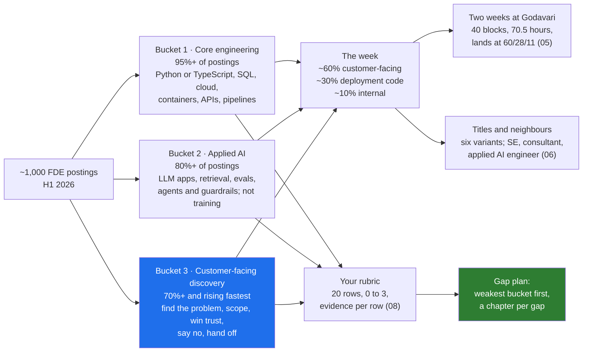

# Day 2 · The Three Buckets and the 60/30/10 Week: What the Job Actually Consists Of

> **[Part 1 · The Role and the Market](../README.md)** · Chapter 2 of 3 · Video ~11 min · Chapter tier: medium
> Builds on: [Day 0 (the engineer in the room)](../../00-start-here/00-the-engineer-in-the-room/README.md) ·
> [Day 1 (where the role came from)](../01-where-the-role-came-from/README.md)
> Sets up: Day 3 (what each title pays, and the services trap), Day 4 (bucket 3 begins: picking the
> problem), Day 11 (bucket 2 begins: the system around the model), Day 43 (how the eight interview rounds
> map to the three buckets), Day 45 (the strengths in your rubric become behavioural stories)
> **Owner:** this chapter owns **the three buckets as measured from 2026 postings (core engineering,
> applied AI, customer-facing discovery), what each consists of and what it looks like at Godavari, the
> 60/30/10 week and the published pace of real teams, the week-in-the-life calendar, the six title
> variants and what each emphasises, the FDE against its three neighbours (solutions engineer, consultant,
> applied AI engineer), a composite day at a frontier lab, a vertical-AI startup and an Indian IT services
> firm, and the skills self-assessment with its gap plan.** Where the role came from is Day 1's; pay by
> title and ARR per FDE are Day 3's; each bucket's skills are taught in their own chapters (Parts 2 to 5)
> and only named here; the full interview loop is Day 43's.
> Versions used: the two scripts were run on **Python 3.14.3** (standard library only, no packages; as of
> October 2026). Shown outputs are from real runs. Every person and number at Godavari and Kaagaz AI is
> invented.

---

## Why this chapter exists

Most people who apply for a forward deployed engineer role have a clear picture of one third of it. The
backend engineer imagines deployment code in a strange cloud account. The ML engineer imagines evals and
retrieval. The solutions engineer imagines workshops and a demo. Each of them is right about a third and
surprised by the other two, and the surprise usually arrives in an interview round that scores exactly
the bucket they did not prepare. An analysis of roughly 1,000 FDE postings published in June 2026 puts
numbers on this: core engineering appears in 95 percent or more of postings, applied AI in 80 percent or
more, and customer-facing discovery in 70 percent or more and rising fastest. Postings describe the week
as roughly 60 percent customer-facing, 30 percent deployment code and 10 percent internal. An engineer
who reads that split and thinks "so it is not really an engineering job" has misread it. It is an
engineering job in which the customer is in the room for most of the hours.

This chapter takes the job apart into the three buckets and puts it back together as a week. You see
what each bucket consists of in practice, measured from postings rather than from titles, and what it
means on the Godavari floor. You see the 60/30/10 week as a real two-week calendar, hour by hour, with
the names of the people you talk to and the code you write, and a script that counts the hours and lands
near 60/30/10 without trying. You see the six title variants of 2026 and what each emphasises, the three
roles the FDE is confused with, and what a day looks like at three very different employers. Then you
score yourself against the three buckets, honestly, and leave with a gap plan that tells you where in
this course to spend longest.

## Mental model

One sentence to carry out of the chapter: **the job is three jobs measured in postings, lived as a week
that is mostly with the customer, and the bucket you are weakest in is the one the interview will find,
so score yourself before they do.**

## Learning goals

After this chapter you can:

1. Name the three buckets with their 2026 shares, say what each consists of in practice and what the
   source is, and explain why "rising fastest" matters more than the absolute number for bucket 3.
2. Describe what each bucket looks like at Godavari in week one, and say which bucket a given task on the
   floor belongs to.
3. Explain the 60/30/10 week, where the figure comes from, and why a week that is 60 percent
   customer-facing is still an engineering job.
4. Build a two-week engagement calendar as hour blocks tagged by bucket, count the hours with the
   chapter's script, and defend the split to a sceptical engineering manager.
5. Quote the published pace of real teams (Ramp's five to six customers per FDE, mostly remote;
   Atlassian's roughly twelve weeks to a self-sufficient customer team; OpenAI's roughly ten major
   engagements at a time) with their dates and source types.
6. Read a 2026 posting's title and say what it emphasises, and separate the FDE from the solutions
   engineer, the consultant and the applied AI engineer in one sentence each.
7. Describe a composite day at a frontier lab, a vertical-AI startup and an Indian IT services firm, and
   say which bucket each one over-weights and why.
8. Score yourself on the twenty-row rubric with evidence, run the gap plan, and choose where in the
   course to spend longest.
9. Use an AI assistant to challenge your self-assessment, and catch its two characteristic failures:
   inflating scores from adjectives on a CV, and treating every bucket as equally learnable from reading.

**Prerequisites:** Day 0 and Day 1. Python at a reading level for the two small scripts; no libraries.

## Reading order

| # | Section | What you get | Words |
|---|---|---|---|
| 01 | [Why this chapter](01-why-this-chapter.md) | The three engineers who each see a third of the job; the career reason; the all-rounder; the hard parts named | ~950 |
| 02 | [The measured job](02-the-measured-job.md) | The 1,000-posting analysis: method, date, source type; the three shares and what each lists; the execution traits; the Stack Overflow figure; how to read figures like these | ~1,200 |
| 03 | [The buckets up close](03-the-buckets-up-close.md) | Each bucket: what it means, how it differs from the same skill in a product team, the trade-offs, what it looks like at Godavari in week one; which bucket a task belongs to | ~1,700 |
| 04 | [The 60/30/10 week](04-the-60-30-10-week.md) | Where the split comes from; what counts in each slice; the published pace of real teams; why it is still engineering; remote versus on site | ~1,150 |
| 05 | [Two weeks at Godavari](05-two-weeks-at-godavari.md) | The calendar day by day: who you talk to, what you build; the script's count; why week 1 and week 2 differ and the fortnight still lands at 60/28/11 | ~1,300 (incl. output) |
| 06 | [Titles, neighbours and three employers](06-titles-neighbours-and-three-employers.md) | The six title variants; FDE against SE, consultant and applied AI engineer; a composite day at a frontier lab, a vertical-AI startup and an Indian IT services firm | ~1,400 |
| 07 | [Production concerns](07-production-concerns.md) | What the split does to you under load: the week that goes 90/10/0, context switching, the internal slice that vanishes, travel, and the calendar as the instrument | ~750 |
| 08 | [Project: the self-assessment and gap plan](08-project-self-assessment.md) | The rubric; the scoring definitions; the script on a sample with real output; the calendar count; Build it with AI; How do you know it's right | ~2,000 (incl. output) |
| 09 | [Mistakes and debugging](09-mistakes-and-debugging.md) | Symptom, cause, fix: reading the figures, planning the week, scoring yourself, and the scripts | ~1,000 |
| 10 | [Interview questions](10-interview-questions.md) | 12 questions with model answers, plus a quick-fire round | ~1,450 |
| 11 | [Exercises](11-exercises.md) | 9 graded exercises including "review this AI-filled rubric", predict-the-output and break-it on the scripts, and your own calendar | ~1,550 |
| 12 | [Further reading](12-further-reading.md) | The posting analysis, the team accounts, the title comparison, the Indian market report; what was fetched and what was not | ~700 |

**Short on time?** Read 02, 04 and 05, then do the project (08). That is the video plus the artifact.
Add 06 before Day 3 and 03 before Day 4.

## Files

| Path | What |
|---|---|
| [`worksheet/skills-rubric-template.md`](worksheet/skills-rubric-template.md) | the empty rubric: three buckets, twenty rows, score 0 to 3 with evidence, and the "where I will spend longest" block |
| [`worksheet/sample-rubric-ravi.md`](worksheet/sample-rubric-ravi.md) | a filled rubric for an invented backend engineer; section 08 shows its gap plan |
| [`worksheet/ai-draft-rubric-priya.md`](worksheet/ai-draft-rubric-priya.md) | a rubric an AI filled from a CV, with at least eight problems; exercise 3.1 |
| [`worksheet/godavari-weeks-1-2-calendar.md`](worksheet/godavari-weeks-1-2-calendar.md) | the first two weeks of the engagement as hour blocks tagged C, D or I; the engagement-folder artifact |
| [`code/gap_plan.py`](code/gap_plan.py) | reads a rubric, checks scores and evidence, prints the gap plan with a chapter per gap, writes `data/<name>-gap-plan.md` |
| [`code/week_hours.py`](code/week_hours.py) | reads a calendar, checks the clock arithmetic, sums hours per bucket per week and overall |
| `data/` | the generated gap plans (regenerated by the script) |

Run from the chapter folder: `python -X utf8 code/gap_plan.py worksheet/sample-rubric-ravi.md` and
`python -X utf8 code/week_hours.py worksheet/godavari-weeks-1-2-calendar.md` (each under a second). No
packages, no downloads, no API keys. `-X utf8` keeps Windows consoles happy with the middle dot.

## What this chapter does *not* teach (single-owner rule)

| Topic | Where it's taught |
|---|---|
| Palantir's Delta and Echo, why generative AI revived the model, OpenAI's team as a case | [Day 1](../01-where-the-role-came-from/README.md) |
| What each title pays in the US and India, ARR per FDE, the services trap, reading a posting for consulting in disguise | [Day 3](../03-the-economics/README.md) |
| Each bucket-3 skill: picking the problem, the stakeholder map, interviews, decomposition, scoping, the business case, the discovery document | [Days 4 to 10](../../02-discovery-and-decomposition/04-picking-the-problem/README.md) |
| Each bucket-2 skill: the system around the model, LLM APIs, prompts, evals, retrieval, agents, observability | Days 11 to 19 |
| Each bucket-1 skill in the customer's environment: integration, identity, CI/CD into their account, reliability | Days 16, 22, 26, 27 |
| The eight interview rounds and what each scores | Day 43 (this chapter only says which bucket each round tests) |
| The behavioural stories your rubric's strengths become | Day 45 |

## Analogies for the Telugu audience

- **The cricket all-rounder** (the chapter's main picture): a specialist batsman is picked for one thing.
  The all-rounder bats (code), bowls (AI) and fields at point (the customer), and the selectors test all
  three. Nobody is picked for the Indian side on fielding alone, and nobody is dropped for being an
  average fielder if the batting and bowling are there; but a batsman who cannot field is a liability in
  the last ten overs, which is where the match is decided (01.2).
- **The family doctor** (Day 0's picture, reused for the week): sixty percent of the family doctor's day
  is in houses, not in the clinic. That is not time away from medicine; it is where the medicine happens
  (04.3).
- **The wedding caterer's week** (previewing Day 3): the chef at the counter spends most of the function
  talking to the family and the hall manager, a third of it cooking, and an evening afterwards telling
  the restaurant what to change in the recipe (04.2).

## Video map

The video (~11 min) covers a slice; the notes cover everything.

| Asset | Covers | Sections |
|---|---|---|
| **Day 2 main video** (~11 min) | Hook: three engineers, each sure the job is their third (1 min) → the three buckets from 1,000 postings, with the shares and the date (1.5 min) → each bucket on the Godavari floor in one line (1.5 min) → the 60/30/10 week and the family doctor (1 min) → the two-week calendar: Monday with the COO, Wednesday with Lakshmi, Thursday's spike, Friday's write-up; the count lands at 60/28/11 (2.5 min) → Ramp's five to six customers, Atlassian's twelve weeks (1 min) → FDE versus SE versus consultant in one table (1 min) → score yourself: the rubric, Ravi's gap plan, the weakest bucket (1 min) → recap and the Day 3 teaser: the same title, pay from 5 lakh to 90 lakh (0.5 min) | 01.1, 02.2, 03.5, 04.1 to 04.3, 05.1 to 05.3, 04.4, 06.2, 08.2 to 08.3 |
| **Short 1:** "60 percent talking, 30 percent coding, 10 percent internal. Still an engineering job." | The pie; what counts as customer-facing (shadowing Lakshmi is engineering input, not a meeting); the Thursday spike that only made sense because of Wednesday | 04.1, 04.3, 05.2 |
| **Short 2:** "FDE vs solutions engineer: one is paid on the deal, the other on the outcome." | The three-row table: when you arrive, what you build, what you are measured on; "the SE sells the vision, the FDE builds it" | 06.2 |
| Notes only | The method and caveats behind the figures (02.1, 02.4), each bucket's trade-offs and the "which bucket is this" test (03.1 to 03.4, 03.6), what counts in each slice (04.2), week-by-week differences (05.4), the six title variants (06.1), the three composite days (06.3), production concerns (07), the project, Build it with AI and How do you know it's right (08), debugging (09), interviews (10), exercises (11) | as listed |

**Callbacks to use on screen:** "Day 0 lo Lakshmi pakkana koorchunnam, Excel tracker chusam; aa Wednesday
ee calendar lo 7 hours customer-facing." (section 05); "Day 1 lo Palantir Delta ni chusam; Delta week kuda
ide shape." (section 04).
**Forward callbacks:** Day 3 (ide title ki 5 lakh nunchi 90 lakh varaku enduku), Day 4 (bucket 3 ikkada
start avutundi), Day 43 (prati interview round oka bucket ni score chestundi).

## Callbacks

- **Builds on:** [Day 0](../../00-start-here/00-the-engineer-in-the-room/README.md) (the first week at
  Godavari as a story, the three-bucket table quoted once, the 60/30/10 pie), [Day 1](../01-where-the-role-came-from/README.md)
  (Delta and Echo as two people, which the 2026 week folds into one engineer; the one-page note that
  is the first artifact in the engagement folder).
- **Sets up:** [Day 3](../03-the-economics/README.md) (the titles priced; the services trap the Indian IT
  services day previews), Day 4 (bucket 3 begins), Day 11 (bucket 2 begins), Day 16 and Day 26 (bucket 1
  in the customer's environment), Day 29 (the Friday readout done properly), Day 43 (rounds to buckets),
  Day 45 (strengths to stories).

**Next chapter:** [Day 3 · The economics: why FDE is not consulting, ARR per FDE, the services trap, titles and pay](../03-the-economics/README.md).
