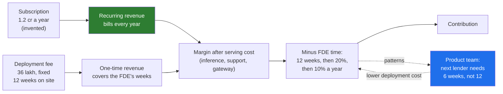

# 02 · Consulting Versus FDE Economics: Hours Billed Against Revenue That Recurs

> Day 3 · Section 2 of 12 · [Chapter overview](README.md) · Previous: [01 · Why the economics](01-why-the-economics.md) · Next: [03 · The services trap](03-the-services-trap.md)

---

## 2.1 Two business models in one table

Everything in this chapter follows from one difference: what the company sells.

| | Consulting or systems integration | The FDE model |
|---|---|---|
| What is sold | Hours, or a fixed-price build | A product subscription, plus a bounded deployment fee |
| What the customer owns at the end | The custom system | A configured instance of the vendor's product |
| What happens at renewal | A new statement of work, or nothing | The subscription bills again, with little or no engineer time |
| What happens with the next customer | Starts from zero; the last build is the last build | Starts from the patterns the last engagement sent back to product |
| How the engineer is measured | Utilisation: billable hours divided by available hours | Recurring revenue per engineer; patterns shipped to product |
| How revenue grows | Hire more engineers | Each engineer's past engagements keep paying; the product needs fewer engineer-weeks per customer over time |
| The failure mode | Thin margins, every project a one-off, the best people burn out on repetition | Becoming the left column without noticing (section 03) |

The right column is a software company with engineers in the field. The left column is a services
company. The title on the business card does not decide which one you are in; the revenue line does.

## 2.2 How the FDE model works inside

Follow one rupee of Kaagaz AI's revenue through the Godavari engagement, in the shape the chapter's
model (section 08) uses:

Three things in the picture carry the whole argument:

1. **The subscription recurs and the engineer's time does not.** In year one the FDE is on site for
   twelve weeks and then on call for about a fifth of her time. In year two she is at a tenth. The
   1.2 crore bills both years. Revenue per FDE-hour rises every year the customer stays.
2. **The deployment fee is bounded.** It pays for the weeks on site and no more. If the engagement
   runs to thirty weeks, the fee does not grow; the margin shrinks. That is deliberate: it makes
   the vendor want the engagement to end, which a time-and-materials contract never does.
3. **Patterns lower the next customer's cost.** The SOAP integration layer, the completeness rules
   for an RBI-regulated lender, the review queue: each one shipped to product means the second lender
   needs six weeks, not twelve. The engineer's work compounds.

In the consulting model none of the three holds. The build is priced on hours, so a slip is revenue.
There is no subscription, so the renewal is a maintenance retainer at best. And the next bank's
pipeline is built again, because the first one belongs to the first bank.

## 2.3 The measures the published teams use

Three companies have said in public how they judge their FDE teams. All three are from a 2026 panel
summarised in the ZenML LLMOps database (self-reported, as the page itself notes; no external audit),
and the earlier 2025 OpenAI interview on the same site.

| Team | Measure | What it does to behaviour |
|---|---|---|
| **Ramp** (enterprise FDE team) | Enterprise revenue divided by FDE salaries. Each FDE handles five to six customers at once, remotely. | Pushes the team toward "high-leverage, roadmap-relevant work": features that serve several customers, minimal custom changes, a small maintenance burden. An FDE with six customers cannot hand-build anything. |
| **Dataland** (two FDEs, hiring a third) | Multiple millions of dollars of ARR per FDE head; the test for any piece of work is whether it delivers recurring value rather than one-time consulting. | Keeps the team tiny and heavily automated (they build agents that build and maintain agents). Headcount grows only when ARR per head stays high. |
| **OpenAI** (FDE function, 2 to over 90 people in two years, about ten major engagements at a time) | Before taking an engagement: is the problem genuinely FDE-shaped, and is there a realistic path to recurring revenue? After: long-term value, meaning ARR unlocked for customers who can then self-serve, and model gains that benefit the whole customer base. The leader warns that services revenue is "a drug" consultancies cannot quit. | The team turns down lucrative pure-services work. Capacity is split between engagements with a product hypothesis and industries with research-interesting problems. Earlier guidance from the same team: target problems worth tens of millions to low billions, and never become "a cast of thousands". |

Read the three together and one shape appears: **revenue that recurs, divided by the engineers it
takes to keep it recurring.** Ramp states it as a ratio. Dataland states it per head. OpenAI states
it as a qualifying question before the engagement and a value test after. Section 08 builds all
three for Godavari.

A fourth published number, from Atlassian's playbook (Day 2 owns it): about twelve weeks to a
self-sufficient customer team. That is the denominator's other half. A ratio of revenue to engineer
time only stays high if the engineer leaves.

## 2.4 Why a vendor pays for FDEs at all

If the economics are about recurring revenue, why not just sell the subscription and skip the
engineer? Because for the problems FDEs are sent to, the subscription does not renew without one.

The published OpenAI case is the clearest. Morgan Stanley in 2023: the retrieval pipeline took six
to eight weeks to build; trust-building with the wealth advisors took about four more months; the
result was 98 percent adoption and three times the use of research reports. Without the four months
the subscription would have been a licence nobody used, and a licence nobody uses does not renew.
Day 31 owns that story. Here it is the answer to the CEO's question: the FDE is the cost of making
the renewal happen, and the renewal is why the cost is worth paying.

The same team's phrase for it is "eat pain and excrete product": sit inside the customer's mess until
it works, and bring back the piece that will make the next customer need less of you. The watchword
is doing what does not scale, so that the product can.

## 2.5 The measure, scaled down to a 40-person vendor

Kaagaz AI is not OpenAI. Its numbers are lakhs and crores, not tens of millions of dollars. The
measures still apply, scaled:

| Measure | At OpenAI or Ramp scale | At Kaagaz AI (invented, section 08) |
|---|---|---|
| Revenue per FDE cost | Enterprise revenue divided by FDE salaries | Godavari's 36-month revenue divided by the FDE's 36-month loaded cost |
| ARR per FDE head | Multiple millions of dollars | Subscription live at month 36 divided by the FDE time still needed to keep it live |
| The qualifying question | Tens of millions to low billions of value; a path to recurring revenue | Will Godavari renew, and will two more lenders buy the same pattern? |
| The floor | Not published | Kaagaz's own choice: revenue at least three times FDE cost over three years |

The floor is Kaagaz's. No published team gives one, and you should not quote the 3x as if someone
did. It is there so the model has a line to cross and so the CEO has something to argue with.

## 2.6 Key takeaways

- Consulting sells hours or a build and starts every customer from zero; the FDE model sells a
  subscription with a bounded deployment fee, and every engagement lowers the next one's cost.
- The subscription recurs and the engineer's time drops: that is the whole argument.
- Ramp: revenue over FDE salaries, five to six customers per FDE. Dataland: multiple millions of ARR
  per head. OpenAI: FDE-shaped with a path to recurring revenue, pure services declined, "services
  revenue is a drug". All self-reported, 2025 to 2026.
- The vendor pays for the FDE because, for these problems, the renewal does not happen without one.
