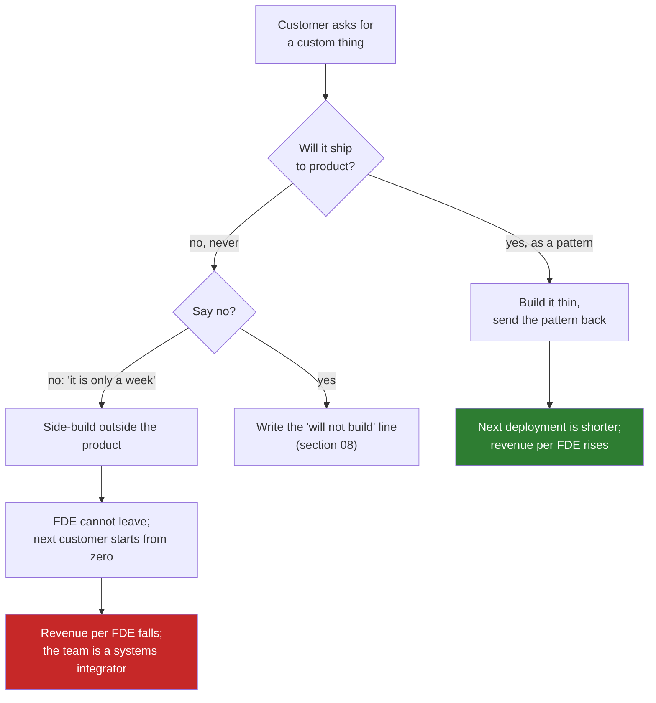

# 03 · The Services Trap: The Custom Build That Never Generalises

> Day 3 · Section 3 of 12 · [Chapter overview](README.md) · Previous: [02 · Consulting versus FDE economics](02-consulting-versus-fde-economics.md) · Next: [04 · Titles and neighbouring roles](04-titles-and-neighbouring-roles.md)

---

## 3.1 What the trap is

The services trap is the slow conversion of an FDE team into a systems integrator. Nobody decides
it. It happens one reasonable yes at a time:

- The sponsor asks for one more screen that only this customer needs. It is a week. Yes.
- The custom screen needs a custom data model. The product team cannot absorb it this quarter, so
  the FDE builds it on the side. Yes.
- The customer pays for the extra weeks. Revenue goes up. The CEO is pleased. Yes.
- Renewal time: the customer's system now depends on the side-build, which only the FDE
  understands. She cannot leave. The next customer gets a different FDE, who starts from zero.

Twelve months later the vendor has three customers, three different systems, three engineers who
cannot be moved, and revenue that stops the day any of them resigns. The subscription is still on
the invoice, but the business is selling hours.

## 3.2 Palantir's dark ages

The oldest FDE organisation has a name for the period when this happened to it. Nominal's CTO,
speaking on the 2026 panel the ZenML database summarises, describes Palantir's "dark ages": the
forward-deployed teams effectively rejected the core products and built parallel systems for their
customers. Field engineers were closer to the customer than the product team, found the product
lacking, and routed around it. The result was exactly the picture above at a much larger scale:
customers running bespoke systems the product could not absorb.

Nominal's answer, which [Day 38](../../06-from-customer-to-product/38-scaling-an-fde-function/README.md)
treats in full, is rotation: engineers move between forward-deployed and core-product roles, so the
person who found the gap on site is the person who fixes it in the product. Its hiring filter is
people frustrated by the "telephone game" between customers and engineering. This chapter needs only
the lesson: the trap is not a services company's disease that an AI vendor is immune to. It
happened to the company that invented the role.

## 3.3 Why the trap is comfortable

The reason the trap works is that every step inside it looks like good news:

| What you see | What it is |
|---|---|
| The customer pays for extra work without arguing | They are buying hours; hours are easy to buy and easy to stop |
| The engagement runs long and the customer wants the FDE to stay | The system depends on a person, not a product |
| Revenue this quarter is up | One-time revenue is up; recurring revenue per engineer is flat or down |
| The product team has not heard from the FDE in a month | Nothing is generalising |
| The second customer's deployment takes as long as the first | The first engagement left nothing behind |

OpenAI's leader calls services revenue a drug for this reason: it arrives fast, it feels like
growth, and a company built on it cannot stop without a revenue cliff. OpenAI avoids it partly, he
says, because its commercial organisation is not the company's power centre; product and research
set the strategy. Most small vendors do not have that protection. The ratio has to do the job
instead, which is why the best teams measure it monthly and why section 08 builds it for Godavari
before the contract is signed.

## 3.4 The early signs, so you do not need the year

You can see the trap forming in the first month of an engagement. Each sign has a question that
exposes it:

| Sign | Question that exposes it | What a healthy answer sounds like |
|---|---|---|
| Work is described by hours, not outcomes | "What does the customer get at the end of the twelve weeks?" | A number: turnaround days, files per analyst, a renewal |
| The customer's requests have no "not now" list | "What have we refused so far?" | At least one thing, in writing, with the reason (Day 8 owns the list) |
| The FDE has not written anything for the product team | "What did the last two weeks teach us that the next lender will need?" | A pattern with a name, in the product backlog |
| The deployment fee is growing with the weeks | "Is the fee fixed or billed by time?" | Fixed; a slip costs us, not them |
| Nobody can say when the FDE leaves | "What is the self-sufficiency bar?" | A date and a test (Day 28: the customer's team runs it without us for a month) |
| The custom thing cannot be named as a feature | "Which other customer would want this?" | A second customer by name, or the answer is no |

The last row is the one that matters most for this chapter. It is the test behind the "we will not
build this" line.

## 3.5 How a custom fix becomes product (a preview)

The opposite of the trap is the path where a fix for one customer becomes a product feature. The
published example runs from Klarna to OpenAI's Agent SDK: in 2023 Klarna needed its assistant to
follow more than 400 policies, hand-written prompts did not scale, the FDE team parameterised the
instructions and tools and wrapped each intent with an evaluation set, the pattern was codified as
an open-source library (Swarm), and the product team built the Agent SDK on those primitives. A
customer-specific fix became a product that every customer uses.

[Day 35](../../06-from-customer-to-product/35-patterns-across-customers/README.md) teaches how to
tell a pattern from a one-off, and [Day 36](../../06-from-customer-to-product/36-feeding-product-and-research/README.md)
teaches how evals are the currency that carries it to product. Here, only the test you apply before
building anything:

> **Would a second, named customer want this, in this shape, within a year?** If yes, build it thin
> and send the pattern back. If no, it is either out of scope or it is services work priced as
> services work, and the FDE does not build it.

At Godavari the test splits the sponsor's wish list cleanly. The loan-file intake pipeline, the
completeness rules for RBI-mandated documents, the SOAP integration layer with idempotency, the
review queue: every lender in India needs these. The branch CRM the COO mentioned in the second
call, so that branch managers can track customer follow-ups: no other Kaagaz customer wants
Godavari's CRM, Godavari does not need a document-AI vendor to build one, and it would keep an
FDE on site for a year. It is the first "we will not build this" line, and section 08 writes it.

## 3.6 Key takeaways

- The trap is a series of reasonable yeses that end with engineers who cannot leave and customers
  who start from zero. It happened to Palantir ("the dark ages"), and Nominal's rotation is the
  published answer (Day 38).
- It is comfortable because every step looks like revenue; the ratio is the only thing that shows
  it early.
- Six early signs, each with a question. The decisive one: name the second customer who wants it.
- The opposite path (Klarna's policies to the Agent SDK) is Days 35 and 36; the test is the same
  question asked before building.
