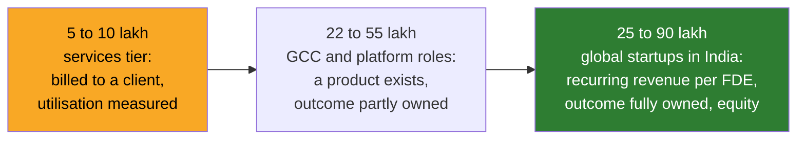

# 05 · Pay: US and India, Every Figure Dated, None of Them a Promise

> Day 3 · Section 5 of 12 · [Chapter overview](README.md) · Previous: [04 · Titles and neighbouring roles](04-titles-and-neighbouring-roles.md) · Next: [06 · Reading an offer](06-reading-an-offer.md)

---

## 5.1 Read this first

Every number in this section comes from a recruiter, a career site, a job board or a vendor blog.
None comes from an official labour survey, an audited compensation study or a peer-reviewed source.
Indeed told Analytics India Magazine in October 2026 that its India FDE sample was too small for a
reliable median. Glassdoor's January 2026 India figure rests on 28 submissions. The US bands are
compiled from postings, which publish ranges, not what anyone was paid.

So: each figure below carries its date and its source type, is quoted as published and never
rounded up, and should be refreshed yearly (CURRICULUM.md says Part 1's market numbers date
fastest). Use them to recognise the shape of the market and to ask better questions. Do not use
them to tell yourself, a friend or a hiring manager what you "should" be paid. The honesty note in
CURRICULUM.md applies to every line of this section.

## 5.2 United States: the bands and the equity share

From the June 2026 analysis of 1,000 FDE postings (a recruiting-intelligence vendor; posted
total-compensation bands, which the page does not label as US-only but which match US postings):

| Level | Posted total compensation (2026) | Equity share of total |
|---|---|---|
| Mid-level FDE | 300 to 450 thousand USD | about 50 to 60 percent |
| Senior FDE | 450 to 550 thousand USD | about 55 to 65 percent |
| Staff or principal, frontier lab | 600 thousand to 1.2 million USD or more | about 55 to 70 percent |

The same source estimates that equity was 35 to 45 percent of total compensation in 2024, so the
equity share has grown by roughly a third in two years. That is the single most important fact in
the table: **half or more of a frontier-lab FDE's pay is equity**, and equity is worth what the
company is worth on the day you can sell it. Section 06 shows how to read it.

Two cross-checks from a different recruiter, Paraform (its own estimates; it says so):

- The April 2026 comparison piece puts FDE average total compensation at 238 thousand USD, with a
  range of 205 to 486 thousand, against 155 to 210 thousand for solutions engineers (on-target
  earnings) and 130 to 180 thousand for customer engineers. The gap between the FDE column and
  the other two is the economics of section 04 priced in.
- The June 2026 piece on OpenAI's FDE role, citing the same 1,000-posting report, gives San
  Francisco base salaries of 160 to 280 thousand for mid-level, 220 to 300 thousand for senior,
  and 280 thousand or more for staff, with equity and bonus taking totals to the bands above. It
  notes that travel can reach 50 percent of the role.

**Palantir's median.** The Part 1 plan records a lower Palantir median of about 215 thousand USD,
from recruiter sources. The 1,000-posting page I could fetch names Palantir as the highest-volume
single hirer of FDEs but does not give its median, so treat the 215 figure as the course's
research note rather than a figure you can point to on a page. The direction is consistent with
everything else published: Palantir hires FDSEs at volume, including early-career, and the
frontier labs hire few, senior, and pay in equity.

The difference between a 238 thousand average and a 300 to 450 thousand mid-level band is also
instructive. Averages across all employers include the many smaller vendors and services firms;
posted bands from the labs sit at the top. Neither number is wrong. They measure different
populations, which is exactly the lesson of section 04.

## 5.3 India: nineteen times the postings, and a band that spans 18x

**Demand.** Indeed data reported by Analytics India Magazine on 14 October 2026: FDE postings in
India grew nearly 19 times between June 2025 and June 2026. June 2026 postings were up 1,807
percent year on year; July 2026 was nearly 16 times the year-earlier level; August 2026 more than
6 times. The cities: Bengaluru, Hyderabad, Chennai, Delhi, Mumbai and remote. Indeed India's
managing director described what employers want as engineers who can "sit with a customer,
unpack a real problem and make the technology work in practice". Note the shape of those growth
numbers: the multiple is falling month by month, which is what a small base looks like a year
later, not a collapse.

**Pay, as reported.**

| Source and date | Figure | What it measures |
|---|---|---|
| Glassdoor India, January 2026 update, reported October 2026 | average annual base about 12 lakh; range 9 to 16 lakh | 28 submissions; base pay only; all employers mixed |
| Glassdoor individual submissions, reported October 2026 | total pay 22 to 26 lakh in Hyderabad and 23 to 27 lakh in Bengaluru | one to three years of experience; a handful of entries |
| fde.directory, July 2026, employer-stated ranges in postings | services tier 5 to 10 lakh; consulting and IT services 5 to 30 lakh or more; global platforms' India GCCs 22 to 55 lakh; global startups in India 25 to 90 lakh | what postings advertise, not what was paid |
| fde.directory, July 2026, named postings | BROADMIND (Chennai) 25 to 30 lakh; Blitzy 40 to 75 lakh; Cartesia, founding FDE, 70 to 90 lakh | three employer-published ranges |

The source calls the top-to-bottom spread "an 18x spread", and advises two things this chapter
agrees with: treat employer-published figures as the reliable ones, and ignore Glassdoor's
"estimated" pay numbers (the January 2026 average above is from submissions, not estimates, but
it is 28 of them).

Put the table against section 04 and the spread stops being mysterious:

The band tracks the economics of the employer, not the skill of the engineer. The same engineer,
moved from the left box to the right, is paid three to nine times more for broadly the same work,
because in the right box her work leaves recurring revenue behind and in the left box it leaves
an invoice.

**Who hires.** From the fde.directory July 2026 article, employers with India FDE postings
included Cartesia, Blitzy, BROADMIND, Databricks, Google Cloud, Workato, Kinaxis, BCG X (Mumbai
and Gurgaon), McKinsey QuantumBlack (Bengaluru), EY, Accenture, Wipro, Zensar, CGI, Cadence and
Meesho. The Part 1 plan also lists Infosys, Tech Mahindra and Peakflo from its research; those
three were not on the page I could fetch in October 2026, so treat them as the course's note. The
mix is the point: frontier-model startups, global platforms' India centres, the strategy
consultancies' tech arms, and the Indian IT services majors, all under one title, at very
different economics.

## 5.4 What moves a role up the band

The 1,000-posting analysis says compensation variance tracks the customer-facing share: postings
that emphasise customer outcomes, renewal and revenue impact pay more than postings about
implementation tickets. fde.directory names three signals it associates with the higher Indian
bands: production AI skill, ownership of the customer outcome, and client-facing fluency. Both are
recruiter observations, not studies, but they agree with each other and with the economics:

| Signal | Why it is paid | Where this course builds it |
|---|---|---|
| Production AI skill (evals, retrieval, integration, deployment into a customer's cloud) | The deployment works and keeps working without the FDE | Parts 3 and 4 |
| Ownership of the customer outcome | The renewal happens; the ratio in section 02 holds | Parts 2 and 5 |
| Client-facing fluency (discovery, the readout, saying no) | Fewer weeks on site; fewer custom builds; the "will not build" line | Parts 2 and 5 |
| Patterns shipped to product | The next deployment is shorter | Part 6 |

## 5.5 Key takeaways

- US, 2026 postings: mid 300 to 450 thousand USD, senior 450 to 550, staff at frontier labs 600
  to 1.2 million, with equity half or more of total; a recruiter average across all employers of
  238 thousand; Palantir's median recorded lower (about 215, course research note).
- India: postings up nearly 19 times June 2025 to June 2026 (Indeed, reported October 2026);
  Glassdoor January 2026 average base about 12 lakh on 28 submissions; postings from a 5 to 10
  lakh services tier to 70 to 90 lakh for a founding role (July 2026).
- The band tracks the employer's economics, not the engineer's skill. Three signals move a role up
  it: production AI skill, outcome ownership, client-facing fluency.
- Every figure is recruiter or job-board data, dated, quoted as published. Refresh yearly. Promise
  nothing.
