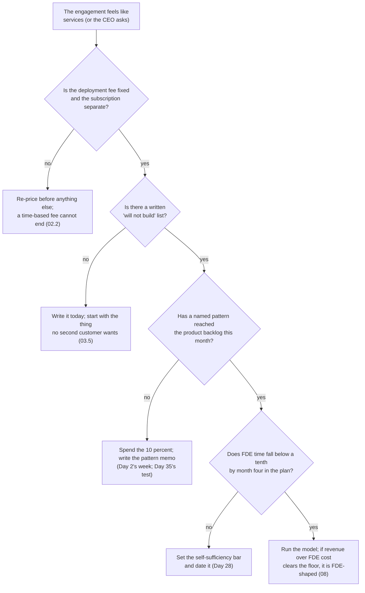

# 09 · Common Mistakes and Debugging

> Day 3 · Section 9 of 12 · [Chapter overview](README.md) · Previous: [08 · Project: is Godavari worth an FDE?](08-project-godavari-unit-economics.md) · Next: [10 · Interview questions](10-interview-questions.md)

---

Each row is **symptom, cause, fix**, with the section that explains it. The first table is the
interview and the offer; the second is the engagement; the third is the model and the assessment.

## 9.1 In the interview and the offer

| Symptom | Likely cause | Fix |
|---|---|---|
| Asked "how is this not consulting?", you answer "I like working with customers" | the economics never learned; the answer describes the week, not the business | recurring revenue per engineer, bounded deployment fee, patterns to product, engagements declined (02.1, 02.3) |
| You quote "FDEs make 300 to 450 thousand" in a salary conversation in Hyderabad | a frontier-lab US posted band read as the title's pay | the band is the employer's economics; India's reported range is 5 lakh to 90 lakh; name the source and the date, never the number alone (05.1, 05.3) |
| An offer's "total" looks high and the cash looks low | equity at the last round's price counted as cash | value startup ESOPs at zero for the cash comparison, then decide whether to believe in the upside (06.1) |
| You accepted an "FDE" role and are billed to a client by the hour | the scope language not read; the title trusted | "billed to client", "utilisation", "statement of work" mean consulting; ask what is measured before accepting (04.3, 06.2) |
| The hiring manager cannot name an engagement they turned down | the team takes everything | that is the signal; price the offer as a services role or walk (06.2) |
| You searched only "forward deployed engineer" and found few roles | one of six titles searched | search all six; a third of the market is under the adjacent ones (04.2) |

## 9.2 On the engagement

| Symptom | Likely cause | Fix |
|---|---|---|
| Month four and the FDE is still on site full-time | no self-sufficiency bar; custom requests accepted one at a time | the exit is a number (FDE share below a tenth by month four); the "will not build" list from day one (03.4, 08.3) |
| The customer offers to pay for the branch CRM and the CEO wants to say yes | one-time revenue read as growth | run the model: full-time FDE for 36 months drops revenue over FDE cost to 2.2x, below the floor; the subscription becomes a retainer (08.2) |
| Deployment fee grows with the weeks | time-and-materials pricing | fixed fee; the slip costs the vendor, which is what makes the vendor want the engagement to end (02.2) |
| The product team has heard nothing from the engagement in a month | patterns not a deliverable | a named pattern per fortnight in the product backlog; the 10 percent of the 60/30/10 week is for this (03.4; Day 2) |
| Renewal arrives and the customer says "we only need it if your engineer stays" | the system depends on a person | that revenue is not ARR; the fix is a handoff with runbooks and a month of running without you (07.3; Day 28) |
| The second lender's deployment takes as long as the first | nothing generalised | the test before building anything: name the second customer who wants it (03.5) |

## 9.3 The model and the assessment

| Symptom | Likely cause | Fix |
|---|---|---|
| Every scenario is above the floor, including the stress tests | FDE time after deployment set too low, or the floor too low | the stress tests exist to bite; if "say yes to everything" passes, the model cannot say no (08.2) |
| ARR/FDE shows 0.00 for a scenario | the contract ended before month 36 (scenario A) | correct: no recurring revenue is live; that zero is the point of the row |
| Break-even is "month 2" for everything | the deployment fee covers the FDE's weeks and the subscription bills from month one | also correct for this pricing; break-even is not the interesting number here, the ratio and the renewal are; make the pre-contract investment larger to see it move |
| The services scenario shows positive contribution and you conclude it is fine | contribution read without the denominator | its revenue over FDE cost is 1.2x and its peak FTE is five people; it is a different business |
| The assessment says "yes" to every qualifying question | the questions answered from the sponsor's pitch | each answer needs a fact from Days 0 to 2 or a stated assumption; "research-interesting" is the one most engagements fail honestly |
| The "will not build" line names something nobody asked for | the line written to look decisive | it must be something the sponsor actually wants (the branch CRM came up in the second call), with the second-customer test as the reason |
| A reviewer says the floor of 3x is "from Ramp" | a Kaagaz choice cited as published | Ramp publishes the measure, not a floor; say so in the memo (02.5) |

## 9.4 A routine for an engagement that feels like services

## 9.5 Key takeaways

- In the interview, the mistake is describing the week instead of the business; in the offer, it
  is reading a band as the title's pay and equity as cash.
- On the engagement, every symptom traces to one of four things: a time-based fee, no "will not
  build" list, no patterns to product, no exit date.
- In the model, the stress tests must bite and the floor must be labelled as Kaagaz's own.
