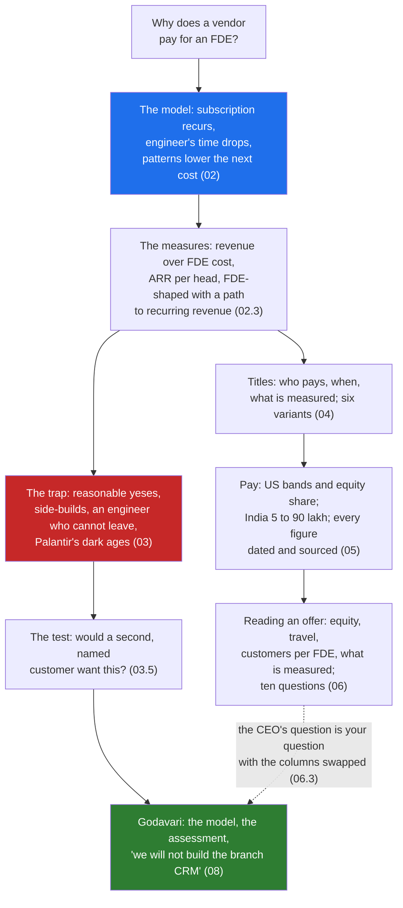

# Day 3 · The Economics: Why FDE Is Not Consulting, ARR per FDE, the Services Trap, Titles and Pay

> **[Part 1 · The Role and the Market](../README.md)** · Chapter 3 of 3 · Video ~13 min · Chapter tier: medium
> Builds on: [Day 1 (where the role came from)](../01-where-the-role-came-from/README.md) ·
> [Day 2 (the three buckets and the 60/30/10 week)](../02-the-three-buckets/README.md) ·
> [Day 0 (the engineer in the room)](../../00-start-here/00-the-engineer-in-the-room/README.md)
> Sets up: Day 4 (the engagement begins, knowing what Kaagaz needs it to be worth), Day 8 (the "will
> not do" list starts with the branch CRM), Day 9 (the customer's business case, the other side of this
> chapter's model), Day 35 and Day 36 (how a fix becomes product), Day 37 (value measured against the
> model's assumptions), Day 38 (scaling the function, the dark ages and the services drug in full),
> Day 46 (comparing offers with this chapter's questions)
> **Owner:** this chapter owns **the economics of the role: consulting versus FDE unit economics; the
> published measures (Ramp's revenue over FDE salaries and five to six customers per FDE, Dataland's
> ARR per head, OpenAI's "FDE-shaped with a path to recurring revenue" test and "services revenue is a
> drug"); the services trap in outline, with Palantir's dark ages; the roles compared by who pays,
> when and what is measured; the six title variants; the US and India pay bands as published in 2026;
> how to read an offer and the questions for a hiring manager; and the "is this FDE-shaped?"
> assessment with the first "we will not build this" line.** The customer's business case is Day 9's;
> the mechanics of turning a fix into product are Days 35 and 36; the numbers that get gamed are Day
> 37's; rotation, ratios across a whole function and the dark ages in depth are Day 38's; the offer
> comparison and the 30/60/90 plan are Day 46's.
> Versions used: the script was run on **Python 3.14.3** (standard library only, no packages; as of
> October 2026). Shown output is from a real run. Every rupee figure in the model is invented; every
> market figure is dated and its source type named.

---

## Why this chapter exists

Two engineers in Hyderabad hold the title "Forward Deployed Engineer" in October 2026. One works
for a product vendor and is measured on the recurring revenue her engagements leave behind; the
other is billed to a client by the hour and measured on utilisation. Postings for the title in India
rose nearly 19 times between June 2025 and June 2026 (Indeed data, reported October 2026), and the
employer-stated pay in those postings runs from 5 lakh to 90 lakh for the same words on the card.
That spread is not noise. It is two business models showing up in a salary band.

This chapter teaches you to see the business model behind the title: why a vendor pays an engineer
to sit inside one customer for twelve weeks (the subscription does not renew without her, and the
engineer's time drops while the revenue recurs); how the teams that run it well measure themselves
(Ramp, Dataland and OpenAI, in their own published words, self-reported and dated); how the role
quietly collapses into a systems-integrator business if nobody watches that number, which happened
to the company that invented the role; what the neighbouring titles are and who pays for each; what
the title pays in the US and India as published in 2026, with every caveat attached; and how to
read an offer. Then you do the thing the CEO of a 40-person vendor has to do before committing one
of four FDEs: build the unit-economics model of the Godavari engagement, run it, stress it, write
the one-page "is this FDE-shaped?" assessment, and write the first "we will not build this" line of
the engagement, before the contract is signed.

## Mental model

One sentence to carry out of the chapter: **an FDE is paid from product margin to make a
subscription renew and then leave, so the measure is revenue that recurs without you divided by
the engineers it takes, and the only thing that breaks it is a yes to work no second customer
wants.**

## Learning goals

After this chapter you can:

1. Explain, in a hiring-manager screen, how forward deployed engineering differs from consulting:
   what is sold, who owns what at the end, what happens at renewal and with the next customer, and
   how the engineer is measured.
2. State the three published measures with their sources and dates (Ramp, Dataland, OpenAI), say
   what each does to a team's behaviour, and scale them to a 40-person Indian vendor.
3. Recognise the services trap in its first month from six signs, name Palantir's dark ages and
   Nominal's rotation as the published case and answer, and apply the second-customer test before
   building anything custom.
4. Place FDE, solutions engineer, consultant, applied AI engineer and customer engineer in a table
   by who pays, when, what is measured and who owns the outcome; list the six title variants and
   search all of them.
5. Quote the 2026 US and India pay figures with their source type, date and caveat, explain why the
   Indian band spans 18x, and never present any of them as a promise.
6. Read an offer for equity (share, valuation, vest, sale), travel share, customers per FDE and what
   is measured, and ask a hiring manager the ten questions that sort a product team from a bench.
7. Build and run a 36-month unit-economics model of an engagement with standard-library Python,
   reconcile one scenario by hand, make the stress tests bite, and count ARR only for revenue that
   recurs without you.
8. Write a one-page "is this FDE-shaped?" assessment with the five qualifying questions, each
   answer traced to evidence or marked as an assumption, ending with a "we will not build this"
   line that refuses something the sponsor actually asked for.
9. Use an AI agent as the sceptical CFO on your own assessment, and catch its characteristic
   failures: one-time revenue counted as ARR, a floor attributed to a company that never published
   one, qualifying answers taken from the pitch, and pay figures as promises.

**Prerequisites:** Days 0 to 2. Python at a reading level for one small script; no libraries.

## Reading order

| # | Section | What you get | Words |
|---|---|---|---|
| 01 | [Why the economics](01-why-the-economics.md) | Two engineers, one title; the three career reasons; the biryani analogy; where the chapter sits; the three hard parts named | ~1,050 |
| 02 | [Consulting versus FDE economics](02-consulting-versus-fde-economics.md) | The two models in one table; one rupee through the engagement; Ramp, Dataland and OpenAI's measures; why the vendor pays at all; the measures scaled to Kaagaz | ~1,450 |
| 03 | [The services trap](03-the-services-trap.md) | The reasonable yeses; Palantir's dark ages; why the trap is comfortable; six early signs with the question for each; the second-customer test; the branch CRM | ~1,350 |
| 04 | [Titles and neighbouring roles](04-titles-and-neighbouring-roles.md) | Five roles by who pays, when, what is measured; the six title variants; the posting that is consulting wearing the title | ~1,200 |
| 05 | [Pay: US and India](05-pay-us-and-india.md) | The honesty note; US bands and the equity share; the Palantir note; India's 19x and the 18x spread; who hires; what moves a role up the band | ~1,500 |
| 06 | [Reading an offer](06-reading-an-offer.md) | Equity, travel, customers per FDE, what is measured; ten questions for a hiring manager; the CEO's question with the columns swapped | ~1,150 |
| 07 | [2026 patterns and production concerns](07-2026-patterns-and-production-concerns.md) | AI-piled teams, product absorbing custom builds, rotation; five hype claims corrected; running the ratio like a production metric | ~950 |
| 08 | [Project: is Godavari worth an FDE?](08-project-godavari-unit-economics.md) | The model's constants and scenarios with real output; reading the table in the meeting; the one-page assessment; the first "will not build" line; Build it with AI; How do you know it's right | ~3,950 (incl. output) |
| 09 | [Mistakes and debugging](09-mistakes-and-debugging.md) | Symptom, cause, fix for the interview and offer, the engagement, and the model; a routine for an engagement that feels like services | ~1,100 |
| 10 | [Interview questions](10-interview-questions.md) | 12 questions with model answers, plus a quick-fire round | ~1,750 |
| 11 | [Exercises](11-exercises.md) | 10 graded exercises: which column, read the posting, source the figure, predict-the-output and break-it on the model, reprice for on-prem, the hiring-manager round out loud, "review this AI-written assessment", your own employer | ~1,750 |
| 12 | [Further reading](12-further-reading.md) | The panel and interview the measures come from, the posting analyses, the India reports, the recruiter comparisons, with what each does and does not contain | ~750 |

**Short on time?** Read 02, 03 and 05, then do the project (08) and exercise 3.1. That is the video
plus the two things the interview and the offer test. Add 06 before any offer and 04 before any
job search.

## Files

| Path | What |
|---|---|
| [`code/unit_economics.py`](code/unit_economics.py) | the 36-month model: four scenarios and two stress tests; prints the table and the measures; writes the CSV |
| `data/godavari-unit-economics.csv` | one row per scenario per month (216 rows), regenerated by the script |
| [`worksheet/godavari-fde-shaped-assessment.md`](worksheet/godavari-fde-shaped-assessment.md) | the one-page assessment for the CEO: five questions, the numbers, the "will not build" line, the week-13 test |
| [`worksheet/ai-draft-fde-shaped-assessment.md`](worksheet/ai-draft-fde-shaped-assessment.md) | an agent's draft of the same page with at least seven problems; exercise 3.1 |

Run from the chapter folder: `python -X utf8 code/unit_economics.py` (under a second). No packages,
no downloads, no API keys.

## What this chapter does *not* teach (single-owner rule)

| Topic | Where it's taught |
|---|---|
| Where the role came from; Delta and Echo; why generative AI spread it | [Day 1](../01-where-the-role-came-from/README.md) |
| The three buckets, the 60/30/10 week, Ramp's customer load and Atlassian's twelve weeks as a working pace | [Day 2](../02-the-three-buckets/README.md) (this chapter uses them as the denominator) |
| The customer's business case: hours into rupees, the baseline | [Day 9](../../02-discovery-and-decomposition/09-success-metrics-and-business-case/README.md) |
| The full "will not do" list and the harder refusals | [Day 8](../../02-discovery-and-decomposition/08-scoping-the-first-90-days/README.md), [Day 32](../../05-working-with-the-customer/32-scope-pushback-and-governance/README.md) |
| Telling a pattern from a one-off; evals as the currency; the Klarna path in full | [Day 35](../../06-from-customer-to-product/35-patterns-across-customers/README.md), [Day 36](../../06-from-customer-to-product/36-feeding-product-and-research/README.md) |
| The numbers that get gamed, measured value | [Day 37](../../06-from-customer-to-product/37-measuring-value-honestly/README.md) |
| Ratios across a function, rotation, the dark ages in depth, the services drug | [Day 38](../../06-from-customer-to-product/38-scaling-an-fde-function/README.md) |
| Comparing offers, the 30/60/90 plan | [Day 46](../../08-capstone-and-career/46-capstone-defence-and-career/README.md) |

## Analogies for the Telugu audience

- **Biryani** (the chapter's main picture): the caterer who invents a recipe for every wedding is
  the consultant; the restaurant that perfected one recipe and sends a chef to run a counter at
  the wedding is the FDE model. The chef adapts to the hall, the recipe comes home improved, and
  the restaurant sells it every day (01.2).
- **The family doctor** (Day 0's picture, reused): the vendor pays for the house call because the
  patient who is never visited never comes back (02.4).
- **The one-time wedding order versus the daily tiffin subscription**: the services firm earns
  more on the day; the tiffin service is worth more at the end of the year, and needs the cook
  less each month (08.2, scenario D against B).

## Video map

The video (~13 min) covers a slice; the notes cover everything.

| Asset | Covers | Sections |
|---|---|---|
| **Day 3 main video** (~13 min) | Hook: two engineers in Hyderabad, same title, 5 lakh and 70 lakh (1 min) → the two business models in one table; the biryani (2 min) → the three measures: Ramp's ratio, Dataland's ARR per head, OpenAI's "FDE-shaped" and "services revenue is a drug" (2 min) → the services trap and Palantir's dark ages; the second-customer test (2 min) → titles: who pays, when, what is measured; six variants (1.5 min) → pay: US bands and the equity share, India's 19x and the 18x spread, with the caveats said out loud (2 min) → Godavari: the model's table on screen, B against B1, and "we will not build the branch CRM" (2 min) → recap and the Day 4 teaser: now you walk into the room (0.5 min) | 01.1 to 01.2, 02.1, 02.3, 03.1 to 03.2, 03.5, 04.1 to 04.2, 05.2 to 05.3, 08.2 to 08.4 |
| **Short 1:** "FDE salary in India: 5 lakh to 90 lakh for the same title. Here is why." | The three boxes (services tier, GCC, global startup); the band tracks the employer's economics, not the engineer; "billed to client" versus "owns the renewal"; every figure dated | 05.3, 04.3 |
| **Short 2:** "ARR per FDE: the one number that decides whether your team survives." | Revenue that recurs without you over the engineers it takes; scenario B's 12 crore per head against B1's 1.2 crore; the engineer's time must fall | 02.3, 07.3, 08.2 |
| Notes only | Why the vendor pays at all and the measures scaled (02.4 to 02.5), why the trap is comfortable and the six signs (03.3 to 03.4), the posting that is consulting wearing the title (04.3), the Palantir note and what moves a role up the band (05.2, 05.4), reading an offer and the ten questions (06), 2026 patterns, hype and production concerns (07), the full project, Build it with AI and How do you know it's right (08), debugging (09), interviews (10), exercises (11) | as listed |

**Callbacks to use on screen:** "Day 1 lo Palantir Delta story chusam; ivala aa company lo ne
'dark ages' ela vachayo chuddam." (section 03); "Day 2 lo Ramp FDEs ki five to six customers
ani chusam; ivala aa number economics lo enduku important o chuddam." (section 02).
**Forward callbacks:** Day 4 (repu COO room loki veltunnam, ee model tho), Day 38 (ee ratio ni
whole team ki ela run cheyyalo), Day 46 (ee ten questions tho offers compare chestam).

## Callbacks

- **Builds on:** [Day 0](../../00-start-here/00-the-engineer-in-the-room/README.md) (the first
  week at Godavari: the tracker, the 6 pm batch, the facts the assessment cites), [Day 1](../01-where-the-role-came-from/README.md)
  (Palantir's model and OpenAI's team as the published case; the one-page note that is the first
  artefact), [Day 2](../02-the-three-buckets/README.md) (the 60/30/10 week whose 10 percent is the
  patterns channel; Ramp's five to six customers; Atlassian's twelve weeks; the two-week calendar).
- **Sets up:** [Day 4](../../02-discovery-and-decomposition/04-picking-the-problem/README.md)
  (the engagement begins), Day 8 (the "will not do" list), Day 9 (the customer's side of the
  model), Day 10 (the commercial page of the discovery document), Day 20 (the second NBFC in the
  room for the skeleton demo), Day 28 (the handoff bar that makes the denominator fall), Days 35 to
  38 (patterns, evals as currency, measured value, scaling the function), Day 46 (offers).

**Next chapter:** [Day 4 · Picking the right problem: frequent, painful, measurable, and worth it](../../02-discovery-and-decomposition/04-picking-the-problem/README.md).
