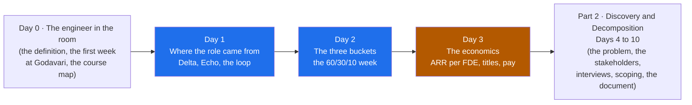

# Part 1 · The Role and the Market

> **Days 1 to 3** · 3 chapters · 3 videos (~36 min in total) · about **6 hours of reading** in the notes
> (plus time to run the code and write the artifacts) · Playlist plan: [`curriculum/part-01-the-role.md`](../curriculum/part-01-the-role.md)

---

## What this Part is for

[Day 0](../00-start-here/00-the-engineer-in-the-room/README.md) defined the forward deployed engineer,
walked through the first week at Godavari Finance as a story, gave Delta and Echo one line and the three
buckets one table, and drew the course map. Part 1 is about the three questions the first ten minutes
of every FDE interview ask, and that most applicants cannot answer: **where did this role come from,
what does the job actually consist of, and how is it not consulting?** Day 1 gives the lineage with
every figure dated and every source typed; Day 2 takes the job apart into three buckets measured from
postings and puts it back together as a week; Day 3 follows the money, from the vendor's reason to pay
for an engineer inside one customer to what the title pays in the US and India. Each chapter adds an
artifact to the Kaagaz AI engagement folder before anyone has walked into the Godavari room.

By the end of these three chapters you can:

- explain why Palantir placed engineers inside customers from about 2005, map Delta, Echo and Dev to
  their public titles, describe the loop from field work to Foundry (80 percent margin against an
  integrator's 32, 2023), name the dark ages as a shape and the three fixes, and say why generative AI
  widened the gap for every vendor after late 2022;
- give the dated spread of the role (OpenAI 2 to 90+ between January 2024 and 2026, Anthropic's posting,
  Atlassian's twelve weeks, Ramp, Nominal, Dataland, Indian postings up nearly 19 times between June
  2025 and June 2026) with the source type of each figure, and apply the two-clause test to a posting;
- name the three buckets with their 2026 shares (core engineering in 95 percent or more of roughly 1,000
  postings published June 2026, applied AI 80 percent or more, customer-facing discovery 70 percent or
  more and rising fastest), explain the 60/30/10 week and why it is still an engineering job, build a
  two-week calendar as hour blocks and count it with a script, and score yourself on a twenty-row
  rubric that tells you where in this course to spend longest;
- explain in a hiring-manager screen how FDE economics differ from consulting (what is sold, who owns
  what at the end, what happens at renewal and with the next customer), quote the three published
  measures (Ramp's revenue over FDE salaries and five to six customers per FDE, Dataland's ARR per
  head, OpenAI's "FDE-shaped with a path to recurring revenue" and "services revenue is a drug"),
  spot the services trap from six early signs and apply the second-customer test;
- place FDE, solutions engineer, consultant, applied AI engineer and customer engineer in a table by
  who pays, when and what is measured, quote the 2026 US and India pay figures with their caveats
  (and never as a promise), read an offer for equity, travel and customers per FDE, and ask a hiring
  manager the ten questions that sort a product team from a bench;
- build and stress a 36-month unit-economics model of an engagement in standard-library Python, write
  the one-page "is this FDE-shaped?" assessment, and write the engagement's first "we will not build
  this" line.

The title is the fastest-growing engineering title in AI as of 2026, Indian postings for it rose
nearly 19 times in a year (Indeed data, June 2025 to June 2026, reported October 2026), and the
employer-stated pay in those postings runs from 5 lakh to 90 lakh for the same words on the card. The
managers who built these teams read the same playbooks, and the interview's "why this role?" is really
"do you know what you are signing up for?". This Part is the answer, with every figure dated.

## Who it's for

- **Learners coming from Day 0.** Continue straight from
  [Day 0](../00-start-here/00-the-engineer-in-the-room/README.md): its first week at Godavari is the
  week Day 2 puts on a calendar, and its one-line Delta and Echo is what Day 1 expands into the full
  mapping.
- **Backend, data, DevOps and ML engineers who want the title.** Each of you has a clear picture of
  one third of the job. Day 2 measures the other two thirds from postings, and its rubric tells you
  which bucket the interview will find first.
- **Engineers in solutions, consulting or services roles.** Day 1's "what the role is not", Day 2's
  neighbours table and Day 3's "who pays, when, what is measured" separate the title you have from the
  title you want, and Day 3's posting checklist shows when an FDE posting is consulting in disguise.
- **Engineers at AI vendors deciding whether an engagement is worth an FDE.** Day 3's project is the
  CEO's question: the unit-economics model, the "is this FDE-shaped?" assessment and the first refusal.
  The same questions, with the columns swapped, are the ones you ask about an offer.
- **Interview preparers.** "Why FDE?", "how is this not consulting?", "what does the week look like?"
  and "what does it pay?" are the opening questions. The three chapters have 13, 12 and 12 interview
  questions with model answers plus a quick-fire round each.

No machine learning theory and no maths are needed. Python at a reading level is enough for the four
small scripts; none of them uses a library.

## How to use these notes

**The notes are for learning the concept deeply. The videos cover one slice.** Each Day's video is
11 to 13 minutes; each chapter here is a full textbook chapter of roughly 22,000 to 24,500 words, with
runnable code, a project that moves the engagement, a "Build it with AI" section with the mistakes a
coding agent typically makes for that task, a "How do you know it's right?" checklist, a
mistakes-and-debugging table, interview questions and graded exercises. Watch the video for the idea,
then read the chapter to own it.

Each chapter folder has a `README.md` with:

- a "why this chapter exists" overview, a Mermaid mental model, the one sentence to carry out of the
  chapter, and learning goals,
- a **reading order** table (one file per section, with word counts),
- a **short-on-time path**,
- a **files** table (the worksheets, code and data the chapter produces, and how to run the script),
- a "what this chapter does not teach" table (the single-owner rule),
- **analogies for the Telugu audience**,
- a **video map** showing which sections the Day's video and Shorts cover, with the on-screen callbacks,
- **callbacks**: which earlier Days it builds on and which later Days it sets up.

Every chapter ends with **interview questions**, **exercises** (graded, each with a "review this
AI-written draft" exercise against a worksheet that has planted errors) and **further reading** (the
sources with their type and what was and was not fetchable).

**Running the code.** All three chapters use **standard-library Python only**: no packages, no
downloads, no API keys. The scripts were run on Python 3.14.3 (October 2026) and each finishes in under
a second. Every script checks its input, prints its result and regenerates a file in `data/`:

| Chapter | Script | Run from the chapter folder |
|---|---|---|
| Day 1 | `code/timeline.py` checks and sorts the 19-row timeline CSV and writes `data/fde-timeline.md` | `python -X utf8 code/timeline.py` |
| Day 2 | `code/gap_plan.py` reads a rubric and writes `data/<name>-gap-plan.md`; `code/week_hours.py` counts a calendar's hours per bucket | `python -X utf8 code/gap_plan.py worksheet/sample-rubric-ravi.md` and `python -X utf8 code/week_hours.py worksheet/godavari-weeks-1-2-calendar.md` |
| Day 3 | `code/unit_economics.py` runs four scenarios and two stress tests over 36 months and writes `data/godavari-unit-economics.csv` | `python -X utf8 code/unit_economics.py` |

The scripts print a middle dot: if you run one on Windows with output redirected to a file or pipe and
see a `UnicodeEncodeError`, the `-X utf8` flag above is the fix (or set `PYTHONUTF8=1`). Shown outputs
in the notes are from real runs. No real LLM is called anywhere; the "Build it with AI" sections show
how to use a coding agent and what to check in what it writes.

**Examples are illustrative.** Kaagaz AI, Godavari Finance, Lakshmi, Ravi, Priya and every rupee figure
in the unit-economics model are invented. Real companies (Palantir, OpenAI, Anthropic, Atlassian, Ramp,
Nominal, Dataland, Morgan Stanley) appear only where a published source describes what they did, and
every market, history and pay figure is dated in the text with its source type and listed in each
chapter's further reading. Most of the market and pay sources are recruiter, career-prep or vendor
content, so the figures are quoted as published and should be refreshed yearly.

## The three chapters

Reading times are from the real word counts of each chapter folder (all sections plus the README,
worksheets and generated tables, code blocks included) at about 200 words per minute. Running the code,
doing the exercises and writing the artifacts takes longer.

| Day | Chapter | What you'll learn | Words | Reading time |
|---|---|---|---|---|
| 1 | [Where the Role Came From](01-where-the-role-came-from/README.md) | The problem Palantir had from about 2005: a platform that worked in the lab and could not be installed, and what was new versus a systems integrator; Delta, Echo and Dev mapped to their public titles, a Delta's week from the 2015 account, and why AI vendors have no Echo; the loop from field work to Foundry and its three conditions (80 percent margin versus 32, 2023); the dark ages as a shape, its symptoms and the three fixes; why generative AI widened the gap for every vendor (general model, probabilistic output, the easy demo; Morgan Stanley 2023); the dated spread to OpenAI (2 to 90+), Anthropic, Atlassian (12 weeks), Ramp, Nominal, Dataland and India (nearly 19x) with its caveats; what the role is not (SE, consultant, model trainer) and the two-clause test; hype. **Project:** the one-page lineage map, the timeline as checked data, and the day-one note that argues for an engineer in Hyderabad over a services quote, before anyone has seen a loan file. | ~23,400 | ~1 h 57 min |
| 2 | [The Three Buckets and the 60/30/10 Week](02-the-three-buckets/README.md) | The job measured from roughly 1,000 postings (June 2026): core engineering 95 percent or more, applied AI 80 percent or more, customer-facing discovery 70 percent or more and rising fastest, with the method and its caveats; each bucket up close, how it differs from the same skill in a product team, and what it looks like on the Godavari floor in week one; the 60/30/10 week, what counts in each slice, the published pace of real teams (Ramp's five to six customers per FDE, Atlassian's twelve weeks, OpenAI's ten engagements at a time) and why it is still engineering; the six title variants; the FDE against the solutions engineer, the consultant and the applied AI engineer; a composite day at a frontier lab, a vertical-AI startup and an Indian IT services firm; what the split does to you under load. **Project:** the two-week Godavari calendar as hour blocks that lands at 60/28/11 without trying, and the twenty-row self-assessment with a gap plan that names a chapter per gap. | ~24,400 | ~2 h 2 min |
| 3 | [The Economics](03-the-economics/README.md) | Consulting versus FDE economics in one table and one rupee through the engagement; why the vendor pays at all; the three published measures (Ramp's revenue over FDE salaries, Dataland's ARR per head, OpenAI's "FDE-shaped" test and "services revenue is a drug") scaled to a 40-person Indian vendor; the services trap (the reasonable yeses, Palantir's dark ages, six early signs, the second-customer test); five roles by who pays, when and what is measured, and the posting that is consulting wearing the title; US bands and the equity share, India's 19x and the 18x spread, every figure dated with its caveat; reading an offer and the ten questions for a hiring manager; 2026 patterns and five hype claims corrected. **Project:** is Godavari worth an FDE? The 36-month unit-economics model with four scenarios and two stress tests, the one-page "is this FDE-shaped?" assessment, and the first "we will not build this" line: the branch CRM. | ~22,100 | ~1 h 50 min |
| | **Total** | | **~69,900** | **~5 h 50 min** |

## Recommended order

Read the chapters in Day order; they follow the order of the questions. Day 1 says where the role came
from and what has not changed, Day 2 says what the job consists of and measures your fit against it,
and Day 3 says why a vendor pays for it, how the good teams measure it, and what it pays you. Each
chapter's artifact assumes the previous one is in the engagement folder.

- **Short on time?** Use each chapter's short path: Day 1 sections 02, 04 and 05, then the project's
  part C (09.4) and exercise 2.3; Day 2 sections 02, 04 and 05, then the project (08); Day 3 sections
  02, 03 and 05, then the project (08) and exercise 3.1. That is about 1.5 to 2 hours of reading for
  the whole Part, plus the artifacts. Add Day 1 section 06 and Day 3 section 04 before any job search,
  and Day 1 section 07 and Day 3 section 06 before accepting any offer.
- **If you read only one chapter, read Day 3.** It is the one that answers "how is this not
  consulting?" with numbers, shows the trap the role collapses into when nobody watches that number,
  and gives you the questions to judge an engagement and an offer; the rest of the course's commercial
  judgement (Days 8, 9, 35 to 38 and 46) picks up from it.
- **Already in a solutions or consulting role?** Skim Day 1 via its interview questions, then read
  Day 1 section 07 (what the role is not, and the two-clause test), Day 2 sections 06 and 08 (the
  neighbours, the three employers, and an honest score on buckets 1 and 2) and Day 3 sections 02, 04
  and 06 (the two business models, who pays for each title, and reading an offer) in full. They are
  the parts that separate the sentences a solutions engineer can say from the ones an FDE can.
- **Do the artifacts.** The Part leaves four things in the engagement folder: the lineage map and the
  day-one note (Day 1), the two-week calendar and your own rubric with its gap plan (Day 2), and the
  unit-economics model with the "is this FDE-shaped?" assessment (Day 3). The ideas stick when you watch
  the fortnight land at 60/28/11 without trying, or scenario B's 12 crore of ARR per head turn into
  B1's 1.2 crore because the engineer never left.

## Single-owner notes (what this Part does and doesn't teach)

The course teaches each concept in **one** owner chapter and calls back to it everywhere else
([CURRICULUM.md](../CURRICULUM.md)). Inside Part 1:

| Concept | Owner | How the other chapters treat it |
|---|---|---|
| The lineage of the role: the problem Palantir had; Delta, Echo and Dev and how they paired; the loop from field work to product and Foundry; the dark ages in outline; why generative AI widened the gap after late 2022; the dated spread to OpenAI, Anthropic, Atlassian, Ramp, Nominal, Dataland, the vertical-AI companies and India; what the role is not; the day-one note | [Day 1](01-where-the-role-came-from/README.md) | Day 2 folds Delta and Echo into one engineer's week; Day 3 uses Palantir's dark ages as the published case of the services trap and OpenAI's team as the published case of the measures. Day 1's section 03.3 is one paragraph on the loop in money and says the rest is Day 3's. |
| **The three buckets** as measured from 2026 postings, what each consists of and looks like at Godavari; the 60/30/10 week and the published pace of real teams; the week-in-the-life calendar; the FDE against its three neighbours; a composite day at three employers; the skills self-assessment and gap plan | **[Day 2](02-the-three-buckets/README.md)** (the frame the rest of the course hangs on: Day 4 begins bucket 3, Day 11 bucket 2, Days 16 and 26 bucket 1, and Day 43 maps the interview rounds to the buckets) | Day 0 quotes the bucket table once; Day 3 uses the week's 10 percent as the patterns channel and Ramp's five to six customers as the denominator. Each bucket's skills are taught in their own chapters (Parts 2 to 5) and only named here. |
| The economics of the role: consulting versus FDE unit economics; the published measures; the services trap in outline; the roles compared by who pays, when and what is measured; the US and India pay bands as published in 2026; reading an offer and the questions for a hiring manager; the "is this FDE-shaped?" assessment with the first "we will not build this" line | [Day 3](03-the-economics/README.md) | Day 1 previews the loop in money in one paragraph and the wedding-caterer picture; Day 2's Indian IT services day previews the services trap and its Day 3 teaser is "the same title, pay from 5 lakh to 90 lakh". |
| The six title variants and the neighbouring roles (a thread through all three) | Day 1 (SE, consultant, model trainer by the edge each lacks, and the two-clause test), Day 2 (the six variants and what each emphasises; SE, consultant and applied AI engineer in one sentence each), Day 3 (five roles by who pays, when and what is measured; the posting that is consulting wearing the title) | Each chapter takes its own angle and points to the other two for the rest. |

Owned **outside** this Part, so only a one-line teaser here:

| Concept | Owner |
|---|---|
| The definition of the role, the first week at Godavari as a story, the course map | [Day 0](../00-start-here/00-the-engineer-in-the-room/README.md) |
| Picking the problem and the stakeholder map | [Day 4](../02-discovery-and-decomposition/04-picking-the-problem/README.md) and [Day 5](../02-discovery-and-decomposition/05-the-stakeholder-map/README.md) |
| The full "will not do" list and scoping the first 90 days | [Day 8](../02-discovery-and-decomposition/08-scoping-the-first-90-days/README.md) |
| The customer's business case: hours into rupees, the baseline | [Day 9](../02-discovery-and-decomposition/09-success-metrics-and-business-case/README.md) |
| The commercial page of the discovery document | [Day 10](../02-discovery-and-decomposition/10-the-discovery-document/README.md) |
| Each bucket-2 skill: the system around the model, LLM APIs, prompts, retrieval, agents, observability | Days 11 to 19, starting at [Day 11](../03-building-the-system/11-the-system-around-the-model/README.md) |
| Evals first, the golden set | [Day 14](../03-building-the-system/14-evals-first/README.md) (Day 1 section 05.4 names it as the AI-era addition) |
| Each bucket-1 skill in the customer's environment: integration, identity, CI/CD into their account, reliability | [Day 16](../03-building-the-system/16-integrating-with-what-exists/README.md), [Day 22](../04-deploying-into-their-world/22-identity-in-their-company/README.md), [Day 26](../04-deploying-into-their-world/26-shipping-into-their-infrastructure/README.md), [Day 27](../04-deploying-into-their-world/27-reliability-in-their-production/README.md) |
| The 12-week bar and the handoff | [Day 28](../04-deploying-into-their-world/28-handoff-and-self-sufficiency/README.md) |
| The weekly readout and writing for a COO | [Day 29](../05-working-with-the-customer/29-communication-for-engineers/README.md) |
| The Morgan Stanley lesson (build versus trust) | [Day 31](../05-working-with-the-customer/31-demos-and-workshops/README.md) |
| Saying no to the customer and the harder refusals | [Day 32](../05-working-with-the-customer/32-scope-pushback-and-governance/README.md) (Day 1 section 04.4 is saying no to yourself) |
| Telling a pattern from a one-off; evals as the currency; the Klarna-to-Agent-SDK path in full | [Day 35](../06-from-customer-to-product/35-patterns-across-customers/README.md), [Day 36](../06-from-customer-to-product/36-feeding-product-and-research/README.md) |
| Measured value and the numbers that get gamed | [Day 37](../06-from-customer-to-product/37-measuring-value-honestly/README.md) |
| Scaling an FDE function: ratios across a function, rotation, the dark ages in full, the services drug | [Day 38](../06-from-customer-to-product/38-scaling-an-fde-function/README.md) |
| The eight interview rounds and the behavioural stories | [Day 43](../08-capstone-and-career/43-the-interview-loop/README.md), [Day 45](../08-capstone-and-career/45-behavioural-and-client-simulation-prep/README.md) (Day 2 only says which bucket each round tests) |
| Comparing offers and the 30/60/90 plan | [Day 46](../08-capstone-and-career/46-capstone-defence-and-career/README.md) |
| Left out on purpose | Training models (bucket 2 is applied AI, not training); machine learning theory (learn-ai-ml Stage 2, for those who want it) |

## How Part 1 connects to the rest of the course

**Builds on Part 0:**

| From Day 0 | Used in Part 1 for |
|---|---|
| [Day 0](../00-start-here/00-the-engineer-in-the-room/README.md) · the definition and the family doctor | The picture Day 1 opens with (the family doctor the vendor sends) and Days 2 and 3 reuse (sixty percent of the day in houses; the house call the vendor pays for) |
| [Day 0](../00-start-here/00-the-engineer-in-the-room/README.md) · the first week at Godavari | Day 2's calendar (the Wednesday beside Lakshmi and the Excel tracker becomes seven customer-facing hours); the facts Day 3's assessment cites (the tracker, the 6 pm batch) |
| [Day 0](../00-start-here/00-the-engineer-in-the-room/README.md) · Delta and Echo in one line, the three-bucket table, the 60/30/10 pie | Day 1 gives the full mapping with sources; Day 2 measures the buckets from postings and lives the pie as a fortnight |
| [Day 0](../00-start-here/00-the-engineer-in-the-room/README.md) · the course map | Day 2's gap plan, which names a chapter per gap |

**Sets up Part 2 and beyond:**

| Later Day | What it picks up from Part 1 |
|---|---|
| [Day 4](../02-discovery-and-decomposition/04-picking-the-problem/README.md) · Picking the right problem | The engagement begins, knowing what Kaagaz needs it to be worth (Day 3); the problem the day-one note refuses to pick (Day 1); bucket 3 begins (Day 2) |
| [Day 8](../02-discovery-and-decomposition/08-scoping-the-first-90-days/README.md) · Scoping the first 90 days | The "will not do" list starts with the branch CRM (Day 3) |
| [Day 9](../02-discovery-and-decomposition/09-success-metrics-and-business-case/README.md) · Success metrics and the business case | The customer's side of Day 3's model |
| [Day 10](../02-discovery-and-decomposition/10-the-discovery-document/README.md) · The discovery document | The commercial page (Day 3) |
| [Day 11](../03-building-the-system/11-the-system-around-the-model/README.md) · The system around the model | Bucket 2 begins (Day 2) |
| [Day 14](../03-building-the-system/14-evals-first/README.md) · Evals first | The AI-era addition Day 1 names in section 05.4 |
| [Day 16](../03-building-the-system/16-integrating-with-what-exists/README.md) and [Day 26](../04-deploying-into-their-world/26-shipping-into-their-infrastructure/README.md) · Integrating and shipping into their environment | Bucket 1 in the customer's environment (Day 2); the Thursday integration spike on the calendar |
| [Day 20](../03-building-the-system/20-the-walking-skeleton-shipped/README.md) · The walking skeleton, shipped | The second NBFC in the room for the skeleton demo (Day 3's second-customer test) |
| [Day 28](../04-deploying-into-their-world/28-handoff-and-self-sufficiency/README.md) · Handoff and self-sufficiency | The 12-week bar (Day 1, Atlassian); the handoff that makes the denominator fall (Day 3) |
| [Day 29](../05-working-with-the-customer/29-communication-for-engineers/README.md) · Communication for engineers | The Friday readout on Day 2's calendar, done properly |
| [Day 31](../05-working-with-the-customer/31-demos-and-workshops/README.md) · Demos and workshops | Morgan Stanley (Day 1) |
| [Day 35](../06-from-customer-to-product/35-patterns-across-customers/README.md) · Patterns across customers | Telling a pattern from a one-off; the 10 percent of the week that is the patterns channel (Days 2 and 3) |
| [Day 36](../06-from-customer-to-product/36-feeding-product-and-research/README.md) · Feeding product and research | The loop's AI-era currency, Klarna to the Agent SDK (Day 1); evals as the currency (Day 3) |
| [Day 37](../06-from-customer-to-product/37-measuring-value-honestly/README.md) · Measuring value honestly | Value measured against the assumptions of Day 3's model |
| [Day 38](../06-from-customer-to-product/38-scaling-an-fde-function/README.md) · Scaling an FDE function | The dark ages, rotation and ratios in full (Day 1); the ratio run across a whole function and the services drug (Day 3) |
| [Day 43](../08-capstone-and-career/43-the-interview-loop/README.md) · The interview loop | "Why FDE?" answered with Godavari (Day 1); the eight rounds mapped to the three buckets (Day 2) |
| [Day 45](../08-capstone-and-career/45-behavioural-and-client-simulation-prep/README.md) · Behavioural and client-simulation prep | "How is this not consulting?" (Day 1); the strengths in your rubric become behavioural stories (Day 2) |
| [Day 46](../08-capstone-and-career/46-capstone-defence-and-career/README.md) · Capstone defence, portfolio and the 30/60/90 plan | Comparing offers with Day 3's ten questions |

**Next Part:** Part 2 · Discovery and Decomposition, starting with
[Day 4](../02-discovery-and-decomposition/04-picking-the-problem/README.md) (Picking the right problem:
frequent, painful, measurable, and worth it).
Plan: [`curriculum/part-02-discovery-and-decomposition.md`](../curriculum/part-02-discovery-and-decomposition.md).
