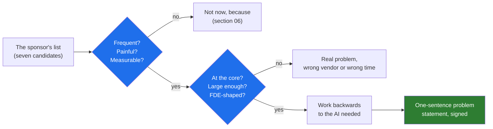

# 02 · The Two Filters: Atlassian's and OpenAI's, Scaled to a 40-Person Vendor

> Day 4 · Section 2 of 12 · [Chapter overview](README.md) · Previous: [01 · Why picking the problem](01-why-picking-the-problem.md) · Next: [03 · Start from the workflow](03-start-from-the-workflow.md)

---

Two teams that run forward deployed engineering at scale have published how they choose problems.
They are not the same filter. One is about the problem; the other is about the vendor. You need
both, and the order matters.

## 2.1 Atlassian: frequent, painful, measurable, then work backwards

Atlassian's Forward Deployed Engineering Playbook (published 2025, read October 2026) puts problem
selection in one sentence under the heading "Pick the right problem": focus on issues that are
frequent, painful and measurable, then work backward to figure out what AI needs to solve them.

Each word carries a test:

| Word | The test | What fails it at Godavari |
|---|---|---|
| **Frequent** | Does it happen every day, to many people, in the normal run of the business? Something that happens twice a month cannot change a Tuesday | Title-deed review: about 120 secured loans a month, each reviewed by an outside lawyer |
| **Painful** | Does it cost hours, rupees, errors or waiting that someone already complains about? Pain that nobody has complained about is pain you are guessing at | The branch chatbot: nobody has counted the policy calls to Hyderabad, and nobody on the floor mentioned them |
| **Measurable** | Is there a number today, counted by the customer, that the system would move? If there is no baseline, there will be no proof | The chatbot again: there is no baseline because there is no count |
| **Work backwards** | Only after the problem passes the three tests do you ask what AI, if any, it needs. Some of the work is deterministic code (Day 11); some of it is a form redesign; some is a model | Intake: page classification and field extraction need a model; the completeness rules do not |

The same playbook adds the line this course uses for adoption, and which applies at selection
time as much as at rollout: "Curiosity drives initial adoption. Value drives sustained usage."
[Day 33](../../05-working-with-the-customer/33-adoption/README.md) owns adoption. Here the lesson is
narrower: a problem whose solution would be used out of curiosity (a chatbot anyone can try) and a
problem whose solution would be used because it removes forty people's re-keying (intake) look
similar in a demo and completely different in month four. Pick for the second.

The playbook's other number is the one Day 2 and Day 28 already use: about twelve weeks to
self-sufficient teams. Twelve weeks is the budget the pick has to fit in.

## 2.2 OpenAI: worth tens of millions, at the core, and FDE-shaped

OpenAI's forward deployed team describes its filter in two interviews that the ZenML LLMOps database
summarises (2025 and 2026; read October 2026). Three parts:

1. **Value.** The team targets problems representing tens of millions to low billions in value to
   the customer. That is not greed; it is the only size of problem at which a customer will put its
   experts in a room with you for weeks, and at which the subscription afterwards is an easy
   decision.
2. **Core, not edge.** The successful deployments the interview describes tackle genuinely
   high-stakes use cases at the core of the business rather than edge cases. The semiconductor and
   life-sciences work it names sits where the customer's revenue is made, not in a side process.
   A side process is easier to get permission for and impossible to get adoption for.
3. **FDE-shaped, with a path to recurring revenue.** The 2026 panel describes the team carefully
   qualifying whether problems are genuinely FDE-shaped and have realistic paths to recurring
   revenue, and declining lucrative services work that advances neither product nor research.
   [Day 3](../../01-the-role/03-the-economics/03-the-services-trap.md) taught this as the
   second-customer test. Here it is a column in the rubric.

The same interview carries the Morgan Stanley lesson that [Day 31](../../05-working-with-the-customer/31-demos-and-workshops/README.md)
owns: the system was technically ready and then needed about four more months of pilots and
feedback before advisors trusted it. For selection the point is that a core problem with real
operators gives you those four months of feedback; an edge problem gives you silence.

## 2.3 The two filters are not the same filter

| | Atlassian's filter | OpenAI's filter |
|---|---|---|
| Asks about | the problem: is it worth solving at all? | the vendor: is it worth us solving it? |
| Fails when | you pick the demo-shaped problem | you pick a real problem that becomes services work |
| Day 4 column | frequency, pain, measurability, data | sponsorship (including product fit), and the value size |
| Owned by | this chapter | Day 3 (the assessment), applied here |

Run Atlassian's filter first. A problem that is not frequent, painful and measurable is not worth
anyone's twelve weeks, so there is nothing to qualify. Then run OpenAI's: of the problems worth
solving, which one is FDE-shaped, at the core, and large enough that the renewal is easy?

## 2.4 Scaled to Kaagaz AI

Kaagaz is not OpenAI. "Tens of millions" is in dollars and the customer is a semiconductor company.
Day 3's assessment already scaled the qualifying questions: for a 40-person vendor selling a 1.2
crore a year subscription, "large enough" means the problem's cost to Godavari is clearly above
the subscription, so that the COO's renewal is an easy decision, and "core" means it sits in the
loan-origination process that is Godavari's business, not in a support function.

At the planning rate this chapter uses (300 rupees per analyst hour, invented, replaced on Day 9),
intake alone is about 6.3 lakh a month of analyst time before counting the 31 percent of files that
go back to the branch and the days of disbursement each one delays. That is the first number in
the memo, and it is marked as a planning estimate until Day 9 measures it. The value test passes on
hours alone; the turnaround is the bonus.

## 2.5 Key takeaways

- Atlassian: frequent, painful, measurable, then work backwards to the AI. Curiosity starts use;
  value sustains it; pick for value.
- OpenAI: worth tens of millions, at the core of the business, FDE-shaped with a path to recurring
  revenue; decline the rest even when it pays.
- Run the problem filter first and the vendor filter second. The rubric in section 04 holds both.
- Scaled to Kaagaz, "large enough" means the problem costs Godavari clearly more than the
  subscription, measured in hours first.
