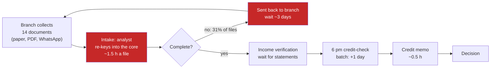

# 03 · Start From the Workflow, Not the Model: The Godavari Catalogue

> Day 4 · Section 3 of 12 · [Chapter overview](README.md) · Previous: [02 · The two filters](02-the-two-filters.md) · Next: [04 · The scoring sheet](04-the-scoring-sheet.md)

---

## 3.1 The wrong first question

"What can the model do?" produces the COO's list. The model reads documents, so every place a
document exists becomes a candidate: KYC papers, bank statements, deeds, policy circulars, call
transcripts, credit memos, loan files. The list is a list of document types wearing the clothes of
problems.

The right first question is "where in the workflow do people wait, re-key or rework?" It produces
a different list, ordered by cost rather than by what the model finds easy. Atlassian's playbook
describes the same move: start with a business outcome and map the work needed to reach it, who is
involved, which systems hold the knowledge, where handoffs break down, what permissions apply.

The three verbs are the whole method of the floor walk:

| Verb | What you are looking for | Where it showed at Godavari (Day 0, Days 2 and 3) |
|---|---|---|
| **Wait** | a file, a person or a decision sitting still because something has not arrived | "waiting on bank statement since" in the tracker; the 6 pm credit-check batch that costs a day; the three days for a branch to resend a document |
| **Re-key** | the same fact typed twice into two systems | forty analysts typing fields from a scanned form into the 2009 core system's screens |
| **Rework** | a unit of work done again because the first pass was wrong or incomplete | 31 percent of files sent back to the branch at least once; the file processed twice |

Each one is a count you can make in a day with a team lead and two analysts, which is what Day 2's
Thursday was for. Counting is the difference between the COO's list and a catalogue.

## 3.2 The catalogue: seven from the room, one from the floor

The catalogue is the list of candidates with evidence attached. Godavari's has eight rows: the
COO's seven, plus one that nobody in the room mentioned and that Day 0 found on Lakshmi's screen.
The volumes are from the ops team's monthly report and the team leads' counts (invented, as all
Godavari numbers are); the hours per unit are the team leads' estimates, to be measured on Day 9.

| Code | Candidate | Raised by | Volume a month | Hours per unit | What the floor says |
|---|---|---|---|---|---|
| C1 | Loan-file intake and completeness check | COO | ~1,400 new files | ~1.5 (the intake and completeness share of the 4.5 hours a file) | 60 percent of files arrive as paper or PDF; analysts re-key them into the 2009 core; 31 percent go back to the branch at least once; turnaround and send-backs are already in the monthly report |
| C2 | Income verification from bank statements | COO | ~900 (salaried and small-business files) | ~0.75 | thirty-odd bank formats, some password-protected; the pain is the days spent waiting for the statement more than the hours spent reading it |
| C3 | KYC document checks and periodic re-KYC | COO | ~3,000 customers due | ~0.3 | done by branch staff and a two-person compliance desk, not by the analysts; the compliance head owns it and wants no vendor near KYC this year; RBI due dates make overdue counts easy |
| C4 | Title-deed review for secured loans | COO | ~120 | ~3 (by an outside lawyer) | empanelled lawyers outside the company; scanned registered deeds in Telugu; the legal head has not been met; nobody times the review |
| C5 | Branch chatbot for policy questions | COO | ~2,000 calls (the COO's guess) | ~0.1 | nobody counts the calls; forty circulars with unclear versions; the COO saw a demo at a conference |
| C6 | Collections call summaries | COO (second call) | ~18,000 calls | ~0.08 | a collections team of forty agents who are not credit-ops; Telugu recordings held by the dialler vendor; consent and DPDP questions open; the collections head was not in the room |
| C7 | Credit-memo drafting | COO | ~1,400 | ~0.5 | memos are Word files on a shared drive; the inputs are the fields intake would extract; the memo is the record the auditor reads |
| C8 | Replace the Excel tracker | the FDE (floor walk) | every file, every day | ~0.4 of upkeep per file | forty workbooks kept by hand; the true state of every file; the COO does not know it exists; the analysts fear losing it |

Three things to notice before any scoring.

**The evidence column is the catalogue.** A row without it is a wish. "Collections call summaries"
with no volume, no owner of the recordings and no agent who asked for it is the COO's idea; with
the volume, the vendor who holds the recordings and the open DPDP question it is a candidate you
can score and decline with a reason.

**The eighth row came from the floor, not the room.** The tracker is where the nine days actually
live (Day 0). It will turn out not to be a separate problem (section 08 explains why it is folded
into C1 as a constraint), but a catalogue that only contains what the sponsor said is a catalogue
of the sponsor's version of the problem, which is the failure Part 2 exists to prevent.

**The branch CRM is not on the list.** Day 3 declined it before the contract was signed, in
writing, with the second-customer test. A catalogue is for problems the vendor could take; the CRM
was never one.

## 3.3 Where the loan file's nine days go

The counting on Thursday of week one, with Srinivas and two analysts, produced the picture below.
It is a rough one (Day 6 replaces it with the real nineteen-step map, and Day 9 measures it), but
it is enough to see why one row dominates.

The two red boxes are one problem seen twice: a file re-keyed by hand, and a third of files sent
back because the check for completeness happens after the re-keying instead of before it. Income
verification (C2) is downstream and waits on documents the branch has not sent, so part of its
pain is C1's. The credit memo (C7) is downstream again and would take its inputs from the fields
C1 extracts. The sponsor's seven candidates include three points on one line, and the line starts
at intake.

That is what "start from the workflow" buys you: the list stops being seven separate things the
model can do and becomes a process with one place where most of the waiting, re-keying and rework
begins.

## 3.4 Key takeaways

- "What can the model do?" lists document types. "Where do people wait, re-key or rework?" lists
  costs. Count the second.
- The catalogue is the candidate list with evidence attached: volume, hours per unit, owner, and
  what the floor said. A row without evidence is a wish.
- Add what the floor shows and the room did not say (the tracker). Leave out what was already
  declined (the CRM).
- Drawn as a flow, Godavari's seven candidates collapse to one line that starts at intake.
