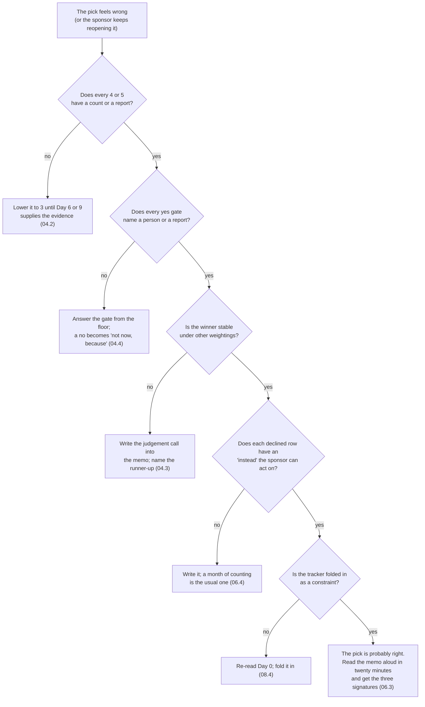

# 09 · Common Mistakes and Debugging

> Day 4 · Section 9 of 12 · [Chapter overview](README.md) · Previous: [08 · Project: the problem selection memo](08-project-problem-selection-memo.md) · Next: [10 · Interview questions](10-interview-questions.md)

---

Each row is **symptom, cause, fix**, with the section that explains it. The first table is the room
and the interview; the second is the engagement weeks later; the third is the sheet and the script.

## 9.1 In the room, and in the interview

| Symptom | Likely cause | Fix |
|---|---|---|
| You said "yes, the platform can do all seven" | answering the capability question instead of the selection question | "it can touch all seven; which one is worth the first twelve weeks is the question, and I would like a week and some counts to answer it" (01.1) |
| Your top candidate is the one with the best demo | the demo trap; frequency never counted | the frequency anchor: how many times a month, to how many people; 120 deeds against 1,400 files (05.1) |
| Your top candidate is named after a product category | the chatbot trap; a solution scored as a problem | rename it as a cost ("branch staff phone Hyderabad and wait") and score that; it fails the baseline gate (05.2) |
| The sponsor's second-call idea is in your top three | the pet project; sponsorship scored on the sponsor alone | the sponsorship anchor needs an operator and product fit; check who the operators report to (05.3) |
| You picked two "to hedge" | fear of being wrong about one | one for the twelve weeks; the ranking keeps the second visible; say "second" to the COO, not "also" (01.4, 06.4) |
| The interviewer asks "how would you choose?" and you listed what the model can do | the wrong first question | the three verbs (wait, re-key, rework), then the three words (frequent, painful, measurable), then the gates (03.1, 04.4) |
| You declined a candidate and the sponsor stopped talking | "no" without "because" and "instead" | not now, because <gate or column>, and instead <what makes it scoreable next cycle>; said in ranking order (06.4) |
| Your problem statement contains "using AI" or a target date | the solution or the promise written before the baseline | the four parts: unit, cost as the customer's number, cause as the floor sees it, no solution (06.1, 06.2) |

## 9.2 On the engagement

| Symptom | Likely cause | Fix |
|---|---|---|
| Week 2: the data request is with a third party and nobody can say when it returns | the data-owner gate skipped | a person inside the customer who can hand it over this month, or the candidate is "not now" (04.4, 07.3) |
| Week 3: the skeleton works and nobody can say what number it moved | the baseline gate skipped; measurability scored on "we will instrument it" | the baseline exists before building; Day 9's hand count starts from it (04.4, 05.4) |
| Week 6: pilot users are polite and do not log in on day two | the operator gate skipped; the sponsor's problem, not theirs | the operator who asked, by name, in the memo; Day 5's champion; Day 33's adoption (04.4, 07.3) |
| Week 8: the compliance head sees the system for the first time and stops it | blast radius under-scored; the design condition (a human decision per file, signed rules) never written | blast radius as a condition in the memo; Day 11's deterministic rules; Day 18's review queue (04.2, 05.5) |
| Week 10: the sponsor asks for the chatbot again | the "not now" lines never written down | the memo's section 6, pointed to; the branch's call count, if it was started (06.4) |
| Month 4: the analysts keep the tracker open beside the new system | the tracker treated as a separate project, or dropped | folded into intake as a constraint: read it before replacing it, write status back (08.4) |
| Month 4: usage falls to zero after the FDE leaves | a curiosity problem picked over a value problem | pick for sustained value: the operators' hours, not the sponsor's demo (02.1) |
| The ranking flipped between Day 4 and Day 9 | Day 4's hours were estimates and the hand count disagreed | version the memo; tell the COO which number moved and why the pick stands or changes (07.4) |

## 9.3 The sheet and the script

| Symptom | Likely cause | Fix |
|---|---|---|
| `C7: 'blast_radius' must be 1 to 5, got 6` | a typo, or "high" where a number should be | integers 1 to 5; 5 is the worst blast radius; the script inverts it |
| `C5: 'has_baseline' must be yes or no, got 'probably'` | hedging in a gate | "probably" is no; write what would make it yes in the note |
| `no candidate rows; fill the catalogue first` | the template CSV was run | fill at least one row with a code and a name |
| `pain 4 but ... below the median` | the pain is not in hours (waiting, errors, duplicated state), or the score is too high | say what the pain is in the memo, or lower the score; never change the hours to silence the warning |
| `measurability 4 or more but no baseline` | the baseline gate answered honestly and the score answered hopefully | one of them is wrong; usually the score |
| `data 4 or more but no data owner` | you saw the data in a demo, not on the customer's share | the data anchor's 5 is "on a share you have been shown, with an owner who said yes" |
| `the winner changes under N weighting(s)` | two candidates are close and the weights decide | say so in the memo; name the weighting under which the second wins; pick anyway, with the reason |
| Every candidate passes every gate | gates answered from the sponsor's description | each yes needs a person or a report in the note; re-answer from the floor |
| The tracker ranks first | you scored the operator gate yes because "they use it every day" | using a tool is not asking for it to be replaced; the gate asks whether an operator wants this change |

## 9.4 A routine for a pick that feels wrong

## 9.5 Key takeaways

- In the room, the mistakes are answering the capability question, scoring the demo or the sponsor,
  hedging with two, and declining without a reason and an alternative.
- On the engagement, each skipped gate has a week in which it fails: week 2 (owner), week 3
  (baseline), week 6 (operator), week 8 (blast radius), month 4 (the tracker, or curiosity).
- The script catches the mechanical mistakes (ranges, hedged gates, scores that disagree with the
  evidence); the human checks are sources per score and names per gate.
