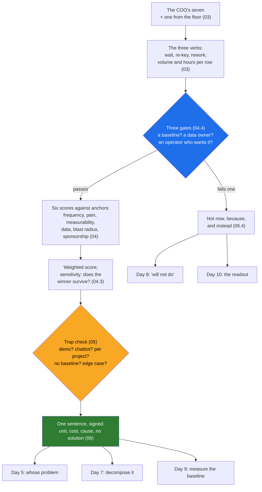

# Day 4 · Picking the Right Problem: Frequent, Painful, Measurable, and Worth It

> **[Part 2 · Discovery and Decomposition](../README.md)** · Chapter 1 of 7 · Video ~11 min · Chapter tier: medium
> Builds on: [Day 2 (the three buckets; bucket 3 and the two-week calendar)](../../01-the-role/02-the-three-buckets/README.md) ·
> [Day 3 (the economics; "is this FDE-shaped?"; the branch CRM declined)](../../01-the-role/03-the-economics/README.md) ·
> [Day 0 (the engineer in the room; the tracker, the batch, Lakshmi)](../../00-start-here/00-the-engineer-in-the-room/README.md)
> Sets up: Day 5 (who owns the chosen problem; the sponsor's version against the operators'), Day 6
> (the operators of the chosen problem are the ones interviewed), Day 7 (the five steps start from the
> signed sentence; the chatbot trap is the "LLM with RAG" anti-pattern from the customer's side), Day 8
> (three "not now" lines become the "will not do" list), Day 9 (the baseline this chapter insists on
> becomes the business case), Day 10 (page one of the discovery document; the chatbot sentence in the
> readout), Day 33 (curiosity and value, in adoption), Day 42 (the capstone repeats this step on a
> hospital)
> **Owner:** this chapter owns **choosing the one problem an engagement attacks: Atlassian's filter
> (frequent, painful, measurable, then work backwards to the AI) and OpenAI's (worth tens of millions,
> at the core of the business, FDE-shaped with a path to recurring revenue), scaled to a small vendor;
> starting from the workflow (wait, re-key, rework) rather than the model; the candidate catalogue with
> evidence; the scoring sheet (frequency, pain in hours and rupees, measurability, data availability,
> blast radius, sponsorship) with anchors, weights and a sensitivity check; the three gates (a baseline,
> a data owner, an operator who wants it); the five traps (the demo, the chatbot, the sponsor's pet
> project, no baseline, the edge case); the one-sentence problem statement both sides sign; "not now,
> because, and instead" on Day 4; and the problem selection memo.** The stakeholder roles are Day 5's;
> the real workflow map is Day 6's; the decomposition method is Day 7's; the dated plan and the full
> "will not do" list are Day 8's; measuring the baseline and the business case are Day 9's; the
> discovery document and the readout are Day 10's; adoption is Day 33's.
> Versions used: the script was run on **Python 3.14.3** (standard library only, no packages; as of
> October 2026). Shown output is from a real run. Every number about Godavari is invented; the
> planning rate per analyst hour is a placeholder until Day 9.

---

## Why this chapter exists

The COO of Godavari Finance says "nine days to three" and then keeps going: he has a list of seven
places the model could help, from KYC checks to a branch chatbot to collections call summaries. The
platform can plausibly touch all seven. The engineer who says "yes, all of them" has twelve weeks,
one pair of hands, and has just started the services trap from Day 3. The engineer who picks the
demo the board liked has started the other failure Part 2 exists to prevent: a prototype built for
the sponsor's version of the problem that the operators never use. Customer-facing discovery, which
this chapter opens, appears in 70 percent or more of the 1,000 FDE postings analysed in 2026 and is
the fastest-rising of the three buckets; the teams that invented the role publish the same rule in
different words (Atlassian: frequent, painful, measurable; OpenAI: worth tens of millions, at the
core, FDE-shaped); and the first week decides whether the next twelve produce a product feature or
a demo nobody runs on a Tuesday.

This chapter teaches the choice as a method: the two published filters and why they are not the
same filter; starting from the workflow (where people wait, re-key and rework) instead of from
what the model can do; a catalogue of eight candidates with evidence, seven from the room and one
from the floor; a scoring sheet with written anchors, weights and a sensitivity check; three gates
that decline a problem before it is scored; the five traps with a tell, a losing column and a
sentence each; the one-sentence problem statement the COO and the team leads both sign; and how to
decline six candidates on a Friday without losing the sponsor. Then you do the week's real work:
score Godavari's catalogue, run the script, and write the problem selection memo that is the first
page of the engagement folder.

## Mental model

One sentence to carry out of the chapter: **pick the problem that happens every day, costs hours the
customer already counts, has an owner for its data and an operator who asked, and that your
product can absorb; write it as one sentence with no solution in it; and give every other candidate
a reason and a next step.**

## Learning goals

After this chapter you can:

1. State Atlassian's and OpenAI's selection filters in their published words, explain why they are
   different filters (the problem's worth; the vendor's fit), and scale "tens of millions" to a
   40-person vendor.
2. Walk a floor looking for the three verbs (wait, re-key, rework) and turn a sponsor's list into a
   catalogue with volume, hours, owner and what the floor said, including a row the room did not
   mention.
3. Score candidates on six criteria against written anchors, explain why pain is weighted heaviest
   and blast radius is inverted and weighted lightest, and defend the ranking with a sensitivity
   check.
4. Apply the three gates (a baseline, a data owner, an operator who wants it) and turn each failed
   gate into a "not now, because, and instead" sentence.
5. Name the five traps (the demo, the chatbot, the sponsor's pet project, no baseline, the edge
   case), their tells, the column each loses on, and the sentence for declining each.
6. Write the one-sentence problem statement with its four parts and no solution word, say what is
   deliberately left out of it, and get it signed by the sponsor and the operators' leads.
7. Explain why the Excel tracker scores second and is neither picked nor dropped, and what "folded
   in as a constraint" means for Days 7 and 8.
8. Decline six candidates to a sponsor in ranking order, with a number, a reason and an alternative
   each, and rehearse the chatbot conversation that Day 10 repeats in the readout.
9. Build the catalogue as a CSV, run the chapter's script, answer its consistency warnings in words,
   and write the problem selection memo from the template.
10. Use an AI agent as the sceptical reviewer and the pushing sponsor, and catch its characteristic
    failures: scoring the sponsor's enthusiasm as evidence, inventing the baseline, putting the
    solution in the problem statement, and treating a vendor-held data source as available.

**Prerequisites:** Days 0 to 3. Python at a reading level for one small script; no libraries.

## Reading order

| # | Section | What you get | Words |
|---|---|---|---|
| 01 | [Why picking the problem](01-why-picking-the-problem.md) | Monday's list of seven; the two ways to spend a minute; the career reason; the exam-prep analogy; where the chapter sits; the three hard parts | ~1,100 |
| 02 | [The two filters](02-the-two-filters.md) | Atlassian's frequent, painful, measurable and work backwards; curiosity and value; OpenAI's tens of millions, core not edge, FDE-shaped; why they are different filters; scaled to Kaagaz | ~1,150 |
| 03 | [Start from the workflow](03-start-from-the-workflow.md) | The wrong first question; wait, re-key, rework; the eight-row catalogue with evidence; where the nine days go | ~1,300 |
| 04 | [The scoring sheet](04-the-scoring-sheet.md) | Six criteria with anchors; the weights and the sensitivity check; the three gates; pain in hours and rupees with its cautions; the sheet on Godavari | ~2,050 |
| 05 | [The traps](05-the-traps.md) | The demo, the chatbot, the sponsor's pet project, no baseline, the edge case: tell, losing column, sentence; the one that is not a trap | ~1,300 |
| 06 | [The problem statement and declining](06-the-problem-statement-and-declining.md) | The four parts; what is left out; who signs; "not now, because, and instead" for seven rows in ranking order; the conversation rehearsed | ~1,400 |
| 07 | [2026 patterns and production concerns](07-2026-patterns-and-production-concerns.md) | What practitioners do; five hype claims corrected; how a bad pick fails week by week; the sheet as a living document; cost, latency, scale and security at selection time | ~1,300 |
| 08 | [Project: the problem selection memo](08-project-problem-selection-memo.md) | The catalogue as data; the script with real output; the memo; Build it with AI; How do you know it's right | ~3,400 (incl. output) |
| 09 | [Mistakes and debugging](09-mistakes-and-debugging.md) | Symptom, cause, fix for the room, the engagement, and the sheet and script; a routine for a pick that feels wrong | ~1,300 |
| 10 | [Interview questions](10-interview-questions.md) | 12 questions with model answers, plus a quick-fire round | ~1,500 |
| 11 | [Exercises](11-exercises.md) | 10 graded exercises: problem or solution, which column loses, score it yourself, predict-the-output and break-it on the script, the sensitivity line forced, the conversation out loud, "review this AI-written memo", your own catalogue | ~2,250 |
| 12 | [Further reading](12-further-reading.md) | The two playbooks and the panel the filters come from, the discovery playbooks behind the gates, the RBI and DPDP texts behind two candidates | ~700 |

**Short on time?** Read 02, 04 and 05, then do the project (08) and exercise 3.1. That is the video
plus the two things the hiring-manager screen and the client simulation test. Add 06 before any
conversation with a sponsor and 03 before any floor walk.

## Files

| Path | What |
|---|---|
| [`data/godavari-candidates.csv`](data/godavari-candidates.csv) | the catalogue: eight candidates with evidence, six scores, three gates and a note each |
| [`code/score_candidates.py`](code/score_candidates.py) | applies the gates, scores, checks the scores against the evidence, tests the winner under twelve other weightings, prints the ranking and writes `data/godavari-candidates-ranking.md` |
| `data/godavari-candidates-ranking.md` | the ranking as a Markdown table, regenerated by the script |
| [`worksheet/problem-selection-memo-template.md`](worksheet/problem-selection-memo-template.md) | the empty memo: the sentence, the catalogue, the gates, the scores, why the winner, "not now", the trap check, what the memo is not |
| [`worksheet/godavari-problem-selection-memo.md`](worksheet/godavari-problem-selection-memo.md) | the filled Godavari memo: the first page of the engagement folder |
| [`worksheet/ai-draft-problem-selection-memo.md`](worksheet/ai-draft-problem-selection-memo.md) | an agent's draft with at least nine problems; exercise 3.1 |

Run from the chapter folder: `python code/score_candidates.py data/godavari-candidates.csv` (about a
quarter of a second). No packages, no downloads, no API keys.

## What this chapter does *not* teach (single-owner rule)

| Topic | Where it's taught |
|---|---|
| The four stakeholder roles, power and interest, the champion, the customer's calendar | [Day 5](../05-the-stakeholder-map/README.md) (the sponsorship column and the operator gate preview it) |
| Shadowing, the interview plan, the real nineteen-step workflow | [Day 6](../06-discovery-interviews/README.md) (the floor walk here is one day of counting, not the map) |
| The five-step decomposition method and the walking skeleton | [Day 7](../07-decomposition/README.md) (step 1 starts from this chapter's sentence) |
| The dated 90-day plan and the full "will not do" list | [Day 8](../08-scoping-the-first-90-days/README.md) (three of this chapter's "not now" lines go there) |
| Measuring the baseline, the loaded rate, hours into rupees, the business case | [Day 9](../09-success-metrics-and-business-case/README.md) (this chapter's rate is a placeholder) |
| Writing and defending the discovery document; the readout; saying no in full | [Day 10](../10-the-discovery-document/README.md) (the chatbot sentence is written here, said there) |
| Why the role's economics make services work the wrong answer; the second-customer test | [Day 3](../../01-the-role/03-the-economics/README.md) (applied here as the sponsorship column) |
| Which work is deterministic code and which is the model | Day 11 (this chapter only says the completeness rules will be signed code) |
| Adoption: curiosity, value and the operator who will not switch | [Day 33](../../05-working-with-the-customer/33-adoption/README.md) (quoted here once, at selection time) |

## Analogies for the Telugu audience

- **Exam preparation** (the chapter's main picture): with a week to go, you do not revise the chapter
  you enjoy; you revise the chapter with the most marks that you keep failing in the mocks. Marks are
  frequency and pain; the mock score is the baseline; the chapter you enjoy is the demo the board
  liked (01.2).
- **The family doctor** (Day 0's picture, reused): the specialist treats whatever the patient brings;
  the family doctor asks what the household actually struggles with every day before prescribing
  (03.1).
- **The wedding caterer's menu** (Day 3's picture, extended): the family brings a list of twelve
  dishes they saw at another wedding; the caterer asks how many guests, which dishes everyone eats
  and which one the grandmother will send back, and cooks that one first (06.4).

## Video map

The video (~11 min) covers a slice; the notes cover everything.

| Asset | Covers | Sections |
|---|---|---|
| **Day 4 main video** (~11 min) | Hook: the COO's list of seven, and the two ways to spend the next minute (1 min) → why it matters: the prototype nobody runs; discovery as the fastest-rising bucket (1 min) → Atlassian's filter and OpenAI's, and why they are two filters; the exam-prep analogy (1.5 min) → start from the workflow: wait, re-key, rework; the eighth row from the floor (1.5 min) → the sheet: six criteria, the three gates, pain in hours and rupees (2 min) → the traps in one table: demo, chatbot, pet project, no baseline, edge case (1.5 min) → Godavari: intake at 93, stable under every weighting; the tracker at 80, folded in (1 min) → the sentence, signed, and "not now, because, and instead" to the COO (1 min) → recap and the Day 5 teaser: whose problem is it? (0.5 min) | 01.1 to 01.2, 02.1 to 02.3, 03.1 to 03.2, 04.2, 04.4 to 04.5, 05.6, 06.1, 06.4, 08.3 |
| **Short 1:** "The customer brought seven problems. Here is how you pick one." | The three verbs; the three gates; the three words; one sentence signed; the ranking table on screen | 03.1, 04.4, 02.1, 06.1 |
| **Short 2:** "A chatbot over your documents is not a problem. It is a solution looking for one." | The chatbot trap: named after a product category; no count, no owner, no branch asked; "not now, because there is no baseline; count for a month" | 05.2, 06.4 |
| Notes only | The filters scaled to Kaagaz (02.4), where the nine days go (03.3), the anchors and weights in full (04.2 to 04.3), the sheet on Godavari row by row (04.6), each trap's sentence (05.1 to 05.5), what is left out of the sentence and who signs (06.2 to 06.3), the conversation rehearsed (06.5), 2026 patterns, hype, the week-by-week failures and the living sheet (07), the project, Build it with AI and How do you know it's right (08), debugging (09), interviews (10), exercises (11) | as listed |

**Callbacks to use on screen:** "Day 0 lo Lakshmi screen meeda Excel tracker chusam; ivala adi
candidate list lo eighth row." (section 03); "Day 3 lo branch CRM ni already decline chesam; ivala aa
same second-customer test sponsorship column lo vastundi." (section 04).
**Forward callbacks:** Day 5 (ee problem evaridi? sponsor version, operators version), Day 7 (ee one
sentence nunchi five steps start avutayi), Day 10 (ee chatbot sentence readout lo COO ki cheptam).

## Callbacks

- **Builds on:** [Day 0](../../00-start-here/00-the-engineer-in-the-room/README.md) (the first week
  on the floor; the tracker, the 6 pm batch, fourteen documents, Lakshmi), [Day 2](../../01-the-role/02-the-three-buckets/README.md)
  (bucket 3 as the fastest-rising skill; the two-week calendar whose first week this is; Srinivas),
  [Day 3](../../01-the-role/03-the-economics/README.md) ("is this FDE-shaped?"; the second-customer
  test; the branch CRM declined; the services trap a yes to all seven becomes).
- **Sets up:** [Day 5](../05-the-stakeholder-map/README.md) (who owns the chosen problem; the two
  versions of it), [Day 6](../06-discovery-interviews/README.md) (the operators of intake are the
  ones shadowed), [Day 7](../07-decomposition/README.md) (step 1 starts from the sentence; the
  tracker as a step-3 row), [Day 8](../08-scoping-the-first-90-days/README.md) (the "will not do"
  list), [Day 9](../09-success-metrics-and-business-case/README.md) (the baseline and the real rate),
  [Day 10](../10-the-discovery-document/README.md) (page one; the chatbot in the readout), Day 20
  (the second candidate gets its first evidence), [Day 33](../../05-working-with-the-customer/33-adoption/README.md)
  (curiosity and value), Day 42 (the sheet on a hospital).

**Next chapter:** [Day 5 · The stakeholder map: sponsor, operators, blockers, and whose version of the problem is true](../05-the-stakeholder-map/README.md).
