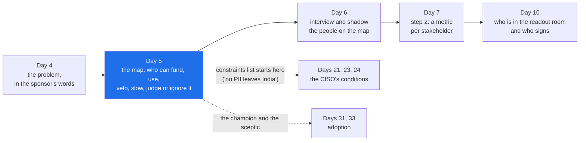

# 01 · Why the Map: Engagements Are Lost to People Who Were Not in the First Meeting

> Day 5 · Section 1 of 12 · [Chapter overview](README.md) · Next: [02 · The roles](02-the-roles.md)

---

## 1.1 Two sentences, one problem

On Day 4 you sat in the glass room on the fourth floor of Godavari Finance and the COO said: "The
analysts are slow. Nine days has to become three." You scored his seven candidate problems and
loan-file intake won. The problem statement he signed reads: "New loan files take a median of nine
days from receipt to decision because intake is manual and a third of files are incomplete."

Two days later you are in Vijayawada beside Lakshmi, who has processed loan files for eleven years.
She says: "We wait three days for the branch to resend a missing document. Then the core system runs
the credit check as a batch at 6 pm, so whatever arrives after lunch is tomorrow's work."

Both sentences are true. The COO sees forty people and a nine-day number; from his seat, the people
are where the days go. Lakshmi sees a queue of files that cannot move; from her seat, the days go to
waiting, and she is the one blamed for them. An engineer who builds for the COO's sentence makes the
analysts faster at a job that is mostly waiting, and ships a tool that saves twenty minutes a file
while the three-day wait for the branch stays exactly where it was. An engineer who builds only for
Lakshmi's sentence fixes the queue and cannot explain to the COO why the number he signed for has
not moved by day 90.

The stakeholder map is the week-0 artefact that holds both sentences, and every other sentence that
can decide whether the engagement lives: the CISO's "where does the PDF go", the compliance head's
"no customer PII leaves India", the core-system owner's "three vendors have broken this before", and
the RBI auditor's question that nobody in the building will say out loud until audit month: "show me
the decision, who made it, and the documents it rested on."

## 1.2 Why it matters for your career

Three reasons, all from the research behind this course (CURRICULUM.md and the Part 2 plan; sources
in section 12):

- **Engagements are lost to people who were not in the first meeting.** The FDE discovery playbooks
  published in 2026 put the stakeholder map in week 0, before any interview, and name the people a
  sponsor never introduces: the admin who owns data access and SSO, the senior individual contributor
  whose judgement decides whether an output is "good", and the sceptic who expects the project to
  fail. One of them calls the hour with the sceptic "the highest-leverage hour of Week 0".
- **The interview loop scores it.** Day 7's decomposition round has a step called "identify the
  stakeholders and the success metric each would accept", and the published guides say that
  surfacing a missing stakeholder, unprompted, is one of the moments an interviewer's notes change
  from "fine" to "strong". The client-simulation round (Day 34) puts you in front of a frustrated
  CTO or a refusing security team; you cannot handle a person you did not know existed.
- **Customer-facing discovery is in 70 percent or more of the 1,000 FDE postings analysed in 2026
  and rising fastest** (Day 2). The map is the first concrete thing that bucket produces, and the
  thing a hiring manager asks to see when you say "I ran discovery".

> **Analogy (Telugu audience).** A wedding. The father pays and wants it done on the date, within
> the budget, with the relatives impressed: the sponsor. The couple lives with every decision made
> for the next forty years: the operators. The priest will not move the muhurtham whatever the
> caterer says: the blocker. And the village elder nobody invited to the planning meetings can still
> stop the function with one remark in the mandapam: the ghost stakeholder. A wedding planner who
> only talks to the father has a very good budget sheet and a very bad wedding.

## 1.3 What the map is, in plain words

The stakeholder map is a table, drawn in week 0 and kept alive to handoff, with one row for every
person or group who can **fund, use, veto, slow, judge or quietly ignore** the system. For each row
it records who they are, which role they play, their version of the problem in their own words, what
they want, how much power they have over the work and how much interest in it, how they could stop
it, whether their own behaviour has to change, and what you will do with them and when.

Nothing in it is a technology. Like Day 7's decomposition, it is a set of questions you must be able
to answer before an architecture can be justified, because every row changes something: the
auditor's row puts a human decision in every file, the CISO's row decides where the first prototype
may run, the branch managers' row adds a workstream nobody in the first meeting mentioned.

## 1.4 Where this sits in the course

| Day | What it gave you | How Day 5 uses it |
|---|---|---|
| [Day 0](../../00-start-here/00-the-engineer-in-the-room/README.md) | the first week: the COO's sentence, the CISO's three questions, Lakshmi's tracker | the first rows of the map, in the words each person used |
| [Day 2](../../01-the-role/02-the-three-buckets/README.md) | the two-week calendar: twelve different people in two weeks | the map is the list behind that calendar, drawn before it |
| [Day 3](../../01-the-role/03-the-economics/README.md) | Kaagaz's own interest: FDE-shaped, a second customer, the first "will not build" line | your own side is on the map too |
| [Day 4](../04-picking-the-problem/README.md) | the problem statement both the sponsor and the operators sign | the map explains why that sentence needed two signatures |

And what it sets up: [Day 6](../06-discovery-interviews/README.md) interviews and shadows the
people on the map (this chapter gives you the three persona scripts for the first conversation; Day
6 owns shadowing and the full question bank). [Day 7](../07-decomposition/README.md) step 2 takes
the map and adds the metric each stakeholder would accept and the fear each carries. [Day 10](../10-the-discovery-document/README.md)
decides who is in the readout room from it. Days 21 and 23 pick up the CISO's conditions; Day 33
picks up the operator who will not switch. **This chapter owns the roles and the map.** Every later
chapter applies it and links back here.

## 1.5 The hard parts, named up front

1. **The sponsor introduces you to the people the sponsor thinks matter.** The COO's list is the
   team leads and "IT". The compliance head, the core-system owner and the auditor are not on it,
   and the sponsor is not hiding them; from his seat they are not part of the problem. Finding them
   is your job, and section 05 is how you do it without an org chart.
2. **Both versions being true feels like a contradiction to resolve.** It is not. Section 03 shows
   how to hold both and find the lever that moves both numbers.
3. **Meeting blockers early feels like inviting trouble.** The instinct is to show the CISO something
   working before she can object. The published pattern is the opposite: the blocker met in week one
   writes conditions; the blocker met in week ten writes a refusal. Section 05.3 gives the words.
4. **Operators have almost no power on paper and all of it in practice.** Forty analysts cannot
   veto anything in a meeting. They can keep the Excel tracker open beside your tool and the
   engagement is over without a single email. The grid in section 04 is built to make that visible.

By the end of the chapter you will have the Godavari map as a table and a diagram, three interview
scripts you can run on Monday, a script that reads the map and shows you the grid and the conflicts,
and the habit of asking, in every room, "who is not here who can stop this?"
