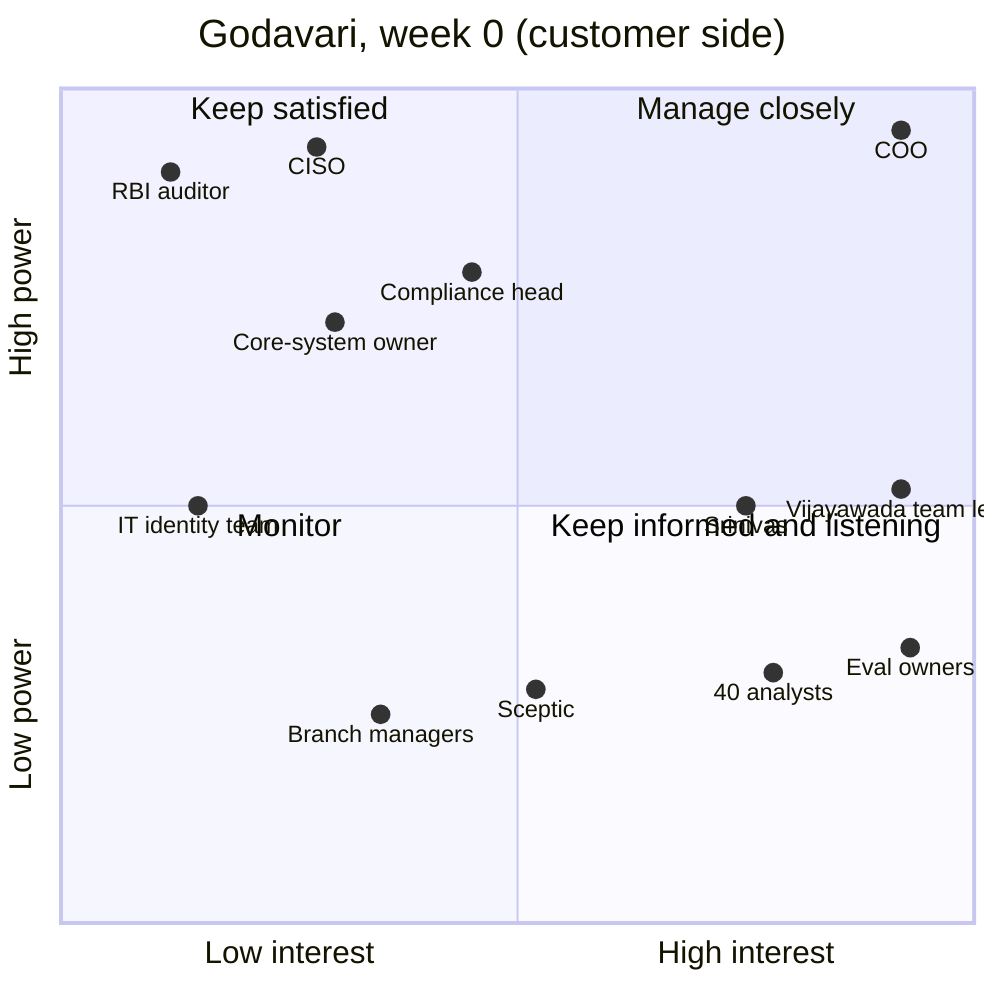

# 04 · Power and Interest: Who Signs, Who Can Veto, Who Will Actually Open the Tool

> Day 5 · Section 4 of 12 · [Chapter overview](README.md) · Previous: [03 · Whose version is true](03-whose-version-is-true.md) · Next: [05 · Reading the org](05-reading-the-org.md)

---

## 4.1 The grid

The oldest tool for this is the power-interest grid, usually credited to Aubrey Mendelow (1991) and
since adopted by most project-management bodies. Two axes: **power** (how much this person can
change the outcome of the work) and **interest** (how much they care about it, day to day). Score
each on 1 to 5; 4 and above is "high". Four quadrants, each with a default way of working with the
people in it.

| Quadrant | Who at Godavari | Default | What that means in an FDE week |
|---|---|---|---|
| High power, high interest: **manage closely** | the COO | in the room for every decision | the weekly readout (Day 29); signs the problem statement, the 90-day plan and the "will not do" list; hears bad news from you before anyone else (Day 30) |
| High power, low interest: **keep satisfied** | the CISO, the compliance head, the core-system owner, the RBI auditor (through his proxy) | meet early, get conditions in writing, never surprise | the CISO in week 1 and the questionnaire in week 2; the compliance head's first sentence into the constraints list; the core-system owner's batch window and sandbox as plan inputs |
| Low power, high interest: **keep informed and listening** | both team leads, the forty analysts, the eval owners | shadow, interview, show the first slice | Day 6's 8 to 10 interviews; the week-3 skeleton demonstrated to the analysts who chose the ten files; the pilot workshop (Day 31) |
| Low power, low interest: **monitor** | the IT identity team, the sceptic, the branch managers | one named contact, told when their part changes | the access ticket in week 2; one hour with the sceptic; a call with the Kukatpally branch manager before the pilot |

The grid is a starting position, not a verdict. Two things it gets wrong for an FDE are the reason
the next two subsections exist.

## 4.2 What the grid hides: the operators' power

On paper, forty analysts score 2 on power. They cannot veto, fund, or sign. In practice they hold
the only power that matters after go-live: **whether the tool is used.** If the Excel tracker stays
open beside the review queue, the engagement has failed with no meeting, no email and no decision
anyone can point to. The CISO's veto is loud and reversible with a conversation; the operators' veto
is silent and reversible only with months of enablement.

The same is true, in a smaller way, of the branch managers. They score 2 and 2 and can still
decide, by what they put in the file, whether 31 percent send-backs becomes 10 or stays at 31.

So the map carries two columns the classic grid does not have:

| Column | The question | Godavari examples |
|---|---|---|
| **Stops it by** | if this person wanted the work to fail, what would they do? | COO: funding · CISO, compliance head: veto · core-system owner, IT identity: slowing · analysts, team leads: ignoring · branch managers: input quality · auditor: a finding |
| **Must change** | does this person's own behaviour have to change for the system to work? | yes: the analysts, both team leads, the eval owners, the branch managers, the core-system owner (a sandbox refresh he controls) · partly: the compliance head (she signs rules she used to apply by hand) · no: the COO, the CISO, the auditor |

Read the two columns together and a rule falls out: **the people who can stop the work and the
people who must change their behaviour are mostly different people, and the second group needs
more of your time than the first.** The sponsor and the blockers get meetings. The operators get
you, sitting beside them, for days.

## 4.3 Who signs, who vetoes, who opens the tool

Three different questions, three different lists, and an engagement needs all three answered by the
end of week 1:

| Question | Godavari answer | What goes wrong if you confuse them |
|---|---|---|
| **Who signs?** (the plan, the scope, the business case) | the COO, with the Kaagaz CEO on our side | treating a team lead's enthusiasm as a signature; the plan has no owner when it slips |
| **Who can veto?** (and on behalf of what) | the CISO (security), the compliance head (RBI, DPDP), the core-system owner (by slowing), the auditor (by a finding) | building for ten weeks and then asking; "the COO approved it" means nothing to a CISO |
| **Who opens the tool on a Tuesday?** | the forty analysts; the Kukatpally branch manager's staff for resubmissions | measuring success as a demo the COO loved; adoption discovered in month four |

A person can be on two lists (the compliance head vetoes and, for the completeness rules, also
changes how she works). Nobody at Godavari is on all three. If your map has one person on all three
lists, you are mapping a startup, not an enterprise, or you have not looked hard enough.

## 4.4 The number each would believe, and where they collide

Day 7's step 2 attaches a formal metric to every row and tests whether the walking skeleton can
measure it on ten files in week three. Day 5 does something smaller and earlier: for each row,
write **the one number that person would believe**, in their words, so that the conflicts show up
before anyone builds anything.

| Stakeholder | The number they would believe |
|---|---|
| COO | median turnaround days in the pilot branches |
| team leads | files per analyst per day |
| analysts | hours per file; how often they chase a branch |
| eval owners | field accuracy on the files they labelled themselves |
| sceptic | handwritten income proofs flagged for review, not guessed |
| CISO | a passed review; a VPC in AWS Mumbai; nothing leaving India |
| compliance head | zero completeness misses; accuracy on KYC fields |
| core-system owner | zero duplicate records; every call inside the batch window |
| branch managers | files accepted first time |
| auditor | an audit trail per file with a human decision |

Now the collisions, which are the most useful output of the whole map, because each one is a
decision that will have to be made and the map says by whom:

| Collision | Where it bites | Who decides | When |
|---|---|---|---|
| COO (turnaround) against auditor (a human decision per file) | the fastest version of the COO's number auto-approves clean files, which removes the auditor's condition | the compliance head, for the auditor; the COO cannot overrule | the Day 10 readout; the skeleton obeys the auditor meanwhile |
| COO (three days) against compliance head (zero skipped documents) | speed against error rate: the trade-off at the centre of the engagement | the compliance head sets the acceptable rate; the COO's number is measured inside it | Day 7 step 1, Day 9 targets |
| analysts (hours per file) against COO (turnaround) | a review step on every file cuts turnaround and can add hours | the COO with the team leads | Day 9 targets, Day 33 adoption |
| core-system owner (batch window) against COO (same-day sanction) | the 6 pm batch bounds how fast anything moves | the core-system owner; it is a constraint, not a preference | Day 7 step 1, Day 16 |
| CISO (no PII near a vendor until the review passes) against COO (a prototype in weeks) | the skeleton needs real scans; the review takes eight weeks | the CISO; masked files on-prem in the meantime | Days 21 and 23 |
| branch managers (sent back only with a reason) against analysts (complete files first time) | each side believes the other causes the 31 percent | the compliance head signs the rule that fires on day one; the blame becomes a rule | Day 11 |

The pattern Day 7 states formally is already visible: **when a sponsor's want collides with a
blocker's or a ghost's condition, the condition wins and the collision goes on the readout agenda.**
Four of the six collisions above have the COO on one side. That is normal; the sponsor's number is
the one everyone else constrains, and a map that shows no collisions with the sponsor has not
interviewed anyone but the sponsor.

## 4.5 Key takeaways

- Score power and interest 1 to 5; the four quadrants give a default: manage closely, keep
  satisfied, keep informed and listening, monitor.
- The grid hides the operators' real power: ignoring the tool. Add "stops it by" and "must change".
- Who signs, who can veto and who opens the tool are three different lists; nobody should be on all
  three.
- Write the number each person would believe, then the collisions, each with a decider and a date.
  Day 7 formalises the metrics; Day 10 decides the collisions.
