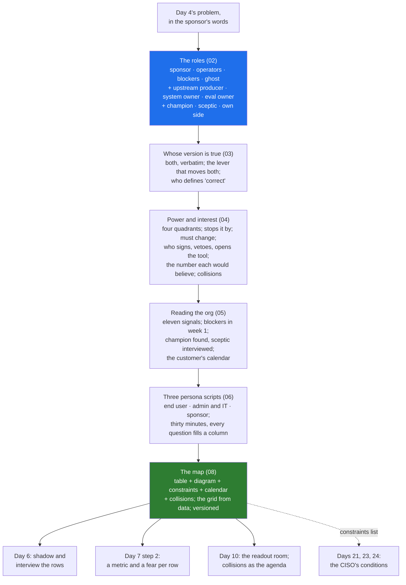

# Day 5 · The Stakeholder Map: Sponsor, Operators, Blockers, and Whose Version of the Problem Is True

> **[Part 2 · Discovery and Decomposition](../README.md)** · Chapter 2 of 7 · Video ~11 min · Chapter tier: medium
> Builds on: [Day 4 (picking the right problem)](../04-picking-the-problem/README.md) ·
> [Day 0 (the engineer in the room)](../../00-start-here/00-the-engineer-in-the-room/README.md) ·
> [Day 2 (the three buckets; twelve people in two weeks)](../../01-the-role/02-the-three-buckets/README.md) ·
> [Day 3 (the economics; your own side's interest)](../../01-the-role/03-the-economics/README.md)
> Sets up: Day 6 (interviewing and shadowing each group on the map), Day 7 (step 2 attaches a metric
> and a fear to every row), Day 10 (who is in the readout room and who signs), Day 21 and Day 23 (the
> CISO's conditions, recorded here in week 1), Day 33 (the operator who will not switch), Day 42 (the
> same map for a hospital)
> **Owner:** this chapter owns **the stakeholder roles and the map for the course: sponsor, operators,
> blockers and ghost stakeholders, plus the upstream producer, the system owner, the eval owner, the
> champion and the sceptic; why the sponsor's version and the operators' version are both true and
> how to hold both; the eval-customer split (whose judgement defines "correct"); the power-interest
> grid with the two columns it lacks ("stops it by" and "must change"); who signs, who can veto and who
> opens the tool; the number each stakeholder would believe and the collisions between them; reading
> an org without an org chart; blockers as early partners; the champion and the sceptic; the customer's
> calendar; the three persona scripts for the mapping conversation; and the map as a versioned
> artefact.** Picking the problem is Day 4's; shadowing, the interview plan and the full question bank
> are Day 6's; the metric column, the fear column and the measurability test are Day 7's; the dated
> plan is Day 8's; the business case is Day 9's; the readout and saying no are Day 10's; the security
> review is Day 23's; adoption is Day 33's.
> Versions used: the script was run on **Python 3.14.3** (standard library only, no packages; as of
> October 2026). Shown output is from a real run. Every person, date and number at Godavari is invented.

---

## Why this chapter exists

The COO of Godavari Finance says "the analysts are slow". Lakshmi, eleven years a credit-ops analyst
in Vijayawada, says "we wait three days for the branch to resend a document, then the core system
runs the batch overnight". Both are true from where each sits, and an engineer who builds for only
one of them ships a tool that either never reaches the COO's number or never gets opened on a
Tuesday. Around those two sentences stand a CISO who said no, no and not yet; a compliance head whose
first sentence is "no customer PII leaves India"; one engineer who runs the 2009 core system and has
watched three vendors fail on it; 300 branch managers who send a third of the files incomplete; and
an RBI auditor who is never in any room and decides what is acceptable. Engagements are lost to the
people who were not in the first meeting. The 2026 FDE discovery playbooks put the stakeholder map in
week 0, before any interview; the decomposition round scores surfacing a missing stakeholder
unprompted; and customer-facing discovery, the bucket this map belongs to, is in 70 percent or more
of the 1,000 FDE postings analysed in 2026 and rising fastest.

This chapter teaches the map as an artefact: the four roles and the three everyone forgets; how to
record the sponsor's and the operators' versions verbatim and find the lever that moves both; who
defines "correct" and why it is never the buyer; the grid, and the two columns it hides (who can stop
the work and how, whose Tuesday changes); the number each person would believe and the six places
those numbers collide at Godavari, each with a decider; eleven signals for reading an organisation
without its chart; why the CISO met in week one writes conditions and the CISO met in week ten writes
a refusal; how a champion is found and why a sceptic is interviewed rather than converted; and the
customer's calendar. You leave with the Godavari map as a table and a diagram, three persona scripts
you can run on Monday, a script that reads the map as data and refuses to stay quiet about its gaps,
and the habit of asking, in every room, "who is not here who can stop this?"

## Mental model

One sentence to carry out of the chapter: **write down everyone who can fund, use, veto, slow, judge
or quietly ignore the system, in their own words, with how they could stop it and whether their day
changes; meet the vetoes in week one; and never let the buyer be the one who decides what "correct"
means.**

## Learning goals

After this chapter you can:

1. Define the four roles by what each can do to the work, name the three everyone forgets (upstream
   producer, system owner, eval owner) and the two that decide adoption (champion, sceptic), and
   put your own side on the map.
2. Record the sponsor's and the operators' versions of a problem verbatim, say what each would need
   to be true, find the lever that moves both numbers, and write the sentence both would sign.
3. Explain the eval-customer split and name, for a given problem, who judges correctness, who judges
   speed and who judges usability.
4. Score power and interest 1 to 5, place every row in a quadrant with its default, and add the two
   columns the grid hides: "stops it by" and "must change". Separate who signs, who can veto and who
   opens the tool.
5. Write the number each stakeholder would believe and list the collisions between them, each with a
   decider and a date; state the rule that a blocker's or ghost's condition beats a sponsor's want.
6. Read an organisation without its chart using the eleven signals; meet blockers in week one for
   conditions; find a champion by three tests; interview a sceptic for a failure model; put the
   customer's calendar on the map.
7. Run the three persona scripts (end user, admin and IT, executive sponsor) in thirty minutes each,
   knowing which column every question fills and what not to ask each persona.
8. Draw the Godavari map as a table and a Mermaid diagram, start the constraints list, keep the map
   versioned, and generate the grid, the veto table and the collisions from CSV with the chapter's
   script.
9. Use an AI agent to interrogate a map for missing rows while catching its characteristic failures:
   invented sponsors, operators lumped into "users", no ghost, one sentence for everyone, power scored
   from the org chart, blockers met at UAT, no collisions.

**Prerequisites:** Days 0 to 4. Python at a reading level for one small script; no libraries.

## Reading order

| # | Section | What you get | Words |
|---|---|---|---|
| 01 | [Why the map](01-why-the-map.md) | The COO's sentence and Lakshmi's; the career reason; the wedding; what the map is; where it sits; the four hard parts named | ~1,400 |
| 02 | [The roles](02-the-roles.md) | Four roles with a test each; the three everyone forgets; the champion and the sceptic; the Godavari cast; your own side | ~1,150 |
| 03 | [Whose version is true](03-whose-version-is-true.md) | Both true from where each sits; the four-step method for holding both; the eval-customer split; the ghost's version | ~1,100 |
| 04 | [Power and interest](04-power-and-interest.md) | The grid and its four defaults; the operators' hidden power; stops it by and must change; signs, vetoes, opens; the number each would believe; six collisions with deciders | ~1,500 |
| 05 | [Reading the org](05-reading-the-org.md) | Eleven signals; blockers as early partners; the champion's three tests and the sceptic's failure model; the customer's calendar | ~1,400 |
| 06 | [The three persona scripts](06-persona-scripts.md) | Why one script does not fit; end user, admin and IT, sponsor, minute by minute, with what not to ask; after the thirty minutes | ~1,400 |
| 07 | [2026 patterns and production concerns](07-2026-patterns-and-production-concerns.md) | The eval owner, the CISO as a model gate, the sceptic as test cases, adoption as a metric; five hype claims; keeping the map alive; what the map says about people | ~1,100 |
| 08 | [Project: the Godavari stakeholder map](08-project-godavari-stakeholder-map.md) | The brief; the map; the scripts; the grid from data with real output; the AI draft's nine warnings; Build it with AI; How do you know it's right | ~3,500 (incl. output) |
| 09 | [Mistakes and debugging](09-mistakes-and-debugging.md) | Symptom, cause, fix on the engagement, in the interview, and in the map and script; a routine for a map that feels wrong | ~1,050 |
| 10 | [Interview questions](10-interview-questions.md) | 12 questions with model answers, plus a quick-fire round | ~1,800 |
| 11 | [Exercises](11-exercises.md) | 10 graded exercises: which role, whose version, place them, two out-loud drills, predict-the-output and break-it on the script, the collisions you did not list, "review this AI-written map", your own map | ~1,900 |
| 12 | [Further reading](12-further-reading.md) | The discovery playbooks, the interview guides, the grid's origin, the RBI and DPDP texts behind the rows | ~650 |

**Short on time?** Read 02, 03 and 04, then do the project (08) and exercise 3.1. That is the video
plus the two things the interview and the engagement test. Add 05 before your first week on site and
06 before your first mapping conversation.

## Files

| Path | What |
|---|---|
| [`worksheet/stakeholder-map-template.md`](worksheet/stakeholder-map-template.md) | the empty map: eleven columns, the roles to check for, constraints, calendar, collisions, readout room, change log |
| [`worksheet/godavari-stakeholder-map.md`](worksheet/godavari-stakeholder-map.md) | the filled Godavari map, week-1 version: the table, the Mermaid diagram, the constraints list, the calendar, the readout room, the change log |
| [`worksheet/interview-script-end-user.md`](worksheet/interview-script-end-user.md) · [`interview-script-admin-it.md`](worksheet/interview-script-admin-it.md) · [`interview-script-executive-sponsor.md`](worksheet/interview-script-executive-sponsor.md) | the three persona scripts, thirty minutes each, every question tied to the column it fills |
| [`worksheet/ai-draft-stakeholder-map.md`](worksheet/ai-draft-stakeholder-map.md) · `worksheet/ai-draft-stakeholders.csv` | an agent's draft with at least ten problems; exercise 3.1 |
| [`data/godavari-stakeholders.csv`](data/godavari-stakeholders.csv) · [`data/godavari-conflicts.csv`](data/godavari-conflicts.csv) | the map and the collisions as data |
| [`code/stakeholder_grid.py`](code/stakeholder_grid.py) | reads both CSVs; prints the grid, who can stop it, whose Tuesday changes, the versions side by side, the checks and the collisions; writes `data/godavari-stakeholder-grid.md` |

Run from the chapter folder: `python -X utf8 code/stakeholder_grid.py` (under a second). No packages,
no downloads, no API keys. `-X utf8` keeps Windows consoles happy with the middle dot.

## What this chapter does *not* teach (single-owner rule)

| Topic | Where it's taught |
|---|---|
| Choosing the problem; the scoring sheet; the demo and chatbot traps; the problem statement | [Day 4](../04-picking-the-problem/README.md) |
| Shadowing, the 8 to 10 interview plan, the full question bank, the situational map | [Day 6](../06-discovery-interviews/README.md) (this chapter's scripts are the thirty-minute mapping conversation that decides whom to shadow) |
| The metric each stakeholder accepts as a formal column, the fear column, measurable from the first slice | [Day 7](../07-decomposition/README.md) step 2 (this chapter writes the number each would believe and the collisions) |
| The dated 90-day plan sequenced around the calendar; the "will not do" list | [Day 8](../08-scoping-the-first-90-days/README.md) |
| The baseline and the business case behind the sponsor's number | [Day 9](../09-success-metrics-and-business-case/README.md) |
| The readout, who presents, what is signed, saying no | [Day 10](../10-the-discovery-document/README.md) (this chapter lists who must be in the room) |
| The deployment model argued with the CISO; the security questionnaire | Day 21, Day 23 (this chapter records her conditions in week 1) |
| Data residency and DPDP in detail | Day 24 (this chapter records the sentence) |
| Demos that build trust; the sceptic who becomes a champion; adoption | Day 31, Day 33 |
| What never goes into an agent's context | Day 39 (this chapter says the customer's data is not the source of the map) |

## Analogies for the Telugu audience

- **The wedding** (the chapter's main picture): the father pays and wants it on the date (sponsor);
  the couple lives with every decision (operators); the priest will not move the muhurtham (blocker);
  the village elder nobody invited can still stop the function (ghost). A planner who talks only to
  the father has a good budget sheet and a bad wedding (01.2).
- **The family doctor** (Day 0's picture, reused): the doctor who treats only the patient who booked
  the appointment misses the grandmother who decides what is cooked (02.2, the upstream producer).
- **Google Maps versus the auto driver** (Day 6's picture, previewed): the sponsor hands you the
  map; the operators know the lane that floods (03.1).

## Video map

The video (~11 min) covers a slice; the notes cover everything.

| Asset | Covers | Sections |
|---|---|---|
| **Day 5 main video** (~11 min) | Hook: "the analysts are slow" and "we wait three days"; both true (1 min) → why it matters: engagements lost to people not in the first meeting; the week-0 map in the 2026 playbooks (1 min) → the four roles with the wedding, and the three everyone forgets (2 min) → whose judgement defines correct: the COO decides fast, Lakshmi and the compliance head decide right (1 min) → the grid on screen: who signs, who vetoes, who opens the tool; the operators' hidden power (1.5 min) → the Godavari map as the diagram; the auditor as the ghost; "no customer PII leaves India" into the constraints list (1.5 min) → the CISO in week one, not week ten; the champion found, the sceptic interviewed (1.5 min) → the script's grid and the six collisions, four with the COO (1 min) → recap and the Day 6 teaser: now sit beside them (0.5 min) | 01.1 to 01.2, 02.1 to 02.3, 03.1, 03.3, 04.1 to 04.4, 05.3 to 05.4, 08.4 |
| **Short 1:** "The COO said slow. The analysts said waiting. Both were right." | The two sentences side by side; what each can and cannot see; the lever that moves both numbers (day-one completeness); the sentence both sign | 03.1, 03.2 |
| **Short 2:** "Meet the CISO in week one. In week ten she will say no." | The week-1 versus week-10 table; the words for the meeting; conditions written verbatim; the questionnaire in week 2 | 05.3 |
| Notes only | The eleven signals (05.2), the customer's calendar (05.5), the three persona scripts in full (06, worksheet), 2026 patterns, hype and keeping the map alive (07), the project, Build it with AI and How do you know it's right (08), debugging (09), interviews (10), exercises (11) | as listed |

**Callbacks to use on screen:** "Day 0 lo Lakshmi pakkana koorchunnam; aa Wednesday sentence ippudu
map lo oka row." (section 03); "Day 4 lo COO tho problem pick chesam; ivala aa problem ni evaru stop
cheyagalaro, evaru use chestaro raastunnam." (section 02); "Day 2 calendar lo twelve people chusam;
ee map enduku twelve mandi o cheptundi." (section 02.3).
**Forward callbacks:** Day 6 (repu ee map lo unna vaalla pakkana koorchuntam), Day 7 (prati row ki oka
metric add chestam), Day 10 (ee collisions e readout agenda).

## Callbacks

- **Builds on:** [Day 0](../../00-start-here/00-the-engineer-in-the-room/README.md) (the COO's
  sentence, the CISO's three questions, Lakshmi's tracker: the first rows), [Day 2](../../01-the-role/02-the-three-buckets/README.md)
  (twelve people in two weeks; the week-1 CISO meeting and the week-2 compliance session already in
  the calendar), [Day 3](../../01-the-role/03-the-economics/README.md) (Kaagaz's own interest; the
  first "will not build" line), [Day 4](../04-picking-the-problem/README.md) (the problem both the
  sponsor and the operators signed).
- **Sets up:** [Day 6](../06-discovery-interviews/README.md) (whom to shadow and interview), [Day 7](../07-decomposition/README.md)
  (step 2's metric and fear columns; step 1's constraints), [Day 8](../08-scoping-the-first-90-days/README.md)
  (the calendar), [Day 9](../09-success-metrics-and-business-case/README.md) (the sponsor's number
  and the eval owners' standard), [Day 10](../10-the-discovery-document/README.md) (the readout room
  and the collisions as its agenda), Day 14 (the eval owners label the golden set), Day 21 and Day
  23 (the CISO's conditions), Day 31 and Day 33 (the sceptic, the champion, adoption), Day 42 (the
  hospital's map).

**Next chapter:** [Day 6 · Discovery interviews: shadowing operators, the situational map, the questions that change the architecture](../06-discovery-interviews/README.md).
