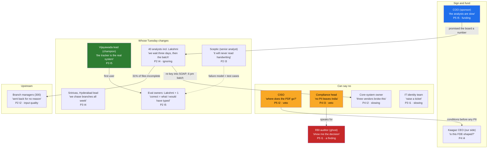

# Stakeholder map · Godavari Finance: nine days to three

> Drawn by the FDE in week 0, after the Day 4 scoring, and updated at the end of week 1 after the
> mapping conversations. Every person and number is from the course's invented engagement. The same
> rows live as data in `data/godavari-stakeholders.csv`; the collisions in `data/godavari-conflicts.csv`.
> Run `python -X utf8 code/stakeholder_grid.py` from the chapter folder.

**Customer:** Godavari Finance Ltd, Hyderabad · **Problem (Day 4):** "New loan files take a median of nine days from receipt to decision because intake is manual and a third of files are incomplete." · **Version:** week 1 · **Author:** Kaagaz AI FDE

## The map

Power and interest are 1 to 5 (4 and 5 are high). "Stops it by" is what this person would do if they wanted the work to fail. "Must change" is whether their own day changes. Versions are verbatim.

| # | Who | Role | Power | Interest | Stops it by | Must change | Their version of the problem | What they want | The number they would believe | Engagement, and when |
|---|---|---|---|---|---|---|---|---|---|---|
| S01 | The COO | sponsor | 5 | 5 | funding | no | "the analysts are slow; nine days must become three" | a number the board recognises before the next RBI cycle | median turnaround days in the pilot branches | signs the problem statement and the "will not do" list; weekly readout (Day 29); decides sponsor-side conflicts |
| S02 | Srinivas, credit-ops team lead, Hyderabad | operator lead | 3 | 4 | ignoring | yes | "files arrive incomplete and my people spend the week chasing branches" | the queue visible, fewer chases, no blame for a wrong field | files per analyst per day | floor walk and counts in week 1; reviews the workflow map (Day 6); co-owns enablement |
| S03 | The credit-ops team lead, Vijayawada | operator lead, champion | 3 | 5 | ignoring | yes | "the tracker is the real system; the SOP is a story" | the tracker's job done properly by something that will not lose a file | files per analyst per day | first user of the review page; owns the tracker migration with the FDE |
| S04 | 40 credit-ops analysts, Hyderabad and Vijayawada | operators | 2 | 4 | ignoring | yes | "we wait three days for the branch to resend a document, then the core batch runs overnight" | less re-keying, fewer chases, a tool that does not add a step | analyst hours per file; send-back rate | 8 to 10 interviewed and shadowed (Day 6); pilot workshop (Day 31); adoption tracked (Day 33) |
| S05 | Lakshmi (Vijayawada) and one senior analyst (Hyderabad) | eval owners | 2 | 5 | ignoring | yes | "a field is correct when I would have typed it; a file is complete when the branch would not get it back" | not to be blamed for the model's mistakes; their judgement written down as the standard | field-level accuracy on the files they labelled | label 30 files in week 2 and the golden set from week 3 (Day 14); first to see every failure |
| S06 | A senior analyst, Hyderabad | sceptic | 2 | 3 | ignoring | yes | "it will never read handwritten income proofs; the 2019 OCR pilot did not" | to be proved right, or shown the failures honestly | the handwritten files flagged for review instead of guessed | one hour in week 1 to extract her failure model; invited to the pilot workshop |
| S07 | The CISO | blocker | 5 | 2 | veto | no | "where does the PDF go; does your model train on our data; which country is the server in" | no data incident with her name on it; no vendor holding production credentials | passed security review; VPC in AWS Mumbai; nothing leaves India | week 1 meeting; questionnaire from week 2 (Day 23); deployment model argued with her in the room (Day 21); monthly thereafter |
| S08 | The compliance head | blocker, rule owner (eval owner for completeness) | 4 | 3 | veto | partly | "no customer PII leaves India; no mandatory KYC document is ever skipped" | zero audit findings caused by the tool; the rules in writing | zero completeness misses; accuracy on KYC fields | fifteen-minute call in week 1; full session in week 2; signs the completeness rules as code (Day 11); stands in for the auditor |
| S09 | The core-system owner (IT, the 2009 core lending system) | system owner | 4 | 2 | slowing | yes | "three vendors have broken this system before; the 6 pm batch window is not negotiable" | no duplicate records, no surprise load, a sandbox refresh he controls | zero duplicate records; every call inside the batch window | sandbox spike in week 2; named in the integration workstream (Day 16); his conditions in the "will not do" list |
| S10 | Corporate IT identity team (Active Directory, SSO) | blocker (admin) | 3 | 1 | slowing | no | "raise a ticket and we will look at it in the next sprint; nobody gets a service account without the CISO" | nothing that breaks the nightly HR sync | service account approved; group filtering verified by them | access ticket in week 2; SSO and group filtering designed with them (Day 22) |
| S11 | Branch managers (300; Kukatpally first) | upstream producer | 2 | 2 | input quality | yes | "credit-ops sends files back for no reason and the customer blames us" | fewer send-backs; to be told on day one what is missing | files accepted first time | a call with the Kukatpally manager in week 2; in the pilot from week 7; the resubmission flow designed with him |
| S12 | The RBI auditor | ghost (proxy: the compliance head) | 5 | 1 | a finding | no | "show me the decision, who made it, and the documents it rested on" | documented, reviewable decisions with a human accountable for each | an audit trail per file with a human decision | never met; the compliance head speaks for him; the audit trail is in the skeleton from week 3 |
| S13 | Kaagaz's CEO and engagement lead (our side) | own-side sponsor | 4 | 4 | funding | no | "is this FDE-shaped, and will a second lender buy the same pattern" | recurring revenue and patterns for product (Day 3) | ARR that survives the FDE leaving; the second-customer test | weekly internal sync; approves the "will not do" list from our side |

## The map as a picture

## The constraints list (started here, owned by Day 7 step 1 from then on)

| Constraint | Said by | When | Where it lands |
|---|---|---|---|
| No customer PII leaves India | the compliance head, first sentence | week 1 | Day 7 step 1; Days 21, 23, 24 |
| No model trains on our data | the CISO | Day 0, Tuesday | Day 23's training-use policy |
| No vendor holds production credentials | the CISO | week 1 | Days 22 and 25 |
| The 6 pm credit-check batch window is not negotiable; no change to the core system's data model | the core-system owner | week 1 | Day 7 step 1; Day 16; the "will not do" list (Day 8) |
| No mandatory KYC document is ever skipped; the rules are signed before they run as code | the compliance head | week 2 | Day 11 |
| A human decision recorded on every file | the auditor, through the compliance head | week 1 | Day 7 step 5; Day 18 |
| Branch managers must not see other branches' files | confirmed in Day 6's shadowing | week 1 to 2 | Days 15 and 22 |

## The customer's calendar (invented for the course)

| Fixed date | Effect on the plan |
|---|---|
| RBI inspection, expected January to March | compliance head unavailable for weeks; no go-live during it; the audit trail must exist before it |
| Core-system release freeze, last two weeks of each quarter | no SOAP changes, no sandbox refresh |
| Financial year end, 31 March | the COO's number is reported then |
| Sankranti week (Vijayawada), Dussehra | half the analysts on leave; no shadowing, no pilot workshop |
| Month-end disbursement push | analyst hours per file not comparable in the last three days of a month (Day 9's baseline must know) |

## Collisions (from `data/godavari-conflicts.csv`)

See the script's output, or section 04.4 of the chapter. Six collisions, four of them with the COO on one side, each with a decider and a date. The rule: when the sponsor's want collides with a blocker's or a ghost's condition, the condition wins and the collision goes on the Day 10 readout agenda.

## Who is in the readout room (for Day 10)

The COO (signs), the CISO and the compliance head (veto), Srinivas and the Vijayawada team lead (operators), two senior analysts including an eval owner, the core-system owner (by invitation; his conditions are read out whether or not he attends). The auditor is represented by the compliance head. The branch managers are represented by the Kukatpally manager's conditions, read into the record. Kaagaz's engagement lead attends from our side.

## Change log

| Version | What changed |
|---|---|
| week 0 | drawn from Day 0 and Day 4: COO, "the analysts", CISO, compliance, "IT", the auditor as a note |
| week 1 | after the mapping conversations: "the analysts" split into two leads, forty analysts, two eval owners and a sceptic; "IT" split into the core-system owner and the identity team; branch managers added as upstream producers; the auditor given a proxy; the constraints list started; the calendar added |
