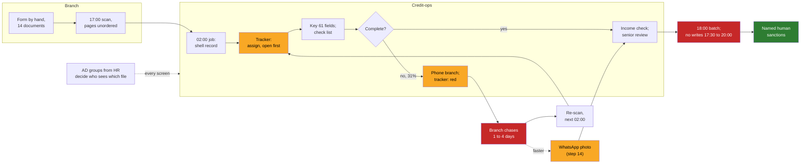

# 07 · The Situational Map: The Workflow as It Actually Runs

> Day 6 · Section 7 of 16 · [Chapter overview](README.md) · Previous: [06 · Interviewing without leading](06-interviewing-without-leading.md) · Next: [08 · The questions that change the architecture](08-questions-that-change-the-architecture.md)

---

## 7.1 What it is

The situational map is the week-one deliverable: one document that shows the work as it actually runs, drawn from the shadowing logs and the interviews, and reviewed with the operators who gave it to you. It is not the SOP redrawn, and it is not an architecture. It has five layers, and each layer answers a question the SOP does not:

| Layer | The question | At Godavari |
|---|---|---|
| **Steps** | what actually happens, in order, including what is in no document? | nineteen steps; twelve in the SOP, seven not |
| **Systems and tools** | what is open on the desk, on and off the screen? | the core, the PDF viewer, the Excel tracker, a printed checklist, a notebook, a personal phone |
| **Handoffs** | where does work pass between people or systems, and where does it break? | branch to analyst (incomplete file sent anyway); analyst to branch (free-text reason); WhatsApp to the paper file (never to the core) |
| **Waits and exceptions** | where do the days go, and what is the path when something is wrong? | three days for a resent document; the 18:00 batch; the send-back loop |
| **Permissions** | who may see and change what, and what enforces it? | branch and regional AD groups, synced from HR, read by the core at login |

A stakeholder map ([Day 5](../05-the-stakeholder-map/README.md)) is about people and power. A situational map is about work and its paths. You need both, and the second one is built from conversations with the people on the first.

The Godavari map is in [`worksheet/situational-map.md`](worksheet/situational-map.md): the nineteen-step table with a source column (which transcript or log each row came from), the full Mermaid diagram, a systems-and-permissions table, and a handoffs table.

## 7.2 Twelve steps on paper, nineteen on the floor

The seven undocumented steps are where the engagement's design came from:

| # | Undocumented step | What it became |
|---|---|---|
| 5 | the team lead assigns files in the tracker | the review queue must do assignment, or the tracker stays |
| 6 | the analyst opens the tracker first, then the PDF, then the core | the tool's first screen is the tracker's job |
| 9 | the analyst judges an unlisted address proof; juniors send back to be safe | the compliance head's signed alternatives list (Day 11) |
| 11 | phone the branch from a personal list; "waiting on X since" in red | day-one feedback to the branch, with the rule that fired |
| 12 | the branch chases the customer for one to four days | the wait the COO did not know was in his nine days |
| 14 | WhatsApp photo, printed, stapled, "received WA" | the resubmission flow; never ingestion |
| 16 | a senior reviews juniors' files before the batch | the review queue's second pair of eyes |

Step 14 is the one the Short is about ("the SOP said 12 steps; I counted 19; step 14 was WhatsApp"). It is also the step that shows why the map must be reviewed with the operators: the first draft had it as "rare", and the read-back changed it to "one in five overall, most files from the far branches".

## 7.3 The map, condensed

The full diagram has every step. The version for a slide keeps the shape:

Yellow is what lives only in the tracker or a phone. Red is where the days go. Green is the step that must never be automated. The dotted permission arrow is on purpose: permissions are not a step, they are a property of every step, and drawing them as a box in the flow is how they get forgotten.

## 7.4 How to build it

1. **Start from the shadowing logs, not the SOP.** Write each logged action as a row. Mark the ones the SOP has.
2. **Merge across operators.** Lakshmi's file and Bhavani's file share most rows; the Hyderabad floor adds assignment by Srinivas; the branch visit adds the scanner. Where two people do a step differently, keep both and say so.
3. **Add a source column.** Every row names the transcript or log it came from. A row with no source is your guess; mark it or delete it. This is the same rule as Day 7's step 3 and the synthesis script: no evidence, no row.
4. **Add waits from the tracker's dates.** "Waiting on address proof since" gives you elapsed days per file without any timestamps in the core.
5. **Draw permissions and systems as separate tables.** Who sees what, enforced by what, granted how. The flow diagram cannot carry this and should not try.
6. **List the handoffs that break.** For each: from, to, what breaks, the quote that proves it.
7. **Review it with the operators, step by step, before anyone else sees it** (section 10).

## 7.5 What the map is for

Three readers use it next. **[Day 7](../07-decomposition/README.md)'s step 3** reads its inputs (the PDFs, the SOAP API, the tracker, the AD groups, the WhatsApp pages, the KYC rules, the historical decisions) and writes them as a table with shape, owner, freshness, access and what is missing; section 5 of the map lists the answers step 3 needs, and Day 7 owns the table. **Day 9** measures the waits the map names. **The COO** sees the condensed diagram and one sentence at the Friday readout: "a large share of your nine days is the branch chasing a customer for a document we could have named on day one."

## 7.6 Key takeaways

- The situational map has five layers: steps, systems and tools, handoffs, waits and exceptions, permissions.
- Build it from logs, merge across operators, give every row a source, take waits from the tracker's own dates.
- Draw permissions as a property of every step, not a box in the flow.
- It is the week-one deliverable and the source for Day 7's inputs table; it is reviewed with the operators before anyone else sees it.
