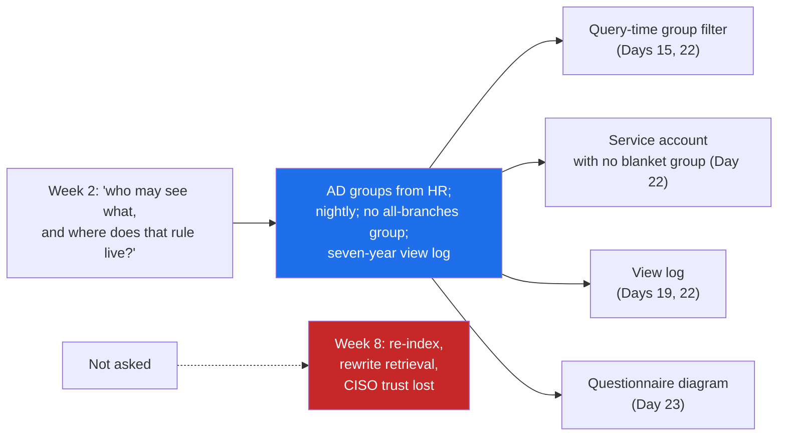

# 08 · The Questions That Change the Architecture

> Day 6 · Section 8 of 16 · [Chapter overview](README.md) · Previous: [07 · The situational map](07-the-situational-map.md) · Next: [09 · Shadow systems and the golden examples](09-shadow-systems-and-golden-examples.md)

---

## 8.1 Why some answers matter more than others

Most of what you hear in discovery changes a screen, a metric or the order of the work. A few answers change the structure of the system: what must be stored with every record, what every query must carry, what may never be written, what the system may not decide. Those are expensive to change later because everything else is built on them. The skill is to ask for them deliberately, in week one, of everyone, and to recognise them when they are said in passing.

Godavari's ten interviews contain six such questions. The Part 2 plan names four of them (who may see what, how access is granted, how fresh the data must be, what must never be automated); the other two (who corrects errors today, what happens when it is wrong) decide the human in the loop.

| Question | Godavari's answer | What it forces | Built on |
|---|---|---|---|
| **Who may see what?** | a branch user sees only that branch; a regional analyst the region; four people in IT and the compliance desk see all | every retrieval filtered by the caller's permissions | Days 15, 22 |
| **How is access granted, and from where?** | AD groups per branch, region and role; HR is the source; nightly sync; exceptions by hand, "forgotten" | the filter resolves groups at query time; the service account starts with none; no "all branches" group | Day 22 |
| **Where does the file come from, and how fresh must the data be?** | branch scan at 17:00, 02:00 transfer, 18:00 credit batch, no writes 17:30 to 20:00 | same-hour intake is out; writes scheduled around the window | Days 7, 16 |
| **What must never be automated?** | the sanction; a named human signs; the reading of handwritten income proofs until proven | a human decision per file in the skeleton; handwritten fields manual | Days 11, 17, 18 |
| **Who corrects errors today?** | the analyst, then a senior, then the credit manager, then the auditor in March | the review queue is for the analyst, with a senior's second pass; confidence routing | Day 18 |
| **What happens when it is wrong?** | an audit observation with the analyst's employee ID; a customer shouting at the branch | the acceptable error rate is the compliance head's; every accepted field records who accepted it | Days 7, 9, 14 |

A seventh, "what do you do on a bad day?", does not change the structure, but it changes the load model and the calendar (month end, March), and it is the question that gets the most honest answers.

## 8.2 The finding: branch visibility comes from Active Directory

Here is how the finding that changes Godavari's retrieval architecture actually arrived. It was never one sentence from one person.

1. **Week one, Thursday, Srinivas,** in passing: "When the Vijayawada lead was on leave in June I could not see her queue at all. I raised a ticket. IT added me to her group by hand. It took two days, and then they forgot to remove me." You wrote it down because it was a wait. It was a permission.
2. **Week one, Thursday, the core-system owner:** "Every query carries the branch filter. It is not optional and it is not in the API; it is in the session. If you call the API with a service account, you get what the service account's groups allow, which today is nothing."
3. **Week two, Tuesday, the CISO,** asked B1 directly: "Active Directory. Every user is in a branch group or a regional group, plus a role group. HR is the source. There is a nightly sync. Transfers lag a day." Then the sentence that settles the design: asked whether there is an all-branches group, "No, and there will not be one for a vendor." And the requirement nobody else would have given you: "I want to be able to answer 'who viewed this file' for any file, for seven years."
4. **Week two, Wednesday, the Kukatpally manager:** "When I moved here from Miyapur, for one day I could still see Miyapur and not Kukatpally." And on whether a manager should ever see another branch's file: "No. Never. Our targets are per branch. If I could see Miyapur's pipeline I would know their dealers."
5. **Week two, Wednesday, the Guntur manager:** "I do not want to see other branches and I do not want them to see mine."

Five interviews, three personas, one rule. The tally script counts BRANCH_ISOLATION in five transcripts and ACCESS_VIA_AD_GROUPS in four, which makes both requirements by the three-interview rule. The reason it is a business rule and not just an IT setting is in the fourth quote: branch targets are competitive, and a manager who can see another branch's pipeline can see its dealers.

## 8.3 What it requires, and what it would have cost in week eight

The finding becomes four requirements. This chapter states them; Days 15 and 22 build them.

| Requirement | Why | Owner |
|---|---|---|
| every query that returns loan-file content carries the caller's groups, resolved at the moment of the query | a manager who moved branches yesterday must not see the old branch today; the CISO said "at the moment of the query" | Day 15 (retrieval), Day 22 (identity) |
| the service account holds no group that grants everything, and the design never relies on one | there is no "all branches" group and there will not be one for a vendor | Day 22 |
| every view is logged with who, which file and when, kept seven years | the CISO's requirement and an RBI expectation | Days 19, 22 |
| the questionnaire describes the filter with a diagram | "I will believe the diagram, not the sentences" | Day 23 |

Now the counterfactual. Suppose nobody asks, and in week four the team builds a document index over the masked files the compliance head approved, with each chunk tagged by the branch it came from at indexing time. It demos well. In week eight the CISO's review asks how a transferred manager's access is revoked, and the honest answer is "at the next re-index". The fixes are a group lookup on every query, a re-index with group metadata, a change to every retrieval call, a new view log, and a rewritten section of the questionnaire, while the pilot branches wait. That is the month of rework the Part 2 plan warns about, and the larger cost is the CISO's conclusion that you did not ask. The rule did not change between week two and week eight. Only the price of knowing it did.

## 8.4 How to hear them when they are said in passing

The architecture-changing answers rarely arrive as answers to the architecture questions. They arrive as complaints, waits and stories ("everybody knows the batch runs at six" is a freshness bound). Three patterns to listen for:

| You hear | What it may be | Ask next |
|---|---|---|
| "I raised a ticket and they added me by hand" | a permission model with manual exceptions | "Which group? Who else is an exception?" |
| "The last vendor created four hundred duplicates" | a write interface without idempotency | "What did it do on a retry?" |
| "The auditor asks who decided" | a governance line | "What must a person always sign?" |

## 8.5 Key takeaways

- Six questions change the structure: who may see what, how access is granted, where the file comes from and how fresh it is, what must never be automated, who corrects errors, what happens when it is wrong.
- At Godavari, branch visibility comes from AD groups synced nightly from HR, with no all-branches group and a seven-year view log. Retrieval filters by the caller's groups at query time; Days 15 and 22 build it.
- The finding arrived in pieces from five people. It was a requirement in week two and would have been a month of rework in week eight.
- Listen for permissions in complaints about tickets, freshness in "everybody knows", idempotency in vendor horror stories.
