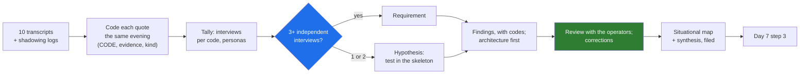

# 10 · Synthesis and Confirmation: From Notes to Findings the Operators Sign

> Day 6 · Section 10 of 16 · [Chapter overview](README.md) · Previous: [09 · Shadow systems and the golden examples](09-shadow-systems-and-golden-examples.md) · Next: [11 · 2026 patterns and production concerns](11-patterns-and-production-concerns.md)

---

## 10.1 The pipeline

Ten transcripts are about ten thousand words. The readout has room for one page. Synthesis is the method for getting from one to the other without losing what was said or adding what was not.

## 10.2 Coding

A code is a short name for one finding, in UPPER_SNAKE_CASE, assigned to a verbatim quote. Each transcript ends with a coded-notes table: code, verbatim evidence, kind. The kinds are architecture, constraint, scope, adoption, metric and evidence; they sort the findings for the synthesis.

Rules that make the tally mean something:

- **Reuse codes across transcripts.** The value is in BRANCH_ISOLATION appearing in five files under the same name. Keep a running code list and check it before inventing a new one.
- **One code per idea, not per sentence.** "Visibility is by AD group" and "branch users see only their branch" are two codes (where the rule lives; what the rule is), and the difference matters to Day 22.
- **Every code has a verbatim quote.** A code with no quote is your inference.
- **Code in the evening, while you remember the tone.** "Nobody has said no. Nobody has said yes." means something different said with a laugh and with a pause.

The playbooks add a cadence rule this course follows: synthesise every three or four interviews, not once at the end.

## 10.3 Requirements and hypotheses

The getperspective.ai playbook (July 2026) gives the threshold this chapter uses: a requirement should appear in at least three independent interviews before it enters the spec; a pain mentioned once is a hypothesis. "Independent" means separate conversations. Lakshmi said it and the team lead nodded is one interview.

Godavari's tally (section 12 has the run): 45 codes, 17 requirements, 28 hypotheses. Two rules for using it:

1. **The threshold is a floor for confidence, not a filter for importance.** CreateApplication's duplicate on retry was said by one person, the core-system owner, because only one person knows. It stays in section A of the synthesis, labelled single-source, because the week-two spike reproduced it. A hypothesis confirmed by a test is as good as three interviews. A hypothesis that cannot be tested goes into the skeleton's expected failures (Day 7, step 5).
2. **A requirement that never reaches the synthesis is a miss.** The script checks both directions: every cited code must exist in a transcript, and every requirement-level code must be cited. Its first run on the Godavari synthesis flagged WRONG_MEANS_AUDIT_FINDING, said by the COO, the compliance head and the senior analyst in three different seats, and not in the draft. It became finding B4.

## 10.4 Writing the findings

The synthesis is in [`worksheet/godavari-discovery-synthesis.md`](worksheet/godavari-discovery-synthesis.md), in five parts: **A**, the findings that change the architecture, first because they are the expensive ones (eight at Godavari: AD groups, the tracker, WhatsApp, the batch, idempotency, the human sanction, signed rules, "unsure" not a guess); **B**, constraints that cannot move, with who set them; **C**, scope and metrics; **D**, what was not found; **E**, confirmation: who reviewed it and what they corrected.

Each finding is one bold sentence, then the codes, then two to four sentences of evidence and consequence. "Five interviews, independently" is better than "users said". A quote is better than a summary of it.

Section D matters more than it looks. An assistant asked to synthesise will add plausible findings (section 12); a sponsor will remember that "everyone wants a chatbot". Writing "nobody asked for a chatbot; the word did not come up in any operator interview" closes that door with evidence.

## 10.5 Confirming with the operators

The week-one deliverable is "the real workflow map, reviewed with the operators who gave it to you". Godavari's review was ninety minutes on week 2 Friday with Lakshmi, Srinivas and the Vijayawada team lead, before the COO's readout. The method:

1. **Walk the map step by step,** aloud, and ask at each row: "Is this what happens? What did I miss?"
2. **Read each architecture finding with its quotes.** "Is this fair to what you said?" Not "do you agree?"
3. **Take corrections in the room and say what they change.** Three came: the two-wheeler clean-file time includes checking; gold loans have nine documents, not fourteen; the Guntur phone-photo share is one in four normally. The second one changed the completeness checklist count for the skeleton.
4. **Ask what they would not want the COO to read.** Nothing came out, but the question matters: the WhatsApp channel is a practice the compliance head tolerates, and the operators should know it is in the document before the readout, not during it.
5. **Get the map signed.** A line at the bottom: reviewed by, date, corrections made.

Then the sponsor sees section A and the waits (C1). He hears it after the operators have confirmed it, so "the analysts told me" is a statement of fact, not a story.

## 10.6 Key takeaways

- Code each quote the same evening; reuse codes; one idea per code; every code with a verbatim quote.
- Three independent interviews make a requirement; fewer make a hypothesis to test. A single-source finding confirmed by a spike stays, labelled.
- Check both directions: no cited finding without a transcript; no requirement left out.
- Architecture first, then constraints, scope, what was not found, and confirmation.
- Review the map and the findings with the operators before the sponsor sees them; take corrections in the room.
