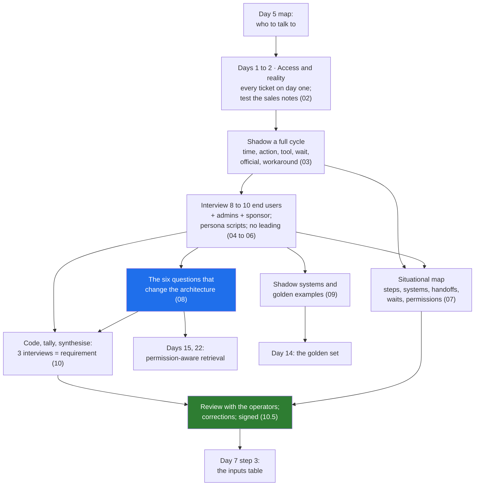

# Day 6 · Discovery Interviews: Shadowing Operators, the Situational Map, the Questions That Change the Architecture

> **[Part 2 · Discovery and Decomposition](../README.md)** · Chapter 3 of 7 · Video ~12 min · Chapter tier: big
> Builds on: [Day 4 (picking the right problem)](../04-picking-the-problem/README.md) ·
> [Day 5 (the stakeholder map)](../05-the-stakeholder-map/README.md) ·
> [Day 0 (the engineer in the room)](../../00-start-here/00-the-engineer-in-the-room/README.md) ·
> [Day 2 (the three buckets and the two-week calendar)](../../01-the-role/02-the-three-buckets/README.md)
> Sets up: Day 7 (step 3 maps the inputs this chapter finds), Day 9 (the waits measured; the golden set agreed
> as a contract), Day 11 (the compliance head's signed rules as the line between code and model), Day 14 (the
> golden set built from the examples captured here), Day 15 and Day 22 (permission-aware retrieval and
> identity, from the AD-group finding), Day 16 (the tracker and the core system as the integration surface),
> Day 23 (the CISO's conditions in the questionnaire), Day 33 (the operator who will not leave the tracker),
> Day 34 (the frustrated-operator role-play), Day 42 (the method on a hospital)
> **Owner:** this chapter owns **discovery on site: days one and two as access and reality, shadowing an
> operator for a full cycle, the interview plan of 8 to 10 end users before production code, the persona
> question banks for operators, admins and sponsors, interviewing without leading, note-taking and the
> read-back, the situational map of the real workflow, the questions that change the architecture, shadow
> systems, capturing the golden examples and their labellers, coding and synthesis into findings with the
> three-interview rule, and confirming the map with the operators.** The stakeholder roles and the
> first-conversation scripts are Day 5's; the inputs table (shape, owner, freshness, access, missing) is Day
> 7's step 3; the baseline measurement is Day 9's; building and running the golden set is Day 14's;
> permission-aware retrieval is built in Days 15 and 22; the client-simulation drills are Day 34's.
> Versions used: the script was run on **Python 3.14.3** (standard library only, no packages; as of October
> 2026). Shown outputs are from real runs. All transcripts, people and numbers are synthetic.

---

## Why this chapter exists

The SOP Godavari Finance emailed on Monday has twelve steps. Sitting beside Lakshmi in Vijayawada on Wednesday you count nineteen, and the seven nobody wrote down are where the nine days go: a spreadsheet that is the real state of every file, a notebook of branch phone numbers, a WhatsApp photo printed and stapled to a paper file that the core system never sees. One answer, given in passing by three different people over two weeks, changes the design more than anything else: branch managers must not see other branches' files, and the rule lives in Active Directory groups synced nightly from HR. Heard in week two, it is a requirement for Days 15 and 22. Heard in month three, it is a re-index, a rewritten retrieval layer and a CISO who no longer believes you asked.

The teams that invented the role interview before they build. The 2026 discovery playbooks say interview at least 8 to 10 end users, not just the sponsor, before production code, ask about the last real instance rather than hypotheticals, and treat a pain mentioned once as a hypothesis and one in three independent interviews as a requirement. Customer-facing discovery appears in 70 percent or more of the 1,000 FDE postings analysed in 2026 and is the fastest-rising bucket (Day 2), and interviewers ask "how did you run discovery?" to hear shadowing, a count and a finding that changed a design.

This chapter teaches that week as a method. You get real access or work without it; shadow operators for full units of work; plan ten interviews from Day 5's map with persona-specific scripts; ask without leading and take notes that are evidence; draw the situational map; ask the six questions that change the architecture; find the shadow systems; capture the 100 to 200 real examples Day 14 will build the golden set from; code, tally and synthesise into findings; and read it all back to the operators before the sponsor sees it. The project is the full discovery pack for the engagement folder, with ten transcripts and a script that refuses a synthesis citing a finding no interviewee gave.

## Mental model

One sentence to carry out of the chapter: **watch the work before you ask about it, ask about the last real instance and never about a hypothetical, ask everyone who may see what and what must never be automated, write down only what was said, and show the map to the people who gave it to you before anyone else sees it.**

## Learning goals

After this chapter you can:

1. Raise every access request on day one with its reason and clock, and test the four sentences every sales note contains (SSO, documents in the system, data in the warehouse, an API) against the floor.
2. Shadow an operator for a complete unit of work with a time-stamped log, and name what shadowing finds that interviews miss.
3. Build an interview plan of 8 to 10 end users across roles and locations from the stakeholder map, plus admins and the sponsor, sequenced so the sponsor's version does not lead the operators.
4. Run persona-specific scripts for operators, admins and sponsors, starting from "show me the last one you did", "what do you do when it is wrong" and "what is in the Excel sheet".
5. Interview without leading, extract the sceptic's failure model, take notes that are evidence, and use the read-back.
6. Draw a situational map with five layers (steps, systems and tools, handoffs, waits and exceptions, permissions), every row sourced, and review it with the operators.
7. Ask the six questions that change the architecture of everyone, and recognise their answers when they arrive as complaints or stories; explain how Godavari's AD-group finding becomes query-time filtering.
8. Find and respect shadow systems, and capture 100 to 200 real golden examples with their labellers and conditions for Day 14.
9. Code transcripts, tally codes by independent interviews, separate requirements from hypotheses, write a synthesis with the architecture findings first and a "what was not found" section, and check it with the chapter's script.
10. Use an assistant to prepare questions and synthesise notes, and catch its characteristic failure: findings that no interviewee said.

**Prerequisites:** Days 4 and 5. Python at a reading level for one small script; no libraries.

## Reading order

| # | Section | What you get | Words |
|---|---|---|---|
| 01 | [Why discovery interviews](01-why-discovery-interviews.md) | Wednesday beside Lakshmi: twelve steps on paper, nineteen on the floor; the career reason; the auto driver; where it sits; the hard parts named | ~1,400 |
| 02 | [Days one and two: access and reality](02-access-and-reality.md) | The access list with clocks; four sales-note sentences tested; what each first-week block is for; where notes live | ~1,450 |
| 03 | [Shadowing](03-shadowing.md) | One full cycle, logged; what it finds that interviews miss; the trust you build by watching; who to shadow; remote shadowing | ~1,450 |
| 04 | [The interview plan](04-the-interview-plan.md) | Why 8 to 10; the roster from the map; three persona scripts in outline; sequencing; "before production code"; when you cannot get ten | ~1,400 |
| 05 | [The question bank](05-the-question-bank.md) | The three questions that do most of the work; operator, admin and sponsor scripts with Godavari's answers; never ask; adapting to a new customer | ~1,450 |
| 06 | [Interviewing without leading](06-interviewing-without-leading.md) | How engineers lead; seven mechanics; the sceptic's failure model; note-taking rules; the read-back; across a language | ~1,350 |
| 07 | [The situational map](07-the-situational-map.md) | Five layers; the seven undocumented steps and what each became; the condensed Mermaid map; how to build it; who reads it next | ~1,100 |
| 08 | [The questions that change the architecture](08-questions-that-change-the-architecture.md) | Six questions and their Godavari answers; the AD-group finding in five interviews; what it requires and what week eight would have cost; how to hear them | ~1,400 |
| 09 | [Shadow systems and the golden examples](09-shadow-systems-and-golden-examples.md) | The tracker nobody mentioned and four other shadow systems; finding and treating them; capturing 180 real examples, their labellers and the edge cases | ~1,100 |
| 10 | [Synthesis and confirmation](10-synthesis-and-confirmation.md) | Coding; the three-interview rule and its exception; checking both directions; the synthesis shape; confirming with the operators | ~1,000 |
| 11 | [2026 patterns and production concerns](11-patterns-and-production-concerns.md) | Transcription, async interviews, assistants, process mining; what is hype; discovery's own security, cost, latency, scale, bias | ~700 |
| 12 | [Project: the discovery pack](12-project-the-discovery-pack.md) | The pack's files; the tally script with real output; Build it with AI; How do you know it's right | ~2,200 (incl. output) |
| 13 | [Mistakes and debugging](13-mistakes-and-debugging.md) | Symptom, cause, fix: in the room, on the job, the script | ~650 |
| 14 | [Interview questions](14-interview-questions.md) | 13 questions with model answers, plus a quick-fire round | ~1,350 |
| 15 | [Exercises](15-exercises.md) | 11 graded exercises: leading or open, a real shadowing session, break-it and predict-the-output on the script, "review this AI-written synthesis", the readout paragraph, a sceptic role-play | ~1,550 |
| 16 | [Further reading](16-further-reading.md) | The discovery playbooks with what each said on fetch, three craft books, the interview guides, the Indian texts | ~550 |

**Short on time?** Read 03, 07 and 08, then do the project (12). That is the video plus the artifact. Add 05 and 06 before your first real interview, and 10 before you write a synthesis.

## Files

| Path | What |
|---|---|
| [`worksheet/interview-plan.md`](worksheet/interview-plan.md) | the roster of ten with persona, city, reason and date; the coverage check; sequencing rules; the note on Day 2's calendar |
| [`worksheet/question-bank.md`](worksheet/question-bank.md) | operator, admin and sponsor scripts with a "then" column; the six architecture questions in three forms; the never-ask list |
| [`worksheet/shadowing-log-template.md`](worksheet/shadowing-log-template.md) | the empty shadowing log |
| [`worksheet/shadowing-log-lakshmi-w1-wed.md`](worksheet/shadowing-log-lakshmi-w1-wed.md) | the filled log of Lakshmi's Wednesday morning |
| [`worksheet/transcripts/`](worksheet/transcripts/) | ten synthetic transcripts (Lakshmi, Srinivas, the COO, the CISO, the compliance head, the core-system owner, the Kukatpally and Guntur branch managers, the senior analyst, Bhavani), each with coded notes |
| [`worksheet/situational-map.md`](worksheet/situational-map.md) | the nineteen-step real workflow with sources, the Mermaid map, systems and permissions, the handoffs that break |
| [`worksheet/godavari-discovery-synthesis.md`](worksheet/godavari-discovery-synthesis.md) | the findings synthesis: eight architecture findings, four constraints, five scope findings, what was not found, confirmation |
| [`worksheet/ai-draft-findings.md`](worksheet/ai-draft-findings.md) | an assistant's synthesis of the same transcripts with invented findings; exercise 3.1 |
| [`code/tally_findings.py`](code/tally_findings.py) | tallies coded findings into a frequency table, classifies requirements and hypotheses, checks a synthesis for unsupported and missed findings, writes `data/<synthesis>-tally.csv` and `.md` |
| `data/` | the generated tallies for the synthesis and the AI draft (regenerated by the script) |

Run from the chapter folder: `python -X utf8 code/tally_findings.py worksheet/transcripts worksheet/godavari-discovery-synthesis.md` (about a third of a second). No packages, no downloads, no API keys. `-X utf8` keeps Windows consoles happy with the middle dot.

## What this chapter does *not* teach (single-owner rule)

| Topic | Where it's taught |
|---|---|
| Choosing the problem; the scoring sheet | [Day 4](../04-picking-the-problem/README.md) |
| The stakeholder roles, power and interest, the champion, the first-conversation scripts | [Day 5](../05-the-stakeholder-map/README.md) |
| The inputs table: shape, owner, freshness, access, what is missing, the architecture risk | [Day 7](../07-decomposition/README.md), step 3 (this chapter finds the inputs; Day 7 writes the table) |
| Measuring the baseline; hours into rupees; the golden set as a contract | [Day 9](../09-success-metrics-and-business-case/README.md) |
| Which rules are deterministic code and which are the model | Day 11 |
| Building, labelling and running the golden set; judges; regression | Day 14 (this chapter captures the examples and the labellers) |
| Permission-aware retrieval and identity | Days 15 and 22 (this chapter finds the rule) |
| Integrating the tracker and the core system | Day 16 |
| What may go in a coding agent's context at a customer | Day 39 |
| The frustrated-operator and refusing-security role-plays | Day 34 |

## Analogies for the Telugu audience

- **Google Maps versus the auto driver** (the chapter's main picture): the sponsor hands you the map; the auto driver knows the lane that floods, the one-way nobody follows and the gate locked after eight. Interview the auto drivers, then show them their map before anyone else (01.2).
- **The family doctor's house visit** (Day 0's picture, reused for shadowing): the specialist asks questions in a cold room; the family doctor sees the kitchen, the water and the grandmother who will not take tablets. Shadowing is the house visit (03).
- **The village panchayat's minutes** (Day 10's picture, previewed for the read-back): the decision is read aloud with everyone present so nobody can say later it was not what they said (06.5).

## Video map

The video (~12 min) covers a slice; the notes cover everything.

| Asset | Covers | Sections |
|---|---|---|
| **Day 6 main video** (~12 min) | Hook: the SOP has twelve steps; beside Lakshmi you count nineteen (1 min) → why it matters: one answer can change the retrieval architecture (1 min) → days one and two: access and reality; the CISO's no, no, not yet, and what you do anyway (1 min) → shadowing: one full file, the log, what it finds (2 min) → the plan: 8 to 10 end users, the roster from the map, three persona scripts (1.5 min) → the three questions and how not to lead (1.5 min) → the situational map: nineteen steps, step 14 is WhatsApp (1 min) → the finding: branch visibility from AD groups, five interviews, week two against week eight (1.5 min) → the tracker nobody mentioned and the 180 golden examples (0.5 min) → synthesis, the three-interview rule, review with the operators (0.5 min) → recap and the Day 7, 14, 15 teasers (0.5 min) | 01.1 to 01.2, 02.2 to 02.4, 03.2 to 03.4, 04.1 to 04.3, 05.1, 06.1 to 06.2, 07.2 to 07.3, 08.2 to 08.3, 09.1, 09.4, 10.3, 10.5 |
| **Short 1:** "The SOP said 12 steps. I counted 19. Step 14 was WhatsApp." | The SOP beside the shadowing log; the seven undocumented steps; the WhatsApp page arriving mid-file; why you review the map with the operators | 03.3, 07.2 |
| **Short 2:** "One interview answer, one month of rework saved: ask who is allowed to see what." | Srinivas's ticket, the CISO's "no, and there will not be one for a vendor", the Kukatpally manager's "never"; query-time filtering in week two against a re-index in week eight | 08.2, 08.3 |
| Notes only | The access list and the four sentences (02.2, 02.3), where notes live (02.5), remote shadowing (03.6), sequencing and "before production code" (04.4 to 04.6), the full scripts and never-ask list (05.2 to 05.7), the seven mechanics, the sceptic and note-taking (06.2 to 06.4), building the map (07.4), hearing the questions in passing (08.4), treating shadow systems (09.2 to 09.3), coding and the synthesis shape (10.2, 10.4), 2026 patterns and production concerns (11), the project, Build it with AI and How do you know it's right (12), debugging (13), interviews (14), exercises (15) | as listed |

**Callbacks to use on screen:** "Day 0 lo Lakshmi pakkana koorchunnam, Excel tracker chusam; ivala adi accident kaadu, method." (section 01); "Day 5 stakeholder map nunchi interview plan tayaru chestunnam: prati row ki oka reason." (section 04); "Day 2 calendar lo Wednesday 7 hours customer-facing gurtunda? Aa hours lo em jarigindo ivala chustunnam." (section 03).
**Forward callbacks:** Day 7 (ee map lo inputs ni step 3 lo table ga raastam), Day 14 (ee 180 files tho golden set build chestam), Day 15 and Day 22 (ee AD-groups rule ni prati query lo implement chestam).

## Callbacks

- **Builds on:** [Day 0](../../00-start-here/00-the-engineer-in-the-room/README.md) (Wednesday beside Lakshmi, the tracker, the 6 pm batch), [Day 2](../../01-the-role/02-the-three-buckets/README.md) (the two-week calendar and its customer-facing blocks), [Day 4](../04-picking-the-problem/README.md) (the problem statement every interview tests), [Day 5](../05-the-stakeholder-map/README.md) (the map the plan is built from, the four roles, the sceptic and the eval owners).
- **Sets up:** [Day 7](../07-decomposition/README.md) (step 3's inputs table), Day 9 (the waits measured), Day 11 (signed rules as code), Day 14 (the golden set), Day 15 and Day 22 (permission-aware retrieval and identity), Day 16 (the tracker and the core as integration surface), Day 23 (the CISO's conditions), Day 33 (the operator who will not switch), Day 34 (the role-plays), Day 42 (the method on a hospital).

**Next chapter:** [Day 7 · Decomposition: the five-step method and the walking skeleton](../07-decomposition/README.md).
