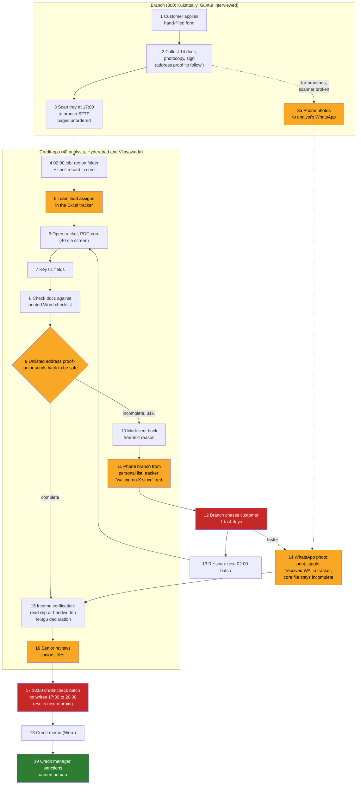

# Godavari situational map · the loan-file workflow as it actually runs

> Day 6 artifact for the engagement folder: the week-one deliverable. The SOP (Hyderabad, 2019) has twelve steps. Three days of shadowing in Vijayawada and Hyderabad and ten interviews found nineteen, seven of which are in no document. Reviewed step by step with Lakshmi, Srinivas and the Vijayawada team lead on week 2 Friday. Everything here is synthetic.

## 1. The nineteen steps

Steps in **bold** are in the SOP. Steps in plain text are real and undocumented. "Wait" is the typical elapsed time before the next step starts, from the tracker's "waiting on ... since" dates and from shadowing; Day 9 measures it properly.

| # | Step | Who | Tool | Wait before next | In SOP | Source |
|---|---|---|---|---|---|---|
| 1 | **Customer applies at the branch with the dealer's quotation** | customer, branch officer | paper form, filled by hand | same day | yes | T07, T08 |
| 2 | **Branch collects the product's documents (14 for two-wheeler, 9 gold, 16 small-business), photocopies, customer signs each** | branch officer | photocopier | same day; address proof often "to follow" | yes | T05, T07 |
| 3 | **Branch scans the day's tray at 17:00 into the branch SFTP folder, one PDF per file, pages in whatever order** | branch officer | scanner, SFTP | overnight | yes (but the SOP says "upload", not "scan at five") | T06, T07 |
| 3a | Far branches photograph pages on a phone and send them to the analyst's personal WhatsApp; originals by Friday courier | branch officer | phone, WhatsApp, courier | same day | no | T01, T08, T10 |
| 4 | **02:00 job moves PDFs to region folders and creates a shell record in the core with branch code and file number** | the core system | nightly job | until 08:00 | yes | T06 |
| 5 | Team lead assigns the day's files by typing file numbers into each analyst's workbook, by skill and leave | Srinivas, the Vijayawada lead, Lakshmi for juniors | the Excel tracker | minutes | no | T02, T10 |
| 6 | Analyst opens the tracker row, then the PDF, then the core screen (40 seconds a load) | analyst | tracker, PDF viewer, core | none | no (the SOP starts at "key the application") | T01, T10 |
| 7 | **Analyst keys 61 fields into CreateApplication from the hand-filled form** | analyst | core | 1.5 h including step 8 | yes | T01, T10 |
| 8 | **Analyst checks the documents against the product's Word checklist (printed)** | analyst | printed checklist | none | yes | T01, T05 |
| 9 | Analyst decides whether an unlisted address proof is acceptable; juniors send back to be safe | analyst, Lakshmi for juniors | judgement; no written list | none | no | T05, T10 |
| 10 | **If incomplete: mark "sent back" in the core with a free-text reason** | analyst | core | none | yes | T02, T07 |
| 11 | Analyst phones the branch from a personal phone list and writes "waiting on X since <date>" in the tracker, colour red | analyst | personal notebook or phone, tracker | 3 days typical, up to a week | no | T01, T10 |
| 12 | Branch chases the customer; customer returns with the document | branch officer, customer | phone | 1 to 4 days | no | T07, T08 |
| 13 | **Branch re-scans the document; it arrives in the next 02:00 batch under the same file number** | branch officer | scanner, SFTP | overnight | yes | T02 |
| 14 | Or: branch officer photographs the document and sends it to the analyst on WhatsApp; analyst prints, staples, writes "received WA" in the tracker; the core file stays incomplete | branch officer, analyst | WhatsApp, printer, tracker | same day | no | T01, T05, T07, T10 |
| 15 | **Income verification: analyst reads the salary slip, bank statement, passbook or handwritten declaration against the keyed figure** | analyst (seniors do this properly; juniors often cannot) | PDF, printed photos | 0.5 to 1 h | yes | T09, T10 |
| 16 | Senior analyst reviews juniors' files before the batch | Lakshmi, the senior analyst | tracker, core | none | no | T10 |
| 17 | **18:00 credit-check batch runs for every record completed since the previous 18:00; no writes 17:30 to 20:00; results next morning** | the core system | batch | overnight; later at month end | yes | T06, T09 |
| 18 | **Credit memo written as a Word file on the shared drive** | analyst | Word | 0.5 h | yes | T02 |
| 19 | **Credit manager sanctions; a named person signs; the sanction letter goes to the branch** | credit manager | core | same day | yes | T03, T05 |

Nineteen numbered steps: twelve in the SOP (bold) and seven that are in no document (5, 6, 9, 11, 12, 14, 16). Step 3a is the far branches' alternative to step 3, not a separate step, so it is not counted. The tracker is touched at steps 5, 6, 11, 14 and 16 and is the only place the "waiting on" state exists.

## 2. The map

Yellow: steps that exist only in the tracker, a notebook or a phone. Red: where the days go. Green: the step that must never be automated.

## 3. Systems, inputs and handoffs

| System | What it holds | Owner | Who may see what | How access is granted |
|---|---|---|---|---|
| Branch scanners and SFTP folders | the day's PDFs per branch, 30 to 40 pages, unordered | branch operations | the branch and the 02:00 job | branch login |
| The 2009 core lending system (SOAP, 14 operations) | the application record, status, free-text send-back reason, sanction | the core-system owner | branch users: own branch; regional analysts: own region; four in IT and the compliance desk: all; filter applied in the session from AD groups | AD group membership from the nightly HR sync; service accounts through the CISO |
| Active Directory | branch, regional and role groups | corporate IT identity team | n/a | HR system is the source; manual exceptions by ticket, "forgotten" |
| The Excel tracker (40 workbooks) | assignment, 7 status columns, 3 colours, "waiting on X since" | the team leads; kept by every analyst | anyone with the shared drive | shared drive permissions; no API |
| Personal phone lists and notebooks | branch phone numbers (the core's list is two years old) | each analyst | the analyst | none |
| WhatsApp on personal phones | late pages as photos | nobody | the analyst and the branch officer | none; not permitted, not forbidden |
| The Word checklist per product | the mandatory documents | the compliance head | everyone, but versions drift | emailed |
| The acceptable-alternatives list | which address proofs are acceptable | "in my head and in Lakshmi's" | nobody | does not exist |
| The credit-bureau feed | the credit check | the core system, 18:00 batch | nobody directly | per-batch contract |
| Paper files | the signed copies plus stapled WhatsApp prints; the auditor's copy | the branch, then credit-ops | whoever holds the file | physical |

## 4. The handoffs that break

| Handoff | From | To | What breaks | Evidence |
|---|---|---|---|---|
| Incomplete file sent anyway | branch | analyst | the file joins the queue before anyone knows it is incomplete; found a day later | T07 "we send the file anyway" |
| Free-text send-back reason | analyst | branch | "KYC pending" tells the branch nothing; the customer blames the branch | T07, T02 |
| Late page by WhatsApp | branch officer | analyst's phone | the page never reaches the core file; the paper file and the system file differ | T01, T05, T10 |
| Checklist update | compliance head | analysts and branches | versions drift; three branches sent unmasked Aadhaar for months after the rule changed | T05 |
| Cross-region cover | team lead | IT | a ticket, two days, and the exception is never removed | T02, T04 |
| Vendor retry | vendor integration | the core | duplicates: four hundred in 2022 | T06 |

## 5. The questions this map answers for Day 7's step 3

Where does the file come from (steps 3, 3a, 4). Who corrects errors today (steps 8, 15, 16: the analyst, then a senior, then the credit manager, then the auditor in March). What happens when it is wrong (an audit query with the analyst's ID on it; a customer at the branch counter). Who sees what (section 3, row 2). What time the batch runs (02:00 transfer, 18:00 credit check, no writes 17:30 to 20:00). What a bad day looks like (month end, quarter end, the day after a holiday, Thursday in Guntur, March). Each one is a row in Day 7's inputs table with its architecture risk.
