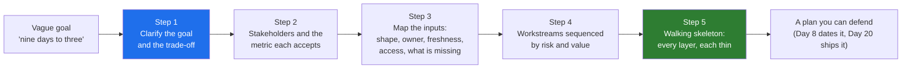

# 01 · Why Decomposition: The Round Most Candidates Fail and the Prototype Nobody Runs

> Day 7 · Section 1 of 16 · [Chapter overview](README.md) · Next: [02 · The five steps](02-the-five-steps.md)

---

## 1.1 Minute one

A conference room in Hyderabad. The COO of Godavari Finance has just said the sentence you have been
waiting two weeks to hear: "We want loan turnaround down from nine days to three. Can your platform do
it?"

There are two ways to spend the next sixty seconds.

The first is the one almost every engineer takes. You have shipped an LLM pipeline before. You know the
documents are PDFs. You say: "Yes. We would run OCR on the scans, extract the fields with a model, put
the documents in a vector store so an assistant can answer questions about any file, and push the result
into your core system. We could have a demo in three weeks." The COO nods. The CISO, sitting at the end
of the table, writes something down. The compliance head says nothing.

The second way takes the same sixty seconds and ends with no architecture at all. "Nine to three is a
clear target. Before I say how, I need to know three things. Where do the nine days actually go today:
is it analysis time or waiting time? What error rate would your RBI auditor accept in exchange for the
speed, because faster and more accurate at the same time is rarely free? And who, in this room and
outside it, has to say yes before a file can be processed by a vendor's system?"

The second engineer has not solved anything yet. But she has done the thing that the FDE interview
loop scores above every other skill, and the thing that separates an engagement that becomes a product
from a prototype nobody runs on a Tuesday. She has **decomposed before she designed**.

This chapter teaches that as a method, in five steps, drilled on Godavari until it is a reflex, then
tested on two problems you have never seen.

## 1.2 Why it matters for your career

Two facts from the research behind this course (CURRICULUM.md and the Part 2 plan; the sources are in
section 16):

- The open-ended **decomposition round** has the lowest pass rate of any stage in the FDE interview
  loop, and the most common rejection reason recorded by the guides is **jumping to a solution before
  scoping**. The Harvard FAS 2026 guide calls it "the single biggest filter in the FDE process" and
  gives it 45 to 60 minutes. Palantir's version, the oldest, runs the full hour.
- Customer-facing discovery appears in 70 percent or more of the 1,000 FDE postings analysed in 2026,
  and it is the fastest-rising of the three buckets (Day 2). Hiring managers can find engineers who can
  build a RAG pipeline. They struggle to find engineers who can turn "nine days to three" into a plan a
  CISO will sign.

The interview and the job score the same behaviour because they are the same behaviour. An FDE who
jumps to "an LLM with RAG" in the first meeting builds the sponsor's version of the problem (Day 5),
discovers in week eight that the analysts' version was different (Day 6), and spends weeks nine to twelve
rebuilding. The interviewer who watches a candidate do it in minute one is predicting exactly that.

> **Analogy (Telugu audience).** Chasing 300 in a one-day match. Nobody in the dressing room says "hit
> sixes". The captain sets a required rate per ten overs, decides how many wickets to keep in hand, picks
> which bowler to attack and which to see off, and writes a plan for the first ten overs that proves the
> chase is on. "Hit sixes" is the architecture in minute one. The first ten overs are the walking
> skeleton. The rest of this chapter is how a captain thinks.

## 1.3 What decomposition is, in plain words

Decomposition is turning a vague goal into:

1. a **clear target** with the trade-off named (what we are optimising and what we are willing to give up),
2. a list of the **people** who decide whether it worked, each with a number they would accept,
3. a map of the **inputs** as they really are (not as the sponsor describes them),
4. a set of **workstreams** in an order that retires the biggest unknowns first, and
5. a **thin end-to-end slice** you can ship in weeks, with every layer present and each one deliberately
   small.

Nothing in that list is a technology. That is the point. The five steps are the questions you must be
able to answer before a technology choice can be justified. When you can answer them, the architecture
is usually obvious. When you cannot, any architecture is a guess dressed as a decision.

Here is the whole method in one picture. Each step is a section of this chapter.

## 1.4 Where this sits in the course

Days 4 to 6 produced the raw material this chapter consumes. You will not re-learn them here; you will
use them.

| Day | What it gave you | How Day 7 uses it |
|---|---|---|
| [Day 4](../04-picking-the-problem/README.md) | the one problem worth attacking (loan-file intake won the scoring sheet) and the one-sentence problem statement | Step 1 starts from that sentence, not from the COO's seven candidates |
| [Day 5](../05-the-stakeholder-map/README.md) | the four roles (sponsor, operators, blockers, ghosts) and the names at Godavari | Step 2 attaches a metric to each name |
| [Day 6](../06-discovery-interviews/README.md) | the real workflow (19 steps, not 12), the Excel tracker, the WhatsApp channel, the AD-group rule | Step 3 is the inputs half of that map, written as a table with owners and gaps |

And it sets up what follows: [Day 8](../08-scoping-the-first-90-days/README.md) turns Step 4's order
into a dated 90-day plan with a "will not do" list; [Day 9](../09-success-metrics-and-business-case/README.md)
turns Step 2's metrics into a baseline and a business case; Day 20 ships Step 5's skeleton; Days 42 and
44 run the whole method on a hospital and on ten timed drills. **This chapter owns the method.** Every
later chapter applies it and links back here.

## 1.5 The hard part, named up front

The five steps look easy on paper. Three things make them hard in practice, and it helps to know them
before you hit them:

1. **Silence feels like failure.** When the COO asks "can your platform do it?", every instinct says
   answer. The method asks you to answer with questions, out loud, for ten minutes. In an interview, the
   guides are explicit that silence is read as being stuck, so the questions must be narrated, not
   thought. Section 09 gives you the words.
2. **You already know the architecture.** Experienced engineers struggle most, because the solution is
   genuinely visible to them in minute one. The discipline is not to pretend you cannot see it; it is to
   hold it until step five, and to let steps one to four change it. On Godavari, step three changes it
   twice (the tracker and the AD groups).
3. **Thin is uncomfortable.** A walking skeleton that handles one loan product from one branch, with a
   plain review page and no SSO, looks unimpressive beside a polished extraction demo. Section 07
   explains why the unimpressive thing is the one that finds the integration failure in week three
   instead of week eleven.

By the end of the chapter you will have run the method three times (Godavari, a city's emergency
response, a trucking firm's invoice backlog), filled a worksheet, generated a sequenced plan from it, and
rehearsed the 25-minute out-loud version against a clock. That is the reflex the interview tests.
