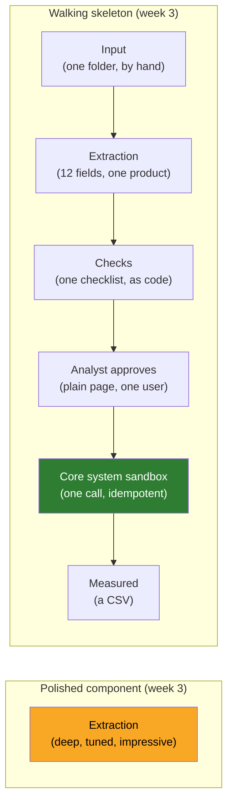

# 07 · Step 5: The Walking Skeleton: Every Layer Present, Each One Thin

> Day 7 · Section 7 of 16 · [Chapter overview](README.md) · Previous: [06 · Step 4: workstreams](06-step-4-workstreams.md) · Next: [08 · Godavari: nine days to three](08-godavari-nine-days-to-three.md)

---

## 7.1 The idea

A **walking skeleton** is the thinnest version of the system that does the whole job end to end: input
in, result out, through every layer the final system will have, with each layer deliberately small.
The term comes from Alistair Cockburn's writing on software architecture (section 16) and the interview
guides adopted it because it describes exactly what an FDE should propose in step five: "the thinnest
possible walking skeleton", then iterate.

The alternative, and the thing most engineers build first, is a **polished component**: the extraction
model, tuned until it is impressive, demonstrated on a laptop. It is not connected to anything. It does
not read the real SFTP folder, does not write to the core system, does not know who may see which file,
and has never been touched by an analyst.

Both take three weeks. One of them has found out whether the SOAP sandbox works, whether the idempotency
key is accepted, whether the analysts will use a queue, and whether the metrics can be measured. The
other has found out that extraction works on files you chose.

## 7.2 Why the skeleton beats the polished component: integration risk surfaces first

Here is the argument in one line: **the risks that kill engagements are at the joints, not in the
components, and only an end-to-end slice exercises the joints.**

Go back to step 4's risk column. The highest-risk workstreams at Godavari are integration and security,
neither of which is a component. The polished extraction demo touches neither. The skeleton touches
both in week one: the first CreateApplication call into the sandbox either creates a duplicate on retry
or it does not; the first service account request either goes through the CISO's process or it does
not. Either way, you know in week two, when the knowledge costs a conversation.

| What the skeleton finds in week three | What the polished component finds in week eleven |
|---|---|
| the sandbox is refreshed quarterly and the last refresh broke the WSDL | the same thing, with eight weeks of code written against the wrong assumption |
| the analysts open the review page, approve two files, and ask for the tracker's colour codes | the analysts see a demo and say "nice", then keep using the tracker |
| the metrics in step 2 can be logged per file from the first day | nobody can say what the demo did to turnaround, because it never touched a real file's path |
| page classification is needed before extraction on 40-page scans | the demo used five hand-picked single-document PDFs |
| the completeness rules the compliance head signed catch 30 percent of files on day one | completeness was "phase two" |

There is a second reason, which the Palantir guide states as a preference: the thin slice is usually
"a visibility layer rather than a prediction model". A skeleton that shows the analysts which files
are incomplete on day one, before any extraction accuracy is proven, already delivers value against
the send-back metric. Prediction can come later; the pipe is the hard part.

> **Analogy (Telugu audience).** The tasting plate at a wedding kitchen (Day 20 uses the same picture).
> Before a thousand plates are served, the cook sends one plate to the family: every item on it, each
> a spoonful, judged honestly. Nobody sends out a perfect gulab jamun and asks the family to imagine the
> rest of the meal.

## 7.3 Designing the skeleton: one row per layer

The skeleton is described as a table with one row per layer of the final system, and three columns:
what the thin version does, what is stubbed or manual, and what it proves. Godavari's:

| Layer | What the thin version does | What is stubbed or manual | What it proves |
|---|---|---|---|
| Input | picks up one branch's two-wheeler loan PDFs from a sandbox SFTP folder | files copied by hand from the real SFTP, masked, approved by the compliance head | we can read what the branch sends |
| Processing | classifies pages and extracts the 12 mandatory fields | two-wheeler forms only; Telugu fields may be returned as "unsure" | the extraction path works on real scans |
| Checks | runs the two-wheeler completeness checklist as code | one product's rules; alternatives not yet listed | the deterministic layer catches missing documents |
| Human in the loop | an analyst sees fields and flags, corrects, approves | a plain review page, no SSO, one user | analysts will use a queue, and what they correct |
| Output / system of record | CreateApplication in the core-system sandbox with an idempotency key | sandbox only; the tracker is not yet written back | the integration path works end to end, no duplicates |
| Measurement | per-file time, fields corrected, completeness flags, logged | a CSV, not a dashboard | the step-2 metrics can be measured at all |

Two rules for filling it in:

1. **Every layer is present.** If the final system has a human approval step, the skeleton has one, even
   if it is a plain HTML page with one user. If the final system writes to the core system, the skeleton
   writes to its sandbox, even if it is one call. A skeleton missing a layer is a polished component in
   disguise.
2. **Every layer is thin, and the "stubbed" column says how.** "One product, one branch, one path" is
   the usual scope sentence. The stubbed column is the honest list of what is not real yet, and it goes
   on the first slide of the week-three demo (Day 20).

## 7.4 Choosing the slice: one product, one site, one path

The scope sentence has three choices in it, and each is made with step 3's data:

| Choice | Godavari | Why |
|---|---|---|
| One product | two-wheeler loans | the largest share of files in the sample (81 of 200), a short checklist, and forms that are mostly printed rather than handwritten |
| One site | Kukatpally branch | close to the Hyderabad analysts for daily feedback; a branch manager who wants fewer send-backs |
| One path | SFTP scans only, no phone photos | the sample's send-back rate for clean scans is 19 percent against 55 percent for phone photos; prove the clean path first, then widen |

The slice should be **representative, not easy**: real scans from a real branch, chosen by the
analysts, not the five cleanest PDFs you could find. Day 20's demo discipline ("files chosen by the
analysts, show a failure on purpose") starts here.

## 7.5 What the skeleton must prove

Write one sentence: by the end of week three, **a PDF goes in, fields and a completeness result come
out, an analyst approves, a record lands in the sandbox, and the whole path is measured on ten files
the analysts chose.** If the sentence has an "and" that is not yet true in week three, the skeleton
is not walking.

Then write the failure modes you expect and what each would change to the plan. This is the part the
guides score as "surface failure modes" and it is the part most candidates skip:

| Expected failure | What it would change |
|---|---|
| Telugu field accuracy too low | a Telugu-specific extraction workstream; those fields stay manual in the pilot |
| the SOAP sandbox is unusable | build a stub from the owner's WSDL; integration risk moves to week five against production-like data |
| analysts bypass the review queue and keep the tracker | enablement becomes the first workstream, not the last; the tool reads the tracker before it replaces it |
| the compliance head will not approve masked files leaving the data centre | the skeleton runs on-prem from week one; the VPC decision (Day 21) moves earlier |

## 7.6 What the skeleton is not

- **Not a prototype in the demo sense.** A prototype shows what could be. A skeleton is the first
  version of what will be, in the same shape, and is extended rather than thrown away.
- **Not the MVP in the product sense.** An MVP is the smallest thing a customer would pay for. A
  skeleton is the smallest thing that exercises every layer; it may not be usable by all forty analysts
  yet. Day 8's pilot (weeks 7 to 10) is closer to an MVP.
- **Not a proof of concept of the model.** The model is one box. The skeleton proves the pipe.

## 7.7 What step 5 sounds like in the interview

> "For the first slice, I would take one loan product, one branch, and only the files that arrive as
> clean scans. A file comes in from a folder, we classify its pages and pull the dozen mandatory fields,
> we run the completeness rules for that product as code the compliance head has signed, an analyst sees
> the fields and the flags on a plain page and approves, and we write one record into the core system's
> sandbox with an idempotency key so a retry cannot duplicate it. Every file is timed and every
> correction logged. That is three weeks. It is thin on purpose: it proves the pipe works, the analysts
> will use a queue, and the metrics can be measured, before we invest in accuracy. The failures I expect
> are Telugu fields, the sandbox, and the analysts keeping their spreadsheet, and each of those would
> change the order of the next phase."

That is the first time in twenty-five minutes you have described a system, and every piece of it was
forced by steps one to four.

## 7.8 Key takeaways

- The skeleton is the thinnest end-to-end slice with every layer present; the polished component is one
  deep layer connected to nothing.
- The skeleton wins because the engagement-killing risks are at the joints, and only an end-to-end slice
  exercises the joints in week three instead of week eleven.
- Describe it as a table: one row per layer; thin, stubbed, proves.
- One product, one site, one path, chosen with step 3's data; representative, not easy.
- Say what it must prove and what failures you expect; each failure maps to a plan change.
