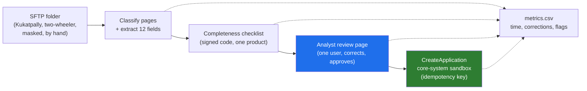

# 08 · Godavari, End to End: "Nine Days to Three" Through All Five Steps

> Day 7 · Section 8 of 16 · [Chapter overview](README.md) · Previous: [07 · Step 5: the walking skeleton](07-step-5-walking-skeleton.md) · Next: [09 · The interview round](09-the-interview-round.md)

---

Sections 03 to 07 each showed their step on Godavari. This section runs the whole method in one pass, the
way you would at the end of discovery week two, with the reasoning between steps made visible. The
filled worksheet is [`worksheet/godavari-decomposition.md`](worksheet/godavari-decomposition.md); this
is the narrative version of it.

## 8.1 Where we stand before step 1

What Days 4 to 6 established, and what this section takes as given:

- **Day 4:** of the COO's seven candidates, loan-file intake and completeness won the scoring sheet: 60
  percent of files arrive as paper or PDF, analysts re-key them into the 2009 core system, and 31
  percent go back to the branch at least once. The signed one-sentence problem: "New loan files take a
  median of nine days from receipt to decision because intake is manual and a third of files are
  incomplete."
- **Day 5:** the map. COO as sponsor; forty analysts in Hyderabad and Vijayawada as operators; the CISO
  and the compliance head as blockers; the core-system owner as the person whose goodwill decides the
  integration; the RBI auditor as the ghost. "No customer PII leaves India" is already in the
  constraints list.
- **Day 6:** the real workflow. Nineteen steps, not twelve; WhatsApp photos at step fourteen; the Excel
  tracker as the true source of file status; and the answer that changed the architecture: branch
  managers must not see other branches' files, and that rule lives in AD groups synced from HR.

## 8.2 Step 1: clarify

The COO's sentence is "nine days to three". Rewritten:

> Median turnaround for new loan files in the two pilot branches from 9.2 days to 3 to 4 days by day
> 90, measured the way the operators agree, without raising the field-level error rate the RBI auditor
> sees and with no new audit findings.

The trade-off is **speed against error rate**, and the error rate is set by the compliance head and
judged by the auditor. It is asymmetric: a slow file costs rupees of delayed disbursement (Day 9 puts
a number on it); a wrong field or a skipped KYC document costs an audit finding, which is a different
kind of cost that the COO cannot trade away.

The constraints that cannot move: no PII leaves India; the mandatory KYC documents per RBI's Master
Direction are never skipped; the core system's data model does not change.

The assumptions, written so they can be revisited: the nine days are mostly waiting (Day 6's shadowing
supports this: the three-day wait for a resent document and the overnight batch dominate); intake and
completeness are the biggest share of the waiting; the analysts will accept a review queue if it
removes re-keying.

Reasoning to the next step: because the lever is waiting rather than analysis, the metrics that
matter most are the ones that measure waiting (send-backs, days to completeness), and the stakeholders
who control the waiting (branch managers upstream, the core-system batch downstream) must be on the
list.

## 8.3 Step 2: stakeholders and metrics

The eight rows from section 04, condensed to the metric each would accept:

| Stakeholder | Metric accepted |
|---|---|
| COO (sponsor) | median turnaround days, pilot branches |
| 40 analysts (operators) | analyst hours per file; send-back rate |
| team lead (champion) | files per analyst per day |
| CISO (blocker) | passed security review; VPC in AWS Mumbai; no vendor-held production credentials |
| compliance head (blocker) | field-level accuracy on KYC fields; zero completeness misses |
| core-system owner (blocker, then partner) | zero duplicate records; calls inside the batch window |
| RBI auditor (ghost) | an audit trail per file with a human decision |
| branch managers (upstream operators) | files accepted first time |

The four metrics the Part file names (turnaround, analyst hours per file, send-back rate, field-level
accuracy) are the ones the business case (Day 9) and the golden set (Day 14) will carry. The other four
are conditions: they do not appear in the business case, but failing any one of them ends the
engagement.

The conflict to carry to the readout: the COO's turnaround improves most if clean files are
auto-approved; the auditor's condition requires a human decision. The skeleton obeys the auditor.

Reasoning to the next step: field-level accuracy needs labelled files that do not exist; zero
duplicates needs to know how the SOAP API behaves on retry; the analysts' metrics need the tracker's
data. Step 3 has to find all three.

## 8.4 Step 3: map the inputs

The seven-row table from section 05. The reasoning that matters is what each row forces:

1. **Scanned PDFs, 8 to 40 pages, no page index, nightly SFTP.** Classification before extraction.
   Same-day intake is bounded by the batch; the "three days" cannot start before the file arrives.
2. **The 2009 SOAP API, 61 fields on CreateApplication, no idempotency, a quarterly sandbox.** The
   integration layer owns idempotency (an application key derived from the file, checked before every
   create). The sandbox's staleness is itself a risk to retire early.
3. **The Excel tracker, 40 workbooks, the true state, no API, no timestamps.** The tool reads the
   tracker before it replaces it, and writes status back, or the analysts will run two systems and
   abandon the new one. The baseline must be hand-sampled.
4. **AD groups per branch and role, synced nightly.** Every query filters by the caller's groups
   (Days 15 and 22 build it); the service account needs the CISO's review, which is on the critical path.
5. **WhatsApp photos, not allowed.** A resubmission flow: tell the branch on day one which page is
   missing and how to send it properly.
6. **RBI KYC rules and an internal checklist that does not list acceptable alternatives.** The
   completeness rules are deterministic code the compliance head signs (Day 11's line between code and
   model), and the alternatives list is a week of her time, scheduled.
7. **28,000 historical decisions, free-text send-back reasons, no field-level ground truth.** The golden
   set is a workstream with two senior analysts (Day 14); the send-back reasons can seed the completeness
   rules but cannot train anything.

Data that does not exist: field-level ground truth (the analysts and the compliance head create it);
timestamps (a two-week hand count creates the baseline, Day 9).

Reasoning to the next step: rows 2, 4 and 7 each describe something that could change the plan and is
slow or outside Kaagaz's control. Those are the high-risk workstreams. Row 1 is where the value is.
Row 6 is high value and low risk. Row 3 and row 5 are adoption, which becomes enablement.

## 8.5 Step 4: workstreams, sequenced

Six workstreams, scored, with the reasons (section 06), and the order the chapter's script produces:

| Rank | Workstream | Value | Risk | Starts | Why here |
|---|---|---|---|---|---|
| 1 | Integration: SFTP, tracker, SOAP create with idempotency | 4 | 5 | week 1 | duplicates on retry and a stale sandbox are the biggest technical unknowns |
| 2 | Security review and VPC path | 2 | 5 | week 1 | eight weeks, outside our control; its outcome changes what is allowed |
| 3 | Evals: golden set of 100 to 200 labelled files | 3 | 4 | week 1 | no ground truth; without it nobody can say extraction works |
| 4 | Extraction: pages and fields from scanned PDFs | 5 | 4 | week 2 | the value; one week behind the labelled set it is judged against |
| 5 | Completeness checks: deterministic rules per product | 4 | 2 | week 5 (thin version in week 1) | the rules are knowable; the thin version is in the skeleton |
| 6 | Enablement: review queue, tracker migration, resubmission | 3 | 3 | week 6 | adoption risk; planned from week one, worked before the pilot |

Out of scope for now, each with a reason and the person who agreed (Day 8 owns this list; step 4 starts
it): the branch chatbot (no baseline); collections call summaries (different operators); any change to
the core system's data model (the owner's condition); any processing outside India (the compliance
head's condition).

Reasoning to the next step: the skeleton must take a thin slice of all six. The thin slice of
integration is one sandbox call with an idempotency key. The thin slice of security is masked files
approved by the compliance head, running where she allows. The thin slice of evals is the first fifty
labelled files. The thin slice of extraction is twelve fields on one product. The thin slice of
completeness is one checklist. The thin slice of enablement is one analyst using a plain review page
and telling you what is wrong with it.

## 8.6 Step 5: the walking skeleton

> **Scope:** two-wheeler loans, Kukatpally branch, SFTP scans only.
> **Path:** PDF in, pages classified, twelve mandatory fields out, the two-wheeler completeness checklist
> run as signed code, an analyst corrects and approves on a plain page, one CreateApplication call into
> the core-system sandbox with an idempotency key, every step timed and logged to a CSV.
> **Proves by week three:** the pipe works on real scans, the sandbox accepts and de-duplicates, an
> analyst will use a queue, and the step-2 metrics can be measured on ten files the analysts chose.
> **Stubbed:** files copied by hand and masked; one user, no SSO; the tracker not yet written back;
> Telugu fields may come back as "unsure".
> **Expected failures and what each changes:** Telugu accuracy (a Telugu workstream; those fields stay
> manual); the sandbox (a WSDL stub; integration risk moves to week five); analysts bypassing the queue
> (enablement moves first; the tool reads the tracker before replacing it); masked files not allowed
> out (the skeleton runs on-prem; the VPC decision moves earlier).

This is the slice Day 20 ships and demonstrates, and the one Part 4 deploys into Godavari's AWS Mumbai
account. Every box in it will be replaced by something better (Days 11 to 19); none of them will be
removed.

## 8.7 What changed because we did it in this order

It is worth seeing what the architecture-first version would have missed. Suppose the FDE had said, in
minute one, "OCR, extraction model, vector store, chatbot, push to core." Compare:

| Minute-one architecture | What the five steps produced instead | Which step found it |
|---|---|---|
| OCR on every file | page classification before extraction; SFTP scans first, phone photos later | 3 (shape), 5 (one path) |
| extraction model | extraction judged against a labelled set that must be created with the analysts | 3 (missing data), 4 (evals first) |
| vector store and chatbot | not in scope; no metric needs it; the COO's chatbot is "not now" | 2 (no stakeholder metric), 4 (out of scope) |
| push to core | an idempotent create into a sandbox, as the first risk retired | 3 (no idempotency), 4 (risk first) |
| nothing about rules | deterministic completeness checks signed by the compliance head, catching 30 percent of files on day one | 1 (trade-off), 3 (RBI rules) |
| nothing about access | group-filtered access from the first query; the service account on the critical path | 3 (AD groups) |
| nothing about the tracker | read it before replacing it; write status back | 3 (the tracker), 2 (the analysts' fear) |
| nothing about security | the questionnaire starts in week two; the VPC decision made with the CISO | 2 (the CISO's metric), 4 (risk first) |
| "demo in three weeks" | a walking skeleton in three weeks, with a stubbed list and an expected-failures list | 5 |

Every row on the right is something the engagement would otherwise have discovered between weeks eight
and twelve. That is the whole case for the method.

## 8.8 Key takeaways

- The five steps on Godavari take the goal from "nine days to three" to a six-workstream plan and a
  week-three skeleton without naming a technology until step five.
- Each step's output feeds the next: the trade-off decides the metrics, the metrics decide what inputs
  matter, the inputs decide the risks, the risks decide the order, the order decides the slice.
- The architecture-first version misses nine things; the method finds all of them in week two.
