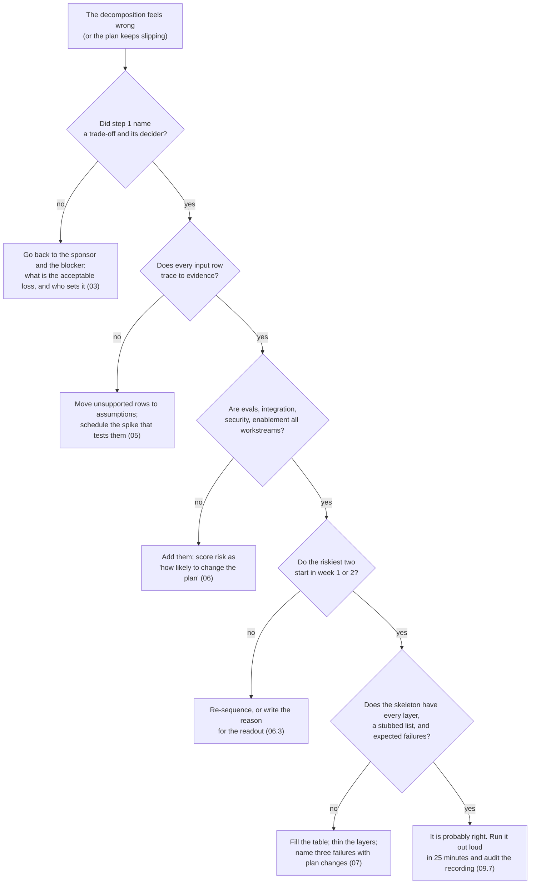

# 13 · Common Mistakes and Debugging

> Day 7 · Section 13 of 16 · [Chapter overview](README.md) · Previous: [12 · Project: decompose Godavari](12-project-decompose-godavari.md) · Next: [14 · Interview questions](14-interview-questions.md)

---

Each row is **symptom, cause, fix**, with the section that explains it. The first table is the interview;
the second is the job; the third is the worksheet and the script.

## 13.1 In the round

| Symptom | Likely cause | Fix |
|---|---|---|
| You described an architecture inside the first two minutes | the solution was visible to you and you said it; "solution before scoping" | announce the five steps in sentence one; make "I will not propose a system until step five" a spoken commitment (02.2, 09.4) |
| The interviewer says "you have asked a lot of questions; what would you build?" at minute 12 | steps 1 to 3 ran long without a "then" attached to each question | every question carries its consequence ("if nightly, then same-hour intake is off the table"); move to step 4 by minute 14 (09.3) |
| Long silences while you think | no narration pattern to fall back on | label the step, state an assumption, park a question, or announce the pause (09.5) |
| You listed "users, IT, management" as stakeholders | Day 5's four roles not applied; upstream producer and ghost forgotten | sponsor, operators, blockers, ghost, upstream producer, system owner; a metric each (04.4) |
| Your inputs were "the documents and the database" | you took the data as the prompt described it | shape, owner, freshness, access, missing, per input; say the data that does not exist (05.2, 05.4) |
| The interviewer asks "what could go wrong?" and you had not said | failure modes only when prompted | three expected failures with plan changes are part of step 5, said unprompted (07.5) |
| Pushed with "just tell me the architecture", you gave the full design and never came back to the method | folding | commit in four sentences, name the two unknowns, say what would change (09.6) |
| Pushed, you refused: "I really need more information" | refusing to commit | state the assumption, commit, flag what changes it (09.6) |
| Your first slice was "the whole system for one customer" | thin confused with small-customer | one product, one site, one path; every layer present; stubbed column (07.3, 07.4) |
| You ran out of time in step 3 | the inputs table was recited row by row without the architecture-risk sentence | one sentence per input: what it forces the design to do; details only if asked (05.7) |

## 13.2 On the job

| Symptom | Likely cause | Fix |
|---|---|---|
| The demo in week three works on your files and fails on the analysts' | slice chosen to be easy; shape column skipped (page order) | representative slice chosen by the analysts; classification as a workstream (07.4, 11.1) |
| Integration "waiting for the sandbox" in week six | integration not first; freshness and access of the sandbox not asked | integration spike in week one; a stub from the WSDL if the sandbox is stale (06.3, 08.5) |
| Security questionnaire arrives in week eight and takes eight weeks | the CISO's metric not in step 2; the review not in week two | security review as a risk-5 workstream from week one (04.2, 06.2) |
| Analysts use the tool for a day and go back to the tracker | the tracker not recognised as the real state; enablement not a workstream | read the tracker before replacing it; write status back; enablement planned from week one (05.3, 06.1) |
| The compliance head finds a missing document marked "present" | completeness as model behaviour instead of signed deterministic rules | rules as code the compliance head signs; the model never overrides them (Day 11; 05.3) |
| Nobody can say how many hours were saved at day 90 | baseline never sampled; "data that does not exist" not written | the two-week hand sample as a step-3 line item; metrics measurable from the first slice (04.3, 05.4) |
| A branch manager sees another branch's file | AD-groups row skipped | group-filtered access from the first query; the service account on the critical path (05.3; Days 15, 22) |
| Duplicate records in the core system after a timeout | no idempotency on CreateApplication not written down | an idempotency key owned by the integration layer, tested in the skeleton (05.3, 07.3) |
| Widening to the second product is a rebuild | the skeleton's stubbed list never written ("tuned on two-wheeler forms only") | the stubbed column, on the first slide of the week-three demo (07.3; Day 20) |
| The auditor asks who approved a file and the system has only the model's output | the ghost's metric (an audit trail with a human decision) skipped | a human decision per file in the skeleton; logged from day one (04.4, 04.5) |
| The decomposition is unchanged at week eight | treated as a document, not a set of bets | revisit at week 1, 3, 4, 8 and day 90; version, never rewrite (11.3) |

## 13.3 The worksheet and the script

| Symptom | Likely cause | Fix |
|---|---|---|
| `Step 4 table has no filled rows` | the template was run, or names are empty | fill the workstream names; keep W1, W2, ... in the first cell |
| `W2 (...) : value, risk and weeks must be whole numbers` | "3-4" or "high" in a score cell | 1 to 5 as integers; weeks as an integer |
| `no workstream mentions 'security'` (or `enable`, `eval`, `integrat`) | the four non-AI workstreams dropped | add them; if one is genuinely out of scope, say so under "out of scope" and rename nothing to fool the check |
| `W1 depends on W7, which is not in the table` | a dependency on a deleted row | fix the codes |
| `dependency cycle among W1, W2` | A depends on B depends on A | one of them does not really depend on the other; split the thin version out |
| `warning: W5 has risk 5 but starts in week 4` | the capacity rule pushed a risky workstream back, or it depends on something slow | reconsider dependencies; or accept and write the reason in the readout |
| `warning: the 'why this score' cell is too short` | a label ("plumbing") instead of a reason | a sentence a COO would accept |
| The order looks wrong to you | the weights are a convention; or your risk scores measured difficulty | re-read 06.2's definition of risk; if the order still looks wrong, your "why" cells will show which score to change |
| The sample numbers in the text do not match the run | the generator was changed | the quoted output is from the seeded run described in 12.3; re-paste after any change |

## 13.4 A routine for a decomposition that feels wrong

## 13.5 Key takeaways

- In the round, the mistakes are solution-first, silence, generic stakeholders, data as described,
  failure modes on request, folding or refusing under pushback.
- On the job, each skipped step has a month-later symptom: stale sandbox, late review, abandoned tool,
  no baseline, cross-branch leak, duplicates, audit finding.
- The script catches the mechanical mistakes (scores, dependencies, four missing workstreams, labels
  instead of reasons); the human checks are evidence per input and the roles count.
