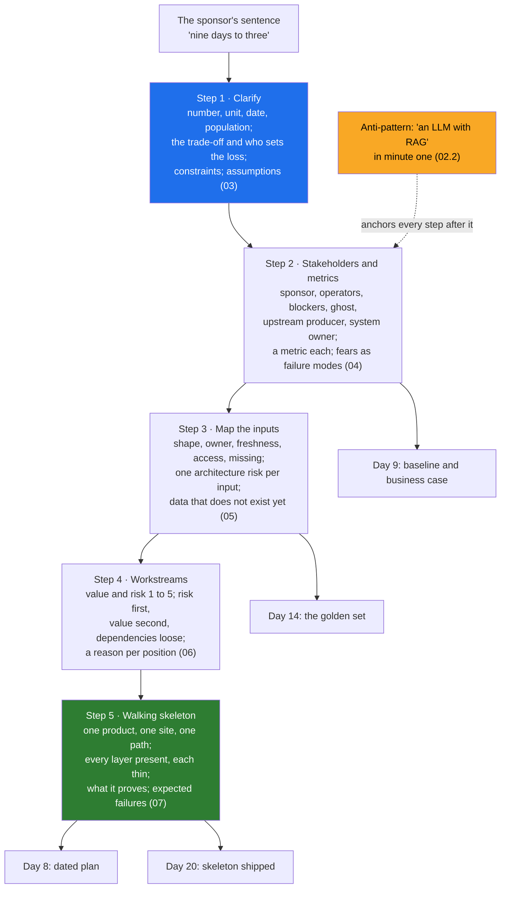

# Day 7 · Decomposition: The Five-Step Method and the Walking Skeleton

> **[Part 2 · Discovery and Decomposition](../README.md)** · Chapter 4 of 7 · Video ~13 min · Chapter tier: big
> Builds on: [Day 4 (picking the right problem)](../04-picking-the-problem/README.md) ·
> [Day 5 (the stakeholder map)](../05-the-stakeholder-map/README.md) ·
> [Day 6 (discovery interviews, the real workflow)](../06-discovery-interviews/README.md) ·
> [Day 2 (the three buckets)](../../01-the-role/02-the-three-buckets/README.md) ·
> [Day 3 (the services trap)](../../01-the-role/03-the-economics/README.md)
> Sets up: Day 8 (the workstreams become the dated 90-day plan), Day 9 (step 2's metrics become the
> baseline and the business case), Day 10 (the decomposition section of the discovery document), Day 11
> (the deterministic-versus-LLM line the skeleton already draws), Day 14 (the golden set step 3 says must
> exist), Day 20 (the walking skeleton shipped), Day 42 and Day 44 (the capstone and ten timed drills apply
> the method)
> **Owner:** this chapter owns **the decomposition method for the course: the five steps (clarify the goal
> and the trade-off; stakeholders and the metric each accepts; map the inputs by shape, owner, freshness,
> access and what is missing; workstreams sequenced by risk and value; a walking-skeleton MVP with every
> layer present and each thin), why a skeleton beats a polished component, the "LLM with RAG in minute one"
> anti-pattern, how the decomposition interview round scores it, the 25-minute out-loud protocol, the
> decomposition worksheet, and the method run on three problems.** Picking the problem is Day 4's; the
> stakeholder roles are Day 5's; interviewing and the real workflow map are Day 6's; the dated plan,
> checkpoints and the "will not do" list are Day 8's; metrics measured and the business case are Day 9's;
> the discovery document and saying no are Day 10's; the full interview loop is Day 43's and the ten drills
> are Day 44's.
> Versions used: the two scripts were run on **Python 3.14.3** (standard library only, no packages; as of
> October 2026). Shown outputs are from real runs. All data is synthetic and generated by code in `code/`.

---

## Why this chapter exists

The COO of Godavari Finance says "nine days to three". The engineer who answers with an architecture
in the next sixty seconds has just done the thing the FDE interview loop rejects more often than any
other, and the thing that on the job produces a prototype built for the sponsor's version of the
problem that the operators never use. The open-ended decomposition round has the lowest pass rate of
any stage in the loop; the 2026 guides call it the single biggest filter and give it 45 to 60 minutes;
the most common rejection is jumping to a solution before scoping. Customer-facing discovery appears in
70 percent or more of the 1,000 FDE postings analysed in 2026 and is the fastest-rising of the three
buckets, because engineers who can build a pipeline are easy to find and engineers who can turn a vague
goal into a plan a CISO signs are not.

This chapter teaches the method those engineers use, as five steps with a written output each: clarify
the goal and the trade-off; name the stakeholders and the metric each would accept; map the inputs as
they really are; decompose into workstreams and sequence them by risk and value; propose a walking
skeleton with every layer present and each one thin. It explains why the skeleton beats a polished
component (the risks that kill engagements are at the joints, and only an end-to-end slice tests them
in week three), names the anti-pattern, shows how the round scores it, and runs the whole method on
Godavari's "nine days to three", on a published interview case (a city's emergency response times) and
on an Indian trucking firm's receivables, so that you see it transfer. You leave with a worksheet, a
script that turns it into a sequenced plan, a 25-minute out-loud protocol with a timing table, good and
bad openings side by side, the words for "just tell me the architecture", and three timed drills.

## Mental model

One sentence to carry out of the chapter: **clarify the goal and its trade-off, attach a metric to every
person who can judge or stop the work, write the inputs down as they really are, order the work by what
could change the plan, and ship a thin slice through every layer in week three; do not say the word
"model" until the fifth step.**

## Learning goals

After this chapter you can:

1. Rewrite a sponsor's goal as a number with a unit, a date and a population, name the trade-off being
   optimised and the person who sets the acceptable loss, and list the constraints that cannot move.
2. Build the stakeholder table with the metric each would accept, including the upstream producer, the
   system owner and the ghost, and name the conflicts between metrics.
3. Map every input by shape, owner, freshness, access and what is missing, write the architecture risk
   each one forces, and name the data that does not exist yet and who will create it.
4. Decompose into five to seven workstreams that include evals, integration, security review and
   enablement; score value and risk (risk as "how likely to change the plan"); sequence risk first,
   value second, dependencies loosely; and give a one-sentence reason for every position.
5. Design a walking skeleton as a table (one row per layer: thin version, stubbed, what it proves),
   choose the slice with step 3's data, and name three expected failures with the plan change each
   implies.
6. Explain why the skeleton beats a polished component and why "an LLM with RAG" in minute one is the
   most common rejection.
7. Run the method out loud in 25 minutes with the step labels spoken, handle "just tell me the
   architecture" by committing while naming what would change the commitment, and audit a recording
   against the seven scored behaviours.
8. Apply the method to Godavari's "nine days to three" in full, and transfer it to a city's emergency
   response and a trucking firm's receivables.
9. Recognise how a skipped step shows up months later and trace the symptom to the step.
10. Fill the decomposition worksheet, generate the inputs inventory and the sequenced plan with the
    chapter's scripts, and pressure-test a decomposition with an AI agent while catching its two
    characteristic failures: inventing data that does not exist and skipping stakeholders.

**Prerequisites:** Days 4 to 6 (the problem, the map, the real workflow). Python at a reading level for
the two small scripts; no libraries.

## Reading order

| # | Section | What you get | Words |
|---|---|---|---|
| 01 | [Why decomposition](01-why-decomposition.md) | Minute one in the COO's room, two ways; the career reason; what decomposition is; where it sits between Days 4 to 6 and 8 to 44; the three hard parts named | ~1,350 |
| 02 | [The five steps](02-the-five-steps.md) | Each step's question, output and failure; the no-solution-before-step-five rule; the three sources mapped; the method on one page for Godavari; state assumptions and narrate | ~1,500 |
| 03 | [Step 1: clarify](03-step-1-clarify.md) | The unit, the date, the trade-off; the pairs table; constraints; the clarifying questions; the worksheet row; what it sounds like | ~1,350 |
| 04 | [Step 2: stakeholders and metrics](04-step-2-stakeholders-and-metrics.md) | Day 5's map plus a metric each; measurable from the first slice; the three stakeholders people miss; when metrics conflict | ~1,300 |
| 05 | [Step 3: map the inputs](05-step-3-map-the-inputs.md) | Shape, owner, freshness, access, missing; Godavari's seven inputs and what each forced; data that does not exist; the synthetic sample read as step 3 | ~1,650 |
| 06 | [Step 4: workstreams](06-step-4-workstreams.md) | Where workstreams come from; scoring value and risk; risk first, value second, dependencies loosely; the script's order; the two sequencing mistakes | ~1,500 |
| 07 | [Step 5: the walking skeleton](07-step-5-walking-skeleton.md) | Skeleton versus polished component; integration risk surfaces first; one row per layer; one product, one site, one path; what it proves; expected failures | ~1,600 |
| 08 | [Godavari: nine days to three](08-godavari-nine-days-to-three.md) | All five steps in one pass with the reasoning between them; the skeleton diagram; what the minute-one architecture would have missed | ~1,900 |
| 09 | [The interview round](09-the-interview-round.md) | What is scored; the 25-minute protocol with a timing table; good and bad openings side by side; narration patterns; "just tell me the architecture"; the self-audit | ~2,250 |
| 10 | [Two more problems](10-two-more-problems.md) | The city's emergency response (a published case) and Rayalaseema Roadways' receivables, both through all five steps; what transferred and what did not | ~2,450 |
| 11 | [Production concerns](11-production-concerns.md) | How a bad decomposition shows up at week 3, 6, 8, 10, 12 and month 4 to 6; why costs grow; the decomposition as a living document; where cost, latency, scale and security enter | ~1,100 |
| 12 | [Project: decompose Godavari](12-project-decompose-godavari.md) | The worksheet; the inputs inventory and sample as data; the sequenced plan from the worksheet with real output; Build it with AI; How do you know it's right | ~2,550 (incl. output) |
| 13 | [Mistakes and debugging](13-mistakes-and-debugging.md) | Symptom, cause, fix for the round, the job, and the worksheet and script; a routine for a decomposition that feels wrong | ~1,150 |
| 14 | [Interview questions](14-interview-questions.md) | 16 questions with model answers, plus a quick-fire round | ~2,050 |
| 15 | [Exercises](15-exercises.md) | 12 graded exercises: three timed drills, predict-the-output and break-it on the script, "review this AI-written decomposition", the readout paragraph, your own project | ~2,500 |
| 16 | [Further reading](16-further-reading.md) | The interview guides, the FDE playbooks, the walking-skeleton sources, the RBI and DPDP texts behind Godavari's constraints | ~650 |

**Short on time?** Read 02, 07, 08 and 09, then do the project (12) and one timed drill (15, 2.1). That
is the video plus the reflex the interview tests. Add 10 before Day 44 and 11 before Day 8.

## Files

| Path | What |
|---|---|
| [`worksheet/decomposition-worksheet-template.md`](worksheet/decomposition-worksheet-template.md) | the empty worksheet: five steps, one table each, narration notes for the out-loud run |
| [`worksheet/godavari-decomposition.md`](worksheet/godavari-decomposition.md) | the filled Godavari worksheet; section 08 is its narrative |
| [`worksheet/ai-draft-godavari.md`](worksheet/ai-draft-godavari.md) | an AI-written draft with at least ten problems; exercise 3.1 |
| [`code/inputs_inventory.py`](code/inputs_inventory.py) | step 3 as data: writes `data/godavari_inputs_inventory.csv` (one row per input) and `data/godavari_loan_file_sample.csv` (200 synthetic files) and prints the summary |
| [`code/plan_from_worksheet.py`](code/plan_from_worksheet.py) | reads a worksheet's Step 4 table, checks it, sequences by risk and value with dependencies and FDE capacity, writes `data/<name>-plan.json` and a week grid `data/<name>-plan.md` |
| `data/` | the generated CSVs, plan JSON and week grid (regenerated by the scripts) |

Run from the chapter folder: `python -X utf8 code/inputs_inventory.py` and
`python -X utf8 code/plan_from_worksheet.py worksheet/godavari-decomposition.md` (each under a second).
No packages, no downloads, no API keys. `-X utf8` keeps Windows consoles happy with the middle dot.

## What this chapter does *not* teach (single-owner rule)

| Topic | Where it's taught |
|---|---|
| Choosing which problem to attack; the scoring sheet; the demo and chatbot traps | [Day 4](../04-picking-the-problem/README.md) |
| The four stakeholder roles, power and interest, the champion, the customer's calendar | [Day 5](../05-the-stakeholder-map/README.md) (step 2 here adds the metric column) |
| Shadowing, the interview plan, the question bank, the situational map | [Day 6](../06-discovery-interviews/README.md) (step 3 here is the inputs half of that map as a table) |
| The dated 90-day plan, overlapping phases, checkpoints, the "will not do" list | [Day 8](../08-scoping-the-first-90-days/README.md) (step 4 here produces the order and the reasons) |
| Measuring the baseline, hours into rupees, the business case | [Day 9](../09-success-metrics-and-business-case/README.md) (step 2 here decides what is measured) |
| Writing and defending the discovery document; saying no | [Day 10](../10-the-discovery-document/README.md) |
| Which work is deterministic code and which is the model | Day 11 (the skeleton here already draws the line for completeness rules) |
| Building the golden set with the customer's experts | Day 14 (step 3 here says it must exist) |
| Shipping and demonstrating the skeleton | Day 20 |
| The full interview loop and the ten timed drills with worked answers | Days 43 and 44 |

## Analogies for the Telugu audience

- **Chasing 300 in a one-day match** (the chapter's main picture): nobody says "hit sixes". The captain
  sets a required rate per ten overs (step 1), decides which wickets to keep in hand and which bowler to
  attack (steps 2 to 4), and plans the first ten overs to prove the chase is on (step 5). The first ten
  overs are the walking skeleton (01.2).
- **The tasting plate at a wedding kitchen**: one plate to the family, every item on it, each a
  spoonful, judged honestly; not one perfect gulab jamun and a promise (07.2).
- **Google Maps versus the auto driver** (Day 6's picture, reused in step 3): the sponsor hands you the
  map; the inputs table is what the auto driver knows (05.1).
- **Booking the hall before printing invitations** (Day 8's picture, previewed in step 4): the scarce,
  risky thing first; the easy thing last (06.3).

## Video map

The video (~13 min) covers a slice; the notes cover everything.

| Asset | Covers | Sections |
|---|---|---|
| **Day 7 main video** (~13 min) | Hook: the COO says "nine to three"; sixty seconds, two ways (1 min) → why it matters: the lowest-pass-rate round, the most common rejection, the prototype nobody runs (1 min) → the five steps on one slide, and the rule: no technology before step five (1 min) → step 1 on Godavari: the trade-off is speed against the auditor's error rate; who sets it (1.5 min) → step 2: eight stakeholders, a metric each; the ghost and the upstream producer (1.5 min) → step 3: seven inputs, one architecture risk each; the data that does not exist (2 min) → step 4: six workstreams, risk first; why security and integration start in week one (1.5 min) → step 5: the skeleton in one diagram; why it beats the polished demo (1.5 min) → the 25-minute protocol table and the bad-versus-good opening (1 min) → recap and the Day 8, 20, 44 teasers (0.5 min) | 01.1 to 01.3, 02.1 to 02.2, 03.2, 04.2, 04.4, 05.3, 06.2 to 06.3, 07.1 to 07.2, 08.6, 09.3 to 09.4 |
| **Short 1:** "Five steps before you say the word LLM." | The anti-pattern in one line; the five step names; the one rule; the COO's sentence through the steps in sixty seconds | 02.1, 02.2, 02.4 |
| **Short 2:** "Walking skeleton: every layer, each one thin, shipped in week three." | The skeleton-versus-polished-component diagram; one product, one branch, PDF in, record out, analyst approves; what it finds in week three that the demo finds in week eleven | 07.1 to 07.3 |
| Notes only | The three sources mapped (02.3), the clarifying questions table (03.4), metrics measurable from the first slice (04.3), the synthetic sample (05.6), the sequencing script and the two mistakes (06.3 to 06.4), the slice choice and the expected-failures table (07.4 to 07.5), the full Godavari pass with reasoning (08), narration patterns, pushback and the self-audit (09.5 to 09.7), the two transfer problems (10), production concerns (11), the project, Build it with AI and How do you know it's right (12), debugging (13), interviews (14), exercises (15) | as listed |

**Callbacks to use on screen:** "Day 4 lo seven problems nunchi loan-file intake ni pick chesam; ivala
daanini build cheyagalige pieces ga break chestunnam." (section 01); "Day 5 stakeholder map gurtunda?
Ivala prati stakeholder ki oka metric add chestunnam." (section 04); "Day 6 lo SOP 12 steps, reality 19
steps chusam; aa 19 steps lo inputs ni ippudu table ga raastunnam." (section 05).
**Forward callbacks:** Day 8 (ee six workstreams ni dates tho 90-day plan ga marchutam), Day 20 (ee
skeleton ni week three lo ship chestam), Day 44 (ide method, ten problems, clock tho).

## Callbacks

- **Builds on:** [Day 4](../04-picking-the-problem/README.md) (the problem statement step 1 starts
  from; the chatbot trap step 4 declines), [Day 5](../05-the-stakeholder-map/README.md) (the four roles
  step 2 extends), [Day 6](../06-discovery-interviews/README.md) (the real workflow, the tracker, the
  WhatsApp channel and the AD-group rule that fill step 3), Day 2 (bucket 3: discovery as the
  fastest-rising skill), Day 3 (the services trap an unscoped engagement becomes).
- **Sets up:** Day 8 (the order dated, checkpoints, "will not do"), Day 9 (the metrics measured, the
  baseline, the business case), Day 10 (the decomposition section of the discovery document), Day 11
  (deterministic rules versus the model), Day 14 (the golden set), Day 15 and Day 22 (group-filtered
  access), Day 16 (the integration surface), Day 20 (the skeleton shipped), Day 23 (the security review
  started in week two), Day 33 (the operator who will not switch), Day 42 and Day 44 (the capstone and
  the drills).

**Next chapter:** Day 8 · Scoping the first 90 days: workstreams, sequencing by risk and value, what you will not do.
