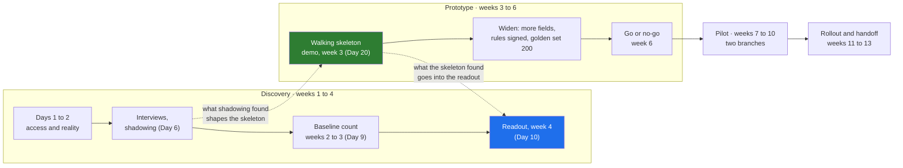

# 02 · The Shape of 90 Days: Overlapping Phases and the Week-3 Skeleton

> Day 8 · Section 2 of 12 · [Chapter overview](README.md) · Previous: [01 · Why scoping](01-why-scoping.md) · Next: [03 · Sequencing in time](03-sequencing-in-time.md)

---

## 2.1 The practitioner convention

The FDE playbooks describe the first engagement in a shape that has become a convention. In the form
the Part 2 plan uses it:

| Phase | Weeks | What it produces |
|---|---|---|
| Discovery | 1 to 4 | access and reality (days 1 and 2), interviews and shadowing, the baseline, the discovery document |
| Prototype | 3 to 6 | a walking skeleton by week 3, widened and measured against the customer's own labelled examples |
| Pilot | 7 to 10 | real users, real files, a small slice of the organisation |
| Productised | by day 90 | in daily use by the people whose work it changes, run by the customer's own team |

Treat this as a **convention, not a law**. It is how practitioners summarise what tends to work, not a
standard anyone publishes with evidence. The sources disagree on the edges: the cloudsoftsol page the Part 2
plan cites frames its 30-60-90 around a newly hired FDE, with dated artefact windows (a security review
pack in days 61 to 75, an evaluation report in days 65 to 85). The getperspective discovery playbook
says eval co-design "should start no later than week three of the engagement". Atlassian's playbook
puts the bar at about twelve weeks to a self-sufficient team. They agree on what matters for planning:
**something real by week three, measured against the customer's experts, and in daily use by day 90**.
Section 12 lists the sources and what each actually says.

## 2.2 Overlap on purpose

Look at the weeks again. Discovery runs 1 to 4. The prototype starts in week 3. They overlap by two
weeks, and that overlap is the most important design decision in the shape.

Why not finish discovery first? Because some of the questions discovery must answer can only be
answered by building something. Does the core system's test copy accept the record? Will the analysts
actually use a review queue, or keep the Excel tracker open beside it? How accurate is extraction on
Vijayawada's Telugu forms? No interview answers those. A thin end-to-end slice does. So the walking
skeleton (Day 7, step 5) is built inside discovery, and what it finds goes into the discovery document
in week 4.

The two dotted arrows are the reason for the overlap. Discovery feeds the skeleton, and the skeleton
feeds discovery back. A plan with a hard line between "discovery" and "build" loses both arrows: the
skeleton is built from a document instead of from the floor, and the document is written without
knowing whether the integration works.

The opposite mistake is overlap without gates: "everything starts in week 1" is a plan to discover in
week 10 that nobody labelled the golden set. The getperspective playbook's rule, "do not advance until every box in the current phase is checked", is
right about **decisions** and wrong if you apply it to **work**. Work overlaps. Decisions are gated:
the pilot does not start until the week-6 checkpoint says yes, however much pilot preparation has
already happened.

## 2.3 Phases are not workstreams

Day 7 made this distinction and it matters more now that dates are attached. A **phase** is a period of
the engagement with a purpose and an exit decision. A **workstream** is a piece of work with an owner
that runs through several phases. At Godavari:

| | Discovery 1 to 4 | Prototype 3 to 6 | Pilot 7 to 10 | Rollout 11 to 13 |
|---|---|---|---|---|
| W4 Integration | access tickets; sandbox spike | skeleton writes to the test copy; a month of clean calls starts | live writes from 8 December | the Mumbai cutover on 4 January |
| W5 Security review | CISO meeting; questionnaire | interim approval for two branches | review passed, 16 December | the approved environment in use |
| W3 Evals | 30 files labelled; 100 by week 4 | 200 files; the week-6 accuracy bar | weekly regression | weekly regression, run by Godavari |
| W1 Extraction | thin, inside the skeleton | two-wheeler fields at the bar | gold loans and phone photos (first to slip) | |
| W2 Completeness | one product's rules, in the skeleton | the compliance head signs v1 | rules in use | |
| W6 Enablement | the champion named | the review queue designed with the team leads | six pilot analysts | twenty-two, then eighteen more |

Read down any column and you see what a phase is for. Read across any row and you see why a workstream
cannot be "done" at the end of a phase. The script in section 08 dates both, separately, and the Gantt
chart shows phases and workstreams in different sections for exactly this reason.

## 2.4 The walking skeleton at week 3

The week-3 skeleton is the first date in the plan that the customer can see working, and it is the
first date that tests the plan itself. Day 7 designed it; Day 20 ships it; Day 8's job is to protect
its date.

At Godavari the skeleton milestone is Friday 13 November (M07): ten real two-wheeler files from
Kukatpally go from PDF to the core system's test copy, each approved by an analyst, every step timed.
It depends on two things the plan must start in week 1 and week 2:

- **M02, the access requests (Thursday 29 October).** The SFTP service account, the test-copy
  credentials and the directory read take one to two weeks through Godavari's IT ticket queue (Day 5:
  "raise a ticket and we will look at it in the next sprint"). Raised in week 1, they arrive in week 2.
  Raised in week 2, the skeleton slips.
- **M05, the first thirty labelled files (Friday 6 November).** Lakshmi and the senior analyst label
  them in week 2. Without them "the extraction works" has no meaning on 13 November.

The skeleton's date is set by tickets and people's time, not by how fast you code. Most of what an
FDE does in week 1 is start clocks; section 03 is about which ones first.

## 2.5 Define "productised" before day 90 argues about it

"Productised" is the word that gets argued about at the day-90 review, so the plan defines it. At
Godavari the review on Friday 22 January checks four things: all forty analysts (twenty-two in
Hyderabad, eighteen in Vijayawada) work from the review queue and the tracker is updated by the system;
turnaround, hours per file and send-backs in the pilot branches are measured against the November count,
so that the COO's "nine to three" is reported as Day 7's "three to four days in the pilot branches by
day 90"; Godavari's own engineer has released a change and the team has run a week with Kaagaz only
watching; and the security review, the signed rules and the audit trail are in place before the RBI
inspection. Not on the list: all 300 branches, every product, every document type. A plan that promises
those has confused "productised" with "finished".

## 2.6 Key takeaways

- Discovery 1 to 4, prototype 3 to 6, pilot 7 to 10, productised by day 90: a practitioner convention
  that agrees on a real slice by week 3 and daily use by day 90.
- The overlap is deliberate; work overlaps, decisions are gated.
- The week-3 skeleton's date is set by access and labelling, so those start in weeks 1 and 2; define
  "productised" before the day-90 review argues about it.
