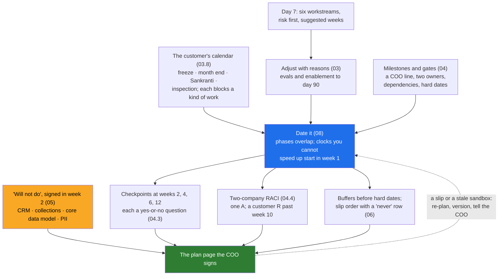

# Day 8 · Scoping the First 90 Days: Workstreams, Sequencing by Risk and Value, What You Will Not Do

> **[Part 2 · Discovery and Decomposition](../README.md)** · Chapter 5 of 7 · Video ~12 min · Chapter tier: medium
> Builds on: [Day 7 (decomposition; the six workstreams in order)](../07-decomposition/README.md) ·
> [Day 3 (the services trap; the branch CRM declined)](../../01-the-role/03-the-economics/README.md) ·
> [Day 4 (not now, because, and instead)](../04-picking-the-problem/README.md) ·
> [Day 5 (the cast and the customer's calendar)](../05-the-stakeholder-map/README.md) ·
> [Day 6 (the findings that set the dependencies)](../06-discovery-interviews/README.md)
> Sets up: [Day 9](../09-success-metrics-and-business-case/README.md) (a number per milestone),
> [Day 10](../10-the-discovery-document/README.md) (the plan in the discovery document), Day 14 (the eval
> workstream), Day 20 (the week-3 milestone), Day 23 (the review started in week 1), Day 28 (the week-12
> question), Days 29 and 30 (re-dating and the slip), Day 32 (defending the list), Day 33 (enablement)
> **Owner:** this chapter owns **the dated 90-day plan: the overlapping phases (a practitioner
> convention); dating Day 7's order against the customer's calendar; the long pole; blackouts by kind of
> work; milestones a COO can read, gates and the week 2, 4, 6 and 12 checkpoints; the two-company RACI
> and what the customer owns from day one; the "will not do" list, the parked list and constraints;
> buffers, slip amplification, the slip order and re-planning.** The method is Day 7's; the business
> case Day 9's; the readout Day 10's; the golden set Day 14's; the questionnaire Day 23's; the handoff
> bar Day 28's; status, bad news, pushback and adoption Days 29, 30, 32 and 33's.
> Versions used: the script was run on **Python 3.14.3** (standard library only; as of October 2026)
> against Day 7's real output. Shown outputs are from real runs. Godavari's people, calendar and numbers
> are invented; the 2026 Telangana holiday dates are real; 2027 dates marked "to confirm" are assumptions.

---

## Why this chapter exists

Day 90 is where most engagements are judged. Day 7 left Godavari six workstreams in a defensible order;
the COO's next question is "when do my analysts get it?", and week numbers say nothing about the freeze,
Sankranti, the RBI inspection or the branch CRM he still assumes is coming. Unscoped, the engagement
becomes Day 3's services trap one small yes at a time. This chapter turns the order into a scope: real
dates around the customer's calendar, milestones in the sponsor's words with an owner on each side,
checkpoints with questions, a two-company RACI, a signed "will not do" list, and an agreed order of what
gives when the long pole slips.

## Mental model

One sentence to carry out of the chapter: **date the work against the customer's calendar, start every
clock you cannot speed up in week one, put a name from each company on every milestone, write down
what you will not build before the demo, and agree what gives when the long pole slips.**

## Learning goals

After this chapter you can:

1. Explain the 30-60-90 convention, why discovery and the prototype overlap, and why decisions are gated
   while work is not.
2. Date a sequenced plan: start the clocks you cannot speed up first, order products, inputs and people
   by value, and route the long pole around a freeze with a staged gate.
3. Write a customer's calendar as blackouts that block kinds of work, and date milestones against it.
4. Write milestones a COO can read, give each checkpoint a yes-or-no question, and build a two-company
   RACI with one A per row and a customer R on everything that outlives you.
5. Write a "will not do" list that holds, apart from the parked list and the constraints.
6. Measure buffers, recognise slip amplification, agree a slip order with a "never" row, and re-plan.
7. Date a plan with the chapter's script and catch an agent's characteristic mistakes in this work.

**Prerequisites:** Day 7. Python at a reading level; no libraries.

## Reading order

| # | Section | What you get | Words |
|---|---|---|---|
| 01 | [Why scoping](01-why-scoping.md) | two answers to "when do my analysts get it?"; why day 90 decides | ~1,200 |
| 02 | [The shape of 90 days](02-the-shape-of-90-days.md) | the convention; overlap on purpose; phases versus workstreams; the week-3 skeleton | ~1,400 |
| 03 | [Sequencing in time](03-sequencing-in-time.md) | clocks first; the long pole and the freeze; evals, value, enablement; blackouts by kind | ~1,600 |
| 04 | [Milestones, checkpoints and the RACI](04-milestones-checkpoints-and-the-raci.md) | milestones a COO reads; gates; four checkpoints; the two-company RACI | ~1,600 |
| 05 | [What you will not do](05-what-you-will-not-do.md) | three lists; Godavari's four lines; why it protects; lines that hold | ~1,300 |
| 06 | [Buffers, slips and re-planning](06-buffers-slips-and-re-planning.md) | buffers; three slips run; amplification; the slip order; the stale sandbox | ~1,600 |
| 07 | [2026 patterns and production concerns](07-2026-patterns-and-production-concerns.md) | plans as data; the hype; calendar latency | ~550 |
| 08 | [Project: the Godavari 90-day plan](08-project-the-godavari-90-day-plan.md) | the real run on Day 7's JSON; a slip; the plan page; Build it with AI; How do you know it's right | ~3,250 (incl. output) |
| 09 | [Mistakes and debugging](09-mistakes-and-debugging.md) | symptom, cause, fix | ~750 |
| 10 | [Interview questions](10-interview-questions.md) | 12 questions with model answers | ~1,050 |
| 11 | [Exercises](11-exercises.md) | 10 graded, four tested runs, "review this AI-written plan" | ~1,600 |
| 12 | [Further reading](12-further-reading.md) | the playbooks as fetched; tools; the holiday source; RBI and DPDP | ~550 |

**Short on time?** Read 02, 03.3, 05 and 06, then run the project (08).

## Files

| Path | What |
|---|---|
| [`worksheet/godavari-90-day-plan.md`](worksheet/godavari-90-day-plan.md) | the plan page the COO signs: dated tables, the Gantt, checkpoints, "will not do", parked list, RACI, buffers and slip order, assumptions, change log |
| [`worksheet/90-day-plan-template.md`](worksheet/90-day-plan-template.md) | the empty page |
| [`worksheet/ai-draft-90-day-plan.md`](worksheet/ai-draft-90-day-plan.md) | an agent's draft with at least ten problems; exercise 3.1 |
| `data/godavari-calendar.csv`, `data/godavari-plan-adjustments.csv`, `data/godavari-milestones.csv`, `data/godavari-raci.csv` | the inputs: blackouts by kind, site and source; Day 8's changes to Day 7 with reasons and the phases; 22 milestones with two owners; the RACI |
| [`code/date_the_plan.py`](code/date_the_plan.py) | reads Day 7's JSON and the CSVs; dates, moves, checks; `--slip`; writes the two generated files |
| `data/godavari-90-day-schedule.json`, [`data/godavari-90-day-plan.md`](data/godavari-90-day-plan.md) | generated: every date and finding; the tables and the Mermaid Gantt |

Run from the chapter folder: `python -X utf8 code/date_the_plan.py`, then `--slip W5=1`, `W5=3`, `W4=2`
(each about a third of a second). It reads `../07-decomposition/data/godavari-decomposition-plan.json`,
so run Day 7's script first if that file is missing. No packages, downloads or keys.

## Analogies for the Telugu audience

- **Planning a wedding** (the chapter's picture): the hall first because it is scarce and the muhurtham
  cannot move, the caterer next, the invitations last; and every date checked against the panchangam,
  the cousins' exams and the month the priest is away (01.2).

## Video map

The video (~12 min) covers a slice; the notes cover everything.

| Asset | Covers | Sections |
|---|---|---|
| **Day 8 main video** (~12 min) | Hook: "when do my analysts get it?" (1 min) → why day 90 decides (1 min) → the 30-60-90 shape and the overlap, with the wedding (1.5 min) → week 1 starts the clocks; the long pole lands in the freeze (2 min) → blackouts by kind; Sankranti moves two milestones (1.5 min) → milestones a COO reads and the four checkpoint questions (1.5 min) → the four "will not do" lines (1.5 min) → slip amplification and the slip order (1.5 min) → recap and teasers (0.5 min) | 01.1 to 01.3, 02.1 to 02.2, 03.2 to 03.3, 03.8, 04.1, 04.3, 05.2, 06.3 to 06.4, 08.4 |
| **Short 1:** "Discovery weeks 1 to 4, prototype weeks 3 to 6. Yes, they overlap." | The two dotted arrows; the skeleton inside discovery; gate decisions, not work | 02.2 |
| **Short 2:** "The most important page of the plan is the list of what you will not build." | The week-5 story; the four lines; signed before the demo | 05.1, 05.2, 05.5 |
| Notes only | 02.3, 03.4, 04.4 to 04.5, 05.3, 06.5, 07, the project and its AI and verification parts (08), 09 to 11 | as listed |

**Callbacks to use on screen:** "Day 7 lo six workstreams ni order chesam; ivala vaatiki dates
pettutunnam, Godavari calendar meeda." (section 01); "Day 3 lo branch CRM ki no cheppam; ivala aa no ni
paper meeda raasi COO tho sign cheyistunnam." (section 05); "Day 5 calendar gurtunda? Freeze, Sankranti,
RBI audit; ippudu avi plan ni move chestayi." (section 03).
**Forward callbacks:** Day 9 (prati milestone ki oka number), Day 20 (week-3 skeleton ship), Day 32 (ee
list ni COO push chesinappudu ela defend cheyali).

**Next chapter:** [Day 9 · Success metrics and the business case: from "faster" to rupees, hours and risk](../09-success-metrics-and-business-case/README.md)
