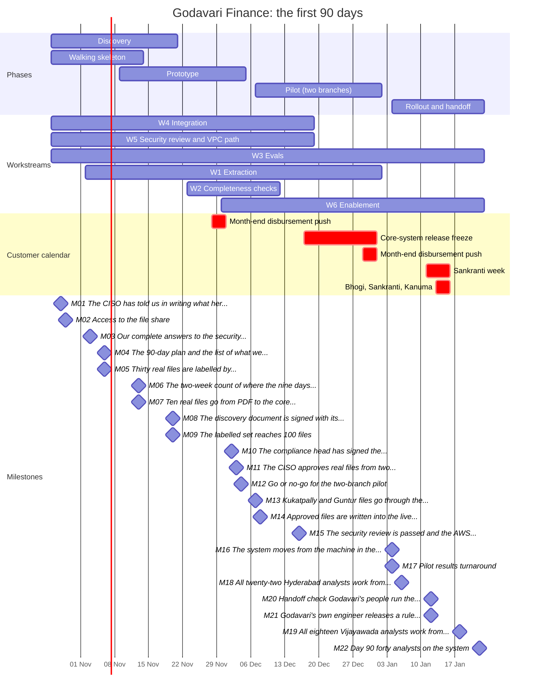

# Godavari 90-day plan: generated tables

> Written by `code/date_the_plan.py` from the Day 7 plan, the adjustments, the calendar and the
> milestones. Do not edit by hand; edit the CSVs and rerun.

| Code | Workstream | Weeks | From | To |
|---|---|---|---|---|
| W4 | Integration: SFTP, tracker, SOAP create with idempotency | 1 to 8 | Mon 26 Oct 2026 | Fri 18 Dec 2026 |
| W5 | Security review and VPC path | 1 to 8 | Mon 26 Oct 2026 | Fri 18 Dec 2026 |
| W3 | Evals: golden set of 100 to 200 labelled files | 1 to 13 | Mon 26 Oct 2026 | Fri 22 Jan 2027 |
| W1 | Extraction: pages and fields from scanned PDFs | 2 to 10 | Mon 02 Nov 2026 | Fri 01 Jan 2027 |
| W2 | Completeness checks: deterministic rules per product | 5 to 7 | Mon 23 Nov 2026 | Fri 11 Dec 2026 |
| W6 | Enablement: review queue, tracker migration, resubmission | 6 to 13 | Mon 30 Nov 2026 | Fri 22 Jan 2027 |

| Date | Week | Id | What the COO reads | Kaagaz | Godavari |
|---|---|---|---|---|---|
| Wed 28 Oct 2026 | 1 | M01 | The CISO has told us in writing what her review needs; the longest task has started. | Kaagaz security lead | CISO |
| Thu 29 Oct 2026 | 1 | M02 | Access to the file share, the core system's test copy and the staff directory is requested. | Kaagaz FDE | IT identity team |
| Tue 03 Nov 2026 | 2 | M03 | Our complete answers to the security questionnaire are with the CISO. | Kaagaz security lead | CISO |
| Fri 06 Nov 2026 | 2 | M04 | The 90-day plan and the list of what we will not build are signed. | Kaagaz FDE | COO |
| Fri 06 Nov 2026 | 2 | M05 | Thirty real files are labelled by Godavari's own analysts; correct now has a definition. | Kaagaz FDE | Lakshmi and the senior analyst |
| Fri 13 Nov 2026 | 3 | M06 | The two-week count of where the nine days go is finished, counted the way the team leads agreed. | Kaagaz FDE | Srinivas and the Vijayawada team lead |
| Fri 13 Nov 2026 | 3 | M07 | Ten real files go from PDF to the core system's test copy, each approved by an analyst, every step timed. | Kaagaz FDE | Vijayawada team lead and core-system owner |
| Fri 20 Nov 2026 | 4 | M08 | The discovery document is signed with its numbers and its risks. | Kaagaz FDE | COO |
| Fri 20 Nov 2026 | 4 | M09 | The labelled set reaches 100 files; every accuracy claim is measured against it. | Kaagaz FDE | Lakshmi and the senior analyst |
| Wed 02 Dec 2026 | 6 | M10 | The compliance head has signed the two-wheeler document rules; the system runs exactly what she signed. | Kaagaz FDE | Compliance head |
| Thu 03 Dec 2026 | 6 | M11 | The CISO approves real files from two branches on the machine inside the Hyderabad building. | Kaagaz security lead | CISO |
| Fri 04 Dec 2026 | 6 | M12 | Go or no-go for the two-branch pilot. | Kaagaz FDE | COO |
| Mon 07 Dec 2026 | 7 | M13 | Kukatpally and Guntur files go through the new review queue; six analysts use it every day. | Kaagaz FDE | Srinivas and the Vijayawada team lead |
| Tue 08 Dec 2026 | 7 | M14 | Approved files are written into the live core system with no duplicates, after a month of clean test calls. | Kaagaz FDE | Core-system owner |
| Wed 16 Dec 2026 | 8 | M15 | The security review is passed and the AWS Mumbai environment is approved. | Kaagaz security lead | CISO |
| Mon 04 Jan 2027 | 11 | M16 | The system moves from the machine in the building to the approved Mumbai environment; nothing leaves India. | Kaagaz FDE | Core-system owner and Godavari application-support engineer |
| Mon 04 Jan 2027 | 11 | M17 | Pilot results: turnaround, hours per file and send-backs in two branches, against the November count. | Kaagaz FDE | COO |
| Wed 06 Jan 2027 | 11 | M18 | All twenty-two Hyderabad analysts work from the new queue. | Kaagaz FDE | Srinivas |
| Tue 12 Jan 2027 | 12 | M20 | Handoff check: Godavari's people run the system for a week, with us watching. | Kaagaz FDE | COO |
| Tue 12 Jan 2027 | 12 | M21 | Godavari's own engineer releases a rule change to the live system without our help. | Kaagaz FDE | Godavari application-support engineer |
| Mon 18 Jan 2027 | 13 | M19 | All eighteen Vijayawada analysts work from the new queue. | Kaagaz FDE | Vijayawada team lead |
| Fri 22 Jan 2027 | 13 | M22 | Day 90: forty analysts on the system, the pilot numbers, and what the next 90 days are for. | Kaagaz engagement lead | COO |

