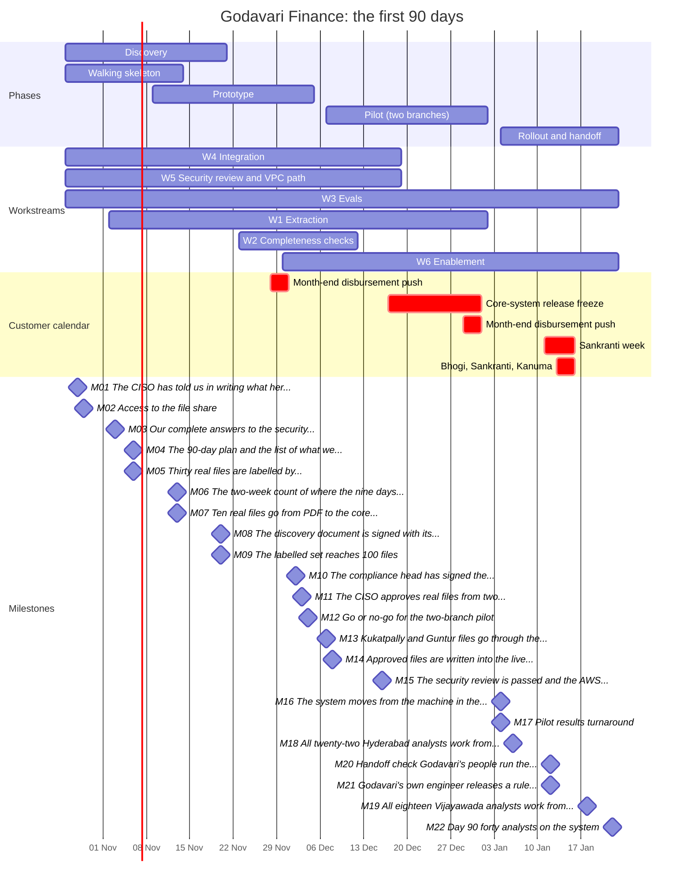

# Godavari Finance · the first 90 days

> Engagement folder · Day 8 · Written on Friday 6 November 2026 (end of discovery week 2) for the
> week-2 checkpoint · Tables and chart generated by `code/date_the_plan.py` from Day 7's plan and the
> files in `data/` · Author: the Kaagaz AI FDE · Version 1 · Every person, date and number at Godavari
> is invented for the course; the public-holiday dates are from the Telangana 2026 list, and the 2027
> dates marked "to confirm" are assumptions.

**Problem (Day 4):** "New loan files take a median of nine days from receipt to decision because intake
is manual and a third of files are incomplete." **Target (Day 7, step 1):** median turnaround in the
pilot branches from 9.2 days to 3 to 4 days by day 90, with no new audit findings.

**Day 1:** Monday 26 October 2026. **Day-90 review:** Friday 22 January 2027 (day 90 is Saturday 23
January).

## 1. What "productised by day 90" means here

1. All forty analysts (twenty-two in Hyderabad, eighteen in Vijayawada) work from the review queue,
   and the Excel tracker is updated by the system, not by hand.
2. Turnaround, analyst hours per file and send-backs in Kukatpally and Guntur are measured against the
   November count (Day 9).
3. Godavari's application-support engineer has released a change on his own, and Godavari's team has
   run the system for a week with Kaagaz only watching.
4. The security review is passed, the compliance head's rules run as she signed them, and every file
   has an audit trail before the RBI inspection.

Not included: other branches beyond the forty analysts' normal intake, other loan products beyond
two-wheeler (gold loans only if the slip order allows), phone-photo intake (same), anything on the
lists in sections 6 and 7.

## 2. Phases

| Phase | Weeks | Dates | Exit decision |
|---|---|---|---|
| Discovery | 1 to 4 | 26 Oct to 20 Nov | week-4 checkpoint: commit to the pilot |
| Walking skeleton | 1 to 3 | 26 Oct to 13 Nov | the week-3 demo (M07) |
| Prototype | 3 to 6 | 9 Nov to 4 Dec | week-6 checkpoint: pilot go or no-go |
| Pilot (Kukatpally and Guntur, six analysts) | 7 to 10 | 7 Dec to 1 Jan | pilot results (M17) |
| Rollout and handoff | 11 to 13 | 4 Jan to 22 Jan | week-12 checkpoint and the day-90 review |

## 3. Workstreams and milestones, dated

| Code | Workstream | Weeks | From | To |
|---|---|---|---|---|
| W4 | Integration: SFTP, tracker, SOAP create with idempotency | 1 to 8 | Mon 26 Oct 2026 | Fri 18 Dec 2026 |
| W5 | Security review and VPC path | 1 to 8 | Mon 26 Oct 2026 | Fri 18 Dec 2026 |
| W3 | Evals: golden set of 100 to 200 labelled files | 1 to 13 | Mon 26 Oct 2026 | Fri 22 Jan 2027 |
| W1 | Extraction: pages and fields from scanned PDFs | 2 to 10 | Mon 02 Nov 2026 | Fri 01 Jan 2027 |
| W2 | Completeness checks: deterministic rules per product | 5 to 7 | Mon 23 Nov 2026 | Fri 11 Dec 2026 |
| W6 | Enablement: review queue, tracker migration, resubmission | 6 to 13 | Mon 30 Nov 2026 | Fri 22 Jan 2027 |

| Date | Week | Id | What the COO reads | Kaagaz | Godavari |
|---|---|---|---|---|---|
| Wed 28 Oct 2026 | 1 | M01 | The CISO has told us in writing what her review needs; the longest task has started. | Kaagaz security lead | CISO |
| Thu 29 Oct 2026 | 1 | M02 | Access to the file share, the core system's test copy and the staff directory is requested. | Kaagaz FDE | IT identity team |
| Tue 03 Nov 2026 | 2 | M03 | Our complete answers to the security questionnaire are with the CISO. | Kaagaz security lead | CISO |
| Fri 06 Nov 2026 | 2 | M04 | The 90-day plan and the list of what we will not build are signed. | Kaagaz FDE | COO |
| Fri 06 Nov 2026 | 2 | M05 | Thirty real files are labelled by Godavari's own analysts; correct now has a definition. | Kaagaz FDE | Lakshmi and the senior analyst |
| Fri 13 Nov 2026 | 3 | M06 | The two-week count of where the nine days go is finished, counted the way the team leads agreed. | Kaagaz FDE | Srinivas and the Vijayawada team lead |
| Fri 13 Nov 2026 | 3 | M07 | Ten real files go from PDF to the core system's test copy, each approved by an analyst, every step timed. | Kaagaz FDE | Vijayawada team lead and core-system owner |
| Fri 20 Nov 2026 | 4 | M08 | The discovery document is signed with its numbers and its risks. | Kaagaz FDE | COO |
| Fri 20 Nov 2026 | 4 | M09 | The labelled set reaches 100 files; every accuracy claim is measured against it. | Kaagaz FDE | Lakshmi and the senior analyst |
| Wed 02 Dec 2026 | 6 | M10 | The compliance head has signed the two-wheeler document rules; the system runs exactly what she signed. | Kaagaz FDE | Compliance head |
| Thu 03 Dec 2026 | 6 | M11 | The CISO approves real files from two branches on the machine inside the Hyderabad building. | Kaagaz security lead | CISO |
| Fri 04 Dec 2026 | 6 | M12 | Go or no-go for the two-branch pilot. | Kaagaz FDE | COO |
| Mon 07 Dec 2026 | 7 | M13 | Kukatpally and Guntur files go through the new review queue; six analysts use it every day. | Kaagaz FDE | Srinivas and the Vijayawada team lead |
| Tue 08 Dec 2026 | 7 | M14 | Approved files are written into the live core system with no duplicates, after a month of clean test calls. | Kaagaz FDE | Core-system owner |
| Wed 16 Dec 2026 | 8 | M15 | The security review is passed and the AWS Mumbai environment is approved. | Kaagaz security lead | CISO |
| Mon 04 Jan 2027 | 11 | M16 | The system moves from the machine in the building to the approved Mumbai environment; nothing leaves India. | Kaagaz FDE | Core-system owner and Godavari application-support engineer |
| Mon 04 Jan 2027 | 11 | M17 | Pilot results: turnaround, hours per file and send-backs in two branches, against the November count. | Kaagaz FDE | COO |
| Wed 06 Jan 2027 | 11 | M18 | All twenty-two Hyderabad analysts work from the new queue. | Kaagaz FDE | Srinivas |
| Tue 12 Jan 2027 | 12 | M20 | Handoff check: Godavari's people run the system for a week, with us watching. | Kaagaz FDE | COO |
| Tue 12 Jan 2027 | 12 | M21 | Godavari's own engineer releases a rule change to the live system without our help. | Kaagaz FDE | Godavari application-support engineer |
| Mon 18 Jan 2027 | 13 | M19 | All eighteen Vijayawada analysts work from the new queue. | Kaagaz FDE | Vijayawada team lead |
| Fri 22 Jan 2027 | 13 | M22 | Day 90: forty analysts on the system, the pilot numbers, and what the next 90 days are for. | Kaagaz engagement lead | COO |

## 4. The chart

## 5. Checkpoints

| Week | Date | The question Godavari answers | Who must be in the room |
|---|---|---|---|
| 2 | Fri 6 Nov | Is this the problem, and is this the plan you will hold us to? | the COO; the Kaagaz engagement lead |
| 4 | Fri 20 Nov | Do you commit to a two-branch pilot in December, on these terms and these numbers? | the COO, the CISO, the compliance head, both team leads, two senior analysts, the core-system owner (Day 10's room) |
| 6 | Fri 4 Dec | Is accuracy on your analysts' files at the agreed bar, and are the rules and the security approval signed, so two branches start on Monday? | the COO, the compliance head, the CISO's approval in writing, both team leads |
| 12 | Tue 12 Jan (moved from Fri 15 Jan, Sankranti) | Can your team run this without us? | the COO, Srinivas, the Vijayawada team lead, the application-support engineer |
| 13 | Fri 22 Jan | Day-90 review: what do the next 90 days buy you? | the COO, the compliance head (before her inspection preparation from 25 Jan), the Kaagaz engagement lead |

## 6. We will not do these

| # | We will not | Because | Agreed by |
|---|---|---|---|
| 1 | build the branch CRM (customer follow-ups for branch managers) | not Kaagaz's product; no other lender would buy Godavari's; it would keep an FDE on site for a year doing work Godavari's IT or a CRM vendor does better. Instead, file status is exposed so a CRM or the tracker can read it | the COO; the Kaagaz CEO and engagement lead |
| 2 | build collections call summaries | a different team, vendor-held Telugu recordings, DPDP consent open, the collections head not in the room. A later-cycle candidate with him as sponsor | the COO |
| 3 | change the core lending system's data model, or ask for a change to it | the core-system owner's condition; every field we write already exists | the core-system owner; the COO |
| 4 | send, store or process customer PII outside India, in any environment, including tests and logs | the compliance head's and the CISO's condition | the compliance head; the CISO; the COO |

Signed: ______________________ (COO, Godavari Finance) · ______________________ (engagement lead, Kaagaz AI) · Date: 6 November 2026

## 7. Not in these 90 days

| Candidate | Why not now | Revisit |
|---|---|---|
| Branch chatbot for policy questions | no baseline; nobody counts the calls | Kukatpally logs its policy calls from 9 November; scored at the day-90 review |
| Income verification from bank statements | waits on intake | first candidate for the next 90 days, at the day-90 review |
| Credit-memo drafting | needs intake's fields | after intake is in daily use |
| KYC and periodic re-KYC | the compliance head: not this year | second cycle, with her as sponsor |
| Title-deed review | rare, outsourced, untimed | a question for the legal head |
| Vendor SSO | the CISO: not this year | designed around (Day 22) |

The Excel tracker is not on this list: it is not replaced; the system writes file status back to it.

## 8. Who does what (RACI)

K: Kaagaz AI · G: Godavari Finance · A: accountable (one per row) · R: responsible · C: consulted · I: informed

| | K: FDE | K: security lead | K: engagement lead | G: COO | G: CISO | G: compliance head | G: core-system owner | G: IT identity | G: team leads | G: eval owners | G: app-support engineer |
|---|---|---|---|---|---|---|---|---|---|---|---|
| W1 Extraction | A R | | I | I | | C | | | | C | I |
| W2 Completeness rules | R | | | I | | A | | | C | C | I |
| W3 Evals and golden set | R | | | I | | C | | | C | A R | I |
| W4 Integration | A R | | | | C | | R | R | | | R |
| W5 Security review | C | R | I | I | A | C | | R | | | I |
| W6 Enablement and rollout | R | | | I | | | | | A R | C | I |
| The plan, checkpoints, this page | R | | C | A | C | C | I | | R | I | I |
| Running it after day 90 | C | | I | I | C | | C | | I | | A R |

The eval owners are Lakshmi (Vijayawada) and the senior analyst in Hyderabad. The application-support
engineer is the person Godavari IT assigns in week 2; requested on 6 November.

## 9. Buffers and what slips first

| Hard date | Milestone | Buffer today |
|---|---|---|
| Wed 16 Dec (freeze from 17 Dec) | M14 live writes to the core system, dated Tue 8 Dec | 6 working days |
| Thu 28 Jan (month end from 27 Jan, then the RBI inspection) | M19 the Vijayawada wave, dated Mon 18 Jan | 7 working days |

When a date we do not control moves, this is the order in which scope gives:

1. gold loans (W1's weeks 8 to 10) move to the next 90 days;
2. Guntur's phone photos stay manual;
3. the Vijayawada wave moves after day 90, but not after 28 January;
4. the pilot shortens, but never below three weeks of measurement.

**Never:** the audit trail, an analyst's approval on every file, the compliance head's signature before
rules run, the security gate, the November baseline.

## 10. Assumptions to confirm before the week-4 checkpoint

| Assumption | Confirm with | By |
|---|---|---|
| Bhogi, Sankranti and Kanuma fall on 13 to 15 January 2027 | the 2027 Telangana and Andhra Pradesh holiday lists; the team leads | 20 Nov |
| The RBI inspection starts on site on or after 1 February 2027 | the compliance head | 20 Nov |
| The CISO will give a staged approval (two branches in the building by week 6) | the CISO | 13 Nov |
| The core-system owner can refresh the test copy in week 4 if the skeleton finds it stale | the core-system owner | 13 Nov |
| Godavari IT can assign an application-support engineer from week 2 | IT | 13 Nov |

## 11. Change log

| Version | Date | What changed | Why |
|---|---|---|---|
| 0 | Thu 5 Nov | first draft from Day 7's week grid, dated | |
| 0.1 | Thu 5 Nov | the Mumbai cutover moved from 17 Dec to 4 Jan; the pilot runs in the building through December | the freeze blocks the core-system owner's firewall change |
| 0.2 | Thu 5 Nov | the team leads made responsible for this plan | the RACI check: nobody at Godavari kept the plan after week 10 |
| 1 | Fri 6 Nov | presented at the week-2 checkpoint | |
