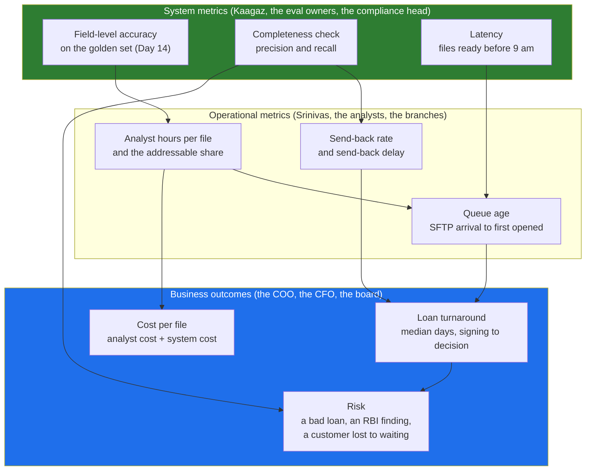

# 02 · The Metric Ladder: From Business Outcome to System Metric

> Day 9 · Section 2 of 14 · [Chapter overview](README.md) · Previous: [01 · Why](01-why-metrics-and-the-case.md) · Next: [03 · Measuring the baseline](03-measuring-the-baseline.md)

---

## 2.1 Three rungs

"Faster" is an adjective about a business outcome. To measure it you need a ladder of three rungs,
each one a lever on the rung above.

Read the arrows as "moves". Field-level accuracy moves analyst hours per file, because an analyst
who trusts the extracted fields stops re-typing them. Hours per file move queue age, because forty
analysts at 97 percent busy have a long queue and at 84 percent busy a short one (section 05.5).
Queue age and send-back delay move turnaround. Completeness recall moves risk directly: a missed
mandatory document is an audit finding.

| Rung | Who reads it | Godavari's metrics |
|---|---|---|
| Business (lagging; monthly) | COO, CFO, board, Kaagaz's CEO | median turnaround (signing to decision); operating cost per file; files decided with a mandatory document missing; customers who withdraw |
| Operational (weekly) | Srinivas, the Vijayawada team lead, branch managers | analyst hours per file and the addressable part; send-back rate and delay; queue age; files per analyst per day |
| System (every build) | Kaagaz, the eval owners, the compliance head | field-level accuracy; completeness precision and recall; share routed to review; time to "ready" |

## 2.2 Why the model metric is never the headline

A system metric is necessary and not sufficient. Three reasons it never goes on page one.

1. **The COO cannot act on it.** "Field-level accuracy 94 percent" gives him nothing to decide. "Each
   analyst spends 0.6 hours less per file, so we need three hires next year instead of seven" does.
2. **The link between rungs can break, and the model metric will not show it.** Accuracy can rise
   from 92 to 96 percent while hours per file stay flat, because the analysts do not trust the
   screen and re-check every field. The 2019 OCR pilot at Godavari (Day 6, finding A8) is the warning:
   it had an accuracy number and was switched off in six weeks. Only the operational rung shows
   whether the system rung is being converted into value.
3. **It is the easiest number to move alone**: tune on the golden set, drop hard fields, or route
   everything uncertain to review (section 08).

The rule: **headline on the business rung, manage on the operational rung, engineer on the system
rung, and show the arrows.** Day 10's discovery document has no model names on page one; this is
the metric version of the same rule.

## 2.3 Where the data comes from

Day 7's step 2 gave each stakeholder a metric. Two of them have no data at all today: the analysts'
hours were never timed (the 4.5 is an estimate), and nobody knows how many files are decided with a
document missing. The COO's turnaround comes from the core system, whose "received" date is not the
customer's signing date (03.2). That is why the baseline needs a hand count.

## 2.4 Leading and lagging indicators

Turnaround is **lagging**: it moves weeks after the change, it is noisy month to month (month-end,
Sankranti, March), and by the time it moves, the decision to renew may already be forming. You need
**leading** indicators that move in days and predict the lagging one.

| Leading (moves in days) | Predicts |
|---|---|
| files through the tool per day, per analyst | adoption, then everything (Day 33) |
| review-queue size and age at 10 am | queue age, then turnaround |
| share of files flagged incomplete on the day of arrival | send-back delay |
| fields corrected per file; time in the review screen | hours per file, capture share |

Lagging metrics (turnaround, send-back rate, withdrawals, hires not made, renewal) are what the COO,
the CFO and Kaagaz wait for.

Leading indicators are for the weekly readout ([Day 29](../../05-working-with-the-customer/29-communication-for-engineers/README.md))
and the quality dashboard (Day 19); lagging ones are for the case and Day 37. Register both (08).

## 2.5 Guardrail metrics: the pairs

Every target needs a partner that catches the cheap way of hitting it.

| Target | The cheap way to hit it | The guardrail |
|---|---|---|
| turnaround down | stop sending incomplete files back | files decided with a document missing must not rise |
| hours per file down | analysts approve without reading | field corrections found in the weekly sample audit |
| send-back delay down | send everything back on day one, to be safe | false send-backs (completeness precision): files sent back that were complete |
| accuracy up | count only easy fields | accuracy reported per field, mandatory fields named |
| files through the tool up | re-run the same file | distinct file numbers |

Precision and recall of the completeness check are the system metrics behind two of these. In plain
words: **recall** is "of the files that really were missing a document, how many did the check
catch"; a miss is a compliance risk. **Precision** is "of the files the check flagged, how many
really were missing something"; a false flag sends a complete file back and costs a customer three
days. The compliance head cares most about recall; the branch managers care most about precision.
Both are measured on the golden set (Day 14), and today's human process already has a recall you can
measure in the baseline (section 03.7: 87 percent in the sample).

## 2.6 Key takeaways

- Three rungs: business outcome, operational metric, system metric; each is a lever on the one above.
- Headline on the business rung, manage on the operational rung, engineer on the system rung, and
  show the arrows between them.
- The model metric is necessary and never the headline: the COO cannot act on it, and the link to
  value can break without it showing.
- Lagging metrics decide the case; leading metrics tell you weekly whether it is on track.
- Every target has a guardrail partner, and both are written down before the pilot.
