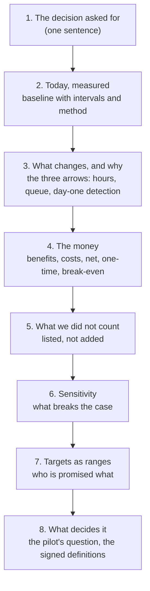

# 07 · The One-Page Case and the Sensitivity Table

> Day 9 · Section 7 of 14 · [Chapter overview](README.md) · Previous: [06 · The cost of being wrong, and of the system](06-the-cost-of-wrong-and-of-the-system.md) · Next: [08 · Pre-registration and gamed numbers](08-pre-registration-and-gamed-numbers.md)

---

## 7.1 Who reads it, and in what order

The COO reads it to decide, the CFO to find the weakest number, Kaagaz's engagement lead to judge
renewal. All three read the top third and stop unless something is wrong, so the page follows the
order of their questions.

The filled version is [`worksheet/godavari-business-case.md`](worksheet/godavari-business-case.md).
This section explains the choices in it.

## 7.2 The money, as it came out

Steady state, year two onwards, three hires made, every input at base:

| Line | Lakh a year | Status of the input |
|---|---|---|
| capacity: 4.2 hires not made x 9.13 lakh | +38.3 | measured hours, invented loaded cost, the COO's growth plan |
| retention: 44 loans a month kept x 24,000 x 12 | +126.6 | measured walk-away rate; **assumed** share kept |
| subscription + cloud + Godavari's staff time | -150.0 | priced |
| **net** | **+15.0** | |
| one-time: deployment fee + staff time | -45.0 | priced |
| operating cost per file | 2,174 -> 2,737 rupees | |

Two numbers change the conversation. **On capacity alone, the system costs Godavari 1.12 crore a year
more than it saves**, and the cost per file rises by about 560 rupees: at 1,400 files a month a 1.2
crore subscription cannot be paid for by analyst hours, and dressing it up would be dishonest. And
**the case is carried by retention**, the one large lever not yet measured: the baseline counted 10.1
percent walking away; nobody knows how many fewer would at 3.6 days. The base assumption (6 percent
of walk-aways kept per day removed, a third at 5.5 days) is plausible and untested.

Day 3 answered "is the value large enough?" with "probably", and Day 4 found the problem big enough
on hours. Both were right about the size of the problem. Day 9's answer names the one thing to test:
**yes, if faster turnaround keeps about three in ten of the customers who walk away today.**

## 7.3 The break-even: when the measured lever does not cover the cost

When the measured lever does not pay for the system, it is tempting to inflate the capture share, add
the risk line to the headline, or annualise the pull-forward. Instead:

1. **State the floor.** Capacity alone: minus 1.12 crore a year.
2. **Compute the break-even on the unmeasured lever**: **38.8 loans a month** kept, out of about 135 a
   month who would be sanctioned and walk away next year, so 29 percent of them.
3. **Say it so the sponsor can judge it**: "keep three in ten of the customers who leave", not
   "6 percent per day".
4. **Make it the pilot's question**: withdrawals reported weekly against the baseline's 10.1 percent.
5. **Leave the commercial answer to the commercial people** (a pilot price, a gated renewal, a smaller
   scope), with the FDE's numbers on the table.

## 7.4 Sensitivity: what breaks the case

A **sensitivity table** moves one assumption at a time, leaving the rest at base, and shows the net.
It tells the reader which numbers matter and which do not. The full output is in section 10.3; in
order of importance:

| Assumption | Swing across its range | What it means |
|---|---|---|
| walk-aways kept per day | -112 to +78 | the whole case; measured only by the pilot |
| contribution per loan | -48 to +78 | Godavari's finance team owns this number; get it in writing this week |
| capture share | -53 to +21 | below about 45 percent the case fails; that needs about 90 to 95 percent field accuracy (08.5) |
| cloud bill | +1 to +29 | the reconciliation question from 06.5 is worth up to 28 lakh a year |
| hires made | +3 to +22 | the COO's speed-versus-cash choice, small in rupees |
| loaded cost | +8 to +21 | the line everyone argues about matters least |

That last row is the lesson people remember. The loaded rate, which takes the longest to agree with
finance, moves the case by 13 lakh. The walk-away assumption, which nobody has measured, moves it by
1.9 crore. Spend your effort where the table says.

The two-way table in 10.3 crosses the two assumptions that depend on the pilot and the golden set
(capture share by walk-aways kept). Its 0 percent column is the same in every row, and that is a finding, not a bug: with three hires
fixed, a better capture share does not save more cash, it shortens the queue, and a shorter queue is
worth money only if customers stay because of it. In this plan, accuracy's rupee value flows through
speed. It could be banked as fewer hires only if the hiring decision waits for the golden set's
result (exercise 2.5 shows why that is wise anyway).

## 7.5 Targets as ranges, and what each person is promised

A target is a range with a date and a population, and each stakeholder gets the one they would
believe (Day 5's column), not the COO's number repeated.

| Stakeholder | Promised (range, date, population) | Baseline |
|---|---|---|
| the COO | median turnaround **3 to 4 days** in the two pilot branches by day 90; the model's 3.6 is the middle, not the promise | 9.1 days (8.7 to 9.7) |
| the CFO | net value between break-even and +80 lakh a year at full rollout, decided by the walk-away measure; no claim before the pilot reports it | capacity-only floor: -1.12 crore |
| Srinivas and the Vijayawada lead | addressable hours per file from 1.6 to **0.5 to 0.9**; queue age under 2 days | 1.59 h; 6.4 days |
| the analysts | no added step: time in the review screen per file under today's re-keying time | 0.97 h re-keying |
| the compliance head | the rules miss **no** mandatory document on the golden set; in production, files decided with a document missing **below today's 4.1 percent**, reported monthly | 4.1% (0.9 to 7.2); human recall 87% |
| branch managers | the missing-document notice on the day the file reaches SFTP | today: after the 6.4-day queue |
| the core-system owner | zero duplicate records | (Day 16) |
| Kaagaz's CEO | renewal evidence: the walk-away measure by month six | none yet |

Her "never" is tested where it can be, on the golden set; in production the honest promise is
"better than today's 4.1 percent, monthly". That conversation is uncomfortable and necessary (Day 32).

The COO's "three days" became "three to four days in the pilot branches by day 90". It is still his
number. It now has a range, a population, a date and a method.

## 7.6 Key takeaways

- One page, in the order of the readers' questions, with the method beside every number.
- When the measured lever does not cover the cost: the floor, the break-even in words the sponsor can
  judge, and that lever as the pilot's question.
- Spend effort where the sensitivity table says; promise each stakeholder a range of their own.
