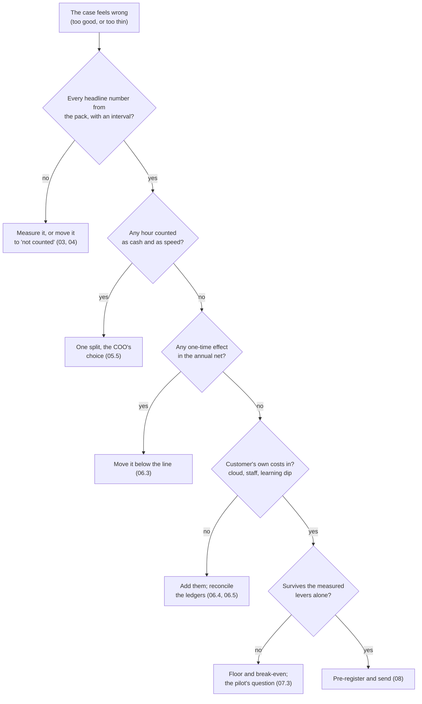

# 11 · Common Mistakes and Debugging

> Day 9 · Section 11 of 14 · [Chapter overview](README.md) · Previous: [10 · Project](10-project-baseline-pack-and-business-case.md) · Next: [12 · Interview questions](12-interview-questions.md)

---

Each row is **symptom, cause, fix**, with the section that explains it.

## 11.1 In the measurement

| Symptom | Likely cause | Fix |
|---|---|---|
| The pilot cannot be compared with the baseline | two clocks: core received date in one, signing date in the other | one written clock, pre-registered; both clocks for a fortnight at any switch-over (03.2, 09.3) |
| The baseline looks faster than everyone's experience | withdrawn and rejected files left out | frame from the SFTP log; exclusions: none (03.4, 08.3) |
| A cluster or product is missing from the sample | a simple random draw, or no floor | stratify with a floor of two (03.5) |
| The second counter disagrees on a third of files | "present" and "sent back" never defined | write the rule with the compliance head; recount (03.6) |
| Hours look too good, or too bad | self-reported, first two days kept, or a month-end week | discard two days; shadow ten files; avoid month-end (03.3) |
| The rare rate's interval is wider than the rate | 5 events in 120 files | census of that one column (04.4) |
| Somebody re-drew because the answer "looked wrong" | no rule against it | seed and list fixed before counting (03.5) |

## 11.2 In the money and the targets

| Symptom | Likely cause | Fix |
|---|---|---|
| "These savings will not show in my P&L" | hours times a rate called savings | capacity versus cash; hires not made (05.4) |
| The rate is challenged | CTC used as loaded cost, allocations included, or paid hours used | the "one analyst fewer" test, line by line (05.2) |
| The problem's size is quoted as the system's value | the two numbers confused | print both, side by side (05.3) |
| The same hours avoid a hire and shorten the queue | double counting | the capacity plan; the COO picks the split (05.5) |
| "Crores brought forward every year" | a one-time timing gain annualised | once, worth its margin for the days (06.3) |
| The CFO adds the cloud bill you left out | VPC in the customer's account not priced | cloud, staff time, learning dip in; reconcile the ledgers (06.4, 06.5) |
| The case is negative on measured levers and the capture share is tempting | the measured lever does not cover the cost | floor, break-even, the pilot's question (07.3) |
| At month seven: "you promised three days" | a point target, no population or date | a range, a population, a date (07.5) |
| The pilot shows 8.8 days and someone calls it a win | no "what counts as a change" | pre-register the threshold (08.2) |
| Send-backs fell and the compliance head is alarmed | analysts stopped sending files back | the guardrail: decided with a document missing (02.5) |
| Accuracy is 97 percent and hours have not moved | analysts re-check everything | manage the operational rung; fields corrected per file (02.2, 08.4) |

## 11.3 In the script

| Symptom | Likely cause | Fix |
|---|---|---|
| `cannot find Day 7's generator at ...` | the chapter is not beside Day 7 | keep the course folder structure |
| `first 200 frame rows identical to Day 7's sample: NO` | Day 7's generator or seed changed | rerun Day 7; re-quote every number here |
| `AttributeError` from `dataclasses` while importing Day 7 | module not in `sys.modules` before `exec_module` | keep that line |
| An interval narrows when the sample shrinks | the finite population correction or `variance / n` is wrong | check `1 - n/N` and the division |
| A sensitivity row moves the wrong way | a sign error | more benefit must mean more net |

## 11.4 A routine for a case that feels wrong

## 11.5 Key takeaways

- Measurement mistakes are clocks, frames, strata, definitions and re-draws.
- Money mistakes are hours called savings, problems quoted as values, double counting and one-time
  gains annualised; target mistakes are points instead of ranges and definitions written late.
