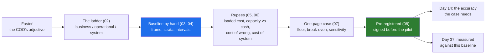

# Day 9 · Success Metrics and the Business Case: From "Faster" to Rupees, Hours and Risk

> **[Part 2 · Discovery and Decomposition](../README.md)** · Chapter 6 of 7 · Video ~11 min · Chapter tier: medium
> Builds on: [Day 3 (the economics; Kaagaz's side of the ledger)](../../01-the-role/03-the-economics/README.md) ·
> [Day 4 (measurable; the 300-rupee placeholder)](../04-picking-the-problem/README.md) ·
> [Day 5 (the number each person would believe)](../05-the-stakeholder-map/README.md) ·
> [Day 6 (the real workflow)](../06-discovery-interviews/README.md) ·
> [Day 7 (step 2's metrics; the generator)](../07-decomposition/README.md) ·
> [Day 8 (the pilot weeks)](../08-scoping-the-first-90-days/README.md)
> Sets up: Day 10 (the metrics, baseline and commercial pages of the discovery document), Day 14 (the
> golden set and the accuracy threshold the case needs), Day 19 (the dashboard computes the registered
> metrics), Day 29 (the weekly readout quotes them), Day 37 (measured value against this baseline)
> **Owner:** this chapter owns **the baseline measurement and the business case**: the metric ladder,
> the hand count with a stratified sample and intervals, hours into rupees (loaded cost, capacity versus
> cash), the cost of wrong decisions and of the system, the one-page case with sensitivity, targets as
> ranges, and pre-registered definitions. Measured value in production is Day 37's; the golden set
> Day 14's; the dashboard Day 19's; the discovery document Day 10's.
> Versions used: the script was run on **Python 3.14.3** (standard library only; October 2026). Output
> shown is from a real run. Every Godavari number is invented.

---

## Why this chapter exists

"It feels faster" does not renew a contract. At month seven the CFO will ask: faster than what,
measured how, worth how much against 1.2 crore a year? The answer has to be built in discovery week
three, before the system touches a file, because the baseline can never be measured afterwards. The
teams that invented the role say the same thing (Atlassian: frequent, painful, *measurable*; OpenAI:
agree how success is measured with the customer's experts before choosing a model), customer-facing
discovery appears in 70 percent or more of the 1,000 FDE postings analysed in 2026, and "how would you
know it worked?" follows every decomposition answer in the interview.

This chapter turns the COO's adjective into a ladder of metrics, counts the baseline by hand, converts
hours into rupees without the usual inflation, and writes a one-page case the CFO cannot easily break.
At Godavari the honest case is thinner than the pitch, and the chapter shows what to do about that.

## Mental model

One sentence to carry out: **headline on the business rung, measure the baseline by hand before you
build, count freed hours as cash only when a hire is not made, state the floor and the break-even when
the measured lever falls short, and get the definitions signed before anyone has a reason to bend them.**

## Learning goals

After this chapter you can:

1. Build the metric ladder, pair each target with a guardrail, and keep the model metric off the headline.
2. Read a report's method and design a two-clock baseline on the customer's clock.
3. Draw a stratified sample with weights and a seed, and run a hand count with a second counter.
4. Explain and compute confidence intervals for a mean, a rate and a median.
5. Build a loaded hourly cost, separate capacity from cash, and lay out the speed-versus-hires choice.
6. Price wrong decisions and the full cost of the system, reconciled with the vendor's ledger.
7. Write a one-page case with a floor, a break-even, a sensitivity table and targets as ranges.
8. Pre-register definitions, close the gaming routes, and tie the case to an eval threshold.

**Prerequisites:** Days 3 to 8. Python at a reading level; no libraries.

## Reading order

| # | Section | What you get | Words |
|---|---|---|---|
| 01 | [Why](01-why-metrics-and-the-case.md) | The renewal question; the career reason; the hard parts | ~750 |
| 02 | [The metric ladder](02-the-metric-ladder.md) | Three rungs; leading and lagging; guardrail pairs | ~1,150 |
| 03 | [Measuring the baseline](03-measuring-the-baseline.md) | Two clocks, the frame, the stratified draw, the form, the findings | ~1,750 |
| 04 | [Confidence intervals](04-confidence-intervals-in-plain-words.md) | Why 9.2 is not a number yet; three intervals | ~1,100 |
| 05 | [Hours into rupees](05-hours-into-rupees.md) | Loaded cost; capacity versus cash; the hours spent once | ~1,250 |
| 06 | [The cost of wrong, and of the system](06-the-cost-of-wrong-and-of-the-system.md) | Wrong decisions priced; the full cost; reconciling with Day 3 | ~1,350 |
| 07 | [The one-page case](07-the-one-page-case.md) | The money; floor and break-even; sensitivity; targets | ~1,300 |
| 08 | [Pre-registration](08-pre-registration-and-gamed-numbers.md) | Signed definitions; gamed numbers; the eval metric underneath | ~1,250 |
| 09 | [2026 patterns and production](09-2026-patterns-and-production-concerns.md) | Practice, hype, PII, clocks, handoff | ~600 |
| 10 | [Project](10-project-baseline-pack-and-business-case.md) | The real run, the three documents, Build it with AI, How do you know it's right | ~2,400 (incl. output) |
| 11 | [Mistakes and debugging](11-mistakes-and-debugging.md) | Symptom, cause, fix | ~850 |
| 12 | [Interview questions](12-interview-questions.md) | 12 questions with model answers | ~1,000 |
| 13 | [Exercises](13-exercises.md) | 12 graded exercises, including the AI-written case | ~1,550 |
| 14 | [Further reading](14-further-reading.md) | Playbooks, statistics, RBI texts | ~400 |

## Files

| Path | What |
|---|---|
| [`code/baseline_and_case.py`](code/baseline_and_case.py) | imports Day 7's generator, draws the stratified sample, computes the baseline with intervals, the loaded rate, the capacity plan, the case and the sensitivity tables |
| [`data/godavari_baseline_sample.csv`](data/godavari_baseline_sample.csv) | the 120 sampled files with every hand-count column and weight (generated) |
| [`data/godavari-baseline-and-case.md`](data/godavari-baseline-and-case.md) | the generated summary (rerun, do not edit) |
| [`worksheet/godavari-baseline-pack.md`](worksheet/godavari-baseline-pack.md) | the baseline measurement pack for the engagement folder |
| [`worksheet/godavari-business-case.md`](worksheet/godavari-business-case.md) | the one-page business case |
| [`worksheet/godavari-metric-definitions.md`](worksheet/godavari-metric-definitions.md) | the pre-registered definitions, ready to sign |
| [`worksheet/business-case-template.md`](worksheet/business-case-template.md) | the empty template with the pre-send checks |
| [`worksheet/ai-draft-business-case.md`](worksheet/ai-draft-business-case.md) | an AI-written case with at least ten problems (exercise 3.1) |

Run from the chapter folder, with Day 7's folder beside it: `python -X utf8 code/baseline_and_case.py`
(about half a second; no packages, no downloads, no keys).

## What this chapter does *not* teach (single-owner rule)

| Topic | Where it's taught |
|---|---|
| Choosing the problem; the "baseline exists" gate | [Day 4](../04-picking-the-problem/README.md) |
| Stakeholder roles and the number each believes | [Day 5](../05-the-stakeholder-map/README.md) |
| The decomposition method; step 2's metrics | [Day 7](../07-decomposition/README.md) |
| The dated 90-day plan and pilot weeks | [Day 8](../08-scoping-the-first-90-days/README.md) |
| Writing and defending the discovery document | [Day 10](../10-the-discovery-document/README.md) |
| Building the golden set; judges; regression | [Day 14](../../03-building-the-system/14-evals-first/README.md) |
| The quality dashboard | [Day 19](../../03-building-the-system/19-observability-for-ai-systems/README.md) |
| Measured value in production, attribution, the full gaming catalogue | [Day 37](../../06-from-customer-to-product/37-measuring-value-honestly/README.md) |

## Analogies for the Telugu audience

- **UPI** (the main picture): nobody funded "convenient payments"; they tracked transactions per day,
  failure rate and seconds per payment, and those numbers moved. "Faster loans" needs the same (01.6).

## Video map

The video (~11 min) covers a slice; the notes cover everything.

| Asset | Covers | Sections |
|---|---|---|
| **Day 9 main video** (~11 min) | Hook: month seven, the CFO's three questions (1 min) → UPI: faster is an adjective (0.5 min) → the ladder; accuracy never the headline (1.5 min) → the report's two clocks (1 min) → the hand count: frame, strata, seed (1.5 min) → intervals: 20 files against 120 (1 min) → six of nine days are queue (1 min) → 456 not 300; capacity is not cash; hires against queue (1.5 min) → the honest case and its break-even (1 min) → pre-registration, the accuracy the case needs, Day 10 teaser (1 min) | 01.1, 02.1 to 02.2, 03.2 to 03.5, 03.7, 04.3, 05.2 to 05.5, 07.2 to 07.3, 08.1, 08.5 |
| **Short 1:** "Faster is not a metric. 9.2 days to 3.5 is." | The ladder in one picture; the customer's clock; the COO's three days as "three to four days in the pilot branches by day 90" | 02.1, 03.2, 07.5 |
| **Short 2:** "Measure the baseline before you build, or you will never prove you helped." | The report survives the hand count and the count finds six days of queue; 20 files versus 120; never re-draw | 03.1, 03.7, 04.3 |
| Notes only | Guardrails (02.5), the form (03.6), interval methods (04.2), the system's errors and the reconciliation (06), sensitivity (07.4), gaming (08.3), 09 to 13 | as listed |

**Callbacks to use on screen:** "Day 4 lo 300 rupees an hour placeholder ani cheppam; ivala adi 456
avutundi, enduko chuddam." (section 05); "Day 5 lo prati stakeholder ki 'the number they would
believe' raasam; ivala aa numbers ki baseline kontam." (section 03); "Day 6 lo analysts 'day and a
half' annaru, COO 'nine days' annaru; iddaru correct, madhyalo six days queue." (section 03.7).
**Forward callbacks:** Day 10 (ee case ni readout lo COO and CFO mundu pedatam), Day 14 (golden set
accuracy 90 to 95 percent kante takkuva ayite case break even avvadu), Day 37 (ee baseline meeda
measure chestam).

**Next chapter:** [Day 10 · The discovery document: writing it, defending it, and saying no](../10-the-discovery-document/README.md).
