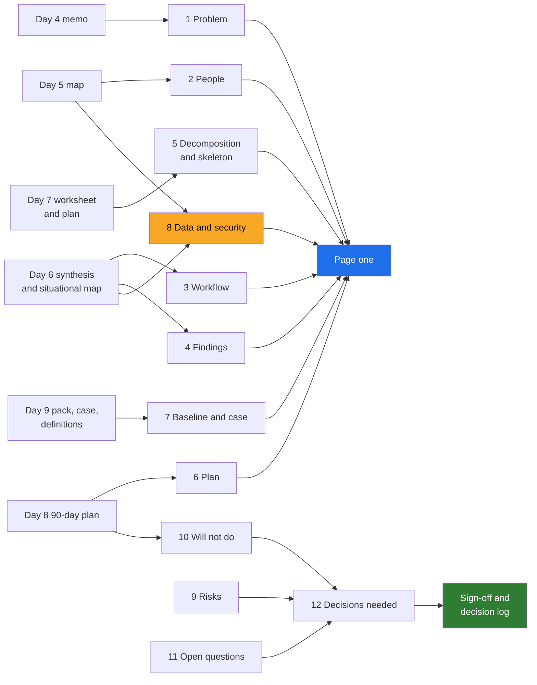

# 02 · What It Is For, and Its Structure

> Day 10 · Section 2 of 13 · [Chapter overview](README.md) · Previous: [01 · Why the discovery document](01-why-the-discovery-document.md) · Next: [03 · Writing for three readers](03-writing-for-three-readers.md)

---

## 2.1 Alignment and a signature, not a report

A report answers "what did you find?". A discovery document answers "what are we agreeing to?". The
difference shows in every paragraph.

| | A report | A discovery document |
|---|---|---|
| organised by | what you did (week 1, week 2, interviews, data) | what the reader must decide |
| ends with | conclusions | decisions, each with an owner and a date |
| the reader's job | understand | agree, object, or sign |
| numbers | what you measured | what you measured, the method, and what each person is promised |
| refusals | not mentioned, or "out of scope" | "not now, because, and instead", each with who agreed |
| after the meeting | filed | versioned at every checkpoint; the source of truth both sides quote |

Three things make it a signature document rather than a summary:

- **It proposes.** Every section ends in something the reader can accept or reject: this problem,
  this plan, these numbers, this list of refusals.
- **It names the decider.** Day 5's collisions each have a decider; the document puts the open ones
  on the agenda with that name beside them.
- **It records what was signed.** After the readout, the signed version is the one everyone quotes.
  The FDE who says "as we agreed on 20 November, section 10.1" ends an argument that the FDE who
  says "as we discussed" starts.

The published FDE discovery playbooks describe the same idea in their own words: the spec at the end
of discovery is "a validated contract, not a wish list", and the goal is that "the humans who own the
outcome have signed off on the target" (getperspective.ai, fetched October 2026).

## 2.2 The structure

Twelve sections plus page one, a decision log, a change log and a sign-off. The order is the order in
which the readers' questions arise. Each section has a source on disk, and the document links it
rather than restating it.

| # | Section | The question it answers | Source artifact |
|---|---|---|---|
| - | Page one | What are we agreeing to, in one page? | all of them |
| 1 | The problem statement | What problem, in one signed sentence? | [Day 4 memo](../04-picking-the-problem/worksheet/godavari-problem-selection-memo.md) |
| 2 | The people | Who decides, who uses, who can stop it? | [Day 5 map](../05-the-stakeholder-map/worksheet/godavari-stakeholder-map.md) |
| 3 | The workflow as it really is | Where does the time actually go? | [Day 6 situational map](../06-discovery-interviews/worksheet/situational-map.md) |
| 4 | Findings that change the architecture | What did discovery find that a demo would have missed? | [Day 6 synthesis](../06-discovery-interviews/worksheet/godavari-discovery-synthesis.md) |
| 5 | Decomposition and the walking skeleton | What are the pieces, in what order, and what ships first? | [Day 7 worksheet](../07-decomposition/worksheet/godavari-decomposition.md) |
| 6 | The 90-day plan | When, and how will we know it is on track? | [Day 8 plan](../08-scoping-the-first-90-days/worksheet/godavari-90-day-plan.md) |
| 7 | The baseline and the business case | How much, measured how, worth what? | [Day 9 pack and case](../09-success-metrics-and-business-case/worksheet/godavari-business-case.md) |
| 8 | Data and security | Where does our data go, and who approves each step? | Day 5 constraints; Day 6 finding B1 |
| 9 | Risks | What could change the plan, and who watches for it? | Day 7 failure modes; Day 8 buffers; Day 9 sensitivity |
| 10 | What we will not do | What did we refuse, why, and who agreed? | Day 8 list; Day 4 "not now" lines |
| 11 | Open questions | What do we not know yet, and who finds out by when? | Day 8 assumptions; Day 9 "what decides it" |
| 12 | Decisions needed | What must be decided, by whom, by when? | Day 5 collisions; Day 8 milestones |

Two sections are new in Day 10 and have no single source: **data and security** (written for the CISO
from conditions scattered across Days 5 and 6) and **decisions needed** (the agenda of the readout).
Everything else is assembly.

## 2.3 What each section must contain

| Section | Must contain | The usual mistake |
|---|---|---|
| Problem statement | the exact signed sentence in a blockquote; who signed it; the date | rewriting it to sound better, which unsigns it |
| People | one row per person who signs, vetoes or opens the tool, with the number they would believe | an org chart; or the three people in the room only |
| Workflow | where the days go, step by step, and what changes at each step | the SOP's version, or a diagram of the new system |
| Findings | the few findings that force a design choice, each with its consequence | every interesting thing anyone said |
| Decomposition | the workstreams with a reason for each position; the skeleton as one product, one site, one path | a component diagram with model names |
| Plan | phases, the milestones of the next few weeks, the dates you do not control | a Gantt chart with no exit decisions |
| Baseline and case | each number with its method and interval; what decides the case | a savings figure with no method |
| Data and security | each condition, who said it, how the plan meets it, stage by stage | "secure, encrypted, compliant" |
| Risks | early signal, response and owner for each | a list of nouns ("adoption", "hallucination") |
| Will not do | each line with a reason, an alternative and who agreed | "out of scope: phase 2" |
| Open questions | owner and due date | questions without anyone to answer them |
| Decisions needed | owner and date for each | "leadership", "ASAP" |

## 2.4 The structure for Godavari, as a picture

Page one is written last and read first. It is drawn from sections 1 to 8, never the other way round.

## 2.5 Length

Godavari's runs to about twelve printed pages including tables, short enough that the CISO reads her
section in full. The rule that keeps it there: **if a paragraph restates an artifact, replace it with a
one-line conclusion and a link.**
