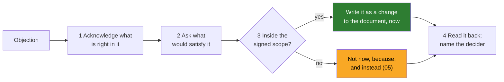

# 04 · The Readout: Pre-Reads, the Room, and Objections Handled Live

> Day 10 · Section 4 of 13 · [Chapter overview](README.md) · Previous: [03 · Writing for three readers](03-writing-for-three-readers.md) · Next: [05 · Saying no in writing](05-saying-no-in-writing.md)

---

## 4.1 What the readout is for

The readout is the meeting where the discovery document is signed. It is not a presentation of
findings. If the document is good, the room already knows the findings; the meeting exists to hear
objections in front of everyone, turn them into written changes, and leave with signatures.

The published practice for this kind of meeting is older than the FDE role. Amazon's 2017 letter to
shareholders (published April 2018) describes meetings built on "narratively structured six-page
memos" read silently at the start of each meeting. You will rarely get a Hyderabad COO to read in
silence for twenty minutes, so the FDE version moves the reading to a **pre-read** two days before,
and keeps the principle: nobody should hear the content for the first time in the meeting.

## 4.2 The pre-reads

| When | What | To whom | Why |
|---|---|---|---|
| Monday of week 4 | one-to-one, fifteen minutes each, with the CISO, the compliance head and the core-system owner: "here is your section; what is wrong with it?" | the three people who can veto or slow it | no blocker should be surprised in front of the sponsor |
| Tuesday | the COO's twenty minutes: page one and section 12 | the sponsor | he must not be surprised by the money or by a "no" |
| Wednesday | version 0.9 to everyone in the room, with the baseline pack attached | all | two days to read |
| Thursday | the team leads walk section 3 with you | operators | they correct the workflow before it is read out |

The rule: **every objection that can be heard before the meeting should be**. The objections left for
the room are the ones that need the room, because they cross two people's interests (the COO's speed
against the auditor's human decision) and must be decided with both present.

## 4.3 Who is in the room, and who presents what

From Day 5's map and Day 8's week-4 checkpoint: the COO (signs), the CISO and the compliance head
(veto), Srinivas and the Vijayawada team lead (operators), two senior analysts including an eval
owner, the core-system owner (by invitation; his conditions are read out whether or not he attends),
and Kaagaz's engagement lead. The auditor is represented by the compliance head; the branch managers
by the Kukatpally manager's conditions, read into the record.

| Minutes | Item | Who speaks |
|---|---|---|
| 0 to 5 | the question for today, and what signing means (and does not mean) | the FDE |
| 5 to 15 | page one, walked; the honest money | the FDE; the COO asks |
| 15 to 25 | the workflow and what changes for the analysts | the Vijayawada team lead, not the FDE |
| 25 to 35 | data and security, stage by stage | the FDE; the CISO responds |
| 35 to 45 | what we will not do, read aloud | the FDE; the COO confirms |
| 45 to 55 | the decisions needed, one at a time, each to its decider | the decider of each |
| 55 to 60 | the changes read back; signatures | the FDE reads; everyone signs |

Two choices in that table matter. **The team lead presents the workflow.** When the operators'
version of the work comes from an operator, the COO hears it as fact rather than as a vendor's
argument. And **each decision is put to its decider by name**: "this one is the compliance head's",
not "does everyone agree?". A question to everyone is answered by the most senior person in the room,
who is not always the right one.

## 4.4 Handling objections live

An objection in the room is information, not an attack. The method has four moves:

1. **Acknowledge what is right in it.** The Harvard guide's strong pattern for the client-simulation
   round is to acknowledge what the customer is right about before pushing back. The CISO who wants
   on-prem is right that no prototype has been reviewed yet.
2. **Ask what would satisfy it.** Often the request is a proxy. "On-prem before any prototype" turned
   out to mean "nothing runs outside the building until I have reviewed it".
3. **Decide whether it fits inside the signed scope.** If it does, it becomes a change to the
   document, written in the meeting. If it does not, it gets "not now, because, and instead".
4. **Read it back and name the decider.** "Change C2: section 8 gets the stage-by-stage gates, each
   your written approval. Agreed?"

## 4.5 Turning objections into plan changes without reopening the scope

At Godavari four objections became four changes, and none of them moved the problem, the six
workstreams or the will-not-do list.

| # | Objection | Who | What it became |
|---|---|---|---|
| C1 | "The board saw the chatbot. Can we not do both?" | the COO | the chatbot stays out (no baseline); Guntur joins Kukatpally in counting policy calls, so the day-90 review can score it with a number |
| C2 | "No prototype outside this building until I have reviewed it." | the CISO | section 8's stage table: the building with masked files, the building with two branches' real files (M11), Godavari's VPC in AWS Mumbai (M15 and M16), each gated by her written approval |
| C3 | "You cannot promise 'below 4.1 percent' on an interval of 0.9 to 7.2." | the compliance head | a census of the 700-file baseline frame before the go or no-go |
| C4 | "Show me the files it got wrong, not a percentage." | the senior analyst | the per-file failure list in the week-6 checkpoint pack |

The test for "without reopening the scope": after the change, does any signed line in sections 1, 5 or
10 read differently? For all four, no. C2 is the closest; it changes where the system runs in December,
which the plan already had in the building, and makes the CISO's existing gates explicit.

When an objection does reopen the scope (the COO asking to add a product, say), the answer is Day 8's:
what it would cost in dates, what would come off the plan to pay for it, and the checkpoint where the
change could be agreed. Then it goes into section 12 as a decision needed, with a date. It is never
agreed in the room on enthusiasm.

## 4.6 What gets signed

Signing means: this is the problem, these are the numbers and their methods, this is the plan we will
be held to, and these are the things we will not do. It does not change the contract. Say that at
minute one, or the CISO will not sign anything with the word "commit" in it.

Who signs: the COO, the CISO, the compliance head, both team leads, Kaagaz's engagement lead and the
FDE. The core-system owner's conditions are in section 10.1 with his name in the "agreed by" column;
that is his signature on the part he owns. Day 9's metric definitions are signed alongside, by the
same people, for the same reason: a definition signed before the pilot cannot be bent after it.

## 4.7 After the meeting

Within two hours: version 1.0 with the four changes marked, the decision log updated, sent to
everyone in the room with one line: "The signed version; four changes, marked; next version at the
week-6 checkpoint on 4 December." Day 29 owns the weekly readout that follows; Day 30 owns what to do
when the first number in it is bad.
