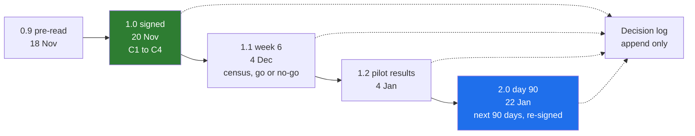

# 06 · The Decision Log and Versioning: Updated at Every Checkpoint, Never Rewritten

> Day 10 · Section 6 of 13 · [Chapter overview](README.md) · Previous: [05 · Saying no in writing](05-saying-no-in-writing.md) · Next: [07 · The Part 2 retrospective](07-the-part-2-retrospective.md)

---

## 6.1 Why a decision log

Three months from now somebody will ask "why does an analyst approve every file? It slows us down."
If the answer is "I think the compliance head wanted it", the decision gets reopened, and the
person reopening it may not know it was the auditor's condition. If the answer is "D07, 20 November,
decided by the compliance head for the auditor; the COO's request for auto-approval was heard and
declined; revisit after the 2027 inspection", the conversation is about whether the reason still
holds, which is the only useful conversation.

Software teams have done this for years as architecture decision records. Michael Nygard's 2011 post
(fetched October 2026) gives each record a number, a context, the decision in "we will" form, a
status, and its consequences; a reversed decision is not deleted but marked superseded, because "it
remains relevant to know what the decision was". The discovery document's log is the same idea with
the customer's people as the deciders.

## 6.2 What a row contains

| Field | Godavari's D07 | Why it is there |
|---|---|---|
| ID | D07 | so other rows, emails and the weekly readout can cite it; never reused |
| date | 20 Nov 2026 | decisions without dates cannot be ordered or revisited |
| decision | a human decision on every file; no auto-approval | one sentence, active, in words both sides use |
| decided by | the compliance head, for the auditor | a named role, never "leadership" or "the team" |
| why | the S01 and S12 collision; the COO cannot overrule | the reason, so the next person can test whether it still holds |
| source | a link to the conflicts file | the evidence, on disk |

The Godavari log has ten rows. Four came from earlier Days (the problem, the error-rate decider, the
90-day plan, the "present" rule) and six from the readout. Copying the earlier ones in matters: the
log is the single place a new person reads to learn what has been settled, and Day 4's decision is as
binding as Friday's.

Atlassian's DACI play (Driver, Approver, Contributors, Informed) makes the same point about roles: one
person approves, and the final decision is documented "in your collaboration document". At Godavari
the FDE is usually the driver and never the approver. A log row with "Kaagaz" in the decided-by column
for a customer decision is a warning sign; the AI draft in exercise 3.1 has one.

## 6.3 Decisions needed versus decisions made

Section 12 of the document has two tables. **Decided at this readout** is a short list of what the
room settled. **Still to decide** is the forward agenda: four items, each with who decides and by when
(the rules signed on 2 December, the CISO's approval on 3 December, go or no-go on 4 December, who
pays for serving by 4 December). At the next checkpoint the "still to decide" rows either move into
the log with an outcome or get a new date with a reason. A row whose date passes silently is the
first sign of a plan that has stopped being managed.

## 6.4 Versioning the document

The document changes as discovery continues. It must not be rewritten.

| Version | When | What it is | Signatures |
|---|---|---|---|
| 0.9 | Wed 18 Nov | the pre-read | none |
| 1.0 | Fri 20 Nov, week-4 checkpoint | signed, with C1 to C4 marked | the room |
| 1.1 | Fri 4 Dec, week-6 checkpoint | the skeleton's results, the census, the go or no-go | the COO; others if their section changed |
| 1.2 | Mon 4 Jan, pilot results | measured against the baseline | the COO and the compliance head |
| 2.0 | Fri 22 Jan, day-90 review | the next 90 days | the room again |

Four rules keep the history honest:

1. **Minor versions change content inside the signed scope; major versions change the scope.** A
   new risk, a moved date or a census result is 1.1. A new product, a new workstream or a removed
   will-not-do line is 2.0 and goes back to the people who signed.
2. **Mark every change in the text** ("[changed at readout, C2]") and list it in the change log with
   the reason. Readers should be able to see what moved without diffing.
3. **Never edit a decision; supersede it.** If the RBI inspection ends and auto-approval is
   reconsidered, D07 stays, and a new row says "D14 supersedes D07".
4. **One copy of record.** For Godavari it lives on Godavari's SharePoint (the CISO's rule from Day 6,
   finding B2), as a signed PDF per version. The working Markdown sits beside it in a repository
   Godavari can read. Never let the copy on the FDE's laptop become the real one.

## 6.5 Keeping the sources in step

The document links Days 4 to 9's artifacts; they change too. Day 4's memo said it would be
re-versioned after Day 9's count. Day 5's map is versioned at every checkpoint. When a source
changes, the discovery document's next version quotes the new conclusion and the link still
resolves. The checker in section 09 catches the broken link; only a human catches a quoted number
that no longer matches its source, which is why the review checklist asks for it.
