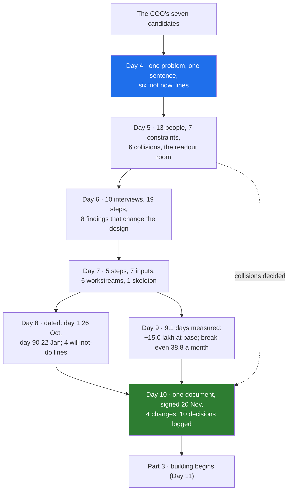

# 07 · The Part 2 Retrospective: How the Six Artifacts Fit

> Day 10 · Section 7 of 13 · [Chapter overview](README.md) · Previous: [06 · The decision log and versioning](06-the-decision-log-and-versioning.md) · Next: [08 · 2026 patterns and production concerns](08-2026-patterns-and-production-concerns.md)

---

## 7.1 Seven chapters, one engagement step each

Part 2 began with a COO's seven candidates and ends with a signed document. Look back at what each
Day produced, what the next Day took from it, and what would have broken without it.

| Day | Artifact | What the next Days took from it | What breaks without it |
|---|---|---|---|
| 4 | [problem-selection memo](../04-picking-the-problem/worksheet/godavari-problem-selection-memo.md) | the one sentence (Day 7 step 1); the "not now" lines (Day 8's lists); the baseline it said must hold (Day 9) | you build the chatbot the board saw |
| 5 | [stakeholder map](../05-the-stakeholder-map/worksheet/godavari-stakeholder-map.md) | whom to shadow (Day 6); the metric column (Day 7 step 2); the readout room and the collisions (Day 10) | the CISO you never met vetoes it in week ten |
| 6 | [synthesis](../06-discovery-interviews/worksheet/godavari-discovery-synthesis.md) and [situational map](../06-discovery-interviews/worksheet/situational-map.md) | the inputs and their risks (Day 7 step 3); the requirements for Days 15, 16, 22 | the tracker and the AD groups surface in month three |
| 7 | [decomposition](../07-decomposition/worksheet/godavari-decomposition.md) and [sequenced plan](../07-decomposition/data/godavari-decomposition-plan.md) | the order and the reasons (Day 8); the skeleton (Day 20) | integration and security start in week ten |
| 8 | [90-day plan](../08-scoping-the-first-90-days/worksheet/godavari-90-day-plan.md) | dates, checkpoints, the signed will-not-do list (Day 10); the slip order | every request is affordable until day 90 |
| 9 | [baseline pack](../09-success-metrics-and-business-case/worksheet/godavari-baseline-pack.md), [case](../09-success-metrics-and-business-case/worksheet/godavari-business-case.md), [definitions](../09-success-metrics-and-business-case/worksheet/godavari-metric-definitions.md) | the numbers with methods; what decides the case; pre-registered definitions (Days 14, 19, 37) | "it feels faster" at renewal |
| 10 | [discovery document](worksheet/godavari-discovery-document.md) | the signed agreement every later Day cites | each of the above is reopened, one at a time |

## 7.2 The chain, as a picture

## 7.3 What changed as it travelled

The artifacts did not just accumulate; each one corrected an earlier one. That is the sign discovery
was working.

| What an early Day said | What a later Day found | Where the correction lives |
|---|---|---|
| "the analysts are slow" (the COO, Day 5) | the nine days are mostly waiting; 6.4 days of queue (Days 6 and 9) | page one, finding 1 |
| 31 percent sent back (the monthly report, Day 4) | 28 percent by hand count, 21 to 35; the report is consistent (Day 9) | section 7, both shown |
| 9.2 days (Days 4 and 7) | 9.1 days, 8.7 to 9.7 (Day 9) | section 5 quotes Day 7, section 7 the measurement |
| twelve steps (the SOP) | nineteen (Day 6) | section 3 |
| intake saves hours, so it pays (Day 3: "probably") | on hours alone it costs 1.12 crore a year more than it saves; it is a speed case (Day 9) | page one, "the money, honestly" |
| the tracker as a candidate to replace (Day 4, C8) | the tracker is the real state and must be written back to (Days 4 and 6) | section 3, in bold for the team leads |

The Day 9 correction is the important one. A team that had not measured would have walked into the
readout with Day 3's "probably", and the CFO would have found the minus 1.12 crore in month seven.
Finding it in week four, and putting it on page one, is what makes the rest of the document believable.

## 7.4 What the method looks like from here

Every one of those steps had the same shape: write it down, attach a source, name who agreed, version
it. That is not bureaucracy; it is how an outsider earns the right to change someone else's workflow.
Part 3 starts building (Day 11 draws the line between deterministic code and the model; the
completeness rules are already on the deterministic side). The discovery document goes with it: Day
14's golden set is the one section 7 depends on; Day 20 ships the skeleton in section 5; Days 21 and
23 turn section 8's gates into an architecture and a passed review; Day 29's weekly readout opens with
the decision log's "still to decide" rows.

The capstone (Day 42) repeats all seven steps for Krishna District Hospital Network with a different
regulator and the same method. If you can produce these seven artifacts for Godavari, you can produce
them for anyone.

## 7.5 A self-check before Part 3

- Can you say Godavari's problem sentence from memory, and who signed it?
- Can you name the two collisions the readout decided, and who decided each?
- Can you name the three findings that would have forced a redesign in month three?
- Can you state the business case in one honest sentence, including the minus?
- Can you list the four will-not-do lines with a reason each?

If any answer needs you to open a file, open it now. Part 3 assumes all five.
