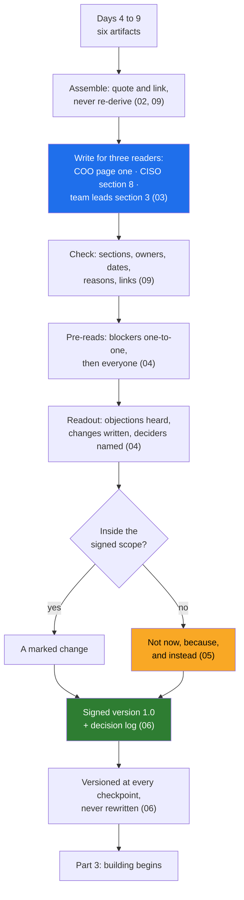

# Day 10 · The Discovery Document: Writing It, Defending It, and Saying No

> **[Part 2 · Discovery and Decomposition](../README.md)** · Chapter 7 of 7 · Video ~12 min · Chapter tier: medium
> Builds on: [Day 4 (the problem statement)](../04-picking-the-problem/README.md) ·
> [Day 5 (the readout room and the collisions)](../05-the-stakeholder-map/README.md) ·
> [Day 6 (the real workflow and the findings)](../06-discovery-interviews/README.md) ·
> [Day 7 (the decomposition and the skeleton)](../07-decomposition/README.md) ·
> [Day 8 (the 90-day plan and the will-not-do list)](../08-scoping-the-first-90-days/README.md) ·
> [Day 9 (the baseline and the business case)](../09-success-metrics-and-business-case/README.md)
> Sets up: Day 11 (building begins on the signed terms), Day 21 and Day 23 (the CISO's stage gates
> become a deployment model and a passed review), Day 29 and Day 30 (the weekly readout and bad news,
> measured against this document), Day 32 (the governance line), Day 34 (the full client-simulation
> drills), Day 42 (the capstone's discovery document)
> **Owner:** this chapter owns **the discovery document and the readout for the course: a decision
> document rather than a report; its structure (page one, the twelve sections, the decision log, the
> change log, the sign-off); writing for three readers at once; the pre-reads, the room, the agenda and
> handling objections live; turning objections into changes without reopening scope; saying no in
> writing as "not now, because, and instead"; the three readout role-plays (the chatbot, on-prem, 100
> percent accuracy); the decision log; versioning; and the Part 2 retrospective.** The problem choice is
> Day 4's; the roles and collisions Day 5's; the workflow and findings Day 6's; the method Day 7's; the
> dated plan and the will-not-do list Day 8's; the baseline and case Day 9's; status updates Day 29's;
> the governance line Day 32's; the full drills Day 34's.
> Versions used: the checker was run on **Python 3.14.3** (standard library only, no packages; as of
> October 2026). Shown outputs are from real runs. Every person, date and number at Godavari is invented.

---

## Why this chapter exists

Four weeks of discovery at Godavari Finance produced six artifacts in six folders: a problem memo, a
stakeholder map, a synthesis and a nineteen-step workflow, a decomposition, a dated plan, and a
baseline with a business case that turned out thinner than anyone hoped. The COO, the CISO and the
compliance head will not read six folders. They will read one document, the COO only its first page,
and decide in one meeting whether to commit to a pilot. If that document is a report, the meeting ends
with "let us take this offline". If it is a decision document, it ends with signatures.

Interviewers ask candidates to describe this artifact, and the client-simulation round (45 minutes in
the 2026 guides) is the readout compressed: present a plan, defend a trade-off, push back "without
losing the relationship". Customer-facing discovery appears in 70 percent or more of the 1,000 FDE
postings analysed in 2026 and is the fastest-rising bucket; the discovery document is its visible
output. This chapter assembles Godavari's from Days 4 to 9, writes it for three readers, runs the
readout where the COO asks for the chatbot and the CISO asks for on-prem, records four changes and ten
decisions, and ships a script that checks any discovery document before it leaves your laptop.

## Mental model

One sentence to carry out of the chapter: **assemble the document from what discovery already proved,
give each reader a front door, hear every objection in front of the people it affects, write each one
down as a change or as "not now, because, and instead", and version the signed result instead of
rewriting it.**

## Learning goals

After this chapter you can:

1. Explain the difference between a report and a decision document, and why the second gets signed.
2. Assemble a discovery document in the twelve-section structure from Days 4 to 9's artifacts, quoting
   conclusions and linking sources instead of restating them.
3. Write page one for a sponsor (no model names, numbers with methods, the honest money, the
   refusals), a data and security section a CISO can sign, and a workflow section operators recognise.
4. Plan and run a readout: pre-reads, who is in the room, who presents what, and what gets signed.
5. Handle objections live and turn them into written changes without reopening the scope.
6. Say no in writing with "not now, because, and instead", including to the sponsor in front of his
   peers, and handle the chatbot, on-prem and 100-percent-accuracy demands.
7. Keep a decision log and version the document at every checkpoint.
8. Explain how Part 2's six artifacts fit, and what each later Day takes from the signed document.
9. Run the chapter's checker, read what it cannot catch, and review an AI-drafted document for the
   mistakes agents make on this task.

**Prerequisites:** Days 4 to 9, or at least their worksheets. Python at a reading level; no libraries.

## Reading order

| # | Section | What you get | Words |
|---|---|---|---|
| 01 | [Why the discovery document](01-why-the-discovery-document.md) | Friday of week four; the career reason; the panchayat; what Day 10 adds to each earlier Day; the hard parts named | ~1,000 |
| 02 | [What it is for, and its structure](02-what-it-is-for-and-its-structure.md) | report versus decision document; the twelve sections and their sources; what each must contain; length | ~1,200 |
| 03 | [Writing for three readers](03-writing-for-three-readers.md) | page one for the COO; section 8 for the CISO; section 3 for the team leads; numbers with methods | ~1,250 |
| 04 | [The readout](04-the-readout.md) | pre-reads; the room and the agenda; four moves for an objection; four objections, four changes; what is signed | ~1,400 |
| 05 | [Saying no in writing](05-saying-no-in-writing.md) | not now, because, and instead; the chatbot, on-prem, 100 percent, the CRM again; the written row | ~1,300 |
| 06 | [The decision log and versioning](06-the-decision-log-and-versioning.md) | what a row holds; decided versus still to decide; versions, marks, supersession, one copy of record | ~1,000 |
| 07 | [The Part 2 retrospective](07-the-part-2-retrospective.md) | the seven artifacts and what each fed; the chain; what changed as it travelled; a self-check | ~1,000 |
| 08 | [2026 patterns and production concerns](08-2026-patterns-and-production-concerns.md) | agent-assembled drafts, docs as code, what is hype; confidentiality, PII, decision latency | ~700 |
| 09 | [Project: the Godavari discovery document](09-project-the-godavari-discovery-document.md) | assembling it; the checker; real output on the signed document and an AI draft; Build it with AI; How do you know it's right | ~2,500 (incl. output) |
| 10 | [Mistakes and debugging](10-mistakes-and-debugging.md) | symptom, cause, fix for the document, the readout, saying no, and the script | ~800 |
| 11 | [Interview questions](11-interview-questions.md) | 14 questions with model answers, four of them client-simulation prompts | ~1,250 |
| 12 | [Exercises](12-exercises.md) | 9 graded exercises: predict-the-output and break-it on the script, "review this AI-written document", your own page one, the readout out loud, version 1.1 | ~1,800 |
| 13 | [Further reading](13-further-reading.md) | memos, design docs, decision records, DACI; the FDE playbooks; the interview guides | ~650 |

**Short on time?** Read 03, 04 and 05, then open the [signed document](worksheet/godavari-discovery-document.md)
and do exercise 3.1. That is the video plus the client-simulation reflex.

## Files

| Path | What |
|---|---|
| [`worksheet/godavari-discovery-document.md`](worksheet/godavari-discovery-document.md) | the assembled Godavari discovery document, version 1.0, signed 20 November 2026 with four changes marked; links every source artifact from Days 4 to 9 (~4,450 words including tables) |
| [`worksheet/ai-draft-discovery-document.md`](worksheet/ai-draft-discovery-document.md) | an AI-written draft with at least fourteen problems; exercise 3.1 |
| [`code/check_discovery_doc.py`](code/check_discovery_doc.py) | checks required sections, a one-sentence problem statement, an owner and date on every decision, a reason on every refusal, links to the source artifacts, and page one's technology words and unsourced numbers; exit code 1 on any error |

Run from the chapter folder: `python -X utf8 code/check_discovery_doc.py worksheet/godavari-discovery-document.md`
(about 0.3 seconds). No packages, no downloads, no API keys.

## What this chapter does *not* teach (single-owner rule)

| Topic | Where it's taught |
|---|---|
| Choosing the problem; the scoring sheet; the chatbot trap | [Day 4](../04-picking-the-problem/README.md) |
| The roles, power and interest, the collisions and their deciders | [Day 5](../05-the-stakeholder-map/README.md) |
| Shadowing, interviews, the situational map, synthesis | [Day 6](../06-discovery-interviews/README.md) |
| The decomposition method and the walking skeleton | [Day 7](../07-decomposition/README.md) |
| Dating the plan, checkpoints, the RACI, writing the will-not-do list | [Day 8](../08-scoping-the-first-90-days/README.md) |
| Measuring the baseline, the business case, pre-registered definitions | [Day 9](../09-success-metrics-and-business-case/README.md) |
| Deployment models and the security questionnaire in full | Days 21 and 23 |
| The weekly status readout; delivering bad news | Days 29 and 30 |
| Requests that cross a governance line | Day 32 |
| Six full client-simulation scenarios | Day 34 |

## Analogies for the Telugu audience

- **The village panchayat** (the chapter's main picture): the case laid out before the elders, every
  objection heard in front of everyone, the decision written in the register so nobody reopens it next
  month (01.2).

## Video map

The video (~12 min) covers a slice; the notes cover everything.

| Asset | Covers | Sections |
|---|---|---|
| **Day 10 main video** (~12 min) | Hook: Friday of week four, eight people, one question (1 min) → report versus decision document (1 min) → the structure on one slide, each section's source Day (1.5 min) → three readers: page one, section 8, section 3 (2 min) → the readout: pre-reads and the agenda (1.5 min) → the COO's chatbot: not now, because, and instead (1.5 min) → the CISO's on-prem: a gate she owns (1.5 min) → four changes, none reopening scope (1 min) → the decision log and versioning (0.5 min) → Part 2 in one picture; Day 11 teaser (0.5 min) | 01.1, 02.1 to 02.2, 03.2 to 03.4, 04.2 to 04.5, 05.2 to 05.3, 06.2, 06.4, 07.2 |
| **Short 1:** "The three words that keep a customer: not now, because." | the three parts; the chatbot exchange in thirty seconds; why "instead" keeps the relationship | 05.1, 05.2 |
| **Short 2:** "A discovery document the CISO signs beats a demo the COO loves." | the CISO's section as a table of her conditions; the stage-by-stage gates; why a demo cannot get this signature | 03.3, 05.3 |
| Notes only | what each section must contain (02.3), numbers with methods (03.5), the 100-percent role-play and the CRM (05.4, 05.5), what changed as it travelled (07.3), 2026 patterns (08), the project, Build it with AI and How do you know it's right (09), debugging (10), interviews (11), exercises (12) | as listed |

**Callbacks to use on screen:** "Day 4 lo raasina chatbot sentence ivala COO mundu cheptunnam." (section
05); "Day 5 lo collisions ki decider ni raasam; ivala aa decisions ee room lo jarugutayi." (section 04);
"Day 9 lo minus 1.12 crore chusam; adi page one lo untundi, page nine lo kaadu." (section 03).
**Forward callbacks:** Day 11 (ee signed terms meeda building start), Day 21 and 23 (CISO gates), Day 34
(full drills).

**Next chapter:** [Day 11 · The system around the model: what the LLM does, what deterministic code does, and why](../../03-building-the-system/11-the-system-around-the-model/README.md).
