# Part 2 · Discovery and Decomposition

> **Days 4 to 10** · 7 chapters · 7 videos (~82 min in total) · about **17 hours of reading** in the notes
> (plus time to run the code and write the artifacts) · Playlist plan: [`curriculum/part-02-discovery-and-decomposition.md`](../curriculum/part-02-discovery-and-decomposition.md)

---

## What this Part is for

[Part 1](../01-the-role/README.md) said where the role came from, what the job consists of and why a
vendor pays for it, and left the engagement folder with a lineage map, a two-week calendar, a
unit-economics model and the first "we will not build this" line, all before anyone had seen a loan
file. Part 2 is the first four weeks inside Godavari Finance: **finding the problem worth solving
inside someone else's company, mapping who owns it, interviewing the people who do it by hand, and
breaking it into a 90-day plan you can defend.** Day 4 picks one problem from the COO's seven; Day 5
maps everyone who can fund, use, veto or quietly ignore the work; Day 6 sits beside the operators and
finds nineteen steps where the SOP has twelve; Day 7 owns the five-step decomposition method and the
walking skeleton; Day 8 dates the work against the customer's calendar and writes what you will not
do; Day 9 measures the baseline by hand and writes a business case that survives a CFO; Day 10
assembles all of it into one discovery document and gets it signed in a room that includes the people
who can veto it. Each chapter adds an artifact to the Kaagaz AI engagement folder, and Day 10's
document quotes and links every one of them.

By the end of these seven chapters you can:

- state Atlassian's filter (frequent, painful, measurable, then work backwards to the AI) and
  OpenAI's (worth tens of millions, at the core of the business, FDE-shaped), say why they are
  different filters, start from the workflow (wait, re-key, rework) rather than the model, score a
  catalogue against six criteria with anchors and a sensitivity check, apply the three gates (a
  baseline, a data owner, an operator who wants it), name the five traps, and write the one-sentence
  problem statement with no solution in it that the sponsor and the operators both sign;
- map sponsor, operators, blockers and the ghost stakeholder, plus the upstream producer, the system
  owner, the eval owner, the champion and the sceptic; hold the sponsor's version ("the analysts are
  slow") and the operators' ("we wait three days") as both true; add "stops it by" and "must change"
  to the power-interest grid; list the collisions between the numbers people would believe, each
  with a decider; and meet the CISO in week one, not week ten;
- run discovery on site: access and reality on days one and two, a shadowing log for a full cycle,
  8 to 10 end-user interviews before production code, questions that start from "show me the last one
  you did", a situational map in five layers, the six questions that change the architecture (who may
  see what at Godavari comes from Active Directory groups synced from HR), shadow systems, 180 golden
  examples with their labellers, and a synthesis where three independent interviews make a
  requirement;
- decompose a vague goal in five steps with a written output each (clarify the goal and the
  trade-off; stakeholders and the metric each accepts; the inputs by shape, owner, freshness, access
  and what is missing; workstreams sequenced risk first, value second; a walking skeleton with every
  layer present and each thin), out loud in 25 minutes, without saying the word "model" before step
  five;
- turn the order into a dated 90-day plan with overlapping phases, blackouts by kind of work,
  milestones a COO can read, checkpoints at weeks 2, 4, 6 and 12, a two-company RACI, a signed "will
  not do" list, buffers and a slip order with a "never" row;
- turn "faster" into a metric ladder, count the baseline by hand from a stratified sample with
  confidence intervals, convert hours into rupees with a loaded cost while keeping capacity apart from
  cash, write a one-page case with a floor, a break-even and sensitivity, and pre-register the
  definitions before the pilot;
- write a discovery document for three readers at once, run the readout, turn objections into
  changes without reopening the scope, say "not now, because, and instead" in writing to the chatbot,
  on-prem and 100-percent-accuracy demands, keep a decision log, and version the signed result instead
  of rewriting it.

The open-ended decomposition round has the lowest pass rate of any FDE interview stage, and the most
common rejection reason is jumping to a solution before scoping. On the job the failure looks the
same: a prototype built for the sponsor's version of the problem that the operators never use. The
teams that invented the role say it plainly: pick problems that are frequent, painful and measurable,
interview the people who do the work before writing production code, and agree how success is
measured before choosing a model. This Part teaches that as a method, drilled on one customer until
it is a reflex.

## Who it's for

- **Learners coming from Part 1.** Continue straight from
  [Day 3](../01-the-role/03-the-economics/README.md): its "is this FDE-shaped?" test becomes Day 4's
  sponsorship column, its branch CRM refusal becomes the first line of Day 8's "will not do" list, and
  its "probably" about the money is what Day 9 measures and corrects.
- **Backend, data, DevOps and ML engineers who want the title.** Customer-facing discovery is the
  bucket most of you have least of; it is in 70 percent or more of the 1,000 FDE postings analysed in
  2026 and rising fastest. Day 6's six questions that change the architecture and Day 7's inputs
  table are where your engineering judgement meets it: one interview answer about who may see what
  decides how retrieval is built.
- **Engineers in solutions, consulting or services roles.** You have run discovery calls and written
  proposals. Day 7's walking skeleton, Day 8's signed "will not do" list and Day 9's
  capacity-versus-cash case are the parts that separate an engagement that ends in a product from one
  that ends in a services contract.
- **Engineers about to run their first discovery at a customer.** Day 5's three persona scripts,
  Day 6's access list, interview plan and question bank, and Day 10's checker are built to be reused
  on Monday; the templates in Days 4, 5, 7, 8 and 9 (and Day 6's shadowing log) are the empty versions
  of the Godavari worksheets.
- **Interview preparers.** The decomposition round and the client simulation are this Part. Day 7
  gives the 25-minute out-loud protocol and three timed drills; Day 10 includes four client-simulation
  prompts. The seven chapters have 12, 12, 13, 16, 12, 12 and 14 interview questions with model
  answers.

No machine learning theory is needed, and no maths beyond the confidence intervals Day 9 explains in
plain words. Python at a reading level is enough for the eight small scripts; none of them uses a
library.

## How to use these notes

**The notes are for learning the concept deeply. The videos cover one slice.** Each Day's video is
11 to 13 minutes; each chapter here is a full textbook chapter of roughly 22,000 to 43,000 words, with
runnable code, a project that moves the engagement, a "Build it with AI" section with the mistakes a
coding agent typically makes for that task, a "How do you know it's right?" checklist, a
mistakes-and-debugging table, interview questions and graded exercises. Watch the video for the idea,
then read the chapter to own it.

Each chapter folder has a `README.md` with:

- a "why this chapter exists" overview, a Mermaid mental model, the one sentence to carry out of the
  chapter, and learning goals,
- a **reading order** table (one file per section, with word counts),
- a **short-on-time path** (every chapter except Day 9),
- a **files** table (the worksheets, code and data the chapter produces, and how to run the script),
- a "what this chapter does not teach" table (the single-owner rule; Day 8 states it in its header's
  owner line instead),
- **analogies for the Telugu audience**,
- a **video map** showing which sections the Day's video and Shorts cover, with the on-screen callbacks,
- **callbacks**: which earlier Days it builds on and which later Days it sets up (a section of its own
  in Days 4 to 7; in the header and the video map in Days 8 to 10).

Every chapter ends with **interview questions**, **exercises** (graded, each with a "review this
AI-written draft" exercise against a worksheet that has planted errors) and **further reading** (the
sources with their type and what was and was not fetchable).

**Running the code.** All seven chapters use **standard-library Python only**: no packages, no
downloads, no API keys. The scripts were run on Python 3.14.3 (October 2026) and each finishes in under
a second. Every script checks its input and prints its result; all but Day 10's checker regenerate
files in `data/`:

| Chapter | Script | Run from the chapter folder |
|---|---|---|
| Day 4 | `code/score_candidates.py` applies the three gates, scores the catalogue, checks the scores against the evidence, tests the winner under other weightings and writes `data/godavari-candidates-ranking.md` (`--rate` changes the rupees-per-hour placeholder) | `python -X utf8 code/score_candidates.py data/godavari-candidates.csv` |
| Day 5 | `code/stakeholder_grid.py` reads the map and the collisions as CSV, prints the grid, who can stop it, whose Tuesday changes, the checks and the collisions, and writes `data/godavari-stakeholder-grid.md` (the two CSV paths are optional arguments) | `python -X utf8 code/stakeholder_grid.py` |
| Day 6 | `code/tally_findings.py` tallies the coded transcripts, classifies requirements (three or more interviews) and hypotheses, checks a synthesis for invented and missed findings, writes `data/<synthesis>-tally.csv` and `.md`, and exits 1 on an unsupported finding | `python -X utf8 code/tally_findings.py worksheet/transcripts worksheet/godavari-discovery-synthesis.md` (or `worksheet/ai-draft-findings.md` for exercise 3.1) |
| Day 7 | `code/inputs_inventory.py` writes the inputs inventory and 200 synthetic loan files and prints the step 3 summary; `code/plan_from_worksheet.py` reads a worksheet's Step 4 table, sequences it by risk and value and writes `data/<name>-plan.json` and a week grid | `python -X utf8 code/inputs_inventory.py` and `python -X utf8 code/plan_from_worksheet.py worksheet/godavari-decomposition.md` |
| Day 8 | `code/date_the_plan.py` reads Day 7's plan JSON and the calendar, adjustments, milestones and RACI CSVs, dates and checks the plan, and writes `data/godavari-90-day-schedule.json` and `data/godavari-90-day-plan.md`; `--slip CODE=WEEKS` shows what a late workstream does, `--no-write` leaves `data/` untouched | `python -X utf8 code/date_the_plan.py`, then `python -X utf8 code/date_the_plan.py --slip W5=1` (also `W5=3`, `W4=2`) |
| Day 9 | `code/baseline_and_case.py` imports Day 7's generator, draws the stratified sample, computes the baseline with intervals, the loaded rate, the capacity plan, the case and the sensitivity tables, and writes `data/godavari_baseline_sample.csv` and `data/godavari-baseline-and-case.md` | `python -X utf8 code/baseline_and_case.py` |
| Day 10 | `code/check_discovery_doc.py` checks the required sections, the one-sentence problem statement, an owner and date on every decision, a reason on every refusal, the source links and page one; exit code 1 on any error | `python -X utf8 code/check_discovery_doc.py worksheet/godavari-discovery-document.md` (or `worksheet/ai-draft-discovery-document.md` for exercise 3.1) |

Days 8 and 9 read from Day 7's folder (`../07-decomposition/`), so keep the Part's chapter folders side
by side, and run Day 7's scripts first if its `data/` files are missing. The commands above use
`-X utf8`, as the chapter READMEs from Day 5 on do: if you run a script on Windows with output
redirected to a file or pipe and see a `UnicodeEncodeError` (for example on a middle dot in a row you
added), the flag is the fix (or set `PYTHONUTF8=1`). Day 4's README runs its script without the flag;
it works either way. Shown outputs in the notes are from real runs. No real LLM is called anywhere;
the "Build it with AI" sections show how to use a coding agent and what to check in what it writes.

**Examples are illustrative.** Kaagaz AI, Godavari Finance, Lakshmi, Srinivas, Bhavani, every
transcript, every loan file and every rupee figure are invented, and the synthetic data is generated
by code in the chapters. Real sources (the Atlassian and OpenAI playbooks, the 2026 discovery
playbooks and interview guides, the RBI Master Direction on KYC, the DPDP Act) appear where a
published text says what they describe, and each chapter's further reading lists them with their
type. Day 7's city emergency-response problem is a published interview case; Day 8's 2026 Telangana
holiday dates are real and its 2027 dates marked "to confirm" are assumptions. The interview and
discovery sources are career-prep or vendor content, so the method is quoted as they describe it.

## The seven chapters

Reading times are from the real word counts of each chapter folder (all sections plus the README,
worksheets, transcripts and generated tables, code blocks included) at about 200 words per minute.
Running the code, doing the exercises and writing the artifacts takes longer.

| Day | Chapter | What you'll learn | Words | Reading time |
|---|---|---|---|---|
| 4 | [Picking the Right Problem](04-picking-the-problem/README.md) | Atlassian's filter (frequent, painful, measurable, then work backwards to the AI) and OpenAI's (worth tens of millions, at the core, FDE-shaped), why they are different filters, scaled to a 40-person vendor; starting from the workflow (wait, re-key, rework) and the eight-row catalogue, seven from the room and one from the floor; the scoring sheet's six criteria (frequency, pain in hours and rupees, measurability, data availability, blast radius, sponsorship) with anchors, weights and a sensitivity check; the three gates; the five traps (the demo, the chatbot, the sponsor's pet project, no baseline, the edge case); the one-sentence problem statement; "not now, because, and instead" for every other candidate. **Project:** the catalogue as data, the ranking script (intake at 93 and stable under every weighting; the Excel tracker at 80, folded in as a constraint) and the problem selection memo, the first page of the engagement folder. | ~25,400 | ~2 h 7 min |
| 5 | [The Stakeholder Map](05-the-stakeholder-map/README.md) | The four roles (sponsor, operators, blockers, ghost stakeholders), the three everyone forgets (upstream producer, system owner, eval owner), the champion, the sceptic and your own side; the sponsor's version and the operators' version as both true, and the eval-customer split (whose judgement defines "correct"); the power-interest grid with "stops it by" and "must change"; who signs, who vetoes and who opens the tool; the number each person would believe and the collisions between them; eleven signals for reading an org without its chart; blockers in week one; the champion found and the sceptic interviewed; the customer's calendar; three thirty-minute persona scripts. **Project:** the Godavari map, 13 rows as a table and a diagram, the constraints list with "no customer PII leaves India" on it, six collisions each with a decider, the readout room, and a script that prints the grid and refuses to stay quiet about the map's gaps. | ~28,000 | ~2 h 20 min |
| 6 | [Discovery Interviews](06-discovery-interviews/README.md) | Days one and two as access and reality, with every ticket raised on day one and the sales notes tested against the floor; shadowing an operator for a full cycle; the interview plan of 8 to 10 end users before production code; persona question banks built on "show me the last one you did", "what do you do when it is wrong" and "what is in the Excel sheet"; interviewing without leading, note-taking and the read-back; the situational map (twelve steps in the SOP, nineteen on the floor, step 14 on WhatsApp); the six questions that change the architecture and the AD-group finding heard in five interviews; shadow systems and 180 golden examples with their labellers; coding, the three-interview rule and confirmation with the operators. **Project:** the discovery pack: interview plan, question bank, Lakshmi's shadowing log, ten coded transcripts, the situational map and the synthesis (eight architecture findings, four constraints, five scope findings, what was not found), checked by a script that fails a synthesis citing a finding no interviewee gave. | ~43,100 | ~3 h 35 min |
| 7 | [Decomposition](07-decomposition/README.md) | The five steps with a written output each: clarify the goal and the trade-off (speed against the error rate the auditor will accept, and who sets the loss); stakeholders and the metric each accepts; the inputs by shape, owner, freshness, access and what is missing, one architecture risk each, and the data that does not exist yet; workstreams scored and sequenced risk first, value second; the walking skeleton, every layer present and each thin; why it beats a polished component; the "LLM with RAG in minute one" anti-pattern; how the decomposition round scores it and the 25-minute out-loud protocol; the method run on Godavari, a city's emergency response times (a published case) and Rayalaseema Roadways' receivables. **Project:** the "nine days to three" worksheet with seven inputs and six workstreams (integration and the security review first), the inputs inventory and 200 synthetic files as data, and the sequenced plan generated from the worksheet; the skeleton is two-wheeler loans, Kukatpally branch, SFTP scans only. | ~37,700 | ~3 h 8 min |
| 8 | [Scoping the First 90 Days](08-scoping-the-first-90-days/README.md) | The 30-60-90 convention and why discovery and the prototype overlap on purpose; decisions gated while work is not; dating Day 7's order against the customer's calendar (the release freeze, Sankranti, the RBI inspection, month end) as blackouts by kind of work; starting the clocks you cannot speed up in week one and routing the long pole around the freeze; milestones a COO can read with an owner on each side; checkpoints at weeks 2, 4, 6 and 12, each a yes-or-no question; the two-company RACI; the "will not do" list kept apart from the parked list and the constraints; buffers, slip amplification, the slip order and re-planning. **Project:** the Godavari plan page, dated from 26 October 2026 to 22 January 2027 with 22 milestones, the Gantt, the RACI and the slip order, generated by a script that reads Day 7's plan and runs slips; the four "will not do" lines (the branch CRM, collections call summaries, the core system's data model, customer PII outside India). | ~23,500 | ~1 h 57 min |
| 9 | [Success Metrics and the Business Case](09-success-metrics-and-business-case/README.md) | The metric ladder (business, operational, system), leading and lagging indicators, a guardrail for every target and the model metric kept off the headline; the baseline counted by hand on the customer's clock, with a sampling frame, a stratified draw with a seed and a second counter; confidence intervals for a mean, a rate and a median in plain words; hours into rupees with a loaded cost (456 rupees an hour, not Day 4's 300 placeholder) and capacity kept apart from cash; the cost of wrong decisions and of the system, reconciled with Day 3; the one-page case with a floor, a break-even, sensitivity and targets as ranges; pre-registration and the numbers that get gamed. **Project:** the baseline pack from 120 sampled files (median 9.1 days, 8.7 to 9.7, 6.4 of them in the queue; 28 percent sent back), the one-page case (about 15.0 lakh a year net at base, minus 1.12 crore on analyst hours alone, break-even at about 38.8 loans a month kept) and the metric definitions ready to sign. | ~22,000 | ~1 h 50 min |
| 10 | [The Discovery Document](10-the-discovery-document/README.md) | A decision document rather than a report; the structure (page one, twelve sections, the decision log, the change log, the sign-off) and the Day each section comes from; writing for three readers (page one for the COO with no model names and numbers with methods, section 8 for the CISO, section 3 for the team leads); pre-reads, the room, the agenda and objections handled live; changes without reopening the scope; "not now, because, and instead" in writing; the three role-plays (the chatbot, on-prem, 100 percent accuracy); the decision log and versioning; the Part 2 retrospective. **Project:** the Godavari discovery document assembled from Days 4 to 9, version 1.0, signed on 20 November 2026 with four changes marked and ten decisions logged, and a checker that passes it and fails the AI draft. | ~22,800 | ~1 h 54 min |
| | **Total** | | **~202,500** | **~16 h 52 min** |

## Recommended order

Read the chapters in Day order; each one starts from the artifact the previous one produced. Day 4
picks the problem, Day 5 says whose problem it is, Day 6 watches it being done, Day 7 breaks it into
work, Day 8 dates the work, Day 9 puts a number on it, and Day 10 gets all of it signed. Days 8 and 9
also run on Day 7's data, and Day 10 assumes every earlier worksheet is in the engagement folder.

```mermaid
flowchart LR
    P1["Part 1 · The Role and the Market<br/>Days 1 to 3<br/>(lineage, buckets, economics)"] --> D4
    D4["Day 4<br/>Picking the problem<br/>one sentence, signed"] --> D5["Day 5<br/>The stakeholder map<br/>whose version is true"]
    D5 --> D6["Day 6<br/>Discovery interviews<br/>12 steps on paper, 19 on the floor"]
    D6 --> D7["Day 7<br/>Decomposition<br/>five steps, walking skeleton"]
    D7 --> D8["Day 8<br/>Scoping 90 days<br/>dates, 'will not do'"]
    D8 --> D9["Day 9<br/>Metrics and the case<br/>baseline by hand"]
    D9 --> D10["Day 10<br/>The discovery document<br/>signed at the readout"]
    D7 -. "plan JSON, generator" .-> D9
    D10 --> P3["Part 3 · Building the System<br/>Days 11 to 20<br/>(building begins on the signed terms)"]
    style D4 fill:#1f6feb,color:#fff
    style D5 fill:#1f6feb,color:#fff
    style D6 fill:#1f6feb,color:#fff
    style D7 fill:#b35900,color:#fff
    style D8 fill:#1f6feb,color:#fff
    style D9 fill:#1f6feb,color:#fff
    style D10 fill:#2e7d32,color:#fff
```

- **Short on time?** Use each chapter's short path: Day 4 sections 02, 04 and 05, then the project
  (08) and exercise 3.1; Day 5 sections 02, 03 and 04, then the project (08) and exercise 3.1; Day 6
  sections 03, 07 and 08, then the project (12); Day 7 sections 02, 07, 08 and 09, then the project
  (12) and one timed drill (exercise 2.1); Day 8 sections 02, 03.3, 05 and 06, then the project (08);
  Day 10 sections 03, 04 and 05, then the signed document and exercise 3.1. Day 9 gives no short path;
  its video covers parts of sections 01 to 05, 07 and 08. That is about 4.5 to 5 hours of reading for
  the whole Part, plus the artifacts. Add Day 5 section 05 before your first week on site, Day 6
  sections 05 and 06 before your first real interview, Day 4 section 06 before any conversation with a
  sponsor, and Day 7 section 10 before the drills on Day 44.
- **If you read only one chapter, read Day 7.** The open-ended decomposition round has the lowest pass
  rate of any stage in the FDE loop, the 2026 guides call it the single biggest filter and give it 45
  to 60 minutes, and the most common rejection is jumping to a solution before scoping. Day 7 owns the
  method for the whole course (Days 8, 20, 42 and 44 apply it), runs it on three problems, and gives
  the 25-minute protocol the round scores.
- **Already in a solutions or consulting role?** Skim Days 4 and 5 via their interview questions
  (section 10 in each), then read Day 6 section 08 (the questions that change the architecture), Day 7
  sections 05 and 07 (the inputs as they really are, and the walking skeleton), Day 8 section 05 (what
  you will not do) and Day 9 sections 05 and 08 (capacity versus cash, and pre-registration) in full.
  They are the parts that turn a well-run discovery call into an engagement that ends in a product
  rather than a services contract.
- **Do the artifacts.** The Part leaves the whole discovery pack in the engagement folder (the table
  below), and Day 10 cannot be done without it. The ideas stick when you watch the tally script fail
  the AI-written synthesis for a finding nobody said, or the honest case come out at minus 1.12 crore
  on analyst hours alone and go onto page one instead of page nine.

## The engagement folder after Part 2

Every Godavari artifact the seven chapters produce, in the order they are written. Every chapter also
has an AI-written draft with planted errors for its "review this" exercise, and Days 4 to 9 have an
empty template; those are for practice and are not part of the engagement folder.

| Day | Artifact | What it is |
|---|---|---|
| 4 | [`04-picking-the-problem/worksheet/godavari-problem-selection-memo.md`](04-picking-the-problem/worksheet/godavari-problem-selection-memo.md) | The problem selection memo, written on the Friday of week one: the one-sentence problem statement, the catalogue, the gates, the scores, why intake won, the "not now" lines and the trap check; the catalogue is in `data/godavari-candidates.csv` with the generated ranking beside it |
| 5 | [`05-the-stakeholder-map/worksheet/godavari-stakeholder-map.md`](05-the-stakeholder-map/worksheet/godavari-stakeholder-map.md) | The stakeholder map, week-1 version: the table, the Mermaid diagram, the constraints list, the calendar, the readout room and the change log; the same rows and the six collisions are CSV in `data/` |
| 5 | [`05-the-stakeholder-map/worksheet/interview-script-end-user.md`](05-the-stakeholder-map/worksheet/interview-script-end-user.md), [`interview-script-admin-it.md`](05-the-stakeholder-map/worksheet/interview-script-admin-it.md), [`interview-script-executive-sponsor.md`](05-the-stakeholder-map/worksheet/interview-script-executive-sponsor.md) | The three persona scripts for the thirty-minute mapping conversations in weeks 0 and 1, every question tied to the column it fills |
| 6 | [`06-discovery-interviews/worksheet/interview-plan.md`](06-discovery-interviews/worksheet/interview-plan.md) | The roster of ten interviews for weeks 1 and 2, drawn from the map, with persona, city, reason and date, the coverage check and the sequencing rules |
| 6 | [`06-discovery-interviews/worksheet/question-bank.md`](06-discovery-interviews/worksheet/question-bank.md) | Operator, admin and sponsor scripts with a "then" column, the six architecture questions in three forms, and the never-ask list |
| 6 | [`06-discovery-interviews/worksheet/shadowing-log-lakshmi-w1-wed.md`](06-discovery-interviews/worksheet/shadowing-log-lakshmi-w1-wed.md) | The shadowing log of Lakshmi's Wednesday morning in Vijayawada: one two-wheeler file, wall-clock times |
| 6 | [`06-discovery-interviews/worksheet/transcripts/`](06-discovery-interviews/worksheet/transcripts/) | Ten synthetic interview transcripts, from Lakshmi to Bhavani, each with the coded notes the tally script reads |
| 6 | [`06-discovery-interviews/worksheet/situational-map.md`](06-discovery-interviews/worksheet/situational-map.md) | The real workflow: nineteen steps with sources, the Mermaid map, systems and permissions, the handoffs that break; reviewed with the operators |
| 6 | [`06-discovery-interviews/worksheet/godavari-discovery-synthesis.md`](06-discovery-interviews/worksheet/godavari-discovery-synthesis.md) | The findings synthesis: eight architecture findings, four constraints, five scope findings, what was not found, and the confirmation |
| 7 | [`07-decomposition/worksheet/godavari-decomposition.md`](07-decomposition/worksheet/godavari-decomposition.md) | The decomposition worksheet for "nine days to three", end of week two: the five steps as tables, the walking skeleton and the narration notes; the generated inputs inventory, the 200-file sample and the sequenced plan ([`data/godavari-decomposition-plan.md`](07-decomposition/data/godavari-decomposition-plan.md)) sit beside it |
| 8 | [`08-scoping-the-first-90-days/worksheet/godavari-90-day-plan.md`](08-scoping-the-first-90-days/worksheet/godavari-90-day-plan.md) | The plan page the COO signs, written on Friday 6 November 2026: dated tables, the Gantt, checkpoints, "will not do", the parked list, the RACI, buffers and the slip order, assumptions and the change log |
| 9 | [`09-success-metrics-and-business-case/worksheet/godavari-baseline-pack.md`](09-success-metrics-and-business-case/worksheet/godavari-baseline-pack.md) | The baseline measurement pack from discovery weeks 2 to 4, counted with Bhavani as second counter |
| 9 | [`09-success-metrics-and-business-case/worksheet/godavari-business-case.md`](09-success-metrics-and-business-case/worksheet/godavari-business-case.md) | The one-page business case for the COO and the CFO |
| 9 | [`09-success-metrics-and-business-case/worksheet/godavari-metric-definitions.md`](09-success-metrics-and-business-case/worksheet/godavari-metric-definitions.md) | The pre-registered metric definitions, signed before the pilot touches a production file |
| 10 | [`10-the-discovery-document/worksheet/godavari-discovery-document.md`](10-the-discovery-document/worksheet/godavari-discovery-document.md) | **The signed discovery document**, version 1.0, signed at the week-4 checkpoint on Friday 20 November 2026: page one, twelve sections, the decision log, the change log and the sign-off. It assembles everything above, quoting conclusions and linking each source rather than restating it |

## Single-owner notes (what this Part does and doesn't teach)

The course teaches each concept in **one** owner chapter and calls back to it everywhere else
([CURRICULUM.md](../CURRICULUM.md)). Inside Part 2:

| Concept | Owner | How the other chapters treat it |
|---|---|---|
| Choosing the one problem: Atlassian's and OpenAI's filters scaled to a small vendor; starting from the workflow; the catalogue with evidence; the scoring sheet with anchors, weights and sensitivity; the three gates; the five traps; the one-sentence problem statement; the problem selection memo | [Day 4](04-picking-the-problem/README.md) | Day 5 maps the people around the signed sentence; Day 7's step 1 starts from it, and the chatbot trap is its "LLM with RAG" anti-pattern from the customer's side; Day 8 takes "not now" lines into its lists; Day 9 measures the baseline the first gate insisted on; Day 10 quotes the sentence on page one. |
| The stakeholder roles and the map: the four roles and the ones people forget, the champion and the sceptic; whose version is true; the eval-customer split; the grid with "stops it by" and "must change"; the number each would believe and the collisions; reading the org; blockers as early partners; the customer's calendar; the three persona scripts | [Day 5](05-the-stakeholder-map/README.md) | Day 4's sponsorship column and operator gate preview it; Day 6 builds the interview plan from it; Day 7's step 2 adds the metric and fear columns; Day 8 dates against its calendar; Day 10 uses its readout room and its collisions as the agenda. |
| Discovery on site: access and reality; shadowing; the 8 to 10 interview plan; the persona question banks; interviewing without leading and the read-back; the situational map; the questions that change the architecture; shadow systems; capturing the golden examples; synthesis with the three-interview rule; confirming with the operators | [Day 6](06-discovery-interviews/README.md) | Day 5's scripts are the thirty-minute mapping conversation that decides whom to shadow; Day 7's step 3 writes the inputs half of the map as a table; Day 9 measures the waits it found; Day 10 quotes the nineteen steps in section 3 and the findings in section 4. |
| **The decomposition method**: the five steps, why a skeleton beats a polished component, the "LLM with RAG in minute one" anti-pattern, how the round scores it, the 25-minute out-loud protocol, the worksheet, the method on three problems | **[Day 7](07-decomposition/README.md)** (the course's single owner of the method: Days 8, 20, 42 and 44 apply it) | Day 8 dates the order (Day 7's script only produces the order and a suggested start week); Day 9 measures step 2's metrics; Day 10 quotes the decomposition and the skeleton in section 5. |
| The dated 90-day plan: the overlapping phases; dating against the calendar; the long pole; blackouts by kind of work; milestones, gates and checkpoints; the two-company RACI; the "will not do" list, the parked list and the constraints; buffers, slips and re-planning | [Day 8](08-scoping-the-first-90-days/README.md) | Day 7's step 4 produces the order and the reasons; Day 9 uses the pilot weeks; Day 10 quotes the plan in section 6 and the signed list in section 10. |
| **The baseline measurement and the business case**: the metric ladder, the hand count with a stratified sample and intervals, hours into rupees, the cost of wrong and of the system, the one-page case with sensitivity, targets as ranges, pre-registered definitions | **[Day 9](09-success-metrics-and-business-case/README.md)** (value measurement is split: Day 9 owns the business case, Day 37 the measured result) | Day 4's rate per analyst hour is a placeholder until Day 9; Day 7's generator is imported, not copied; Day 10 puts the honest money on page one. |
| The discovery document and the readout: a decision document; its structure; writing for three readers; pre-reads, the room and objections live; saying no in writing; the three role-plays; the decision log; versioning; the Part 2 retrospective | [Day 10](10-the-discovery-document/README.md) | Every earlier chapter's artifact is quoted and linked, never re-derived; Day 4 writes the chatbot sentence that Day 10 says; Day 5 lists who must be in the room. |
| Saying no (a thread through three chapters) | Day 4 ("not now, because, and instead" for the candidates not picked), Day 8 (the "will not do" list, kept apart from the parked list and the constraints, signed in week 2), Day 10 (saying no in writing and at the readout, to the chatbot, on-prem and 100 percent accuracy) | Each takes its own moment and points to the other two; Day 3 wrote the first line (the branch CRM) and Day 32 defends the list later. |
| The number each stakeholder accepts (a thread through three chapters) | Day 5 (the number each would believe, and the collisions), Day 7 (step 2: a metric per stakeholder, measurable from the first slice), Day 9 (the ladder, the measured baseline and the signed definitions) | Each chapter takes the previous one's column and makes it more exact. |

Owned **outside** this Part, so only a one-line teaser here:

| Concept | Owner |
|---|---|
| The definition of the role; the first week at Godavari as a story | [Day 0](../00-start-here/00-the-engineer-in-the-room/README.md) |
| Why the role's economics make services work the wrong answer; "is this FDE-shaped?"; the second-customer test; the branch CRM declined | [Day 3](../01-the-role/03-the-economics/README.md) |
| Which work is deterministic code and which is the model | [Day 11](../03-building-the-system/11-the-system-around-the-model/README.md) (Days 4 and 7 only say the completeness rules will be signed code) |
| Building, labelling and running the golden set; judges; regression | [Day 14](../03-building-the-system/14-evals-first/README.md) (Day 6 captures the examples and the labellers) |
| Permission-aware retrieval and identity | [Day 15](../03-building-the-system/15-retrieval-for-enterprise-documents/README.md) and [Day 22](../04-deploying-into-their-world/22-identity-in-their-company/README.md) (Day 6 finds the rule) |
| Integrating the tracker and the core system | [Day 16](../03-building-the-system/16-integrating-with-what-exists/README.md) |
| The quality dashboard | [Day 19](../03-building-the-system/19-observability-for-ai-systems/README.md) |
| Shipping and demonstrating the walking skeleton | [Day 20](../03-building-the-system/20-the-walking-skeleton-shipped/README.md) |
| Deployment models and the security questionnaire in full | [Day 21](../04-deploying-into-their-world/21-deployment-models/README.md) and [Day 23](../04-deploying-into-their-world/23-security-review-and-procurement/README.md) (Day 5 records the CISO's conditions in week 1) |
| Data residency and DPDP in detail | [Day 24](../04-deploying-into-their-world/24-data-residency-and-indian-law/README.md) (Day 5 records the sentence) |
| The 12-week handoff bar | [Day 28](../04-deploying-into-their-world/28-handoff-and-self-sufficiency/README.md) |
| The weekly status readout; delivering bad news | [Day 29](../05-working-with-the-customer/29-communication-for-engineers/README.md) and [Day 30](../05-working-with-the-customer/30-delivering-bad-news/README.md) |
| Demos that build trust; the sceptic who becomes a champion | [Day 31](../05-working-with-the-customer/31-demos-and-workshops/README.md) |
| Requests that cross a governance line; defending the "will not do" list | [Day 32](../05-working-with-the-customer/32-scope-pushback-and-governance/README.md) |
| Adoption: curiosity, value and the operator who will not switch | [Day 33](../05-working-with-the-customer/33-adoption/README.md) |
| The full client-simulation drills and role-plays | [Day 34](../05-working-with-the-customer/34-client-simulation-drills/README.md) |
| Measured value in production, attribution, the full gaming catalogue | [Day 37](../06-from-customer-to-product/37-measuring-value-honestly/README.md) |
| What may go into a coding agent's context at a customer | [Day 39](../07-ai-era-toolkit/39-coding-agents-on-customer-code/README.md) |
| The full interview loop and the ten timed drills with worked answers | [Day 43](../08-capstone-and-career/43-the-interview-loop/README.md) and [Day 44](../08-capstone-and-career/44-decomposition-and-design-drills/README.md) |

## How Part 2 connects to the rest of the course

**Builds on Part 1 and Day 0:**

| From | Used in Part 2 for |
|---|---|
| [Day 0](../00-start-here/00-the-engineer-in-the-room/README.md) · the first week at Godavari (the COO's sentence, the CISO's three questions, Lakshmi's Excel tracker, the 6 pm batch, fourteen documents) | Day 4's eighth candidate, the one from the floor; Day 5's first rows; Day 6's Wednesday beside Lakshmi, now a method |
| [Day 0](../00-start-here/00-the-engineer-in-the-room/README.md) · the family doctor | Day 4 (asking what the household struggles with every day), Day 5 (the grandmother who decides what is cooked: the upstream producer) and Day 6 (shadowing as the house visit) |
| [Day 2](../01-the-role/02-the-three-buckets/README.md) · bucket 3, customer-facing discovery, the fastest-rising skill | The bucket this whole Part teaches; Day 4 opens it |
| [Day 2](../01-the-role/02-the-three-buckets/README.md) · the two-week calendar | Day 4 is its first week; Day 5's twelve people in two weeks, the week-1 CISO meeting and the week-2 compliance session; Day 6's customer-facing Wednesday |
| [Day 3](../01-the-role/03-the-economics/README.md) · "is this FDE-shaped?" and the second-customer test | Day 4's sponsorship column |
| [Day 3](../01-the-role/03-the-economics/README.md) · the branch CRM declined | The first line of Day 8's "will not do" list, signed; Day 10's "the CRM again" |
| [Day 3](../01-the-role/03-the-economics/README.md) · the services trap | What an unscoped engagement becomes (Day 7), one small yes at a time (Day 8) |
| [Day 3](../01-the-role/03-the-economics/README.md) · Kaagaz's side of the ledger and its "probably" | Kaagaz's own row on Day 5's map; Day 9's reconciliation, which turns "probably" into a speed case with a minus on analyst hours |

**Sets up Part 3 and beyond:**

| Later Day | What it picks up from Part 2 |
|---|---|
| [Day 11](../03-building-the-system/11-the-system-around-the-model/README.md) · The system around the model | Building begins on the signed terms (Day 10); the compliance head's signed rules as the line between code and model (Day 6); the deterministic-versus-LLM line the skeleton already draws (Day 7) |
| [Day 14](../03-building-the-system/14-evals-first/README.md) · Evals first | The 180 golden examples and their labellers (Day 6); the eval owners (Day 5); the golden set step 3 says must exist (Day 7); the eval workstream (Day 8); the accuracy threshold the case needs (Day 9) |
| [Day 15](../03-building-the-system/15-retrieval-for-enterprise-documents/README.md) and [Day 22](../04-deploying-into-their-world/22-identity-in-their-company/README.md) · Retrieval and identity | The AD-group finding: filter by the caller's groups at query time (Days 6 and 7) |
| [Day 16](../03-building-the-system/16-integrating-with-what-exists/README.md) · Integrating with what exists | The tracker and the core system as the integration surface (Days 6 and 7) |
| [Day 19](../03-building-the-system/19-observability-for-ai-systems/README.md) · Observability for AI systems | The dashboard computes the pre-registered metrics (Day 9) |
| [Day 20](../03-building-the-system/20-the-walking-skeleton-shipped/README.md) · The walking skeleton, shipped | The skeleton (Day 7); the week-3 milestone (Day 8); the second candidate's first evidence (Day 4) |
| [Day 21](../04-deploying-into-their-world/21-deployment-models/README.md) and [Day 23](../04-deploying-into-their-world/23-security-review-and-procurement/README.md) · Deployment models and the security review | The CISO's conditions recorded in week 1 (Day 5) and carried into the questionnaire (Day 6); the review started in week 1 (Day 8); the CISO's stage gates in section 8 (Day 10) |
| [Day 28](../04-deploying-into-their-world/28-handoff-and-self-sufficiency/README.md) · Handoff and self-sufficiency | The week-12 question and a customer R on everything that outlives you (Day 8) |
| [Day 29](../05-working-with-the-customer/29-communication-for-engineers/README.md) and [Day 30](../05-working-with-the-customer/30-delivering-bad-news/README.md) · Communication and bad news | The weekly readout quotes the metrics (Day 9) and opens with the decision log's "still to decide" rows (Day 10); re-dating and the slip (Day 8) |
| [Day 31](../05-working-with-the-customer/31-demos-and-workshops/README.md) and [Day 33](../05-working-with-the-customer/33-adoption/README.md) · Demos and adoption | The champion and the sceptic (Day 5); curiosity and value (Day 4); the operator who will not leave the tracker (Day 6); enablement (Day 8) |
| [Day 32](../05-working-with-the-customer/32-scope-pushback-and-governance/README.md) · Scope pushback and governance | Defending the "will not do" list (Day 8); the governance line (Day 10) |
| [Day 34](../05-working-with-the-customer/34-client-simulation-drills/README.md) · Client-simulation drills | The frustrated-operator role-play (Day 6); the full drills behind Day 10's three readout role-plays |
| [Day 37](../06-from-customer-to-product/37-measuring-value-honestly/README.md) · Measuring value honestly | Measured against Day 9's baseline and signed definitions |
| [Day 42](../08-capstone-and-career/42-capstone-brief/README.md) · The capstone brief | All seven steps again for Krishna District Hospital Network: the sheet (Day 4), the map (Day 5), the interviews (Day 6), the method (Day 7) and the discovery document (Day 10) |
| [Day 44](../08-capstone-and-career/44-decomposition-and-design-drills/README.md) · Decomposition and design drills | The five-step method on ten timed problems (Day 7) |

**Next Part:** Part 3 · Building the System Around the Model, starting with
[Day 11](../03-building-the-system/11-the-system-around-the-model/README.md) (The system around the
model: what the LLM does, what deterministic code does, and why).
Plan: [`curriculum/part-03-building-the-system.md`](../curriculum/part-03-building-the-system.md).
